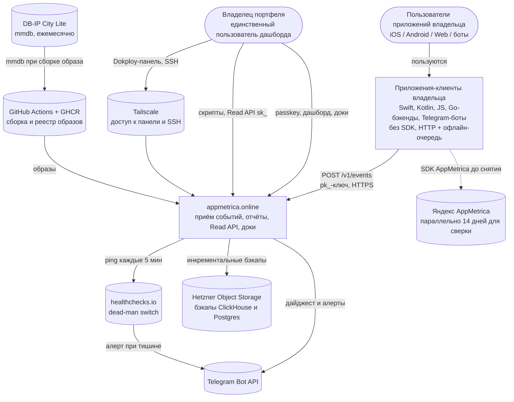
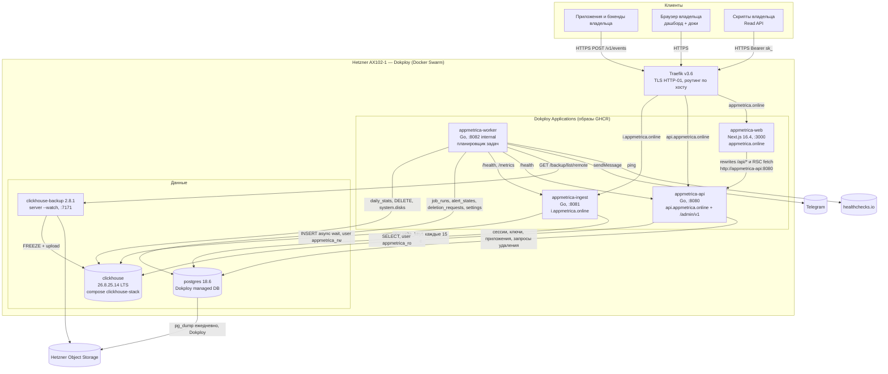
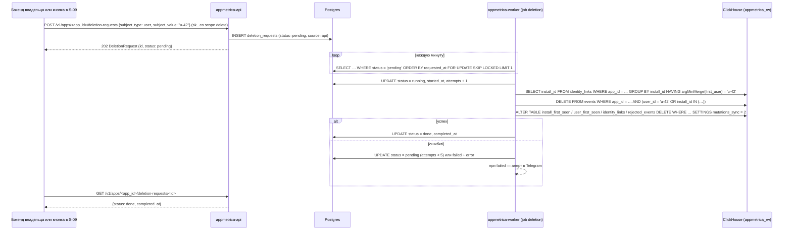
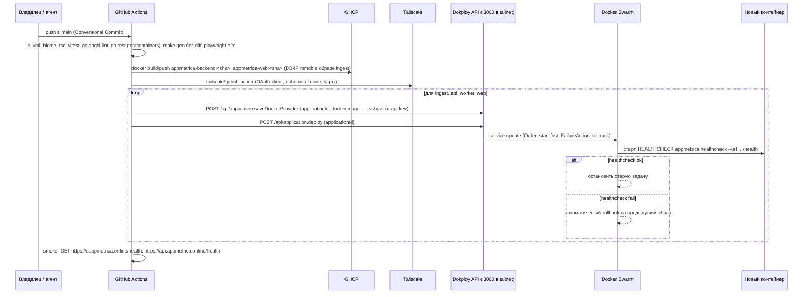
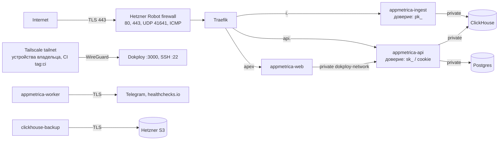
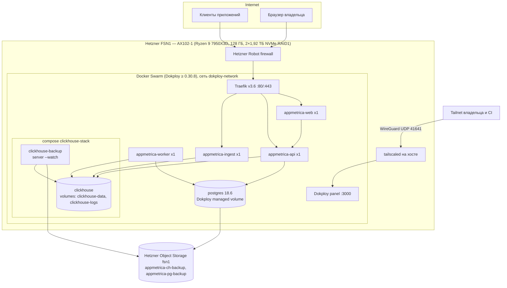

# Архитектура: appmetrica.online

**Версия**: 1.1 | **Дата**: 2026-10-14

> Архитектурный документ в стиле **C4 model** (Context → Container → Component →
> Code). Фокус на границах ответственности, потоках данных и ключевых решениях
> с rationale.
>
> Связанные документы: стек и версии — [04-tech-stack.md](./04-tech-stack.md); схемы БД — [05-data-model.md](./05-data-model.md);
> контракты — [06-api-contracts.md](./06-api-contracts.md); структура репо — [07-project-structure.md](./07-project-structure.md);
> эксплуатация — [21-ops-runbooks.md](./21-ops-runbooks.md). Имена сервисов, таблиц и эндпоинтов совпадают с этими документами.

---

## 1. Context (Level 1) — система и её окружение

### 1.1. System Context diagram



### 1.2. Actors

| Actor | Описание | Interaction |
|---|---|---|
| Владелец (owner) | Единственный пользователь системы: соло-разработчик портфеля приложений (iOS/macOS, Android, сайты, боты). Владеет Go, TS/React, Linux/Docker; не владеет ClickHouse | Дашборд `appmetrica.online` (passkey), документация `/docs`, Read API `api.appmetrica.online` с ключом `sk_`, Telegram-дайджест, панель Dokploy через Tailscale |
| Приложение-клиент | Код в приложениях владельца, отправляющий события без SDK: генерирует `install_id`, `session_id`, `insert_id`, держит офлайн-очередь до 7 дней | `POST https://i.appmetrica.online/v1/events` с `X-App-Key: pk_…` (или `app_key` в теле для `sendBeacon`) |
| Бэкенд владельца | Серверные компоненты приложений владельца (боты, API) | Отправка событий от имени пользователей (`context.ip`), GDPR-удаление через `POST /v1/apps/{app_id}/deletion-requests` |
| Конечный пользователь приложения | Субъект данных (GDPR). Не взаимодействует с системой напрямую | Косвенно — через приложения; право на удаление реализуется владельцем через API или кнопку в профиле |
| CI (GitHub Actions) | Автоматизированный актор сборки и деплоя | GHCR push, вход в tailnet, вызовы Dokploy API |

### 1.3. External Systems

| System | Назначение | SLA зависимость |
|---|---|---|
| Telegram Bot API | Ежедневный дайджест, системные алерты, тестовое сообщение из настроек | Soft — при недоступности дайджест ретраится 3 раза с интервалом 10 мин, алерты пишутся в лог и `alert_states`; приём событий не зависит |
| healthchecks.io | Dead-man switch: worker пингует после каждого успешного `system_check`; тишина > 10 мин → алерт в Telegram от healthchecks.io | Soft — единственный канал узнать о «сервер умер целиком»; на работу системы не влияет |
| DB-IP City Lite | Гео по IP (страна, регион, город) | Soft — база вшита в образ ingest; при отсутствии файла `country/region/city = ''` |
| GHCR + GitHub Actions | Сборка, хранение и доставка образов | Soft для работы, Hard для деплоя — без них нельзя выкатить новую версию; работающие контейнеры не затронуты |
| Hetzner Object Storage | Хранение бэкапов ClickHouse (clickhouse-backup) и Postgres (Dokploy) | Soft — при недоступности бэкап не создаётся, через 26 ч срабатывает алерт `backup_stale` |
| Tailscale | Административный доступ (панель Dokploy :3000, SSH :22), канал CI → Dokploy API | Soft для работы, Hard для деплоя и администрирования; аварийный доступ — консоль Hetzner Robot (KVM/rescue) |
| Яндекс AppMetrica | Источник эталонных цифр на период сверки (NFR-010) | Не зависимость системы; используется владельцем вручную 14 дней |

---

## 2. Container (Level 2) — высокоуровневые компоненты

### 2.1. Container diagram



### 2.2. Container descriptions

#### Web App
- **Tech**: Next.js 16.4.0 App Router, React 19.3.0, TypeScript 6.0.3 strict, Tailwind 4.3.3, shadcn (Radix), Recharts 3.10.1, TanStack Query 5.104.2 (хуки orval), nuqs 2.10.2, Fumadocs 16.17.2.
- **Hosting**: Dokploy Application `appmetrica-web`, образ `ghcr.io/<owner>/appmetrica-web:<sha>`, `output: 'standalone'`, Node 24.21.0.
- **Responsibility**: дашборд (экраны S-01…S-12, S-14), документация `/docs` (S-13) за логином; не хранит данных и не ходит в БД.
- **Key decisions**:
  - Все обращения к данным идут в Go API: браузер — через rewrites `/api/:path*` → `http://appmetrica-api:8080/:path*` (тот же origin, cookie `am_session` host-only); RSC — прямым `fetch` на `API_INTERNAL_URL` с пробросом cookie.
  - `src/proxy.ts` только проверяет наличие cookie и редиректит на `/login`; валидность сессии проверяет Go (401 → редирект на клиенте).
  - Server Components для первой отрисовки, `'use client'` для фильтров, графиков, realtime-поллинга (5 с), ожидания первого события (3 с).
  - **Никакого `'use cache'` на страницах с данными владельца** (Cache Components включены по умолчанию в 16.4).
  - Только десктоп, минимальная ширина 1280px, светлая тема, русский язык без i18n.
  - Preview deployments не используются — `# Deviation` (см. §8.1).

#### Mobile App (если есть)
> **N/A как контейнер системы.** Мобильные приложения владельца — внешние клиенты ingestion API (см. §1.2), а не часть appmetrica.online. SDK нет; для каждой платформы в документации есть рецепт (Swift: `install_id` в Keychain, офлайн-очередь в файле, `session_start` на `didBecomeActive` / `session_end` с `duration_ms` на `didEnterBackground` в `beginBackgroundTask`; Kotlin: SharedPreferences + Auto Backup, `ProcessLifecycleOwner`; Web: `localStorage`, `visibilitychange` + `sendBeacon`).
> - **Offline**: офлайн-очередь на стороне клиента, хранение до 7 дней (`INGEST_LATE_WINDOW=168h`), отправка батчами до 500 событий, ретраи по политике из [06-api-contracts.md](./06-api-contracts.md).

#### API / Server Actions
> В этой системе «API» — два Go-процесса одного бинарника, Server Actions Next.js не используются.

**appmetrica-ingest** (`appmetrica ingest`, :8081, хост `i.appmetrica.online`)
- **Tech**: Go 1.27.2, stdlib `net/http`, типы из `internal/gen/ingestapi` (oapi-codegen 2.8.0), горячий хендлер `POST /v1/events` написан вручную, clickhouse-go 2.49.0, geoip2-golang 2.5.0, x/time/rate 0.16.0.
- **Responsibility**: аутентификация по `pk_`, валидация батча, коррекция времени, PII-guard, гео, rate limiting, запись в `appmetrica.events`, запись отказов в `appmetrica.rejected_events`, ответ `IngestResult`.
- **Key decisions**:
  - Ответ 200 только после подтверждения async insert ClickHouse (ADR-004).
  - Кэш `write_keys` в памяти, полная перезагрузка из Postgres каждые 15 с; Postgres не на горячем пути.
  - CORS `*` без credentials; ключ только в заголовке или теле, не в query string.
  - IP клиента используется только для гео-lookup и отбрасывается (ADR-006).

**appmetrica-api** (`appmetrica api`, :8080, хост `api.appmetrica.online` + внутренний для web)
- **Tech**: Go 1.27.2, oapi-codegen strict server (`internal/gen/api`), pgx 5.11.0 + sqlc 1.31.1, clickhouse-go 2.49.0 (пользователь `appmetrica_ro`), go-webauthn 0.18.2, goose 3.29.0.
- **Responsibility**: публичный Read API `/v1/*` (Bearer `sk_` или cookie), административный `/admin/v1/*` (только cookie + `X-Requested-With: appmetrica-web` на изменяющих запросах), passkey-аутентификация, управление приложениями и ключами, приём запросов на удаление, статус системы.
- **Key decisions**:
  - При старте выполняет `migrate up` для Postgres и ClickHouse (`MIGRATE_ON_START=true`); миграции только expand/contract.
  - Отчёты строятся SQL-билдерами `internal/reports` с параметрами ClickHouse (`{app_id:UUID}`), без конкатенации пользовательского ввода.
  - Rate limit: 10 req/s на `sk_`-ключ (burst 30), 30 req/s на сессию.

#### Background Jobs
- **Tech**: `appmetrica worker` (Go), собственный планировщик (тикеры + расписание в TZ), задачи пишут историю в `job_runs`.
- **Responsibility**: `system_check` (5 мин), `digest` (ежедневно в `settings.digest_time`), `close_day` (проверка каждые 15 мин, закрытие D−8 в 03:30 по TZ приложения), `deletion` (каждую минуту), `session_cleanup` (ежечасно).
- **Retry policy**: `deletion` — до 5 попыток (`attempts`), между попытками экспонента 1 → 2 → 4 → 8 → 16 мин, затем `failed` + алерт в Telegram; `digest` — 3 попытки через 10 мин; `close_day` — повтор на следующем тике (идемпотентно благодаря ReplacingMergeTree и PK `closed_days`); `system_check` — следующий тик, при исключении — ping `HEALTHCHECKS_PING_URL/fail`.
- Конкурентность: один экземпляр worker (Swarm replicas=1); `deletion` дополнительно берёт строки `FOR UPDATE SKIP LOCKED`, поэтому кратковременное перекрытие при start-first деплое безопасно.

#### Postgres (primary DB)
- **Provider**: Dokploy managed DB, образ `postgres:18.6-trixie`, volume в `/var/lib/postgresql`.
- **Responsibility**: метаданные — `owner`, `passkeys`, `passkey_setup_tokens`, `webauthn_ceremonies`, `auth_sessions`, `apps`, `write_keys`, `api_keys`, `deletion_requests`, `settings`, `job_runs`, `alert_states`, `closed_days`.
- **Backup**: ежедневный бэкап Dokploy в S3-бакет `appmetrica-pg-backup`, хранить 30; проверка восстановления — ежеквартально по [21-ops-runbooks.md](./21-ops-runbooks.md).
- **Scale**: десятки тысяч строк за всё время жизни; пул `pgxpool` max 10 соединений на процесс.

#### Redis
> **N/A для этого проекта.** Причина: rate limiting выполняется в памяти ingest (один экземпляр), кэш ключей — в памяти, сессии — в Postgres, очередь не нужна (ADR-005). (Относится к: Data Tier.)

#### Object Storage
- **Provider**: Hetzner Object Storage, регион fsn1, endpoint `https://fsn1.your-objectstorage.com`.
- **Responsibility**: бэкапы ClickHouse (бакет `appmetrica-ch-backup`, инкремент ежедневно, полный еженедельно, 35 удалённых бэкапов) и Postgres (бакет `appmetrica-pg-backup`, 30 бэкапов). Пользовательских файлов нет.
- **Why Hetzner**: тот же дата-центр (входящий трафик и трафик внутри eu-central бесплатны), 6,49 €/мес за 1 ТБ, поддержка versioning и object lock (включается при создании бакета — защита бэкапов от удаления при компрометации сервера).

#### ClickHouse (events store)
- **Provider**: compose-сервис `clickhouse` в стеке `clickhouse-stack` Dokploy, образ `clickhouse/clickhouse-server:26.8.25.14` (+ `@sha256`), named volumes `clickhouse-data`, `clickhouse-logs`; сеть только внутренняя (`dokploy-network`), порты наружу не публикуются.
- **Responsibility**: таблицы `events`, `install_first_seen`, `user_first_seen`, `identity_links`, `rejected_events`, `daily_stats` + MV `install_first_seen_mv`, `user_first_seen_mv`, `identity_links_mv`.
- **Users**: `appmetrica_rw` (ingest, worker), `appmetrica_ro` (api: `readonly=2`, `max_execution_time=30`, `max_memory_usage=8G`), пользователь бэкапа.

---

## 3. Component (Level 3) — внутри API

### 3.1. Module breakdown

Go-модуль `appmetrica.online/backend` разбит на пакеты `internal/*` по ответственности; один пакет — одна причина для изменения.
Пакеты ролей (`ingest`, `api`, `worker`) зависят от сервисных пакетов, сервисные — от store-пакетов, обратных зависимостей нет.

```
backend/
├── cmd/appmetrica/main.go     — разбор подкоманд: ingest | api | worker | migrate up|status | admin passkey-link | healthcheck --url
└── internal/
    ├── config/      — загрузка и валидация env (полный список в 12-dev-runbook), типизированный Config на каждую роль
    ├── httpx/       — middleware: request_id, recover, slog-логирование без IP, gzip-декомпрессия, лимит тела, CORS ingest, CSRF-заголовок admin, ошибки в конверте Error
    ├── clock/       — интерфейс Clock (Now) для детерминированных тестов коррекции времени и закрытия дня
    ├── ingest/      — Handler POST /v1/events, Validator, TimeCorrector, PIIGuard, ContextMerger, Enricher (geo), Writer (батч в CH), RejectionSink, KeyCache write-ключей (keycache.go, перезагрузка каждые 15 с)
    ├── geo/         — открытие mmdb (geoip2-golang), Lookup(netip.Addr) → {country, region, city}
    ├── ratelimit/   — AppLimiter (events/s), InstallLimiter (events/min) с TTL-эвикцией
    ├── auth/        — WebAuthn-церемонии (go-webauthn), setup-токены, сессии (cookie am_session), API-ключи sk_ (HMAC с pepper), middleware Authenticator
    ├── apps/        — сервис приложений, write-ключей pk_ и API-ключей sk_ (кэш ключей ingest — в ingest/, правила импорта 07 §5)
    ├── identity/    — person_key: парсинг/форматирование `u:` / `i:`, SQL-фрагменты links CTE и first_seen
    ├── reports/     — Portfolio, AudienceSummary, AudienceTimeseries, RollingActive, Breakdown, Retention, Realtime, ProfileSearch, Profile, IntegrationHealth — каждый: билдер SQL + маппинг в тип API
    ├── deletion/    — Executor: разрешение install_id для user, DELETE / ALTER DELETE с mutations_sync=2, учёт строк
    ├── worker/      — Scheduler, задачи SystemCheck, Digest, CloseDay, Deletion, SessionCleanup; запись job_runs, alert_states
    ├── telegram/    — клиент sendMessage на net/http с обработкой 429 retry_after
    ├── chstore/     — подключение clickhouse-go, батч-вставка с WithAsync, health
    ├── pgstore/     — pgxpool + сгенерированный sqlc (pgstore/sqlc), транзакции
    ├── api/         — реализация StrictServerInterface (gen/api): маппинг HTTP ↔ сервисы
    └── gen/
        ├── ingestapi/ — oapi-codegen из contracts/openapi/ingest.yaml (коммитится)
        └── api/       — oapi-codegen из contracts/openapi/api.yaml (коммитится)
```

Web-модули (Next.js) для полноты картины:

```
web/src/
├── proxy.ts                      — редирект на /login при отсутствии cookie am_session
├── app/(auth)/login, setup/[token]
├── app/(dashboard)/              — S-03…S-12 (portfolio, apps/[appId]/*, settings)
├── app/(docs)/docs/[[...slug]]   — S-13 Fumadocs, проверка сессии в layout
├── app/api/health/route.ts       — healthcheck для Docker/Swarm
├── lib/api/                      — orval: хуки TanStack Query, Zod, MSW; fetcher.ts (credentials, X-Requested-With, 401 → /login)
└── components/{ui, charts, reports, layout, icons/platform}
```

### 3.2. Layering

```
┌──────────────────────────────────────────────────────────┐
│ Transport: internal/api (strict server), ingest.Handler  │  ← HTTP, коды, конверты ошибок
├──────────────────────────────────────────────────────────┤
│ Services: ingest.*, reports.*, auth.*, apps.*,           │  ← бизнес-правила, не знают про HTTP
│           deletion.*, worker jobs                        │
├──────────────────────────────────────────────────────────┤
│ Stores: chstore (ClickHouse), pgstore/sqlc (Postgres),   │  ← SQL, соединения, батчи
│         geo (mmdb), telegram (HTTP-клиент)               │
├──────────────────────────────────────────────────────────┤
│ ClickHouse / Postgres / DB-IP / Telegram / healthchecks  │  ← внешние границы
└──────────────────────────────────────────────────────────┘
```

**Правила**:
- Transport-слой не содержит SQL и не ходит в store напрямую — только через сервисы.
- Сервисы получают зависимости через конструкторы (`New…(deps)`), время — через `clock.Clock`, не через `time.Now()`.
- Все аналитические SQL-запросы живут в `internal/reports` и `internal/identity`, используют параметры ClickHouse (`{name:Type}`) и покрыты тестами на фикстурах (testcontainers ClickHouse 26.8.25.14).
- Сгенерированный код (`internal/gen`, `internal/pgstore/sqlc`) руками не правится; CI падает, если `make gen` даёт diff.
- Web никогда не обращается к БД и не хранит секретов, кроме `API_INTERNAL_URL`.

---

## 4. Data flows (ключевые сценарии)

### 4.1. Flow: Приём батча событий (ingest с частичным успехом)

```mermaid
sequenceDiagram
    participant C as Приложение-клиент
    participant Q as Офлайн-очередь клиента
    participant T as Traefik
    participant I as appmetrica-ingest
    participant K as KeyCache (память)
    participant R as Rate limiters
    participant G as DB-IP mmdb
    participant CH as ClickHouse

    C->>Q: append session_start (insert_id, install_id, session_id, timestamp)
    Q->>T: POST /v1/events (X-App-Key: pk_…, gzip, sent_at, ≤500 событий)
    T->>I: proxy (X-Forwarded-For)
    I->>I: распаковка gzip, лимит 1 MiB, JSON → EventBatch
    alt тело невалидно
        I-->>C: 400 invalid_json / invalid_batch (не ретраить)
    end
    I->>K: lookup(pk_)
    alt ключ неизвестен или отозван
        I-->>C: 401 invalid_app_key
    else приложение archived
        I-->>C: 403 app_archived
    end
    I->>R: AppLimiter.AllowN(app_id, len(events))
    alt лимит приложения превышен
        I-->>C: 429 app_rate_limited + Retry-After
    end
    I->>I: для каждого события: слияние context, валидация полей, PII-guard user_id,<br/>event_time = received_at + (timestamp − sent_at), clamp > +10 мин, отказ < −168 ч,<br/>дедуп insert_id внутри батча, InstallLimiter
    I->>G: Lookup(context.ip или X-Forwarded-For)
    G-->>I: country, region, city (IP отбрасывается)
    I->>CH: INSERT INTO events (принятые) — async insert, wait
    I->>CH: INSERT INTO rejected_events (отклонённые, payload ≤4 KB без ip)
    alt ClickHouse не подтвердил
        I-->>C: 503 storage_unavailable + Retry-After: 30
    else подтвердил
        CH-->>I: ack
        I-->>C: 200 {accepted, rejected[{index, code, retryable}], warnings, server_time}
        C->>Q: удалить принятые и невосстановимые; оставить rejected с retryable=true
    end
```

### 4.2. Flow: Passkey — первичная настройка по CLI-ссылке и вход

```mermaid
sequenceDiagram
    participant O as Владелец
    participant D as Dokploy (через Tailscale)
    participant CLI as appmetrica admin (контейнер api)
    participant B as Браузер
    participant W as appmetrica-web
    participant A as appmetrica-api
    participant PG as Postgres

    O->>D: Terminal → exec в appmetrica-api
    D->>CLI: appmetrica admin passkey-link
    CLI->>PG: INSERT passkey_setup_tokens (sha256(token), expires_at = now + 15m)
    CLI-->>O: https://appmetrica.online/setup/<token>
    O->>B: открыть ссылку
    B->>W: GET /setup/<token>
    B->>W: POST /api/admin/v1/auth/setup/<token>/begin
    W->>A: rewrite → /admin/v1/auth/setup/<token>/begin
    A->>PG: проверить токен (не used, не expired)
    A->>A: go-webauthn BeginRegistration (resident key, UV required)
    A->>PG: INSERT webauthn_ceremonies (kind=registration, session_data)
    A-->>B: {ceremony_id, options}
    B->>B: startRegistration({optionsJSON: options.publicKey}) — Face ID / Touch ID
    B->>A: POST …/setup/<token>/finish {ceremony_id, credential, name}
    A->>A: CreateCredential (проверка attestation, origin, RP ID)
    A->>PG: BEGIN; INSERT owner (если нет); INSERT passkeys; UPDATE token used_at; INSERT auth_sessions; COMMIT
    A-->>B: 204 + Set-Cookie am_session (HttpOnly, Secure, SameSite=Lax)
    B->>W: GET / (портфель)

    Note over B,A: Последующий вход
    B->>W: GET /login
    B->>A: POST /admin/v1/auth/login/begin (через rewrite)
    A->>PG: INSERT webauthn_ceremonies (kind=login)
    A-->>B: {ceremony_id, options} (discoverable, conditional UI)
    B->>B: startAuthentication({optionsJSON, useBrowserAutofill: true})
    B->>A: POST /admin/v1/auth/login/finish
    A->>A: ValidatePasskeyLogin, проверка sign_count
    A->>PG: UPDATE passkeys (sign_count, last_used_at); INSERT auth_sessions
    A-->>B: 204 + Set-Cookie am_session
```

### 4.3. Flow: Отчёт с разрешением person_key (core action — владелец смотрит аудиторию)

```mermaid
sequenceDiagram
    participant B as Браузер (S-05)
    participant W as appmetrica-web (RSC)
    participant A as appmetrica-api
    participant PG as Postgres
    participant CH as ClickHouse (appmetrica_ro)

    B->>W: GET /apps/<appId>?from=…&to=…&platform=ios
    W->>A: GET /v1/apps/<appId>/audience/summary (cookie am_session проброшен)
    A->>PG: SELECT auth_sessions WHERE token_hash = sha256(cookie) AND не истёк
    A->>PG: SELECT apps WHERE id = appId (timezone, status)
    A->>A: from/to в TZ приложения → границы event_time UTC; проверка диапазона ≤ 366 дней
    A->>CH: WITH links AS (SELECT install_id, argMinMerge(first_user) AS linked_user<br/>FROM identity_links WHERE app_id = {app_id:UUID} GROUP BY install_id)<br/>SELECT uniqExact(person_key), uniqExact(session_id) … FROM events LEFT JOIN links
    CH-->>A: active, sessions, durations
    A->>CH: new = persons с first_seen в периоде (install_first_seen ∪ user_first_seen через links)
    CH-->>A: new
    A-->>W: AudienceSummary (+ compare previous_period)
    W-->>B: HTML с KPI-карточками
    B->>A: клиентские запросы timeseries / breakdown / rolling-active (TanStack Query, через /api rewrite)
    A-->>B: JSON
```

### 4.4. Flow: Error handling

- **4xx** → конверт `Error {error: {code, message, request_id, details}}`, логируем на уровне `warn` без тела запроса и без IP. Коды перечислены в [06-api-contracts.md](./06-api-contracts.md).
- **5xx** → `error`-лог с `request_id`, инкремент `http_errors_total{service,code}`; пользователь дашборда видит экран ошибки (S-14) с `request_id` для поиска в логах.
- **Частичный успех ingest** → 200 с `rejected[]` и `warnings[]`; каждое отклонение записывается в `rejected_events` (TTL 7 дней) и видно на экране «Интеграция» (S-10).

Деградация по зависимостям:

| Отказ | Поведение | Восстановление / алерт |
|---|---|---|
| ClickHouse недоступен или не подтвердил вставку | ingest → 503 `storage_unavailable` + `Retry-After: 30`; события остаются в офлайн-очередях клиентов (до 7 дней). api → 503 на отчёты. worker пропускает CH-задачи | `system_check` → алерт `clickhouse_down`; после восстановления клиенты досылают очереди автоматически |
| Postgres недоступен | ingest продолжает работать на последнем снимке `write_keys` до 15 мин (`key_cache_age_seconds`); снимок старше 15 мин → 503 `storage_unavailable` + `Retry-After: 60` (нельзя гарантировать актуальность отзыва ключей). api → 503 на всё, кроме `/health`. worker пропускает задачи | Алерт `api_down` (ready = false); после восстановления кэш обновляется за ≤15 с |
| Файл DB-IP отсутствует или повреждён | ingest стартует, `country = region = city = ''`, метрика `geo_db_loaded = 0`, warn-лог при старте | Следующая сборка образа (`geo-refresh.yml`) |
| clickhouse-backup или S3 недоступны | Бэкап не создаётся, приём и отчёты работают | `backup_stale` при возрасте последнего бэкапа > 26 ч |
| Telegram недоступен | Дайджест — 3 попытки с интервалом 10 мин, затем `job_runs.status = failed`; алерты фиксируются в `alert_states` и логах | healthchecks.io пингуется только при успешном `system_check`; при проблеме с Telegram healthchecks.io продолжает алертить по своему каналу |
| appmetrica-api или appmetrica-web недоступны | Дашборд недоступен; приём событий не затронут (отдельный контейнер) | `api_down`; Swarm рестартует контейнер |
| appmetrica-worker недоступен | Не закрываются дни, нет дайджеста и удалений; приём и отчёты работают (открытые дни считаются live) | healthchecks.io: нет ping > 10 мин → алерт в Telegram |
| Сервер целиком недоступен | Всё недоступно; клиенты копят очереди до 7 дней | healthchecks.io → Telegram; восстановление по runbook «Потеря сервера» (RTO 4 ч) |

### 4.5. Flow: GDPR-удаление данных пользователя



### 4.6. Flow: Закрытие дня D−8

```mermaid
sequenceDiagram
    participant WK as appmetrica-worker (close_day, тик 15 мин)
    participant PG as Postgres
    participant CH as ClickHouse

    WK->>PG: SELECT apps (id, timezone) WHERE status = 'active'
    loop для каждого приложения
        WK->>WK: local_now = now() в TZ приложения; если local_now < 03:30 — пропустить
        WK->>WK: D = local_date − 8 дней
        WK->>PG: SELECT 1 FROM closed_days WHERE app_id = … AND day = D
        alt день уже закрыт
            WK-->>WK: пропустить
        else не закрыт
            WK->>CH: INSERT INTO daily_stats SELECT … unit = 'persons' (active, new, sessions, sessions_with_duration, duration_ms_sum) для environment production и development
            WK->>CH: INSERT INTO daily_stats SELECT … unit = 'installs'
            WK->>PG: INSERT closed_days (app_id, day) ON CONFLICT DO NOTHING
            WK->>PG: INSERT job_runs (job = close_day, status = ok, details = {app_id, day, rows})
        end
    end
    Note over WK,CH: Повторный запуск безопасен: ReplacingMergeTree(closed_at) оставит последнюю версию строки
```

### 4.7. Flow: Деплой из CI через Tailscale в Dokploy



### 4.8. Flow: Payment

> **N/A для этого проекта.** Причина: внутренний инструмент без биллинга (см. [04-tech-stack.md](./04-tech-stack.md), раздел «Payments — не применимо»).

---

## 5. Key Architectural Decisions (ADR-style)

Формат MADR: контекст → решение → альтернативы → последствия. Статус всех ADR — **Accepted (2026-10-13)**.

### ADR-001: Один Go-бинарник с ролями (modular monolith)
- **Контекст**: соло-разработчик, четыре функции (приём, API, фоновые задачи, админ-CLI), разные профили нагрузки.
- **Решение**: один бинарник `appmetrica` с подкомандами `ingest`, `api`, `worker`, `migrate`, `admin`, `healthcheck`; три контейнера из одного образа `appmetrica-backend`.
- **Альтернативы**: один процесс на всё (тяжёлый отчёт тормозит приём) — отклонено; отдельные репозитории/модули (дублирование, рассинхрон версий) — отклонено.
- **Последствия**: изоляция нагрузки на уровне процессов, единые тесты и версии; границы пакетов `internal/*` соблюдаются дисциплиной и линтером.

### ADR-002: Одна широкая таблица событий в ClickHouse
- **Контекст**: 10–150 млн событий/мес, отчёты по `uniqExact` и разбивкам.
- **Решение**: `appmetrica.events` — `ReplacingMergeTree(received_at)`, `PARTITION BY toYYYYMM(event_date)`, `ORDER BY (app_id, event_date, install_id, insert_id)`, `LowCardinality` для измерений, bloom-индексы на `user_id`, `session_id`, `install_id`, TTL 25 мес.
- **Альтернативы**: отдельные таблицы сессий и устройств (джойны, сложнее ingest); Postgres + TimescaleDB (медленнее на distinct-подсчётах).
- **Последствия**: один INSERT на батч; все отчёты — один источник; будущие кастомные события ложатся в ту же таблицу с новыми колонками.

### ADR-003: Склейка identity при чтении («первый владелец»)
- **Контекст**: владелец выбрал ретро-склейку `install_id → user_id`; анонимные сессии до логина должны засчитываться человеку.
- **Решение**: MV `identity_links_mv` агрегирует `argMinState(user_id, event_time)` по `(app_id, install_id)`; отчёты джойнят CTE `links` и вычисляют `person_key = u:<user_id> | u:<linked_user> | i:<install_id>`. Сырые события не переписываются.
- **Альтернативы**: перезапись `user_id` в событиях при логине (мутации ClickHouse, дорого и необратимо); словарь ClickHouse (пароль в DDL, задержка обновления 30–60 с, недетерминированные тесты).
- **Последствия**: исторические цифры меняются один раз — при первом логине на устройстве; закрытые дни (ADR-012) не пересчитываются.

### ADR-004: Ответ 200 только после подтверждения записи
- **Контекст**: клиенты держат офлайн-очередь и ретраят; потеря подтверждённых событий недопустима (NFR-005).
- **Решение**: ingest вставляет батч через clickhouse-go с `clickhouse.WithAsync(true)` (async insert с ожиданием) и отвечает 200 только после ack; при ошибке — 503 + `Retry-After`.
- **Альтернативы**: буфер в памяти Go с flush раз в 5 с (Aptabase/Plausible) — до 5 с потерь при падении процесса.
- **Последствия**: латентность ответа растёт до сотен миллисекунд (NFR-001: P99 ≤ 500 мс) — для фоновых клиентских очередей приемлемо; at-least-once + идемпотентные метрики (ADR-010) = эффективно exactly-once в отчётах.

### ADR-005: Без Kafka и Redis
- **Контекст**: пик ~500 rps, один сервер, один владелец.
- **Решение**: async insert ClickHouse вместо брокера; лимитеры и кэш ключей — в памяти; сессии — в Postgres.
- **Альтернативы**: Kafka + консьюмер (PostHog-модель), Redis для лимитов.
- **Последствия**: меньше stateful-компонентов и ops; при росте > 5 000 событий/с — пересмотр ([04-tech-stack.md](./04-tech-stack.md), «Когда пересматривать»).

### ADR-006: IP не храним, гео на входе
- **Контекст**: GDPR для пользователей из ЕС, 152-ФЗ для пользователей из РФ, решение владельца «страна + город, IP не храним».
- **Решение**: ingest определяет `country`, `region`, `city` через DB-IP City Lite и отбрасывает IP; IP не пишется ни в ClickHouse, ни в Postgres, ни в логи; `context.ip` для server-to-server используется так же; `"none"` отключает гео.
- **Альтернативы**: хранить усечённый IP для антифрода (отклонено владельцем).
- **Последствия**: расследование спама по IP невозможно — компенсируется лимитами по `install_id` и отзывом ключей.

### ADR-007: Passkey-only аутентификация в Go, Next.js как прокси
- **Контекст**: один пользователь, данные и API в Go.
- **Решение**: WebAuthn (go-webauthn 0.18.2) в `appmetrica-api`; cookie `am_session` выдаёт Go; Next.js проксирует `/api/:path*` на Go через rewrites, поэтому cookie остаётся host-only на `appmetrica.online`; первая регистрация и восстановление — CLI-ссылка на 15 мин.
- **Альтернативы**: auth в Next.js (Auth.js/Better Auth) — два хранителя сессий; пароль + TOTP; GitHub OAuth.
- **Последствия**: нет паролей и почтовых flows; потеря всех passkey лечится доступом к серверу через Tailscale.

### ADR-008: Dokploy как PaaS (выбор владельца)
- **Контекст**: рекомендовался Coolify 4.4.6; владелец выбрал Dokploy.
- **Решение**: Dokploy ≥ 0.30.8; ingest/api/worker/web — Applications из GHCR (Swarm start-first + auto-rollback); ClickHouse — compose со своим закреплённым образом; Postgres — managed DB; панель и SSH — только через Tailscale; автообновление выключено.
- **Альтернативы**: Coolify (встроенные алерты диска/контейнеров, managed ClickHouse), compose по SSH, Kamal 2.
- **Последствия**: отсутствующие в Dokploy алерты закрыты `system_check` + healthchecks.io; критические CVE Dokploy без авторизации нейтрализованы закрытым портом 3000 (Hetzner firewall, issue #2661).

### ADR-009: Ingest на отдельном поддомене `i.appmetrica.online`
- **Контекст**: URL вшивается в бинарники приложений, домен содержит чужой товарный знак.
- **Решение**: приём — только `i.appmetrica.online`; Read API — `api.appmetrica.online`; дашборд — `appmetrica.online`.
- **Альтернативы**: всё на одном хосте по путям; URL из remote config.
- **Последствия**: ingest можно перенести на другой сервер/CDN одной DNS-записью; при потере домена (UDRP) план миграции описан в [09-risks-and-mitigations.md](./09-risks-and-mitigations.md).

### ADR-010: Метрики идемпотентны по конструкции
- **Контекст**: at-least-once доставка (ретраи, 5xx «может записалось»).
- **Решение**: все метрики считаются через `uniqExact(person_key)`, `uniqExact(session_id)`, длительность — `any`/`max` по `session_id`; дедуп в хранилище — `ReplacingMergeTree` по `insert_id` (в фоне).
- **Альтернативы**: `count()` с `FINAL` (дорого), дедуп-кэш insert_id в памяти (не переживает рестарт).
- **Последствия**: дубли не влияют на цифры даже до слияния частей; `count()` по `events` в отчётах запрещён.

### ADR-011: OpenAPI 3.0.3 contract-first + кодогенерация
- **Контекст**: «без SDK, но с доками» — контракт и есть продукт.
- **Решение**: `contracts/openapi/ingest.yaml` и `api.yaml` — источник истины; oapi-codegen 2.8.0 (Go strict server), orval 8.42.0 (TS-клиент, Zod, MSW), fumadocs-openapi 12.4.2 (страницы документации).
- **Альтернативы**: OAS 3.1 (неполная поддержка в oapi-codegen), code-first генерация спеки из Go.
- **Последствия**: изменение API начинается с PR в спеку; CI проверяет отсутствие diff после `make gen`.

### ADR-012: Закрытие дня D−8 и TTL сырых событий 25 месяцев
- **Контекст**: окно досыла 7 дней, хранение сырых данных 25 мес, агрегаты бессрочно.
- **Решение**: worker в 03:30 по TZ приложения пишет `daily_stats` за D−8 для unit `persons` и `installs`; портфель и длинные графики берут закрытые дни из `daily_stats`, открытые (8 последних) — live; TTL `events` — 25 мес.
- **Альтернативы**: MV на лету (не учитывает склейку и поздние события); хранить сырые вечно (диск, GDPR-минимизация).
- **Последствия**: цифры закрытого дня неизменны; разбивки старше 25 мес недоступны (в `daily_stats` только итоги).

### ADR-013: Rate limit по приложению и `install_id`, не по IP
- **Контекст**: мобильный CGNAT, публичный `pk_` в бинарниках.
- **Решение**: 2 000 событий/с на приложение (429 на батч), 100 событий/мин с burst 1 000 на `install_id` (отказ события, `retryable=true`).
- **Альтернативы**: лимит по IP в Traefik — режет честный трафик за NAT.
- **Последствия**: спам с ротацией `install_id` упирается в лимит приложения; реакция — отзыв `pk_` и выпуск нового.

### ADR-014: Сессии определяет клиент, время корректируется через `sent_at`
- **Контекст**: без SDK сервер не видит жизненный цикл приложения; часы устройств врут.
- **Решение**: клиент генерирует `session_id`, шлёт `session_start` и `session_end` с `duration_ms`; сервер считает `event_time = received_at + (timestamp − sent_at)`, clamp будущего > 10 мин, отказ старше 7 дней.
- **Альтернативы**: серверная нарезка сессий по паузе 30 мин (длительность была бы нулевой при одних системных событиях); heartbeat раз в 60 с (в разы больше запросов).
- **Последствия**: потерянный `session_end` (kill приложения) занижает длительность — такие сессии исключаются из расчёта длительности, но учитываются в количестве.

---

## 6. Security Architecture

### 6.1. Threat model (STRIDE summary)

| Threat | Example | Mitigation |
|---|---|---|
| Spoofing | Подделка событий с публичным `pk_`, извлечённым из бинарника | Ключ только на запись; лимиты по приложению и `install_id`; отзыв ключа и выпуск нового без даунтайма (несколько активных `write_keys`); отклонения видны на S-10 |
| Spoofing | Кража сессии дашборда | Passkey (фишинг-устойчиво), cookie HttpOnly + Secure + SameSite=Lax, токен 32 байта, в БД sha256, idle 7 дней, абсолют 30 дней |
| Tampering | Изменение payload, инъекция в SQL отчётов | Валидация по схеме OpenAPI (`nethttp-middleware`) и ручная в ingest; параметры ClickHouse `{name:Type}`; пользователь `appmetrica_ro` для api |
| Repudiation | «Это удаление сделал не я» | `deletion_requests` хранит `source`, `api_key_id`, время; `job_runs` с деталями; ключи и passkeys с `created_at`/`revoked_at` |
| Info disclosure | Утечка PII пользователей приложений | IP не хранится; PII-guard `user_id`; `sk_` только HMAC-хэш; `context.ip` вырезается из `payload_sample`; логи без IP и тел запросов |
| Info disclosure | Утечка бэкапов | Приватные бакеты Hetzner, ключи доступа только в env Dokploy, object lock на бакетах бэкапов |
| DoS | Флуд ingest | Лимит тела 1 MiB, 500 событий, лимиты событий, Traefik + Hetzner DDoS-защита сети; ingest изолирован от api и web |
| Elevation of privilege | Захват панели Dokploy (CVE с CVSS 9.8–10) | Порт 3000 и SSH закрыты в Hetzner firewall, доступ только из tailnet; версия ≥ 0.30.8; ручные обновления, security-релизы ≤ 48 ч |
| Elevation of privilege | `sk_` со scope `read` удаляет данные | Проверка scope `delete` на `POST …/deletion-requests`; ключ с `app_id` видит только своё приложение (404 на чужие) |
| CSRF | Изменяющий запрос на `/admin/v1` со стороннего сайта | SameSite=Lax + обязательный заголовок `X-Requested-With: appmetrica-web` (иначе 403 `csrf_check_failed`) |

### 6.2. Trust boundaries



### 6.3. Secrets management
- **Production**: переменные окружения Dokploy на уровне каждого Application/compose (`POSTGRES_URL`, `CLICKHOUSE_PASSWORD`, `KEY_HASH_PEPPER`, `TELEGRAM_BOT_TOKEN`, `HEALTHCHECKS_PING_URL`, `S3_ACCESS_KEY`, `S3_SECRET_KEY`); CI — GitHub Actions secrets (`DOKPLOY_API_KEY`, `DOKPLOY_APP_ID_*`, `TS_OAUTH_CLIENT_ID`, `TS_OAUTH_SECRET`).
- **Rotation policy**: `DOKPLOY_API_KEY`, ключи S3 и пароли ClickHouse — раз в 6 месяцев и немедленно при подозрении на компрометацию; `TELEGRAM_BOT_TOKEN` — при утечке через BotFather `/revoke`; `KEY_HASH_PEPPER` не ротируется (иначе все `sk_` становятся невалидными) — при компрометации выпускаются новые `sk_`, pepper меняется вместе с отзывом всех старых ключей.
- Никогда не в git: `.env` в `.gitignore`, `.env.example` содержит только имена и безопасные значения по умолчанию.

---

## 7. Scalability plan

### 7.1. Current (MVP)
- Один регион: Hetzner FSN1 (Германия), один сервер AX102-1, один экземпляр каждого сервиса.
- Объём: системные события (`session_start`, `session_end`) от приложений с суммарным DAU 10k–100k.
- ClickHouse без шардов и реплик; Postgres без реплик.

### 7.2. Trigger to scale

| Тrigger | Действие |
|---|---|
| Диск ClickHouse занят > 60 % | Пересмотр TTL или переход на сервер с большими дисками (AX102 → AX162), перенос по runbook |
| P95 отчётов > 1,5 с на 90-дневном диапазоне 7 дней подряд (NFR-003) | Профилирование через `system.query_log`, добавить проекции/агрегаты по hot-запросам, увеличить `max_threads` для `appmetrica_ro` |
| Устойчиво > 5 000 событий/с | Вынести ingest на отдельный сервер (DNS `i.`), очередь перед ClickHouse |
| > 300k DAU суммарно | Второй сервер: ClickHouse отдельно от приложений; реплика ClickHouse Keeper + 2 реплики для отказоустойчивости |
| Требование RPO < 24 ч | Реплика ClickHouse на втором сервере или бэкап каждые 6 ч (`WATCH_INTERVAL=6h`) |

### 7.3. Bottleneck watchlist
- **Async insert ClickHouse**: рост `ingest_batch_duration_seconds` P99 > 500 мс → проверить `system.asynchronous_insert_log`, количество частей (`system.parts`), `Too many parts`.
- **JOIN `links`** в отчётах: при > 5 млн привязанных установок на приложение — перейти на словарь или предвычисленную таблицу `person_map`.
- **Мутации удаления**: тяжёлые `ALTER … DELETE` при массовых удалениях — выполнять пачками, следить за `system.mutations`.
- **Postgres pool**: `pgxpool` max 10 на процесс; при ошибках «too many clients» — уменьшить пул api.
- **Telegram API**: лимит 30 сообщений/с на бота — с запасом (одно сообщение в день + алерты).

### 7.4. Capacity plan (3 / 6 / 12 месяцев)

Допущения: в MVP только системные события, в среднем 3 сессии на активного пользователя в день → ~6 событий на DAU в сутки; пик в 10 раз выше среднего; средний батч — 2 события; сжатая строка `events` ~70 байт (три случайных UUID плохо сжимаются).

| Горизонт | Суммарный DAU | Событий в сутки | Событий в месяц | Пик событий/с | Пик запросов/с | Диск ClickHouse (накопительно) | Хватает AX102-1? |
|---|---|---|---|---|---|---|---|
| 3 мес (январь 2027) | 30 000 | 180 000 | 5,4 млн | 21 | 11 | ~1 ГБ | Да, загрузка CPU < 5 % |
| 6 мес (апрель 2027) | 60 000 | 360 000 | 10,8 млн | 42 | 21 | ~3,5 ГБ | Да |
| 12 мес (октябрь 2027) | 100 000 | 600 000 | 18 млн | 70 | 35 | ~12 ГБ | Да |
| Верхняя граница с будущими кастомными событиями (P2) | 100 000 | 5 млн | 150 млн | 580 | 290 | ~100 ГБ/год, ~210 ГБ за 25 мес | Да, 11 % полезного объёма RAID1 |

Целевая производительность ingest (NFR-001) — 500 rps с P99 ≤ 500 мс — превышает 12-месячный пик в 14 раз.

---

## 8. Deployment architecture

### 8.1. Environments

| Env | URL | Purpose |
|---|---|---|
| Local dev | `http://localhost:3000` (web), `http://localhost:8081` (ingest), `http://localhost:8080` (api) | `make dev`: docker compose с ClickHouse 26.8.25.14 и Postgres 18.6, Go-процессы и `pnpm dev` локально; WebAuthn RP ID `localhost` |
| CI (эфемерно) | — | GitHub Actions: testcontainers для Go-тестов, полный стек в docker compose для Playwright e2e |
| Production | `https://appmetrica.online`, `https://i.appmetrica.online`, `https://api.appmetrica.online` | Единственное постоянное окружение на Hetzner AX102-1 |

`# Deviation`: preview- и staging-окружений нет — один пользователь, один сервер; Dokploy не поддерживает preview для compose. Замена: локальный стек + e2e в CI + Swarm auto-rollback по healthcheck.

### 8.2. CI/CD

```
git push → GitHub Actions
├── ci.yml (каждый push и PR)
│   ├── web: pnpm install --frozen-lockfile → biome ci → tsc --noEmit → vitest run --coverage
│   ├── backend: golangci-lint run → go test -race ./... (testcontainers) → coverage gate 80 % для internal/{ingest,reports,auth,identity,deletion}
│   ├── contracts: make gen → git diff --exit-code (oapi-codegen, sqlc, orval)
│   ├── e2e: docker compose up (CH, PG, ingest, api, worker, web) → playwright test (Chromium, виртуальный WebAuthn) + axe
│   └── security: govulncheck ./... , pnpm audit --prod
└── deploy.yml (push в main после зелёного ci.yml)
    ├── build & push ghcr.io/<owner>/appmetrica-backend:<sha> (DB-IP mmdb текущего месяца в образе), appmetrica-web:<sha>
    ├── tailscale/github-action (OAuth client, tag:ci)
    ├── Dokploy API: saveDockerProvider + deploy для appmetrica-api → appmetrica-ingest → appmetrica-worker → appmetrica-web
    └── smoke: /health ingest и api, GET / web → 200/307
geo-refresh.yml — cron "0 6 2 * *": пересборка образа backend с новой mmdb и деплой ingest
```

Порядок деплоя: сначала `appmetrica-api` (выполняет миграции при старте), затем ingest, worker, web — новые колонки и таблицы появляются до кода, который их использует.

### 8.3. Rollback
- **Автоматический**: Swarm Update Config `{"Parallelism":1,"Delay":10000000000,"FailureAction":"rollback","Order":"start-first"}` — если новый контейнер не прошёл healthcheck, Swarm возвращает предыдущий образ.
- **Ручной**: Dokploy → Deployments → Rollback на предыдущий тег GHCR (хранятся 10 последних тегов) или `POST /api/application.saveDockerProvider` с прежним `<sha>` + `application.deploy`.
- **Миграции БД**: только backward-compatible; breaking-изменения — в два релиза (expand → contract). Откат кода не требует отката схемы.
- **Feature flags**: env-флаги `FEATURE_<NAME>` выключают незавершённую функциональность без отката образа (`# Deviation`: без сервиса флагов, см. [04-tech-stack.md](./04-tech-stack.md)).

### 8.4. Deployment topology



### 8.5. Firewall и доступ

Hetzner Robot firewall — stateless, не более 10 правил на направление, применяется в течение 20–30 с; фильтрация IPv6 включается отдельной галочкой.

| # | Направление | Протокол | Порт | Источник | Действие | Назначение |
|---|---|---|---|---|---|---|
| 1 | in | TCP | 80 | any | accept | HTTP-01 ACME и редирект на HTTPS |
| 2 | in | TCP | 443 | any | accept | ingest, api, web |
| 3 | in | UDP | 41641 | any | accept | Tailscale (WireGuard) |
| 4 | in | ICMP | — | any | accept | диагностика |
| 5 | in | TCP (флаг ACK) | 32768–65535 | any | accept | ответный трафик исходящих соединений (stateless) |
| 6 | in | UDP | 32768–65535 | any | accept | ответы DNS/NTP |
| 7 | in | any | any | any | discard | всё остальное: 22, 3000, 5432, 8123, 9000 закрыты снаружи |

Docker обходит UFW, поэтому фильтрация выполняется именно на уровне Hetzner Robot. SSH и панель Dokploy доступны только по Tailscale-имени хоста.

### 8.6. Конфигурация Dokploy Applications

| Application | Образ | Command | Домен → порт | Healthcheck |
|---|---|---|---|---|
| appmetrica-ingest | `ghcr.io/<owner>/appmetrica-backend:<sha>` | `appmetrica ingest` | `i.appmetrica.online` → 8081 | `["CMD","/app/appmetrica","healthcheck","--url","http://127.0.0.1:8081/health"]` |
| appmetrica-api | `ghcr.io/<owner>/appmetrica-backend:<sha>` | `appmetrica api` | `api.appmetrica.online` → 8080 | `["CMD","/app/appmetrica","healthcheck","--url","http://127.0.0.1:8080/health"]` |
| appmetrica-worker | `ghcr.io/<owner>/appmetrica-backend:<sha>` | `appmetrica worker` | — | `["CMD","/app/appmetrica","healthcheck","--url","http://127.0.0.1:8082/health"]` |
| appmetrica-web | `ghcr.io/<owner>/appmetrica-web:<sha>` | `node server.js` | `appmetrica.online` → 3000 | `["CMD","node","-e","fetch('http://127.0.0.1:3000/api/health').then(r=>process.exit(r.ok?0:1)).catch(()=>process.exit(1))"]` |

`<owner>` — значение `github.repository_owner` репозитория; подставляется в CI автоматически. Healthcheck: interval 10 с, timeout 3 с, retries 3, start period 20 с (api — 60 с из-за миграций). Для всех: без `ports:` (трафик только через Traefik), Update Config из §8.3.

---

## 9. Observability

### 9.1. Three pillars

**Logs**
- Structured JSON (`log/slog` JSONHandler) в stdout контейнеров; просмотр — Dokploy Logs / `docker service logs`.
- Fields: `time, level, service (ingest|api|worker), request_id, app_id, route, status, duration_ms, accepted, rejected, job, msg`. Запрещены: IP клиента, тела запросов, `user_id`, cookie, ключи.
- Provider: локальные логи Docker (json-file, ротация `max-size=50m`, `max-file=5`); внешнего агрегатора нет — данные не покидают сервер.
- Retention: определяется ротацией (~250 МБ на сервис, ориентировочно 7–14 дней).

**Metrics**
- Provider: Prometheus-формат на `METRICS_LISTEN_ADDR` (:9090) каждого Go-процесса, без внешнего хранилища; worker читает метрики ingest для `system_check`.
- Business (из ClickHouse, на экранах): DAU, новые, сессии, retention по приложениям; на S-10 — accepted/rejected за 24 ч.
- System: `ingest_events_total{result=accepted|rejected}`, `ingest_rejections_total{code}`, `ingest_batch_duration_seconds` (histogram), `clickhouse_insert_errors_total`, `key_cache_age_seconds`, `geo_db_loaded`, `http_requests_total{service,route,status}`, `http_request_duration_seconds`, `report_query_duration_seconds{report}`, `worker_job_duration_seconds{job}`, `worker_job_failures_total{job}`.

**Traces**
- `# Deviation`: OpenTelemetry tracing не внедряется (три процесса, один сервер, один владелец). Корреляция — сквозной `request_id` (заголовок `X-Request-Id`, проброс web → api, логирование во всех сервисах). Триггер пересмотра — второй сервер или межсервисные цепочки длиннее двух хопов.

### 9.2. Alerting

| Alert | Threshold | Channel |
|---|---|---|
| `disk_free` | Свободно < 20 % на диске ClickHouse (`system.disks`) | Telegram (worker), повтор раз в 6 ч, «восстановлено» при возврате |
| `insert_errors` | Доля ошибок вставки ingest > 1 % за 5 мин | Telegram (worker) |
| `backup_stale` | Последний удалённый бэкап ClickHouse старше 26 ч | Telegram (worker) |
| `ingest_down` | `GET http://appmetrica-ingest:8081/health` не 200 два цикла подряд | Telegram (worker) |
| `api_down` | `GET http://appmetrica-api:8080/health` не 200 два цикла подряд | Telegram (worker) |
| `clickhouse_down` | Ping ClickHouse не проходит | Telegram (worker) |
| Worker или сервер мёртв | Нет ping `HEALTHCHECKS_PING_URL` > 10 мин | Telegram (healthchecks.io) |
| Деплой упал / ошибка сборки / бэкап Postgres / рестарт Dokploy | Событие Dokploy | Telegram (Dokploy notifications) |
| Удаление `failed` после 5 попыток | Любое | Telegram (worker) |

Алерты владельца включаются флагом `settings.alerts_enabled`; при `false` состояние продолжает записываться в `alert_states` и видно на S-12 «Система».

---

## 10. Open architectural questions

Переходят в [10-open-questions.md](./10-open-questions.md). Архитектурно значимые:
- Переход Node 24 → 26 LTS после 2026-10-28 (влияет на образ web).
- 152-ФЗ: допустимость хранения данных пользователей из РФ в ЕС (может потребовать второго ingest-узла в РФ — ADR-009 делает это возможным через DNS `i.`).
- Порог перехода с JOIN `links` на предвычисленную таблицу `person_map` (см. §7.3).
- Нужна ли реплика ClickHouse, если RPO 24 ч окажется недостаточным после первого инцидента.

---

## Changelog

| Date | Version | Changes |
|---|---|---|
| 2026-10-13 | 1.0 | Initial architecture после discovery: C4 L1/L2/L3, 8 потоков, ADR-001…ADR-014, топология Hetzner AX102-1 + Dokploy |
| 2026-10-14 | 1.1 | §L3 backend: KeyCache перенесён из `apps/` в `ingest/keycache.go` — как в коде и по правилам импорта 07-project-structure §5 |
