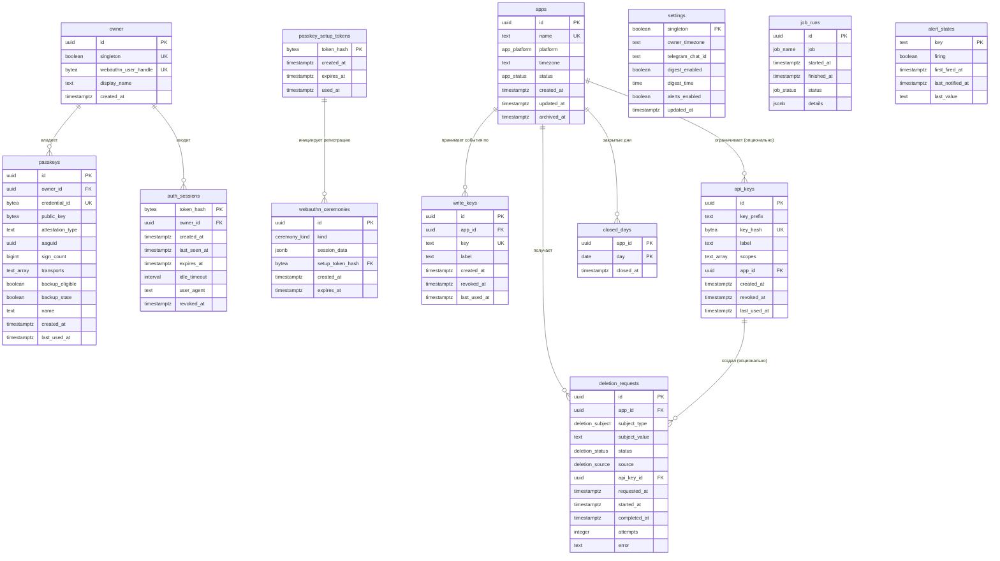
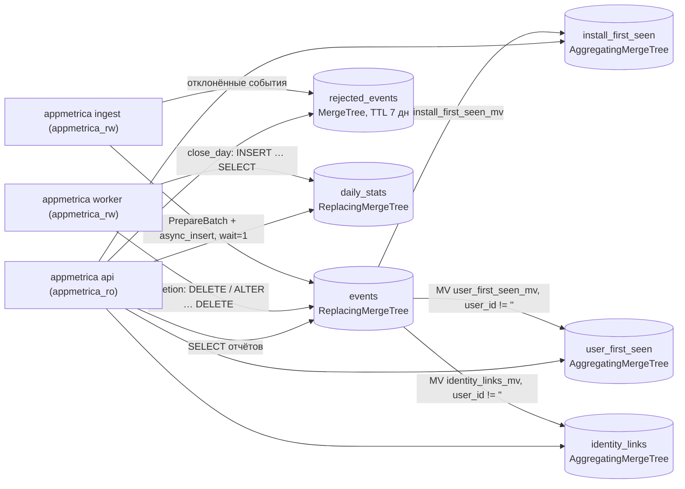

# Data Model: appmetrica.online

**Версия**: 1.0 | **Дата**: 2026-10-13

> Сущности, отношения, поля, индексы и миграции двух хранилищ.
> **PostgreSQL 18.6** хранит метаданные: владелец, passkey, сессии входа, приложения, ключи, журнал удалений, настройки и служебное состояние worker.
> **ClickHouse 26.8.25.14 LTS** хранит события и производные агрегаты.
> ORM не используется. Postgres: `pgx/v5 v5.11.0` + `sqlc v1.31.1` (типобезопасный код из SQL) + `goose v3.29.0` (миграции). ClickHouse: `clickhouse-go/v2 v2.49.0` + goose (диалект `clickhouse`).
> Имена таблиц, колонок и enum-значений канонические, они совпадают с [06-api-contracts.md](./06-api-contracts.md), [02-tech-spec.md](./02-tech-spec.md).

---

## 1. ER-диаграмма

### 1.1. PostgreSQL (метаданные)



Таблицы `settings`, `job_runs` и `alert_states` ни на кого не ссылаются: это служебное состояние singleton-установки.

### 1.2. ClickHouse (события и агрегаты) — поток данных



Все три materialized view срабатывают **на каждый INSERT** в `events`. Поэтому агрегаты first_seen и identity всегда согласованы с сырыми событиями и не требуют отдельного job. Повторная вставка того же события при ретрае клиента безопасна: агрегаты считаются через `min`, `max` и `argMin`, а повтор их не меняет.

---

## 2. Сущности (подробно)

### 2.1. Owner и аутентификация

**Описание**: единственный владелец установки и всё, что относится к входу по passkey. Пароля в системе нет. Первый passkey и восстановление доступа идут через одноразовую ссылку, которую печатает `appmetrica admin passkey-link`.

#### 2.1.1. `owner`

| Колонка | Тип | Constraints | Описание |
|---|---|---|---|
| id | uuid | PK, default `uuidv7()` | Идентификатор владельца |
| singleton | boolean | NOT NULL, default true, UNIQUE, CHECK (singleton) | Гарантирует ровно одну строку |
| webauthn_user_handle | bytea | NOT NULL, UNIQUE, CHECK octet_length = 64 | User handle для WebAuthn (64 случайных байта, не PII) |
| display_name | text | NOT NULL, default 'owner' | Имя в диалоге passkey браузера |
| created_at | timestamptz | NOT NULL, default now() | Создаётся при первом `finishSetup` |

**PII flag**: нет. **Retention**: бессрочно, пока существует установка.

#### 2.1.2. `passkeys`

| Колонка | Тип | Constraints | Описание |
|---|---|---|---|
| id | uuid | PK, default `uuidv7()` | |
| owner_id | uuid | NOT NULL, FK owner(id) ON DELETE CASCADE | |
| credential_id | bytea | NOT NULL, UNIQUE | ID credential из WebAuthn |
| public_key | bytea | NOT NULL | COSE public key (не секрет) |
| attestation_type | text | NOT NULL | `none` для passkey без attestation |
| aaguid | uuid | NOT NULL | Модель аутентификатора (для подписи в UI) |
| sign_count | bigint | NOT NULL, default 0, CHECK ≥ 0 | Счётчик подписей (clone detection) |
| transports | text[] | NOT NULL, default '{}' | `internal`, `hybrid`, `usb`, `nfc`, `ble` |
| backup_eligible | boolean | NOT NULL | Флаг BE |
| backup_state | boolean | NOT NULL | Флаг BS (синхронизируемый passkey) |
| name | text | NOT NULL, CHECK длина 1..64 | «MacBook», «iPhone», «YubiKey» |
| created_at | timestamptz | NOT NULL, default now() | |
| last_used_at | timestamptz | NULL | Обновляется при каждом успешном входе |

**Инвариант**: последний passkey удалить нельзя (API 409 `last_passkey`). Проверка идёт в транзакции под `SELECT … FROM owner FOR UPDATE`. **PII flag**: нет. **Retention**: до удаления пользователем.

#### 2.1.3. `passkey_setup_tokens`

| Колонка | Тип | Constraints | Описание |
|---|---|---|---|
| token_hash | bytea | PK, CHECK octet_length = 32 | sha256 от 32-байтового токена из ссылки `/setup/<token>` |
| created_at | timestamptz | NOT NULL, default now() | |
| expires_at | timestamptz | NOT NULL, CHECK > created_at | created_at + 15 минут (вычисляется в Go) |
| used_at | timestamptz | NULL | Заполняется в `finishSetup`; повторное использование — 410 `setup_token_expired` |

**Retention**: job `session_cleanup` ежечасно удаляет использованные и истёкшие токены.

#### 2.1.4. `webauthn_ceremonies`

| Колонка | Тип | Constraints | Описание |
|---|---|---|---|
| id | uuid | PK, default `uuidv7()` | `ceremony_id`, который фронт возвращает в `*/finish` |
| kind | ceremony_kind | NOT NULL | `registration` или `login` |
| session_data | jsonb | NOT NULL | Сериализованный `webauthn.SessionData` (challenge, user id, allowed credentials) |
| setup_token_hash | bytea | NULL, FK passkey_setup_tokens(token_hash) ON DELETE CASCADE, CHECK (NULL или kind = 'registration') | Для регистрации по setup-ссылке |
| created_at | timestamptz | NOT NULL, default now() | |
| expires_at | timestamptz | NOT NULL | created_at + 5 минут |

Церемония одноразовая: `TakeCeremony` удаляет строку и возвращает её (`DELETE … RETURNING`), поэтому повторить finish с тем же challenge невозможно. **Retention**: удаляется при использовании или cleanup-ом после истечения.

#### 2.1.5. `auth_sessions`

| Колонка | Тип | Constraints | Описание |
|---|---|---|---|
| token_hash | bytea | PK, CHECK octet_length = 32 | sha256 от 32-байтового значения cookie `am_session` |
| owner_id | uuid | NOT NULL, FK owner(id) ON DELETE CASCADE | |
| created_at | timestamptz | NOT NULL, default now() | |
| last_seen_at | timestamptz | NOT NULL, default now() | Sliding: обновляется не чаще раза в 5 минут |
| expires_at | timestamptz | NOT NULL | Абсолютный TTL: created_at + `SESSION_TTL` (720h) |
| idle_timeout | interval | NOT NULL, default '7 days' | `SESSION_IDLE_TTL` |
| user_agent | text | NOT NULL, default '', CHECK длина ≤ 512 | Для списка сессий; **IP не хранится** |
| revoked_at | timestamptz | NULL | Logout |

**PII flag**: `user_agent` — минимальные персональные данные владельца. **Retention**: удаляется cleanup-ом после expires_at, revoke или idle-таймаута.

### 2.2. Organization (для B2B/multi-tenant)

> **N/A для этого проекта.** Причина: установка однопользовательская (решение интервью «только я»), организаций и тенантов нет; изоляция между приложениями — через `app_id` во всех таблицах и через `api_keys.app_id` для Read API.
> (Относится к: категория L Multi-tenancy — неактивна для T1.)

### 2.3. Membership (User ↔ Organization)

> **N/A для этого проекта.** Причина: нет ролей и приглашений — доступ к дашборду имеет только `owner`, доступ скриптов регулируется scopes `read`/`delete` у `api_keys`.
> (Относится к: категория G RBAC — сведена к одному владельцу + scoped API-ключам.)

### 2.4. Core domain: приложения, ключи, удаления, служебные таблицы

#### 2.4.1. `apps`

| Колонка | Тип | Constraints | Описание |
|---|---|---|---|
| id | uuid | PK, default `uuidv7()` | `app_id` во всех таблицах ClickHouse |
| name | text | NOT NULL, CHECK длина 1..64, UNIQUE INDEX по lower(name) | «Notes iOS» |
| platform | app_platform | NOT NULL | Задаётся при создании; значение по умолчанию для `context.platform` |
| timezone | text | NOT NULL, CHECK длина 1..64 | IANA TZ (валидируется в Go через `time.LoadLocation`); границы суток всех отчётов |
| status | app_status | NOT NULL, default 'active' | `archived` → ingest отвечает 403 `app_archived` |
| created_at | timestamptz | NOT NULL, default now() | |
| updated_at | timestamptz | NOT NULL, default now() | |
| archived_at | timestamptz | NULL, CHECK (status = 'archived') = (archived_at IS NOT NULL) | |

**Удаление**: `DELETE /admin/v1/apps/{app_id}` создаёт `deletion_requests` (subject_type `app`). Worker очищает ClickHouse, копирует запрос в `job_runs.details` и только потом удаляет строку `apps` (каскад снимает ключи, закрытые дни и сам запрос). **Retention**: бессрочно.

#### 2.4.2. `write_keys` (публичные ключи `pk_`)

| Колонка | Тип | Constraints | Описание |
|---|---|---|---|
| id | uuid | PK, default `uuidv7()` | Пишется в `events.write_key_id` |
| app_id | uuid | NOT NULL, FK apps(id) ON DELETE CASCADE | |
| key | text | NOT NULL, UNIQUE, CHECK `^pk_[A-Za-z0-9]{32}$` | Хранится открыто: ключ публичный и вшит в приложения, сниппеты на экране «Интеграция» подставляют его |
| label | text | NOT NULL, default '', CHECK длина ≤ 64 | «iOS 3.x», «Web» |
| created_at | timestamptz | NOT NULL, default now() | |
| revoked_at | timestamptz | NULL | После отзыва ingest отвечает 401 `invalid_app_key` в течение ≤ 15 с (`KEY_CACHE_REFRESH`) |
| last_used_at | timestamptz | NULL | Ingest сбрасывает батчем раз в 5 минут |

#### 2.4.3. `api_keys` (секретные ключи `sk_`)

| Колонка | Тип | Constraints | Описание |
|---|---|---|---|
| id | uuid | PK, default `uuidv7()` | |
| key_prefix | text | NOT NULL, CHECK `^sk_[A-Za-z0-9]{8}$` | Первые 11 символов, для отображения |
| key_hash | bytea | NOT NULL, UNIQUE, CHECK octet_length = 32 | HMAC-SHA256(`KEY_HASH_PEPPER`, secret) |
| label | text | NOT NULL, CHECK длина 1..64 | |
| scopes | text[] | NOT NULL, CHECK scopes ⊆ {read, delete} и не пусто | |
| app_id | uuid | NULL, FK apps(id) ON DELETE CASCADE | NULL = все приложения |
| created_at | timestamptz | NOT NULL, default now() | |
| revoked_at | timestamptz | NULL | |
| last_used_at | timestamptz | NULL | Обновляется не чаще раза в минуту |

**Secret**: полное значение ключа показывается один раз в ответе `createApiKey` и нигде не сохраняется.

#### 2.4.4. `deletion_requests`

| Колонка | Тип | Constraints | Описание |
|---|---|---|---|
| id | uuid | PK, default `uuidv7()` | `request_id` |
| app_id | uuid | NOT NULL, FK apps(id) ON DELETE CASCADE | |
| subject_type | deletion_subject | NOT NULL | `install`, `user`, `app` |
| subject_value | text | NOT NULL, CHECK длина 1..128 | install_id (UUID-строка), user_id или app_id |
| status | deletion_status | NOT NULL, default 'pending' | `pending` → `running` → `done` / `failed` |
| source | deletion_source | NOT NULL | `api` или `dashboard` |
| api_key_id | uuid | NULL, FK api_keys(id) ON DELETE SET NULL | Каким ключом создан запрос |
| requested_at | timestamptz | NOT NULL, default now() | |
| started_at | timestamptz | NULL | |
| completed_at | timestamptz | NULL | SLA ≤ 24 ч от requested_at |
| attempts | integer | NOT NULL, default 0, CHECK 0..5 | После 5 неудач → `failed` и Telegram-алерт |
| error | text | NULL | Последняя ошибка |

**Идемпотентность**: частичный UNIQUE-индекс по `(app_id, subject_type, subject_value) WHERE status IN ('pending','running')`. Повторный POST возвращает уже существующий активный запрос. **PII flag**: `subject_value` — псевдонимные идентификаторы. **Retention**: бессрочно, как журнал исполнения GDPR-запросов (содержит только ID, без данных событий).

#### 2.4.5. `settings`

| Колонка | Тип | Constraints | Описание |
|---|---|---|---|
| singleton | boolean | PK, default true, CHECK (singleton) | Одна строка, создаётся миграцией |
| owner_timezone | text | NOT NULL, default 'Europe/Moscow' | TZ расписания worker (digest, system_check) и default для новых приложений |
| telegram_chat_id | text | NULL, CHECK `^(-?[0-9]{1,20}|@[A-Za-z][A-Za-z0-9_]{4,31})$` | Куда слать дайджест и алерты |
| digest_enabled | boolean | NOT NULL, default false, CHECK (NOT digest_enabled OR telegram_chat_id IS NOT NULL) | |
| digest_time | time | NOT NULL, default '09:00' | Время в owner_timezone |
| alerts_enabled | boolean | NOT NULL, default true | Системные алерты FR-021 |
| updated_at | timestamptz | NOT NULL, default now() | |

#### 2.4.6. `job_runs`, `alert_states`, `closed_days`

`job_runs` — журнал запусков worker:

| Колонка | Тип | Constraints | Описание |
|---|---|---|---|
| id | uuid | PK, default `uuidv7()` | |
| job | job_name | NOT NULL | `close_day`, `digest`, `system_check`, `deletion`, `session_cleanup` |
| started_at | timestamptz | NOT NULL, default now() | |
| finished_at | timestamptz | NULL | |
| status | job_status | NOT NULL, default 'running' | `running`, `ok`, `failed` |
| details | jsonb | NOT NULL, default '{}' | Счётчики, ошибки, копия удалённого deletion-запроса для subject_type `app` |

`alert_states` — состояние системных алертов (дедупликация Telegram-сообщений):

| Колонка | Тип | Constraints | Описание |
|---|---|---|---|
| key | text | PK, CHECK IN ('disk_free','insert_errors','backup_stale','ingest_down','api_down','clickhouse_down') | |
| firing | boolean | NOT NULL, default false | |
| first_fired_at | timestamptz | NULL | |
| last_notified_at | timestamptz | NULL | Повтор не чаще раза в 6 часов |
| last_value | text | NOT NULL, default '' | «disk_free_pct=14.2» |

`closed_days` — какие дни закрыты job `close_day`:

| Колонка | Тип | Constraints | Описание |
|---|---|---|---|
| app_id | uuid | PK part, FK apps(id) ON DELETE CASCADE | |
| day | date | PK part | День в TZ приложения |
| closed_at | timestamptz | NOT NULL, default now() | |

**Retention**: `job_runs` хранится 90 дней (cleanup), `alert_states` и `closed_days` бессрочно.

### 2.5. AuditLog

> **N/A для этого проекта.** Причина: единственный актор — владелец. Юридически значимые операции журналируются специализированно: GDPR-удаления в `deletion_requests` (бессрочно), запуски задач и удаления приложений в `job_runs`, входы через `auth_sessions.created_at` + `passkeys.last_used_at`. Общий append-only audit log добавил бы таблицу без потребителя.
> (Относится к: категория M Compliance — Tier 3/4.)

### 2.6. BillingEvent

> **N/A для этого проекта.** Причина: внутренний инструмент без монетизации — нет тарифов, платежей и вебхуков платёжного провайдера.
> (Относится к: модификатор Monetization — не активирован.)

### 2.7. ClickHouse: `events`

**Описание**: одна строка = одно принятое системное событие (`session_start` / `session_end`). Источник истины для всех отчётов.
**Engine**: `ReplacingMergeTree(received_at)`, `PARTITION BY toYYYYMM(event_date)`, `ORDER BY (app_id, event_date, install_id, insert_id)`, `TTL event_date + INTERVAL 25 MONTH DELETE`.

| Колонка | Тип | Источник | Описание |
|---|---|---|---|
| app_id | UUID | write_keys кэш | Приложение |
| event_date | Date | `toDate(event_time)` UTC | Ключ партиции и prefix ORDER BY (pruning по диапазону) |
| event_time | DateTime64(3,'UTC') | `received_at + (timestamp − sent_at)`, clamp будущего | Скорректированное время события |
| client_time | DateTime64(3,'UTC') | `timestamp` из запроса | Сырые часы устройства (диагностика) |
| sent_at | DateTime64(3,'UTC') | `sent_at` батча | |
| received_at | DateTime64(3,'UTC') | часы сервера | Версия для ReplacingMergeTree; realtime-лента |
| insert_id | UUID | клиент | Ключ идемпотентности |
| name | LowCardinality(String) | клиент | `session_start` или `session_end` |
| install_id | UUID | клиент | Установка (псевдонимный ID) |
| user_id | String | клиент | '' если не передан; ≤ 128 символов, PII-guard |
| session_id | UUID | клиент | Сессия |
| duration_ms | UInt32 | клиент | 0 для `session_start`; длительность foreground для `session_end` |
| environment | LowCardinality(String) | context | `production` / `development` |
| platform | LowCardinality(String) | context или apps.platform | |
| os_name, os_version | LowCardinality(String) | context | '' если не передано |
| app_version, app_build | LowCardinality(String) | context | |
| device_model, device_type | LowCardinality(String) | context | device_type ∈ phone, tablet, desktop, tv, watch, server, unknown, '' |
| locale | LowCardinality(String) | context | BCP 47 |
| country | LowCardinality(String) | DB-IP по IP | ISO-3166-1 alpha-2 или '' |
| region, city | String | DB-IP по IP | '' если не определено; **IP не сохраняется** |
| write_key_id | UUID | кэш ключей | Каким `pk_` принято |

Skip-индексы: `idx_user_id`, `idx_session_id`, `idx_install_id` — `bloom_filter(0.01) GRANULARITY 4`, для поиска профилей и удаления по всему диапазону дат.

**Дубликаты**: ретрай клиента даёт строку с тем же ключом сортировки (`app_id, event_date, install_id, insert_id`), которую ReplacingMergeTree схлопнет при merge. До merge дубли видны, поэтому **все метрики считаются через `uniqExact`** по `person_key` и `session_id`, а длительность — через `max(duration_ms)` на сессию. `FINAL` в отчётах не используется.

### 2.8. ClickHouse: `install_first_seen`, `user_first_seen`, `identity_links`

| Таблица | ORDER BY | Колонки | Наполнение | TTL |
|---|---|---|---|---|
| `install_first_seen` | (app_id, environment, install_id) | first_seen `SimpleAggregateFunction(min, DateTime64(3,'UTC'))`, last_seen `SimpleAggregateFunction(max, …)` | MV `install_first_seen_mv` из events | `toDate(last_seen) + 25 MONTH` |
| `user_first_seen` | (app_id, environment, user_id) | first_seen min, last_seen max | MV `user_first_seen_mv` из events WHERE user_id != '' | `toDate(last_seen) + 25 MONTH` |
| `identity_links` | (app_id, install_id) | first_user `AggregateFunction(argMin, String, DateTime64(3,'UTC'))`, first_linked_at `SimpleAggregateFunction(min, …)`, last_seen_at `SimpleAggregateFunction(max, …)` | MV `identity_links_mv` из events WHERE user_id != '' | `toDate(last_seen_at) + 25 MONTH` |

**Правило «первого владельца»** (FR-007): `argMinMerge(first_user)` — user_id из самого раннего по `event_time` события установки с непустым user_id. Анонимные события установки приписываются этому пользователю ретроактивно, при запросе. Событие с явным user_id всегда принадлежит этому user_id.

**Почему TTL на агрегатах**: сырые события живут 25 месяцев. Если установка молчит 25 месяцев, её first_seen и привязка тоже удаляются (минимизация данных по GDPR). Вернувшийся после этого пользователь считается новым.

### 2.9. ClickHouse: `rejected_events`, `daily_stats`

`rejected_events` — `MergeTree`, `PARTITION BY toDate(received_at)`, `ORDER BY (app_id, received_at)`, `TTL toDate(received_at) + INTERVAL 7 DAY DELETE`:

| Колонка | Тип | Описание |
|---|---|---|
| received_at | DateTime64(3,'UTC') | |
| app_id | UUID | nil-UUID `00000000-0000-0000-0000-000000000000`, если ключ не распознан |
| key_prefix | String | Первые 11 символов присланного ключа (для диагностики 401) |
| code | LowCardinality(String) | RejectionCode или batch-код (`invalid_json`, `invalid_batch`, `payload_too_large`, `app_archived`, `app_rate_limited`; `invalid_app_key` и `missing_app_key` не пишутся — ключ не привязан к приложению, OQ-033 (3)) |
| field | String | JSON-путь поля, например `events[3].timestamp` |
| message | String | Человекочитаемая причина |
| event_name | LowCardinality(String) | '' для batch-уровня |
| app_version | LowCardinality(String) | Из context, если удалось разобрать |
| platform | LowCardinality(String) | |
| payload_sample | String | ≤ 4096 байт JSON одного события (или начала тела батча), переписанного ingest токен за токеном в каноничный компактный вид (`encoding/json` без HTML-экранирования, обрезка по границе токена); пары с ключом `ip` на любом уровне вырезаются, `user_id`, похожие на email или телефон, заменяются на `"[redacted]"` (и при batch-ошибке, до проверки событий), строковые `app_key` обрезаются до `key_prefix` — сэмпл уходит в Read API как `example_payload`; экранирование клиента (`"\u0069p"`) снимается при разборе, у неразбираемого тела остаётся префикс до последнего полного токена |

`daily_stats` — `ReplacingMergeTree(closed_at)`, `ORDER BY (app_id, environment, unit, day)`, **без TTL**:

| Колонка | Тип | Описание |
|---|---|---|
| app_id | UUID | |
| day | Date | День в TZ приложения |
| environment | LowCardinality(String) | |
| unit | LowCardinality(String) | `persons` / `installs` |
| active | UInt64 | uniqExact(person_key) за день |
| new | UInt64 | persons с first_seen в этот день |
| sessions | UInt64 | uniqExact(session_id) по `session_start` |
| sessions_with_duration | UInt64 | Сессии, у которых пришёл `session_end` |
| duration_ms_sum | UInt64 | Сумма max(duration_ms) по этим сессиям |
| closed_at | DateTime64(3,'UTC') | Версия строки (повторное закрытие перезаписывает) |

---

## 3. Отношения

### 3.1. Основные связи

```
owner 1:N passkeys
owner 1:N auth_sessions
passkey_setup_tokens 1:N webauthn_ceremonies (только kind = registration)
apps 1:N write_keys
apps 1:N api_keys (api_keys.app_id NULL = доступ ко всем приложениям)
apps 1:N deletion_requests
api_keys 1:N deletion_requests (api_key_id NULL для source = dashboard)
apps 1:N closed_days
apps.id  ≙ ClickHouse *.app_id (логическая связь без FK; целостность обеспечивает deletion job)
write_keys.id ≙ events.write_key_id (логическая)
events (app_id, install_id) N:1 identity_links (app_id, install_id) — person resolution
```

### 3.2. Cascade rules

| From | To | On Delete | Обоснование |
|---|---|---|---|
| owner | passkeys | CASCADE | Без владельца passkey не имеют смысла (в норме owner не удаляется никогда) |
| owner | auth_sessions | CASCADE | |
| passkey_setup_tokens | webauthn_ceremonies | CASCADE | Cleanup токена убирает незавершённую церемонию |
| apps | write_keys | CASCADE | Удаление приложения отзывает приём событий |
| apps | api_keys (app-scoped) | CASCADE | Ключ, ограниченный удалённым приложением, бесполезен |
| apps | deletion_requests | CASCADE | Запрос subject_type `app` до удаления копируется в `job_runs.details` |
| apps | closed_days | CASCADE | |
| api_keys | deletion_requests.api_key_id | SET NULL | Журнал удалений сохраняется; api_keys на практике не удаляются (только revoke) |
| apps (Postgres) | ClickHouse-данные приложения | Явный job `deletion` | В ClickHouse нет FK; worker удаляет события до удаления строки apps |

---

## 4. Индексы — полный список

| Хранилище | Таблица | Индекс / ключ | Колонки | Тип | Обоснование |
|---|---|---|---|---|---|
| PG | owner | owner_pkey | id | btree PK | |
| PG | owner | owner_singleton_uq | singleton | btree unique | Одна строка |
| PG | owner | owner_webauthn_user_handle_uq | webauthn_user_handle | btree unique | Поиск владельца по userHandle при discoverable login |
| PG | passkeys | passkeys_pkey | id | btree PK | |
| PG | passkeys | passkeys_credential_id_uq | credential_id | btree unique | Lookup при каждом входе |
| PG | passkeys | passkeys_owner_id_idx | owner_id | btree | FK |
| PG | passkey_setup_tokens | passkey_setup_tokens_pkey | token_hash | btree PK | Lookup по ссылке |
| PG | passkey_setup_tokens | passkey_setup_tokens_expires_at_idx | expires_at | btree | Cleanup |
| PG | webauthn_ceremonies | webauthn_ceremonies_pkey | id | btree PK | TakeCeremony |
| PG | webauthn_ceremonies | webauthn_ceremonies_expires_at_idx | expires_at | btree | Cleanup |
| PG | webauthn_ceremonies | webauthn_ceremonies_setup_token_hash_idx | setup_token_hash (partial NOT NULL) | btree | FK |
| PG | auth_sessions | auth_sessions_pkey | token_hash | btree PK | Проверка сессии на каждый запрос дашборда |
| PG | auth_sessions | auth_sessions_owner_id_idx | owner_id | btree | FK |
| PG | auth_sessions | auth_sessions_expires_at_idx | expires_at | btree | Cleanup |
| PG | apps | apps_pkey | id | btree PK | |
| PG | apps | apps_name_lower_uq | lower(name) | btree unique (expression) | 409 `app_name_taken` |
| PG | write_keys | write_keys_pkey | id | btree PK | |
| PG | write_keys | write_keys_key_uq | key | btree unique | Загрузка кэша, уникальность ключа |
| PG | write_keys | write_keys_app_id_idx | app_id | btree | FK, список ключей приложения |
| PG | api_keys | api_keys_pkey | id | btree PK | |
| PG | api_keys | api_keys_key_hash_uq | key_hash | btree unique | Аутентификация Read API |
| PG | api_keys | api_keys_app_id_idx | app_id (partial NOT NULL) | btree | FK |
| PG | deletion_requests | deletion_requests_pkey | id | btree PK | |
| PG | deletion_requests | deletion_requests_status_requested_at_idx | (status, requested_at) | btree | ClaimNextDeletionRequest |
| PG | deletion_requests | deletion_requests_app_id_idx | app_id | btree | FK, список по приложению |
| PG | deletion_requests | deletion_requests_api_key_id_idx | api_key_id (partial NOT NULL) | btree | FK |
| PG | deletion_requests | deletion_requests_active_subject_uq | (app_id, subject_type, subject_value) WHERE status IN ('pending','running') | btree unique partial | Идемпотентный POST |
| PG | job_runs | job_runs_job_started_at_idx | (job, started_at DESC) | btree | Последний запуск каждой задачи |
| PG | closed_days | closed_days_pkey | (app_id, day) | btree PK | |
| CH | events | primary key | (app_id, event_date, install_id, insert_id) | sparse index | Все отчёты фильтруют app_id + диапазон event_date |
| CH | events | idx_user_id | user_id | bloom_filter(0.01), GRANULARITY 4 | Профиль/удаление по user_id |
| CH | events | idx_session_id | session_id | bloom_filter(0.01), GRANULARITY 4 | Лента сессий профиля |
| CH | events | idx_install_id | install_id | bloom_filter(0.01), GRANULARITY 4 | Профиль/удаление по install_id через все даты |
| CH | install_first_seen | primary key | (app_id, environment, install_id) | sparse | persons_first, поиск профиля |
| CH | user_first_seen | primary key | (app_id, environment, user_id) | sparse | persons_first, поиск профиля |
| CH | identity_links | primary key | (app_id, install_id) | sparse | CTE `links` |
| CH | rejected_events | primary key | (app_id, received_at) | sparse | Экран «Интеграция» за 24 ч |
| CH | daily_stats | primary key | (app_id, environment, unit, day) | sparse | Sparkline портфеля |

**Правило**: каждый FK в Postgres имеет индекс (Postgres не создаёт его автоматически).

---

## 5. Миграционная стратегия

### 5.1. Tool

- **goose v3.29.0** для обоих хранилищ. Миграции встраиваются в бинарник через `embed.FS` (`backend/migrations/postgres`, `backend/migrations/clickhouse`) и применяются goose Provider API из `appmetrica migrate up|status`. При `MIGRATE_ON_START=true` контейнер `api` запускает их перед стартом HTTP.
- Для разработки CLI пиннится как tool: `go get -tool github.com/pressly/goose/v3/cmd/goose@v3.29.0` → `go tool goose -dir migrations/postgres postgres "$POSTGRES_URL" status`.
- **sqlc v1.31.1** читает goose-миграции как схему (`schema: migrations/postgres`). Секции `-- +goose Down` sqlc игнорирует.
- Postgres-миграции транзакционны (goose default). ClickHouse-миграции помечены `-- +goose NO TRANSACTION`, каждый DDL — отдельный блок `StatementBegin/StatementEnd`. Таблица версий goose в ClickHouse создаётся на MergeTree и попадает в бэкап `clickhouse-backup`.
- Миграции ClickHouse выполняются пользователем **`appmetrica_admin`** (создаётся образом, DDL-права; им же работает clickhouse-backup) через `CLICKHOUSE_MIGRATE_USER` / `CLICKHOUSE_MIGRATE_PASSWORD`. Рабочие подключения api, ingest и worker используют `appmetrica_ro` / `appmetrica_rw` без DDL-прав.

### 5.2. Правила

- **Только backward-compatible изменения в одном релизе.** Swarm rolling update (`Order: start-first`) какое-то время держит старую и новую версии одновременно. Новые колонки Postgres — nullable или с default. Новые колонки ClickHouse — с `DEFAULT` (добавление — только метаданные, мгновенно).
- **Breaking change = expand → contract в двух релизах**:
  1. **Expand**: добавить новую колонку или таблицу, код пишет в обе, читает старую.
  2. Деплой, наблюдение не меньше суток.
  3. Переключить чтение на новую и проверить golden-тестами.
  4. **Contract** (следующий релиз): удалить старое.
- **`ALTER TABLE … MODIFY COLUMN` в ClickHouse** запускает мутацию всех партиций. Такие миграции выносятся в отдельный релиз, выполняются вне пиков (03:00–05:00 UTC), прогресс смотрится через `system.mutations`. Порядок описан в [21-ops-runbooks.md](./21-ops-runbooks.md).
- **Изменение SELECT в materialized view**: создать новую MV `<name>_v2` в ту же целевую таблицу, удалить старую в той же миграции (окно двойного счёта безопасно: агрегаты min/max/argMin идемпотентны). Если меняется целевая таблица: новая таблица + MV, backfill `INSERT INTO new SELECT … FROM events`, переключение запросов, удаление старой.
- **Data migrations отдельно от schema migrations**: backfill идёт одноразовой подкомандой (`appmetrica migrate backfill <name>`, появляется только вместе с такой миграцией), а не внутри goose-файла.
- **Никогда `DROP COLUMN` в том же релизе, что и код, переставший её читать.**

### 5.3. Testing

- `TestPostgresMigrationsUpDown` (testcontainers-go `modules/postgres`, образ `postgres:18.6-trixie`): up → down → up на пустой БД. Проверяет, что Down-секции корректны и sqlc-схема совпадает с фактической.
- `TestClickHouseMigrationsUp` (`modules/clickhouse`, образ `clickhouse/clickhouse-server:26.8.25.14`): up на пустой БД, затем вставка фикстуры `retention_basic.ndjson` и проверка, что все три MV наполнили агрегаты.
- `make gen` (`sqlc generate` + `oapi-codegen`) в CI не должен давать диффа: сгенерированный код коммитится.
- Перед применением ClickHouse-миграции с мутацией в проде выполняется ручной бэкап (`clickhouse-backup create_remote pre-<migration>`), см. [21-ops-runbooks.md](./21-ops-runbooks.md).

---

## 6. Data access patterns

### 6.1. Hot paths

| # | Запрос | Частота | План |
|---|---|---|---|
| 1 | Проверка `pk_` при приёме батча | Каждый запрос ingest (до ~500 rps) | In-memory map из `LoadWriteKeyCache` (перезагрузка раз в 15 с по `write_keys_key_uq`). Postgres на горячем пути не участвует |
| 2 | Вставка событий | Каждый запрос ingest | Native batch + `async_insert=1, wait_for_async_insert=1`: сервер ClickHouse склеивает мелкие батчи в крупные parts. Сортировка по (app_id, event_date, …) даёт локальность |
| 3 | Отчёты аудитории, портфель, retention | Каждое открытие экрана (секунды между кликами) | Prefix-диапазон primary key `app_id = X AND event_date BETWEEN d_lo AND d_hi` → чтение только партиций периода; `persons_first` из маленьких AggregatingMergeTree по prefix `(app_id, environment)` |
| 4 | Проверка cookie `am_session` | Каждый запрос `/admin/v1` и `/v1` из дашборда | `auth_sessions_pkey` по token_hash, < 1 мс |
| 5 | Профиль по install_id / user_id | Поиск в дашборде, удаление | `install_first_seen` / `user_first_seen` по primary key + bloom-фильтры `idx_install_id` / `idx_user_id` в events по всем партициям |

### 6.2. Expected row counts (12 мес target)

Только системные события: на активного пользователя в день ~2,5 сессии × 2 события ≈ 5 строк.

| Таблица | 10k DAU / год | 100k DAU / год | 100k DAU / 25 мес (TTL) | Размер на диске (сжато) |
|---|---|---|---|---|
| events | ~18 млн | ~182 млн | ~380 млн | ~50 Б/строку → ~19 ГБ на 25 мес при 100k DAU |
| install_first_seen | ~0,3 млн | ~3 млн | ~5 млн | < 0,5 ГБ |
| user_first_seen | ~0,1 млн | ~1 млн | ~2 млн | < 0,2 ГБ |
| identity_links | ~0,1 млн | ~1,5 млн | ~2,5 млн | < 0,3 ГБ |
| rejected_events | ≤ 1 млн (7 дней) | ≤ 5 млн (7 дней) | — | < 0,5 ГБ |
| daily_stats | ~ приложения × 365 × 4 | то же | бессрочно | < 10 МБ |
| Postgres (все таблицы) | < 10 тыс. | < 50 тыс. | — | < 100 МБ |

Сервер (Hetzner AX102-1, ~1,92 ТБ RAID1) берётся с запасом на порядок. Это место под будущие кастомные события (post-MVP), которые умножат объём `events` в 5–20 раз. **Partitioning**: помесячные партиции `events` позволяют TTL удалять целые части (`ttl_only_drop_parts = 1`), без дорогих мутаций.

---

## 7. RLS / Row-Level Security (если применимо)

> **N/A для этого проекта.** Причина: в Postgres один владелец и нет тенантов — RLS не даёт дополнительной изоляции. Разграничение реализовано иначе: (1) Go-слой авторизации (`internal/auth`) проверяет scope `sk_`-ключа и `api_keys.app_id` до любого запроса; (2) в ClickHouse три пользователя с разными грантами — `appmetrica_ro` (только SELECT, используется api), `appmetrica_rw` (SELECT/INSERT/ALTER DELETE, ingest и worker), `appmetrica_admin` (DDL, миграции и бэкапы) — так что ошибка в коде отчётов не может изменить данные.
> (Относится к: категория L Multi-tenancy.)

Гранты ClickHouse заданы в `deploy/clickhouse/users.d/appmetrica.xml` (см. §10.3) и проверяются тестом `TestClickHouseGrants`: попытка `INSERT` под `appmetrica_ro` должна вернуть ошибку `ACCESS_DENIED` (code 497).

---

## 8. Backup / Recovery

- **Postgres**: managed-база Dokploy, ежедневный бэкап (`pg_dump`) в Hetzner Object Storage, бакет `appmetrica-pg-backup`, хранятся 30 последних. Уведомление Dokploy «Database Backup» уходит в Telegram.
- **ClickHouse**: sidecar `altinity/clickhouse-backup:2.8.1` в режиме `server --watch`. Инкрементальный бэкап раз в 24 ч (`WATCH_INTERVAL=24h`), полный раз в 7 дней (`FULL_INTERVAL=168h`), в бакет `appmetrica-ch-backup` (`https://fsn1.your-objectstorage.com`), хранятся 35 удалённых бэкапов (`BACKUPS_TO_KEEP_REMOTE=35`, около 5 недель). На бакетах включены versioning и object lock (защита от удаления скомпрометированным ключом).
- **Контроль свежести**: worker `system_check` раз в 5 минут читает `GET http://clickhouse-backup:7171/backup/list/remote`. Если последний бэкап старше 26 часов, срабатывает алерт `backup_stale` в Telegram.
- **Локальная защита**: RAID1 на 2 × 1,92 ТБ NVMe переживает выход из строя одного диска.
- **Тест восстановления**: ежемесячно, по runbook «Restore drill» в [21-ops-runbooks.md](./21-ops-runbooks.md): поднять ClickHouse во временном контейнере, `restore_remote` последнего бэкапа, сверить `count()` и `daily_stats` за последний закрытый день.

**RPO**: 24 часа при полной потере сервера. При отказе одного диска или процесса — 0: события подтверждаются клиенту только после записи в ClickHouse, а клиенты держат офлайн-очередь до 7 дней.
**RTO**: 4 часа: заказ и разметка нового AX102 (~1–2 ч), установка Dokploy и восстановление Postgres + ClickHouse из S3 (~1–2 ч), переключение DNS.

---

## 9. Data classification

| Класс | Колонки | Обработка |
|---|---|---|
| Secret | Значение cookie `am_session`, полный `sk_…`, `KEY_HASH_PEPPER`, `TELEGRAM_BOT_TOKEN`, пароли ClickHouse/Postgres, S3-ключи | Не хранятся в БД. В БД только производные: `auth_sessions.token_hash` (sha256), `api_keys.key_hash` (HMAC-SHA256). Секреты — в env Dokploy и GitHub Secrets |
| Псевдонимные персональные данные (GDPR ст. 4(5)) | events.install_id, events.user_id, events.session_id, events.insert_id, install_first_seen.install_id, user_first_seen.user_id, identity_links.*, rejected_events.payload_sample, deletion_requests.subject_value | TTL 25 месяцев (события, агрегаты), 7 дней (rejected_events). Удаление по запросу (FR-019, SLA 24 ч). В логах приложения `user_id` не пишется, install_id — только первые 8 символов |
| Персональные данные в совокупности (квази-идентификаторы) | events.country, region, city, device_model, os_name, os_version, locale, app_version | Город по IP без хранения IP; TTL 25 месяцев; в отчётах только агрегаты |
| **Не хранится вообще** | IP-адрес клиента | Используется в памяти для гео-lookup и отбрасывается. Не пишется в ClickHouse, Postgres и логи (middleware `httpx` вырезает `RemoteAddr` и `X-Forwarded-For` из access-лога) |
| Персональные данные владельца (internal) | auth_sessions.user_agent, settings.telegram_chat_id, passkeys.name | Хранятся как есть, удаляются cleanup-ом или владельцем |
| Internal | apps.*, write_keys.label, api_keys.label/scopes/key_prefix, job_runs, alert_states, closed_days, daily_stats | Без ограничений; daily_stats — агрегаты без идентификаторов, не удаляются по GDPR-запросам |
| Public credential | write_keys.key (`pk_…`) | Вшит в клиентские приложения и считается публичным; от злоупотребления защищает rate limit FR-005 и отзыв ключа |
| Regulated (PCI/PHI) | — | Не обрабатываются |

---

## 10. Готовый ORM-код (implementation-ready)

ORM не используется. Ниже весь слой данных в виде copy-paste файлов: goose-миграции, конфигурация и запросы sqlc, DDL ClickHouse, гранты, Go-структура строки события и канонические SQL отчётов.

### 10.1. Postgres: goose-миграция `backend/migrations/postgres/00001_init.sql`

```sql
-- +goose Up
CREATE TYPE app_platform AS ENUM ('ios', 'android', 'web', 'macos', 'windows', 'linux', 'bot', 'server', 'other');
CREATE TYPE app_status AS ENUM ('active', 'archived');
CREATE TYPE deletion_subject AS ENUM ('install', 'user', 'app');
CREATE TYPE deletion_status AS ENUM ('pending', 'running', 'done', 'failed');
CREATE TYPE deletion_source AS ENUM ('api', 'dashboard');
CREATE TYPE job_name AS ENUM ('close_day', 'digest', 'system_check', 'deletion', 'session_cleanup');
CREATE TYPE job_status AS ENUM ('running', 'ok', 'failed');
CREATE TYPE ceremony_kind AS ENUM ('registration', 'login');

CREATE TABLE owner (
    id                   uuid        PRIMARY KEY DEFAULT uuidv7(),
    singleton            boolean     NOT NULL DEFAULT true,
    webauthn_user_handle bytea       NOT NULL,
    display_name         text        NOT NULL DEFAULT 'owner',
    created_at           timestamptz NOT NULL DEFAULT now(),
    CONSTRAINT owner_singleton_uq UNIQUE (singleton),
    CONSTRAINT owner_singleton_chk CHECK (singleton),
    CONSTRAINT owner_webauthn_user_handle_uq UNIQUE (webauthn_user_handle),
    CONSTRAINT owner_webauthn_user_handle_len_chk CHECK (octet_length(webauthn_user_handle) = 64)
);

CREATE TABLE passkeys (
    id               uuid        PRIMARY KEY DEFAULT uuidv7(),
    owner_id         uuid        NOT NULL REFERENCES owner (id) ON DELETE CASCADE,
    credential_id    bytea       NOT NULL,
    public_key       bytea       NOT NULL,
    attestation_type text        NOT NULL,
    aaguid           uuid        NOT NULL,
    sign_count       bigint      NOT NULL DEFAULT 0,
    transports       text[]      NOT NULL DEFAULT '{}',
    backup_eligible  boolean     NOT NULL,
    backup_state     boolean     NOT NULL,
    name             text        NOT NULL,
    created_at       timestamptz NOT NULL DEFAULT now(),
    last_used_at     timestamptz,
    CONSTRAINT passkeys_credential_id_uq UNIQUE (credential_id),
    CONSTRAINT passkeys_name_len_chk CHECK (char_length(name) BETWEEN 1 AND 64),
    CONSTRAINT passkeys_sign_count_chk CHECK (sign_count >= 0)
);
CREATE INDEX passkeys_owner_id_idx ON passkeys (owner_id);

CREATE TABLE passkey_setup_tokens (
    token_hash bytea       PRIMARY KEY,
    created_at timestamptz NOT NULL DEFAULT now(),
    expires_at timestamptz NOT NULL,
    used_at    timestamptz,
    CONSTRAINT passkey_setup_tokens_hash_len_chk CHECK (octet_length(token_hash) = 32),
    CONSTRAINT passkey_setup_tokens_expiry_chk CHECK (expires_at > created_at)
);
CREATE INDEX passkey_setup_tokens_expires_at_idx ON passkey_setup_tokens (expires_at);

CREATE TABLE webauthn_ceremonies (
    id               uuid          PRIMARY KEY DEFAULT uuidv7(),
    kind             ceremony_kind NOT NULL,
    session_data     jsonb         NOT NULL,
    setup_token_hash bytea         REFERENCES passkey_setup_tokens (token_hash) ON DELETE CASCADE,
    created_at       timestamptz   NOT NULL DEFAULT now(),
    expires_at       timestamptz   NOT NULL,
    CONSTRAINT webauthn_ceremonies_setup_kind_chk CHECK (setup_token_hash IS NULL OR kind = 'registration')
);
CREATE INDEX webauthn_ceremonies_expires_at_idx ON webauthn_ceremonies (expires_at);
CREATE INDEX webauthn_ceremonies_setup_token_hash_idx ON webauthn_ceremonies (setup_token_hash)
    WHERE setup_token_hash IS NOT NULL;

CREATE TABLE auth_sessions (
    token_hash   bytea       PRIMARY KEY,
    owner_id     uuid        NOT NULL REFERENCES owner (id) ON DELETE CASCADE,
    created_at   timestamptz NOT NULL DEFAULT now(),
    last_seen_at timestamptz NOT NULL DEFAULT now(),
    expires_at   timestamptz NOT NULL,
    idle_timeout interval    NOT NULL DEFAULT '7 days',
    user_agent   text        NOT NULL DEFAULT '',
    revoked_at   timestamptz,
    CONSTRAINT auth_sessions_hash_len_chk CHECK (octet_length(token_hash) = 32),
    CONSTRAINT auth_sessions_user_agent_len_chk CHECK (char_length(user_agent) <= 512)
);
CREATE INDEX auth_sessions_owner_id_idx ON auth_sessions (owner_id);
CREATE INDEX auth_sessions_expires_at_idx ON auth_sessions (expires_at);

CREATE TABLE apps (
    id          uuid         PRIMARY KEY DEFAULT uuidv7(),
    name        text         NOT NULL,
    platform    app_platform NOT NULL,
    timezone    text         NOT NULL,
    status      app_status   NOT NULL DEFAULT 'active',
    created_at  timestamptz  NOT NULL DEFAULT now(),
    updated_at  timestamptz  NOT NULL DEFAULT now(),
    archived_at timestamptz,
    CONSTRAINT apps_name_len_chk CHECK (char_length(name) BETWEEN 1 AND 64),
    CONSTRAINT apps_timezone_len_chk CHECK (char_length(timezone) BETWEEN 1 AND 64),
    CONSTRAINT apps_archived_consistency_chk CHECK ((status = 'archived') = (archived_at IS NOT NULL))
);
CREATE UNIQUE INDEX apps_name_lower_uq ON apps (lower(name));

CREATE TABLE write_keys (
    id           uuid        PRIMARY KEY DEFAULT uuidv7(),
    app_id       uuid        NOT NULL REFERENCES apps (id) ON DELETE CASCADE,
    key          text        NOT NULL,
    label        text        NOT NULL DEFAULT '',
    created_at   timestamptz NOT NULL DEFAULT now(),
    revoked_at   timestamptz,
    last_used_at timestamptz,
    CONSTRAINT write_keys_key_uq UNIQUE (key),
    CONSTRAINT write_keys_key_format_chk CHECK (key ~ '^pk_[A-Za-z0-9]{32}$'),
    CONSTRAINT write_keys_label_len_chk CHECK (char_length(label) <= 64)
);
CREATE INDEX write_keys_app_id_idx ON write_keys (app_id);

CREATE TABLE api_keys (
    id           uuid        PRIMARY KEY DEFAULT uuidv7(),
    key_prefix   text        NOT NULL,
    key_hash     bytea       NOT NULL,
    label        text        NOT NULL,
    scopes       text[]      NOT NULL,
    app_id       uuid        REFERENCES apps (id) ON DELETE CASCADE,
    created_at   timestamptz NOT NULL DEFAULT now(),
    revoked_at   timestamptz,
    last_used_at timestamptz,
    CONSTRAINT api_keys_key_hash_uq UNIQUE (key_hash),
    CONSTRAINT api_keys_key_hash_len_chk CHECK (octet_length(key_hash) = 32),
    CONSTRAINT api_keys_key_prefix_chk CHECK (key_prefix ~ '^sk_[A-Za-z0-9]{8}$'),
    CONSTRAINT api_keys_label_len_chk CHECK (char_length(label) BETWEEN 1 AND 64),
    CONSTRAINT api_keys_scopes_chk CHECK (scopes <@ ARRAY['read', 'delete']::text[] AND cardinality(scopes) > 0)
);
CREATE INDEX api_keys_app_id_idx ON api_keys (app_id) WHERE app_id IS NOT NULL;

CREATE TABLE deletion_requests (
    id            uuid             PRIMARY KEY DEFAULT uuidv7(),
    app_id        uuid             NOT NULL REFERENCES apps (id) ON DELETE CASCADE,
    subject_type  deletion_subject NOT NULL,
    subject_value text             NOT NULL,
    status        deletion_status  NOT NULL DEFAULT 'pending',
    source        deletion_source  NOT NULL,
    api_key_id    uuid             REFERENCES api_keys (id) ON DELETE SET NULL,
    requested_at  timestamptz      NOT NULL DEFAULT now(),
    started_at    timestamptz,
    completed_at  timestamptz,
    attempts      integer          NOT NULL DEFAULT 0,
    error         text,
    CONSTRAINT deletion_requests_subject_value_len_chk CHECK (char_length(subject_value) BETWEEN 1 AND 128),
    CONSTRAINT deletion_requests_attempts_chk CHECK (attempts BETWEEN 0 AND 5)
);
CREATE INDEX deletion_requests_status_requested_at_idx ON deletion_requests (status, requested_at);
CREATE INDEX deletion_requests_app_id_idx ON deletion_requests (app_id);
CREATE INDEX deletion_requests_api_key_id_idx ON deletion_requests (api_key_id) WHERE api_key_id IS NOT NULL;
CREATE UNIQUE INDEX deletion_requests_active_subject_uq ON deletion_requests (app_id, subject_type, subject_value)
    WHERE status IN ('pending', 'running');

CREATE TABLE settings (
    singleton        boolean     PRIMARY KEY DEFAULT true,
    owner_timezone   text        NOT NULL DEFAULT 'Europe/Moscow',
    telegram_chat_id text,
    digest_enabled   boolean     NOT NULL DEFAULT false,
    digest_time      time        NOT NULL DEFAULT '09:00',
    alerts_enabled   boolean     NOT NULL DEFAULT true,
    updated_at       timestamptz NOT NULL DEFAULT now(),
    CONSTRAINT settings_singleton_chk CHECK (singleton),
    CONSTRAINT settings_telegram_chat_id_chk CHECK (
        telegram_chat_id IS NULL OR telegram_chat_id ~ '^(-?[0-9]{1,20}|@[A-Za-z][A-Za-z0-9_]{4,31})$'),
    CONSTRAINT settings_digest_requires_chat_chk CHECK (NOT digest_enabled OR telegram_chat_id IS NOT NULL)
);
INSERT INTO settings (singleton) VALUES (true);

CREATE TABLE job_runs (
    id          uuid        PRIMARY KEY DEFAULT uuidv7(),
    job         job_name    NOT NULL,
    started_at  timestamptz NOT NULL DEFAULT now(),
    finished_at timestamptz,
    status      job_status  NOT NULL DEFAULT 'running',
    details     jsonb       NOT NULL DEFAULT '{}'
);
CREATE INDEX job_runs_job_started_at_idx ON job_runs (job, started_at DESC);

CREATE TABLE alert_states (
    key              text        PRIMARY KEY,
    firing           boolean     NOT NULL DEFAULT false,
    first_fired_at   timestamptz,
    last_notified_at timestamptz,
    last_value       text        NOT NULL DEFAULT '',
    CONSTRAINT alert_states_key_chk CHECK (key IN ('disk_free', 'insert_errors', 'backup_stale', 'ingest_down', 'api_down', 'clickhouse_down'))
);

CREATE TABLE closed_days (
    app_id    uuid        NOT NULL REFERENCES apps (id) ON DELETE CASCADE,
    day       date        NOT NULL,
    closed_at timestamptz NOT NULL DEFAULT now(),
    PRIMARY KEY (app_id, day)
);

-- +goose Down
DROP TABLE closed_days;
DROP TABLE alert_states;
DROP TABLE job_runs;
DROP TABLE settings;
DROP TABLE deletion_requests;
DROP TABLE api_keys;
DROP TABLE write_keys;
DROP TABLE apps;
DROP TABLE auth_sessions;
DROP TABLE webauthn_ceremonies;
DROP TABLE passkey_setup_tokens;
DROP TABLE passkeys;
DROP TABLE owner;
DROP TYPE ceremony_kind;
DROP TYPE job_status;
DROP TYPE job_name;
DROP TYPE deletion_source;
DROP TYPE deletion_status;
DROP TYPE deletion_subject;
DROP TYPE app_status;
DROP TYPE app_platform;
```

### 10.2. sqlc: `backend/sqlc.yaml` и `backend/queries/postgres/*.sql`

`backend/sqlc.yaml` (UUID — `github.com/google/uuid`, транзитивная зависимость `clickhouse-go/v2 v2.49.0`, версия фиксируется `go mod tidy`; `go.mod` её не понижает):

```yaml
version: "2"
sql:
  - engine: "postgresql"
    schema: "migrations/postgres"
    queries: "queries/postgres"
    gen:
      go:
        package: "sqlc"
        out: "internal/pgstore/sqlc"
        sql_package: "pgx/v5"
        emit_interface: true
        emit_empty_slices: true
        emit_enum_valid_method: true
        emit_all_enum_values: true
        emit_pointers_for_null_types: true
        overrides:
          - db_type: "uuid"
            go_type: { import: "github.com/google/uuid", type: "UUID" }
          - db_type: "uuid"
            nullable: true
            go_type: { import: "github.com/google/uuid", type: "NullUUID" }
          - db_type: "pg_catalog.timestamptz"
            go_type: { import: "time", type: "Time" }
          - db_type: "pg_catalog.timestamptz"
            nullable: true
            go_type: { import: "time", type: "Time", pointer: true }
```

Время во всех запросах, зависящих от «сейчас», передаётся параметром `now` из `internal/clock`. Тесты с поддельными часами детерминированы, а `now()` базы используется только в DEFAULT.

`queries/postgres/owner.sql`:
```sql
-- name: GetOwner :one
SELECT id, webauthn_user_handle, display_name, created_at FROM owner WHERE singleton;

-- name: GetOrCreateOwner :one
INSERT INTO owner (webauthn_user_handle) VALUES (sqlc.arg(webauthn_user_handle))
ON CONFLICT (singleton) DO UPDATE SET singleton = EXCLUDED.singleton
RETURNING id, webauthn_user_handle, display_name, created_at;

-- name: LockOwner :one
SELECT id FROM owner WHERE singleton FOR UPDATE;
```

`queries/postgres/passkeys.sql`:
```sql
-- name: ListPasskeys :many
SELECT id, name, aaguid, transports, backup_eligible, backup_state, created_at, last_used_at
FROM passkeys ORDER BY created_at;

-- name: ListPasskeyCredentials :many
SELECT id, credential_id, public_key, attestation_type, aaguid, sign_count, transports, backup_eligible, backup_state
FROM passkeys WHERE owner_id = sqlc.arg(owner_id);

-- name: GetPasskeyByCredentialID :one
SELECT id, owner_id, credential_id, public_key, attestation_type, aaguid, sign_count, transports,
       backup_eligible, backup_state, name, created_at, last_used_at
FROM passkeys WHERE credential_id = sqlc.arg(credential_id);

-- name: CountPasskeys :one
SELECT count(*) FROM passkeys;

-- name: CreatePasskey :one
INSERT INTO passkeys (owner_id, credential_id, public_key, attestation_type, aaguid, sign_count, transports,
                      backup_eligible, backup_state, name)
VALUES (sqlc.arg(owner_id), sqlc.arg(credential_id), sqlc.arg(public_key), sqlc.arg(attestation_type), sqlc.arg(aaguid),
        sqlc.arg(sign_count), sqlc.arg(transports), sqlc.arg(backup_eligible), sqlc.arg(backup_state), sqlc.arg(name))
RETURNING id, name, created_at;

-- name: UpdatePasskeyAfterLogin :exec
UPDATE passkeys
SET sign_count = sqlc.arg(sign_count), backup_state = sqlc.arg(backup_state), last_used_at = sqlc.arg(now)
WHERE credential_id = sqlc.arg(credential_id);

-- name: RenamePasskey :one
UPDATE passkeys SET name = sqlc.arg(name) WHERE id = sqlc.arg(id) RETURNING id, name;

-- name: DeletePasskey :execrows
DELETE FROM passkeys WHERE id = sqlc.arg(id);
```
Удаление passkey выполняется в транзакции: `LockOwner` → `CountPasskeys` (если 1, то 409 `last_passkey`) → `DeletePasskey`.

`queries/postgres/auth.sql` (setup-токены, церемонии, сессии):
```sql
-- name: CreateSetupToken :exec
INSERT INTO passkey_setup_tokens (token_hash, created_at, expires_at)
VALUES (sqlc.arg(token_hash), sqlc.arg(now), sqlc.arg(expires_at));

-- name: GetUsableSetupToken :one
SELECT token_hash, created_at, expires_at FROM passkey_setup_tokens
WHERE token_hash = sqlc.arg(token_hash) AND used_at IS NULL AND expires_at > sqlc.arg(now)::timestamptz
FOR UPDATE;

-- name: MarkSetupTokenUsed :execrows
UPDATE passkey_setup_tokens SET used_at = sqlc.arg(now)
WHERE token_hash = sqlc.arg(token_hash) AND used_at IS NULL;

-- name: CreateCeremony :one
INSERT INTO webauthn_ceremonies (kind, session_data, setup_token_hash, created_at, expires_at)
VALUES (sqlc.arg(kind), sqlc.arg(session_data), sqlc.narg(setup_token_hash), sqlc.arg(now), sqlc.arg(expires_at))
RETURNING id;

-- name: TakeCeremony :one
DELETE FROM webauthn_ceremonies
WHERE id = sqlc.arg(id) AND kind = sqlc.arg(kind) AND expires_at > sqlc.arg(now)::timestamptz
RETURNING session_data, setup_token_hash;

-- name: CreateSession :exec
INSERT INTO auth_sessions (token_hash, owner_id, created_at, last_seen_at, expires_at, user_agent)
VALUES (sqlc.arg(token_hash), sqlc.arg(owner_id), sqlc.arg(now), sqlc.arg(now), sqlc.arg(expires_at), sqlc.arg(user_agent));

-- name: GetActiveSession :one
SELECT token_hash, owner_id, created_at, last_seen_at, expires_at
FROM auth_sessions
WHERE token_hash = sqlc.arg(token_hash)
  AND revoked_at IS NULL
  AND expires_at > sqlc.arg(now)::timestamptz
  AND last_seen_at + idle_timeout > sqlc.arg(now)::timestamptz;

-- name: TouchSession :exec
UPDATE auth_sessions SET last_seen_at = sqlc.arg(now)
WHERE token_hash = sqlc.arg(token_hash) AND last_seen_at < sqlc.arg(now)::timestamptz - interval '5 minutes';

-- name: RevokeSession :exec
UPDATE auth_sessions SET revoked_at = sqlc.arg(now) WHERE token_hash = sqlc.arg(token_hash) AND revoked_at IS NULL;
```

`queries/postgres/apps.sql`:
```sql
-- name: ListApps :many
SELECT id, name, platform, timezone, status, created_at, updated_at, archived_at
FROM apps
WHERE sqlc.arg(include_archived)::boolean OR status = 'active'
ORDER BY lower(name);

-- name: GetApp :one
SELECT id, name, platform, timezone, status, created_at, updated_at, archived_at FROM apps WHERE id = sqlc.arg(id);

-- name: CreateApp :one
INSERT INTO apps (name, platform, timezone) VALUES (sqlc.arg(name), sqlc.arg(platform), sqlc.arg(timezone))
RETURNING id, name, platform, timezone, status, created_at, updated_at, archived_at;

-- name: UpdateApp :one
UPDATE apps
SET name = coalesce(sqlc.narg(name), name),
    timezone = coalesce(sqlc.narg(timezone), timezone),
    updated_at = sqlc.arg(now)
WHERE id = sqlc.arg(id)
RETURNING id, name, platform, timezone, status, created_at, updated_at, archived_at;

-- name: ArchiveApp :one
UPDATE apps SET status = 'archived', archived_at = sqlc.arg(now), updated_at = sqlc.arg(now)
WHERE id = sqlc.arg(id) AND status = 'active'
RETURNING id, name, platform, timezone, status, created_at, updated_at, archived_at;

-- name: UnarchiveApp :one
UPDATE apps SET status = 'active', archived_at = NULL, updated_at = sqlc.arg(now)
WHERE id = sqlc.arg(id) AND status = 'archived'
RETURNING id, name, platform, timezone, status, created_at, updated_at, archived_at;

-- name: DeleteApp :execrows
DELETE FROM apps WHERE id = sqlc.arg(id);

-- name: ListAppsForJobs :many
SELECT id, name, timezone, status FROM apps ORDER BY id;
```

`queries/postgres/keys.sql`:
```sql
-- name: ListWriteKeys :many
SELECT id, app_id, key, label, created_at, revoked_at, last_used_at
FROM write_keys WHERE app_id = sqlc.arg(app_id) ORDER BY created_at DESC;

-- name: CreateWriteKey :one
INSERT INTO write_keys (app_id, key, label) VALUES (sqlc.arg(app_id), sqlc.arg(key), sqlc.arg(label))
RETURNING id, app_id, key, label, created_at, revoked_at, last_used_at;

-- name: RevokeWriteKey :one
UPDATE write_keys SET revoked_at = sqlc.arg(now)
WHERE id = sqlc.arg(id) AND app_id = sqlc.arg(app_id) AND revoked_at IS NULL
RETURNING id, app_id, key, label, created_at, revoked_at, last_used_at;

-- name: LoadWriteKeyCache :many
SELECT k.id AS write_key_id, k.key, k.app_id, a.status AS app_status, a.platform AS app_platform
FROM write_keys AS k
JOIN apps AS a ON a.id = k.app_id
WHERE k.revoked_at IS NULL;

-- name: TouchWriteKeysLastUsed :exec
UPDATE write_keys AS k
SET last_used_at = u.last_used_at
-- Два unnest в списке выборки равносильны unnest(a, b): sqlc 1.31.1 не выводит типы многоаргументного unnest.
FROM (SELECT unnest(sqlc.arg(ids)::uuid[]) AS id, unnest(sqlc.arg(last_used)::timestamptz[]) AS last_used_at) AS u
WHERE k.id = u.id AND (k.last_used_at IS NULL OR k.last_used_at < u.last_used_at);

-- name: ListApiKeys :many
SELECT id, key_prefix, label, scopes, app_id, created_at, revoked_at, last_used_at
FROM api_keys ORDER BY created_at DESC;

-- name: CreateApiKey :one
INSERT INTO api_keys (key_prefix, key_hash, label, scopes, app_id)
VALUES (sqlc.arg(key_prefix), sqlc.arg(key_hash), sqlc.arg(label), sqlc.arg(scopes), sqlc.narg(app_id))
RETURNING id, key_prefix, label, scopes, app_id, created_at, revoked_at, last_used_at;

-- name: RevokeApiKey :one
UPDATE api_keys SET revoked_at = sqlc.arg(now) WHERE id = sqlc.arg(id) AND revoked_at IS NULL
RETURNING id, key_prefix, label, scopes, app_id, created_at, revoked_at, last_used_at;

-- name: GetActiveApiKeyByHash :one
SELECT id, scopes, app_id FROM api_keys WHERE key_hash = sqlc.arg(key_hash) AND revoked_at IS NULL;

-- name: TouchApiKeyLastUsed :exec
UPDATE api_keys SET last_used_at = sqlc.arg(now)
WHERE id = sqlc.arg(id) AND (last_used_at IS NULL OR last_used_at < sqlc.arg(now)::timestamptz - interval '1 minute');
```

`queries/postgres/deletion_requests.sql`:
```sql
-- name: CreateDeletionRequest :one
INSERT INTO deletion_requests (app_id, subject_type, subject_value, source, api_key_id, requested_at)
VALUES (sqlc.arg(app_id), sqlc.arg(subject_type), sqlc.arg(subject_value), sqlc.arg(source), sqlc.narg(api_key_id), sqlc.arg(now))
ON CONFLICT (app_id, subject_type, subject_value) WHERE status IN ('pending', 'running')
DO UPDATE SET requested_at = deletion_requests.requested_at
RETURNING id, app_id, subject_type, subject_value, status, source, api_key_id, requested_at, started_at, completed_at, attempts, error;

-- name: GetDeletionRequest :one
SELECT id, app_id, subject_type, subject_value, status, source, api_key_id, requested_at, started_at, completed_at, attempts, error
FROM deletion_requests WHERE id = sqlc.arg(id) AND app_id = sqlc.arg(app_id);

-- name: ListDeletionRequests :many
SELECT id, app_id, subject_type, subject_value, status, source, api_key_id, requested_at, started_at, completed_at, attempts, error
FROM deletion_requests
WHERE sqlc.narg(app_id)::uuid IS NULL OR app_id = sqlc.narg(app_id)::uuid
ORDER BY requested_at DESC
LIMIT 200;

-- name: ClaimNextDeletionRequest :one
UPDATE deletion_requests
SET status = 'running', started_at = sqlc.arg(now), attempts = attempts + 1
WHERE id = (
    SELECT id FROM deletion_requests
    WHERE status = 'pending'
    ORDER BY requested_at
    LIMIT 1
    FOR UPDATE SKIP LOCKED
)
RETURNING id, app_id, subject_type, subject_value, status, source, api_key_id, requested_at, started_at, completed_at, attempts, error;

-- name: CompleteDeletionRequest :exec
UPDATE deletion_requests SET status = 'done', completed_at = sqlc.arg(now), error = NULL WHERE id = sqlc.arg(id);

-- name: FailDeletionRequest :exec
UPDATE deletion_requests
SET status = CASE WHEN attempts >= 5 THEN 'failed'::deletion_status ELSE 'pending'::deletion_status END,
    error = sqlc.arg(error)
WHERE id = sqlc.arg(id);

-- name: RequeueStuckDeletionRequests :execrows
-- Зависший running (worker упал посреди удаления) возвращается в очередь; с исчерпанными попытками — failed:
-- следующий claim нарушил бы CHECK attempts ≤ 5.
UPDATE deletion_requests
SET status = CASE WHEN attempts >= 5 THEN 'failed'::deletion_status ELSE 'pending'::deletion_status END,
    error  = coalesce(error, 'worker interrupted')
WHERE status = 'running' AND started_at < sqlc.arg(stale_before)::timestamptz;
```

`queries/postgres/ops.sql` (settings, job_runs, alert_states, closed_days, cleanup):
```sql
-- name: GetSettings :one
SELECT owner_timezone, telegram_chat_id, digest_enabled, digest_time, alerts_enabled, updated_at FROM settings WHERE singleton;

-- name: UpdateSettings :one
UPDATE settings
SET owner_timezone   = coalesce(sqlc.narg(owner_timezone), owner_timezone),
    telegram_chat_id = CASE WHEN sqlc.arg(clear_telegram_chat_id)::boolean THEN NULL
                            ELSE coalesce(sqlc.narg(telegram_chat_id), telegram_chat_id) END,
    digest_enabled   = coalesce(sqlc.narg(digest_enabled), digest_enabled),
    digest_time      = coalesce(sqlc.narg(digest_time), digest_time),
    alerts_enabled   = coalesce(sqlc.narg(alerts_enabled), alerts_enabled),
    updated_at       = sqlc.arg(now)
WHERE singleton
RETURNING owner_timezone, telegram_chat_id, digest_enabled, digest_time, alerts_enabled, updated_at;

-- name: StartJobRun :one
INSERT INTO job_runs (job, started_at) VALUES (sqlc.arg(job), sqlc.arg(now)) RETURNING id;

-- name: FinishJobRun :exec
-- details дополняет записанное задачей по ходу цикла (AppendDeletedAppToJobRun), а не заменяет.
UPDATE job_runs SET finished_at = sqlc.arg(now), status = sqlc.arg(status), details = details || sqlc.arg(details)::jsonb
WHERE id = sqlc.arg(id);

-- name: AppendDeletedAppToJobRun :exec
-- Копия deletion-запроса subject_type app в details.deleted_apps цикла — до удаления строки apps (каскад снимет запрос).
UPDATE job_runs
SET details = jsonb_set(details, '{deleted_apps}', coalesce(details -> 'deleted_apps', '[]'::jsonb) || jsonb_build_array(sqlc.arg(request)::jsonb))
WHERE id = sqlc.arg(id);

-- name: ListLatestJobRuns :many
SELECT DISTINCT ON (job) id, job, started_at, finished_at, status, details
FROM job_runs ORDER BY job, started_at DESC;

-- name: GetLastSuccessfulJobRun :one
SELECT id, job, started_at, finished_at, status, details
FROM job_runs WHERE job = sqlc.arg(job) AND status = 'ok' ORDER BY started_at DESC LIMIT 1;

-- name: DeleteOldJobRuns :execrows
DELETE FROM job_runs WHERE started_at < sqlc.arg(before)::timestamptz;

-- name: ListAlertStates :many
SELECT key, firing, first_fired_at, last_notified_at, last_value FROM alert_states ORDER BY key;

-- name: GetAlertState :one
SELECT key, firing, first_fired_at, last_notified_at, last_value FROM alert_states WHERE key = sqlc.arg(key);

-- name: UpsertAlertState :one
INSERT INTO alert_states (key, firing, first_fired_at, last_notified_at, last_value)
VALUES (sqlc.arg(key), sqlc.arg(firing), sqlc.narg(first_fired_at), sqlc.narg(last_notified_at), sqlc.arg(last_value))
ON CONFLICT (key) DO UPDATE
SET firing = EXCLUDED.firing, first_fired_at = EXCLUDED.first_fired_at,
    last_notified_at = EXCLUDED.last_notified_at, last_value = EXCLUDED.last_value
RETURNING key, firing, first_fired_at, last_notified_at, last_value;

-- name: IsDayClosed :one
SELECT EXISTS (SELECT 1 FROM closed_days WHERE app_id = sqlc.arg(app_id) AND day = sqlc.arg(day)) AS closed;

-- name: MarkDayClosed :exec
INSERT INTO closed_days (app_id, day, closed_at) VALUES (sqlc.arg(app_id), sqlc.arg(day), sqlc.arg(now))
ON CONFLICT (app_id, day) DO NOTHING;

-- name: GetLastClosedDay :one
SELECT coalesce(max(day), DATE '1970-01-01')::date AS day FROM closed_days WHERE app_id = sqlc.arg(app_id);

-- name: DeleteExpiredSessions :execrows
DELETE FROM auth_sessions
WHERE expires_at < sqlc.arg(now)::timestamptz
   OR revoked_at IS NOT NULL
   OR last_seen_at + idle_timeout < sqlc.arg(now)::timestamptz;

-- name: DeleteExpiredCeremonies :execrows
DELETE FROM webauthn_ceremonies WHERE expires_at < sqlc.arg(now)::timestamptz;

-- name: DeleteSpentSetupTokens :execrows
DELETE FROM passkey_setup_tokens WHERE expires_at < sqlc.arg(now)::timestamptz OR used_at IS NOT NULL;
```

### 10.3. ClickHouse: миграции, гранты, Go-строка события

`backend/migrations/clickhouse/00001_init.sql`:
```sql
-- +goose NO TRANSACTION
-- +goose Up
-- +goose StatementBegin
CREATE TABLE IF NOT EXISTS events
(
    app_id        UUID,
    event_date    Date,
    event_time    DateTime64(3, 'UTC'),
    client_time   DateTime64(3, 'UTC'),
    sent_at       DateTime64(3, 'UTC'),
    received_at   DateTime64(3, 'UTC'),
    insert_id     UUID,
    name          LowCardinality(String),
    install_id    UUID,
    user_id       String,
    session_id    UUID,
    duration_ms   UInt32,
    environment   LowCardinality(String),
    platform      LowCardinality(String),
    os_name       LowCardinality(String),
    os_version    LowCardinality(String),
    app_version   LowCardinality(String),
    app_build     LowCardinality(String),
    device_model  LowCardinality(String),
    device_type   LowCardinality(String),
    locale        LowCardinality(String),
    country       LowCardinality(String),
    region        String,
    city          String,
    write_key_id  UUID,
    INDEX idx_user_id user_id TYPE bloom_filter(0.01) GRANULARITY 4,
    INDEX idx_session_id session_id TYPE bloom_filter(0.01) GRANULARITY 4,
    INDEX idx_install_id install_id TYPE bloom_filter(0.01) GRANULARITY 4
)
ENGINE = ReplacingMergeTree(received_at)
PARTITION BY toYYYYMM(event_date)
ORDER BY (app_id, event_date, install_id, insert_id)
TTL event_date + INTERVAL 25 MONTH DELETE
SETTINGS index_granularity = 8192, ttl_only_drop_parts = 1;
-- +goose StatementEnd

-- +goose Down
-- +goose StatementBegin
DROP TABLE IF EXISTS events;
-- +goose StatementEnd
```

`backend/migrations/clickhouse/00002_aggregates.sql`:
```sql
-- +goose NO TRANSACTION
-- +goose Up
-- +goose StatementBegin
CREATE TABLE IF NOT EXISTS install_first_seen
(
    app_id      UUID,
    environment LowCardinality(String),
    install_id  UUID,
    first_seen  SimpleAggregateFunction(min, DateTime64(3, 'UTC')),
    last_seen   SimpleAggregateFunction(max, DateTime64(3, 'UTC'))
)
ENGINE = AggregatingMergeTree
ORDER BY (app_id, environment, install_id)
TTL toDate(last_seen) + INTERVAL 25 MONTH DELETE;
-- +goose StatementEnd

-- +goose StatementBegin
CREATE MATERIALIZED VIEW IF NOT EXISTS install_first_seen_mv TO install_first_seen AS
SELECT app_id, environment, install_id, min(event_time) AS first_seen, max(event_time) AS last_seen
FROM events
GROUP BY app_id, environment, install_id;
-- +goose StatementEnd

-- +goose StatementBegin
CREATE TABLE IF NOT EXISTS user_first_seen
(
    app_id      UUID,
    environment LowCardinality(String),
    user_id     String,
    first_seen  SimpleAggregateFunction(min, DateTime64(3, 'UTC')),
    last_seen   SimpleAggregateFunction(max, DateTime64(3, 'UTC'))
)
ENGINE = AggregatingMergeTree
ORDER BY (app_id, environment, user_id)
TTL toDate(last_seen) + INTERVAL 25 MONTH DELETE;
-- +goose StatementEnd

-- +goose StatementBegin
CREATE MATERIALIZED VIEW IF NOT EXISTS user_first_seen_mv TO user_first_seen AS
SELECT app_id, environment, user_id, min(event_time) AS first_seen, max(event_time) AS last_seen
FROM events
WHERE user_id != ''
GROUP BY app_id, environment, user_id;
-- +goose StatementEnd

-- +goose StatementBegin
CREATE TABLE IF NOT EXISTS identity_links
(
    app_id          UUID,
    install_id      UUID,
    first_user      AggregateFunction(argMin, String, DateTime64(3, 'UTC')),
    first_linked_at SimpleAggregateFunction(min, DateTime64(3, 'UTC')),
    last_seen_at    SimpleAggregateFunction(max, DateTime64(3, 'UTC'))
)
ENGINE = AggregatingMergeTree
ORDER BY (app_id, install_id)
TTL toDate(last_seen_at) + INTERVAL 25 MONTH DELETE;
-- +goose StatementEnd

-- +goose StatementBegin
CREATE MATERIALIZED VIEW IF NOT EXISTS identity_links_mv TO identity_links AS
SELECT app_id, install_id,
       argMinState(user_id, event_time) AS first_user,
       min(event_time) AS first_linked_at,
       max(event_time) AS last_seen_at
FROM events
WHERE user_id != ''
GROUP BY app_id, install_id;
-- +goose StatementEnd

-- +goose Down
-- +goose StatementBegin
DROP VIEW IF EXISTS identity_links_mv;
-- +goose StatementEnd
-- +goose StatementBegin
DROP TABLE IF EXISTS identity_links;
-- +goose StatementEnd
-- +goose StatementBegin
DROP VIEW IF EXISTS user_first_seen_mv;
-- +goose StatementEnd
-- +goose StatementBegin
DROP TABLE IF EXISTS user_first_seen;
-- +goose StatementEnd
-- +goose StatementBegin
DROP VIEW IF EXISTS install_first_seen_mv;
-- +goose StatementEnd
-- +goose StatementBegin
DROP TABLE IF EXISTS install_first_seen;
-- +goose StatementEnd
```

`backend/migrations/clickhouse/00003_service_tables.sql`:
```sql
-- +goose NO TRANSACTION
-- +goose Up
-- +goose StatementBegin
CREATE TABLE IF NOT EXISTS rejected_events
(
    received_at    DateTime64(3, 'UTC'),
    app_id         UUID,
    key_prefix     String,
    code           LowCardinality(String),
    field          String,
    message        String,
    event_name     LowCardinality(String),
    app_version    LowCardinality(String),
    platform       LowCardinality(String),
    payload_sample String
)
ENGINE = MergeTree
PARTITION BY toDate(received_at)
ORDER BY (app_id, received_at)
TTL toDate(received_at) + INTERVAL 7 DAY DELETE
SETTINGS ttl_only_drop_parts = 1;
-- +goose StatementEnd

-- +goose StatementBegin
CREATE TABLE IF NOT EXISTS daily_stats
(
    app_id                 UUID,
    day                    Date,
    environment            LowCardinality(String),
    unit                   LowCardinality(String),
    active                 UInt64,
    new                    UInt64,
    sessions               UInt64,
    sessions_with_duration UInt64,
    duration_ms_sum        UInt64,
    closed_at              DateTime64(3, 'UTC')
)
ENGINE = ReplacingMergeTree(closed_at)
ORDER BY (app_id, environment, unit, day);
-- +goose StatementEnd

-- +goose Down
-- +goose StatementBegin
DROP TABLE IF EXISTS daily_stats;
-- +goose StatementEnd
-- +goose StatementBegin
DROP TABLE IF EXISTS rejected_events;
-- +goose StatementEnd
```

`deploy/clickhouse/users.d/appmetrica.xml` . Пользователь `appmetrica_admin` создаётся самим образом ClickHouse через env контейнера `CLICKHOUSE_USER=appmetrica_admin` / `CLICKHOUSE_PASSWORD=${CLICKHOUSE_ADMIN_PASSWORD}` и используется только для DDL-миграций goose (`CLICKHOUSE_MIGRATE_USER` / `CLICKHOUSE_MIGRATE_PASSWORD` в api) и для clickhouse-backup (`CLICKHOUSE_USERNAME`). Пароли `appmetrica_rw` / `appmetrica_ro` берутся из env контейнера ClickHouse `CLICKHOUSE_RW_PASSWORD` / `CLICKHOUSE_RO_PASSWORD`; в Go-сервисы они приходят как `CLICKHOUSE_PASSWORD`:
```xml
<!--
  Пользователи и профили ClickHouse для appmetrica.online.
  appmetrica_admin создаётся образом (CLICKHOUSE_USER/CLICKHOUSE_PASSWORD) — DDL, миграции goose, бэкапы.
  Пароли appmetrica_rw / appmetrica_ro берутся из переменных окружения контейнера (from_env).
-->
<clickhouse>
    <profiles>
        <!-- ingest и worker: запись событий асинхронными вставками с ожиданием подтверждения -->
        <appmetrica_rw>
            <async_insert>1</async_insert>
            <wait_for_async_insert>1</wait_for_async_insert>
            <async_insert_busy_timeout_min_ms>50</async_insert_busy_timeout_min_ms>
            <async_insert_busy_timeout_max_ms>200</async_insert_busy_timeout_max_ms>
            <async_insert_max_data_size>10485760</async_insert_max_data_size>
            <async_insert_deduplicate>0</async_insert_deduplicate>
            <lightweight_deletes_sync>2</lightweight_deletes_sync>
            <mutations_sync>2</mutations_sync>
            <max_execution_time>600</max_execution_time>
            <date_time_output_format>iso</date_time_output_format>
        </appmetrica_rw>

        <!-- api: только чтение отчётов -->
        <appmetrica_ro>
            <readonly>2</readonly>
            <max_execution_time>30</max_execution_time>
            <max_memory_usage>8589934592</max_memory_usage>
            <join_use_nulls>0</join_use_nulls>
            <max_threads>8</max_threads>
            <date_time_output_format>iso</date_time_output_format>
        </appmetrica_ro>
    </profiles>

    <users>
        <appmetrica_rw>
            <password from_env="CLICKHOUSE_RW_PASSWORD"/>
            <networks>
                <ip>::/0</ip>
            </networks>
            <profile>appmetrica_rw</profile>
            <quota>default</quota>
            <access_management>0</access_management>
            <grants>
                <query>GRANT SELECT, INSERT, ALTER DELETE ON appmetrica.*</query>
                <query>GRANT SYSTEM FLUSH ASYNC INSERT QUEUE ON *.*</query>
                <query>GRANT SELECT ON system.disks</query>
                <query>GRANT SELECT ON system.parts</query>
                <query>GRANT SELECT ON system.mutations</query>
            </grants>
        </appmetrica_rw>

        <appmetrica_ro>
            <password from_env="CLICKHOUSE_RO_PASSWORD"/>
            <networks>
                <ip>::/0</ip>
            </networks>
            <profile>appmetrica_ro</profile>
            <quota>default</quota>
            <access_management>0</access_management>
            <grants>
                <query>GRANT SELECT ON appmetrica.*</query>
                <query>GRANT SELECT ON system.disks</query>
                <query>GRANT SELECT ON system.parts</query>
            </grants>
        </appmetrica_ro>
    </users>
</clickhouse>
```
`networks ::/0` безопасен: порты ClickHouse 9000/8123 не публикуются из Docker-сети Dokploy, а Hetzner firewall пропускает только 80, 443 и UDP Tailscale.

`backend/internal/chstore/event_row.go` — контракт строки для `PrepareBatch("INSERT INTO appmetrica.events")` (контекст `clickhouse.Context(ctx, clickhouse.WithSettings(clickhouse.Settings{"async_insert": 1, "wait_for_async_insert": 1}))`):
```go
package chstore

import (
	"time"

	"github.com/google/uuid"
)

// EventRow — одна строка appmetrica.events. Порядок полей = порядок колонок DDL 00001_init.sql.
type EventRow struct {
	AppID       uuid.UUID `ch:"app_id"`
	EventDate   time.Time `ch:"event_date"`  // UTC-дата event_time
	EventTime   time.Time `ch:"event_time"`  // скорректированное время (FR-002)
	ClientTime  time.Time `ch:"client_time"` // timestamp клиента как есть
	SentAt      time.Time `ch:"sent_at"`
	ReceivedAt  time.Time `ch:"received_at"`
	InsertID    uuid.UUID `ch:"insert_id"`
	Name        string    `ch:"name"` // "session_start" | "session_end"
	InstallID   uuid.UUID `ch:"install_id"`
	UserID      string    `ch:"user_id"` // "" если отсутствует
	SessionID   uuid.UUID `ch:"session_id"`
	DurationMs  uint32    `ch:"duration_ms"`
	Environment string    `ch:"environment"`
	Platform    string    `ch:"platform"`
	OSName      string    `ch:"os_name"`
	OSVersion   string    `ch:"os_version"`
	AppVersion  string    `ch:"app_version"`
	AppBuild    string    `ch:"app_build"`
	DeviceModel string    `ch:"device_model"`
	DeviceType  string    `ch:"device_type"`
	Locale      string    `ch:"locale"`
	Country     string    `ch:"country"`
	Region      string    `ch:"region"`
	City        string    `ch:"city"`
	WriteKeyID  uuid.UUID `ch:"write_key_id"`
}

// RejectedRow — одна строка appmetrica.rejected_events.
type RejectedRow struct {
	ReceivedAt    time.Time `ch:"received_at"`
	AppID         uuid.UUID `ch:"app_id"` // uuid.Nil, если ключ не распознан
	KeyPrefix     string    `ch:"key_prefix"`
	Code          string    `ch:"code"`
	Field         string    `ch:"field"`
	Message       string    `ch:"message"`
	EventName     string    `ch:"event_name"`
	AppVersion    string    `ch:"app_version"`
	Platform      string    `ch:"platform"`
	PayloadSample string    `ch:"payload_sample"` // ≤ 4096 байт, без context.ip и PII-подобных user_id
}
```

### 10.4. Канонические запросы отчётов ClickHouse (`backend/internal/reports/sql.go`)

Это контракт `internal/reports`, и каждый запрос покрыт golden-тестом (§10.5). Параметры передаются server-side binding'ом clickhouse-go (`clickhouse.Named`) в синтаксисе `{name:Type}`. В текст SQL подставляются только константы из whitelist (`$BUCKET`, `$DIM`), пользовательский ввод — никогда.

Общие параметры:
- `{app_id:UUID}`, `{env:String}`, `{unit:String}` (`persons`|`installs`), `{tz:String}` (`apps.timezone`);
- `{start_utc:DateTime64(3)}`, `{end_utc:DateTime64(3)}` — полуинтервал от `from 00:00` до `to+1 00:00` в TZ приложения, переведённый в UTC в Go;
- `{d_lo:Date}`, `{d_hi:Date}` — UTC-даты `start_utc` и `end_utc` для отсечения партиций;
- фильтры `{f_platform:Array(String)}`, `{f_app_version:Array(String)}`, `{f_os_name:Array(String)}`, `{f_country:Array(String)}` (пустой массив = фильтр выключен).

```go
package reports

const linksCTE = `links AS (
    SELECT install_id, argMinMerge(first_user) AS linked_user
    FROM appmetrica.identity_links
    WHERE app_id = {app_id:UUID}
    GROUP BY install_id
)`

const personKeyExpr = `if({unit:String} = 'installs',
        concat('i:', toString(e.install_id)),
        if(e.user_id != '',
            concat('u:', e.user_id),
            if(l.linked_user != '', concat('u:', l.linked_user), concat('i:', toString(e.install_id)))))`

const eventsFilter = `e.app_id = {app_id:UUID}
    AND e.event_date BETWEEN {d_lo:Date} AND {d_hi:Date}
    AND e.event_time >= {start_utc:DateTime64(3)}
    AND e.event_time < {end_utc:DateTime64(3)}
    AND e.environment = {env:String}
    AND (empty({f_platform:Array(String)}) OR e.platform IN {f_platform:Array(String)})
    AND (empty({f_app_version:Array(String)}) OR e.app_version IN {f_app_version:Array(String)})
    AND (empty({f_os_name:Array(String)}) OR e.os_name IN {f_os_name:Array(String)})
    AND (empty({f_country:Array(String)}) OR e.country IN {f_country:Array(String)})`

// persons_first: first_seen «человека» = min по его установкам и по явным событиям с его user_id.
const personsFirstCTE = `persons_first AS (
    SELECT person_key, min(first_seen) AS first_seen
    FROM (
        SELECT if({unit:String} = 'installs' OR l.linked_user = '',
                  concat('i:', toString(f.install_id)),
                  concat('u:', l.linked_user)) AS person_key,
               f.first_seen AS first_seen
        FROM (
            SELECT install_id, min(first_seen) AS first_seen
            FROM appmetrica.install_first_seen
            WHERE app_id = {app_id:UUID} AND environment = {env:String}
            GROUP BY install_id
        ) AS f
        LEFT JOIN links AS l ON l.install_id = f.install_id
        UNION ALL
        SELECT concat('u:', user_id) AS person_key, min(first_seen) AS first_seen
        FROM appmetrica.user_first_seen
        WHERE app_id = {app_id:UUID} AND environment = {env:String} AND {unit:String} = 'persons'
        GROUP BY user_id
    )
    GROUP BY person_key
)`

const evCTE = `ev AS (
    SELECT ` + personKeyExpr + ` AS person_key,
           e.name AS name, e.session_id AS session_id, e.duration_ms AS duration_ms, e.event_time AS event_time
    FROM appmetrica.events AS e
    LEFT JOIN links AS l ON l.install_id = e.install_id
    WHERE ` + eventsFilter + `
)`

// Бакеты: $COL заменяется на имя колонки DateTime64 (event_time, first_seen, ended_at).
var bucketTemplates = map[string]string{
	"hour":  "toStartOfHour(toTimeZone($COL, {tz:String}))",
	"day":   "toDateTime(toDate($COL, {tz:String}), {tz:String})",
	"week":  "toDateTime(toMonday($COL, {tz:String}), {tz:String})",
	"month": "toDateTime(toStartOfMonth($COL, {tz:String}), {tz:String})",
}

// Разрезы: $DIM заменяется значением из whitelist.
var dimensionExprs = map[string]string{
	"platform":     "e.platform",
	"os_name":      "e.os_name",
	"os_version":   "concat(e.os_name, ' ', e.os_version)",
	"app_version":  "e.app_version",
	"device_model": "e.device_model",
	"device_type":  "e.device_type",
	"country":      "e.country",
	"city":         "if(e.city = '', '', concat(e.city, ', ', e.country))",
	"locale":       "e.locale",
}

// GET /v1/apps/{app_id}/audience/summary (compare: тот же запрос с параметрами предыдущего периода).
const QAudienceSummary = `WITH ` + linksCTE + `, ` + personsFirstCTE + `, ` + evCTE + `,
sess AS (
    SELECT session_id, max(duration_ms) AS duration_ms FROM ev WHERE name = 'session_end' GROUP BY session_id
),
active_persons AS (SELECT DISTINCT person_key FROM ev)
SELECT
    (SELECT count() FROM active_persons) AS active,
    (SELECT count() FROM active_persons AS ap
        INNER JOIN persons_first AS pf ON pf.person_key = ap.person_key
        WHERE pf.first_seen >= {start_utc:DateTime64(3)} AND pf.first_seen < {end_utc:DateTime64(3)}) AS new,
    (SELECT uniqExactIf(session_id, name = 'session_start') FROM ev) AS sessions,
    (SELECT if(count() = 0, NULL, toUInt64(round(avg(duration_ms)))) FROM sess) AS avg_duration_ms,
    (SELECT if(count() = 0, NULL, toUInt64(quantileExact(0.5)(duration_ms))) FROM sess) AS median_duration_ms`

// GET …/audience/timeseries, metric=active|new|sessions|avg_duration_ms. $BUCKET — bucketTemplates[granularity].
const QTimeseriesActive = `WITH ` + linksCTE + `, ` + evCTE + `
SELECT $BUCKET(event_time) AS ts, uniqExact(person_key) AS value FROM ev GROUP BY ts ORDER BY ts`

const QTimeseriesNew = `WITH ` + linksCTE + `, ` + personsFirstCTE + `, ` + evCTE + `,
pb AS (SELECT DISTINCT $BUCKET(event_time) AS ts, person_key FROM ev)
SELECT pb.ts AS ts, countIf($BUCKET(pf.first_seen) = pb.ts) AS value
FROM pb INNER JOIN persons_first AS pf ON pf.person_key = pb.person_key
GROUP BY ts ORDER BY ts`

const QTimeseriesSessions = `WITH ` + linksCTE + `, ` + evCTE + `
SELECT $BUCKET(event_time) AS ts, uniqExact(session_id) AS value FROM ev WHERE name = 'session_start' GROUP BY ts ORDER BY ts`

const QTimeseriesAvgDuration = `WITH ` + linksCTE + `, ` + evCTE + `,
sess AS (
    SELECT session_id, max(duration_ms) AS duration_ms, max(event_time) AS ended_at
    FROM ev WHERE name = 'session_end' GROUP BY session_id
)
SELECT $BUCKET(ended_at) AS ts, toUInt64(round(avg(duration_ms))) AS value FROM sess GROUP BY ts ORDER BY ts`

// GET …/audience/rolling-active. start_utc = начало (from − 29 дней), end_utc = конец to; {from:Date}, {to:Date}.
const QRollingActive = `WITH ` + linksCTE + `, ` + evCTE + `,
daily AS (SELECT toDate(event_time, {tz:String}) AS day, uniqExactState(person_key) AS st FROM ev GROUP BY day),
calendar AS (
    SELECT addDays(subtractDays({from:Date}, 29), number) AS day
    FROM numbers(toUInt64(dateDiff('day', subtractDays({from:Date}, 29), {to:Date}) + 1))
),
daily_full AS (SELECT c.day AS day, d.st AS st FROM calendar AS c LEFT JOIN daily AS d ON d.day = c.day)
SELECT day, dau, wau, mau FROM (
    SELECT day,
           finalizeAggregation(st) AS dau,
           uniqExactMerge(st) OVER (ORDER BY toUInt32(day) RANGE BETWEEN 6 PRECEDING AND CURRENT ROW) AS wau,
           uniqExactMerge(st) OVER (ORDER BY toUInt32(day) RANGE BETWEEN 29 PRECEDING AND CURRENT ROW) AS mau
    FROM daily_full
)
WHERE day BETWEEN {from:Date} AND {to:Date}
ORDER BY day`

// GET …/audience/breakdown. $DIM — dimensionExprs[dimension]; {limit:UInt32} ≤ 500.
const qBreakdownBase = `WITH ` + linksCTE + `, ` + personsFirstCTE + `,
evd AS (
    SELECT ` + personKeyExpr + ` AS person_key, $DIM AS value, e.name AS name, e.session_id AS session_id
    FROM appmetrica.events AS e
    LEFT JOIN links AS l ON l.install_id = e.install_id
    WHERE ` + eventsFilter + `
)`

const QBreakdownActive = qBreakdownBase + `
SELECT value, uniqExact(person_key) AS count, (SELECT uniqExact(person_key) FROM evd) AS total
FROM evd GROUP BY value ORDER BY count DESC, value ASC LIMIT {limit:UInt32}`

const QBreakdownSessions = qBreakdownBase + `
SELECT value, uniqExactIf(session_id, name = 'session_start') AS count,
       (SELECT uniqExactIf(session_id, name = 'session_start') FROM evd) AS total
FROM evd GROUP BY value ORDER BY count DESC, value ASC LIMIT {limit:UInt32}`

const QBreakdownNew = qBreakdownBase + `,
evn AS (
    SELECT evd.person_key AS person_key, evd.value AS value
    FROM evd INNER JOIN persons_first AS pf ON pf.person_key = evd.person_key
    WHERE pf.first_seen >= {start_utc:DateTime64(3)} AND pf.first_seen < {end_utc:DateTime64(3)}
)
SELECT value, uniqExact(person_key) AS count, (SELECT uniqExact(person_key) FROM evn) AS total
FROM evn GROUP BY value ORDER BY count DESC, value ASC LIMIT {limit:UInt32}`

// GET …/retention, cohort_granularity=day. start_utc/end_utc — диапазон когорт; activity до {act_end_utc}
// (= min(конец дня to + periods, now)), {act_d_hi:Date}; {periods:UInt16}.
const qRetentionActivity = `act AS (
    SELECT DISTINCT ` + personKeyExpr + ` AS person_key, toDate(e.event_time, {tz:String}) AS day
    FROM appmetrica.events AS e
    LEFT JOIN links AS l ON l.install_id = e.install_id
    WHERE e.app_id = {app_id:UUID}
      AND e.event_date BETWEEN {d_lo:Date} AND {act_d_hi:Date}
      AND e.event_time >= {start_utc:DateTime64(3)} AND e.event_time < {act_end_utc:DateTime64(3)}
      AND e.environment = {env:String}
      AND (empty({f_platform:Array(String)}) OR e.platform IN {f_platform:Array(String)})
      AND (empty({f_app_version:Array(String)}) OR e.app_version IN {f_app_version:Array(String)})
      AND (empty({f_os_name:Array(String)}) OR e.os_name IN {f_os_name:Array(String)})
      AND (empty({f_country:Array(String)}) OR e.country IN {f_country:Array(String)})
)`

const QRetentionDay = `WITH ` + linksCTE + `, ` + personsFirstCTE + `, ` + qRetentionActivity + `,
cohort AS (
    SELECT pf.person_key AS person_key, toDate(pf.first_seen, {tz:String}) AS cohort_start
    FROM persons_first AS pf
    WHERE pf.first_seen >= {start_utc:DateTime64(3)} AND pf.first_seen < {end_utc:DateTime64(3)}
),
cohort_f AS (
    SELECT c.person_key AS person_key, c.cohort_start AS cohort_start
    FROM cohort AS c INNER JOIN act AS a0 ON a0.person_key = c.person_key AND a0.day = c.cohort_start
)
SELECT c.cohort_start AS cohort_start,
       toUInt16(dateDiff('day', c.cohort_start, a.day)) AS period,
       uniqExact(c.person_key) AS persons
FROM cohort_f AS c
INNER JOIN act AS a ON a.person_key = c.person_key
WHERE a.day >= c.cohort_start AND dateDiff('day', c.cohort_start, a.day) <= {periods:UInt16}
GROUP BY cohort_start, period
ORDER BY cohort_start, period`

const QRetentionWeek = `WITH ` + linksCTE + `, ` + personsFirstCTE + `, ` + qRetentionActivity + `,
cohort AS (
    SELECT pf.person_key AS person_key, toMonday(pf.first_seen, {tz:String}) AS cohort_start
    FROM persons_first AS pf
    WHERE pf.first_seen >= {start_utc:DateTime64(3)} AND pf.first_seen < {end_utc:DateTime64(3)}
),
cohort_f AS (
    SELECT DISTINCT c.person_key AS person_key, c.cohort_start AS cohort_start
    FROM cohort AS c INNER JOIN act AS a0 ON a0.person_key = c.person_key
    WHERE toMonday(a0.day) = c.cohort_start
)
SELECT c.cohort_start AS cohort_start,
       toUInt16(intDiv(dateDiff('day', c.cohort_start, toMonday(a.day)), 7)) AS period,
       uniqExact(c.person_key) AS persons
FROM cohort_f AS c
INNER JOIN act AS a ON a.person_key = c.person_key
WHERE a.day >= c.cohort_start AND intDiv(dateDiff('day', c.cohort_start, toMonday(a.day)), 7) <= {periods:UInt16}
GROUP BY cohort_start, period
ORDER BY cohort_start, period`

// GET …/realtime ({now_utc:DateTime64(3)}; unit всегда 'persons').
const QRealtimeActiveNow = `WITH ` + linksCTE + `,
s AS (
    SELECT e.session_id AS session_id, any(e.install_id) AS install_id, max(e.user_id) AS user_id,
           countIf(e.name = 'session_start') AS starts, countIf(e.name = 'session_end') AS ends
    FROM appmetrica.events AS e
    WHERE e.app_id = {app_id:UUID} AND e.environment = {env:String}
      AND e.event_date >= toDate({now_utc:DateTime64(3)} - INTERVAL 1 DAY)
      AND e.event_time >= {now_utc:DateTime64(3)} - INTERVAL 30 MINUTE
      AND e.event_time <= {now_utc:DateTime64(3)} + INTERVAL 10 MINUTE
    GROUP BY e.session_id
)
SELECT uniqExact(if(s.user_id != '', concat('u:', s.user_id),
                    if(l.linked_user != '', concat('u:', l.linked_user), concat('i:', toString(s.install_id))))) AS active_now
FROM s LEFT JOIN links AS l ON l.install_id = s.install_id
WHERE s.starts > 0 AND s.ends = 0`

const QRealtimePerMinute = `SELECT toStartOfMinute(e.event_time) AS minute, uniqExact(e.session_id) AS sessions_started
FROM appmetrica.events AS e
WHERE e.app_id = {app_id:UUID} AND e.environment = {env:String} AND e.name = 'session_start'
  AND e.event_date >= toDate({now_utc:DateTime64(3)} - INTERVAL 1 DAY)
  AND e.event_time >= {now_utc:DateTime64(3)} - INTERVAL 30 MINUTE
  AND e.event_time <= {now_utc:DateTime64(3)}
GROUP BY minute ORDER BY minute`

const QRealtimeRecentEvents = `WITH ` + linksCTE + `
SELECT e.received_at, e.event_time, e.name, e.platform, e.app_version, e.os_name, e.os_version, e.device_model,
       e.country, e.city, e.install_id, e.user_id, e.session_id, e.duration_ms,
       if(e.user_id != '', concat('u:', e.user_id),
          if(l.linked_user != '', concat('u:', l.linked_user), concat('i:', toString(e.install_id)))) AS person_key
FROM appmetrica.events AS e
LEFT JOIN links AS l ON l.install_id = e.install_id
WHERE e.app_id = {app_id:UUID} AND e.environment = {env:String}
  AND e.event_date >= toDate({now_utc:DateTime64(3)} - INTERVAL 8 DAY)
  AND e.received_at >= {now_utc:DateTime64(3)} - INTERVAL 30 MINUTE
ORDER BY e.received_at DESC
LIMIT 50`

// GET …/profiles?q= : если q — валидный UUID, выполняются оба поиска; иначе только по user_id.
const QProfileSearchByInstall = `SELECT if(l.linked_user != '', concat('u:', l.linked_user), concat('i:', toString(f.install_id))) AS person_key,
       min(f.first_seen) AS first_seen, max(f.last_seen) AS last_seen
FROM appmetrica.install_first_seen AS f
LEFT JOIN (
    SELECT install_id, argMinMerge(first_user) AS linked_user
    FROM appmetrica.identity_links
    WHERE app_id = {app_id:UUID} AND install_id = {q_uuid:UUID}
    GROUP BY install_id
) AS l ON l.install_id = f.install_id
WHERE f.app_id = {app_id:UUID} AND f.install_id = {q_uuid:UUID}
GROUP BY person_key`

const QProfileSearchByUser = `SELECT concat('u:', user_id) AS person_key, min(first_seen) AS first_seen, max(last_seen) AS last_seen
FROM appmetrica.user_first_seen
WHERE app_id = {app_id:UUID} AND user_id = {q:String}
GROUP BY user_id`

// GET …/profiles/{person_key}. Для u:<user> сначала QProfileUserInstalls, для i:<install> — [install].
const QProfileUserInstalls = `SELECT install_id FROM (
    SELECT install_id FROM appmetrica.identity_links
    WHERE app_id = {app_id:UUID}
    GROUP BY install_id
    HAVING argMinMerge(first_user) = {user_id:String}
    UNION DISTINCT
    SELECT DISTINCT install_id FROM appmetrica.events
    WHERE app_id = {app_id:UUID} AND user_id = {user_id:String}
)`

const QProfileInstalls = `SELECT e.install_id AS install_id,
       argMax(e.platform, e.event_time) AS platform, argMax(e.device_model, e.event_time) AS device_model,
       argMax(e.device_type, e.event_time) AS device_type, argMax(e.os_name, e.event_time) AS os_name,
       argMax(e.os_version, e.event_time) AS os_version, argMax(e.app_version, e.event_time) AS app_version,
       argMax(e.country, e.event_time) AS country, argMax(e.city, e.event_time) AS city,
       min(e.event_time) AS first_seen, max(e.event_time) AS last_seen
FROM appmetrica.events AS e
WHERE e.app_id = {app_id:UUID} AND e.install_id IN {install_ids:Array(UUID)}
GROUP BY e.install_id
ORDER BY last_seen DESC`

// {before:Nullable(DateTime64(3))} — курсор пагинации, {limit:UInt32} = sessions_limit (≤ 500).
const QProfileSessions = `WITH links AS (
    SELECT install_id, argMinMerge(first_user) AS linked_user
    FROM appmetrica.identity_links
    WHERE app_id = {app_id:UUID} AND install_id IN {install_ids:Array(UUID)}
    GROUP BY install_id
),
pe AS (
    SELECT e.session_id AS session_id, e.install_id AS install_id, e.name AS name, e.event_time AS event_time,
           e.duration_ms AS duration_ms, e.app_version AS app_version, e.platform AS platform, e.environment AS environment,
           if(e.user_id != '', concat('u:', e.user_id),
              if(l.linked_user != '', concat('u:', l.linked_user), concat('i:', toString(e.install_id)))) AS person_key
    FROM appmetrica.events AS e
    LEFT JOIN links AS l ON l.install_id = e.install_id
    WHERE e.app_id = {app_id:UUID} AND e.install_id IN {install_ids:Array(UUID)}
)
SELECT session_id,
       any(install_id) AS install_id,
       if(countIf(name = 'session_start') > 0, minIf(event_time, name = 'session_start'), min(event_time)) AS started_at,
       if(countIf(name = 'session_end') > 0, toNullable(maxIf(duration_ms, name = 'session_end')), NULL) AS duration_ms,
       any(app_version) AS app_version, any(platform) AS platform, any(environment) AS environment
FROM pe
WHERE person_key = {person_key:String}
GROUP BY session_id
HAVING isNull({before:Nullable(DateTime64(3))}) OR started_at < {before:Nullable(DateTime64(3))}
ORDER BY started_at DESC
LIMIT {limit:UInt32}`

// GET …/integration/health ({since_utc:DateTime64(3)} = now − hours; {since_d_lo:Date} = toDate(since_utc) − 8).
const QIntegrationFirstEvent = `SELECT min(first_seen) AS first_event_at FROM appmetrica.install_first_seen WHERE app_id = {app_id:UUID}`

const QIntegrationHourly = `SELECT hour, sum(accepted) AS accepted, sum(rejected) AS rejected FROM (
    SELECT toStartOfHour(received_at) AS hour, count() AS accepted, toUInt64(0) AS rejected
    FROM appmetrica.events
    WHERE app_id = {app_id:UUID} AND event_date >= {since_d_lo:Date} AND received_at >= {since_utc:DateTime64(3)}
    GROUP BY hour
    UNION ALL
    SELECT toStartOfHour(received_at) AS hour, toUInt64(0) AS accepted, count() AS rejected
    FROM appmetrica.rejected_events
    WHERE app_id = {app_id:UUID} AND received_at >= {since_utc:DateTime64(3)}
    GROUP BY hour
) GROUP BY hour ORDER BY hour`

const QIntegrationReasons = `SELECT code, count() AS count, max(received_at) AS last_seen,
       argMax(payload_sample, received_at) AS example_payload, argMax(message, received_at) AS example_message
FROM appmetrica.rejected_events
WHERE app_id = {app_id:UUID} AND received_at >= {since_utc:DateTime64(3)}
GROUP BY code ORDER BY count DESC`

const QIntegrationVersions = `SELECT app_version, sum(accepted) AS accepted, sum(rejected) AS rejected, max(last_seen) AS last_seen FROM (
    SELECT app_version, count() AS accepted, toUInt64(0) AS rejected, max(received_at) AS last_seen
    FROM appmetrica.events
    WHERE app_id = {app_id:UUID} AND event_date >= {since_d_lo:Date} AND received_at >= {since_utc:DateTime64(3)}
    GROUP BY app_version
    UNION ALL
    SELECT app_version, toUInt64(0) AS accepted, count() AS rejected, max(received_at) AS last_seen
    FROM appmetrica.rejected_events
    WHERE app_id = {app_id:UUID} AND received_at >= {since_utc:DateTime64(3)}
    GROUP BY app_version
) GROUP BY app_version ORDER BY last_seen DESC LIMIT 50`

// GET /v1/portfolio — выполняется на каждое приложение (errgroup, ≤ 4 параллельно), фильтры = пустые массивы.
// start_utc = начало (date − 7), end_utc = конец today в TZ приложения; {date:Date}, {today:Date}.
const QPortfolioActive = `WITH ` + linksCTE + `,
pd AS (
    SELECT DISTINCT toDate(e.event_time, {tz:String}) AS day, ` + personKeyExpr + ` AS person_key
    FROM appmetrica.events AS e
    LEFT JOIN links AS l ON l.install_id = e.install_id
    WHERE ` + eventsFilter + `
)
SELECT uniqExactIf(person_key, day = {today:Date}) AS active_today,
       uniqExactIf(person_key, day = {date:Date}) AS active_date,
       uniqExactIf(person_key, day = subtractDays({date:Date}, 7)) AS active_same_day_prev_week
FROM pd`

const QPortfolioNewRetention = `WITH ` + linksCTE + `, ` + personsFirstCTE + `,
pd AS (
    SELECT DISTINCT ` + personKeyExpr + ` AS person_key
    FROM appmetrica.events AS e
    LEFT JOIN links AS l ON l.install_id = e.install_id
    WHERE ` + eventsFilter + ` AND toDate(e.event_time, {tz:String}) = {date:Date}
),
pf AS (SELECT person_key, toDate(first_seen, {tz:String}) AS first_day FROM persons_first)
SELECT
    (SELECT count() FROM pf WHERE first_day = {date:Date}) AS new_date,
    (SELECT count() FROM pf WHERE first_day = subtractDays({date:Date}, 1)) AS cohort_d1_size,
    (SELECT count() FROM pf INNER JOIN pd ON pd.person_key = pf.person_key WHERE pf.first_day = subtractDays({date:Date}, 1)) AS cohort_d1_returned,
    (SELECT count() FROM pf WHERE first_day = subtractDays({date:Date}, 7)) AS cohort_d7_size,
    (SELECT count() FROM pf INNER JOIN pd ON pd.person_key = pf.person_key WHERE pf.first_day = subtractDays({date:Date}, 7)) AS cohort_d7_returned`

const QPortfolioSessions = `SELECT uniqExact(e.session_id) AS sessions_date
FROM appmetrica.events AS e
WHERE e.app_id = {app_id:UUID} AND e.environment = {env:String} AND e.name = 'session_start'
  AND e.event_date BETWEEN {day_d_lo:Date} AND {day_d_hi:Date}
  AND e.event_time >= {day_start_utc:DateTime64(3)} AND e.event_time < {day_end_utc:DateTime64(3)}`

// Sparkline: закрытые дни из daily_stats; дни после GetLastClosedDay — QTimeseriesActive (granularity=day).
const QPortfolioSparklineClosed = `SELECT day, active
FROM appmetrica.daily_stats FINAL
WHERE app_id = {app_id:UUID} AND environment = {env:String} AND unit = {unit:String}
  AND day BETWEEN subtractDays({date:Date}, 29) AND {date:Date}
ORDER BY day`

// Job close_day: на каждое приложение × environment {production, development} × unit {persons, installs}.
// start_utc/end_utc — границы дня {day:Date} в TZ приложения; фильтры пустые. active/new/sessions — те же,
// что у QAudienceSummary за этот день (new — активные в этот день с first_seen в нём, OQ-065).
const QCloseDayInsert = `INSERT INTO appmetrica.daily_stats
    (app_id, day, environment, unit, active, new, sessions, sessions_with_duration, duration_ms_sum, closed_at)
WITH ` + linksCTE + `, ` + personsFirstCTE + `, ` + evCTE + `,
sess AS (SELECT session_id, max(duration_ms) AS duration_ms FROM ev WHERE name = 'session_end' GROUP BY session_id)
SELECT {app_id:UUID}, {day:Date}, {env:String}, {unit:String},
       (SELECT uniqExact(person_key) FROM ev),
       (SELECT uniqExact(a.person_key) FROM ev AS a INNER JOIN persons_first AS pf ON pf.person_key = a.person_key
        WHERE pf.first_seen >= {start_utc:DateTime64(3)} AND pf.first_seen < {end_utc:DateTime64(3)}),
       (SELECT uniqExactIf(session_id, name = 'session_start') FROM ev),
       (SELECT count() FROM sess),
       (SELECT sum(duration_ms) FROM sess),
       {now_utc:DateTime64(3)}`

// Job deletion (пользователь appmetrica_rw). Для subject_type=user install_ids = QProfileUserInstalls.
const QDeleteEventsByUser = `DELETE FROM appmetrica.events
WHERE app_id = {app_id:UUID} AND (user_id = {user_id:String} OR install_id IN {install_ids:Array(UUID)})`

const QDeleteEventsByInstall = `DELETE FROM appmetrica.events WHERE app_id = {app_id:UUID} AND install_id = {install_id:UUID}`

const QDeleteInstallFirstSeen = `ALTER TABLE appmetrica.install_first_seen DELETE
WHERE app_id = {app_id:UUID} AND install_id IN {install_ids:Array(UUID)} SETTINGS mutations_sync = 2`

const QDeleteUserFirstSeen = `ALTER TABLE appmetrica.user_first_seen DELETE
WHERE app_id = {app_id:UUID} AND user_id = {user_id:String} SETTINGS mutations_sync = 2`

const QDeleteIdentityLinks = `ALTER TABLE appmetrica.identity_links DELETE
WHERE app_id = {app_id:UUID} AND install_id IN {install_ids:Array(UUID)} SETTINGS mutations_sync = 2`

const QDeleteRejectedMentions = `ALTER TABLE appmetrica.rejected_events DELETE
WHERE app_id = {app_id:UUID} AND multiSearchAny(payload_sample, {needles:Array(String)}) SETTINGS mutations_sync = 2`

// subject_type=app: все таблицы, включая daily_stats.
const QDeleteAppTemplate = `ALTER TABLE appmetrica.$TABLE DELETE WHERE app_id = {app_id:UUID} SETTINGS mutations_sync = 2`

var appScopedTables = []string{"events", "install_first_seen", "user_first_seen", "identity_links", "rejected_events", "daily_stats"}

// GET /admin/v1/system/status и job system_check.
const QSystemDisk = `SELECT free_space, total_space FROM system.disks WHERE name = 'default'`
const QSystemEventsRows = `SELECT sum(rows) AS events_rows FROM system.parts WHERE database = 'appmetrica' AND table = 'events' AND active`
```

Постобработка в Go (`internal/reports`):
- **Заполнение пустых бакетов.** Timeseries и per_minute дозаполняются нулями, avg_duration — `null`.
- **Retention.** `size` = значение period 0. `values[N] = persons(N) / size`. Если день или неделя `cohort_start + N` ещё не наступили в TZ приложения, значение `null`. Средняя строка взвешенная: `average[N] = Σ persons(N) / Σ size` по когортам, у которых период N наступил.
- **Портфель.**
  - `active_delta_pct = (active_date − active_same_day_prev_week) / active_same_day_prev_week × 100`; если база = 0, то `null`.
  - `retention_d1 = cohort_d1_returned / cohort_d1_size`; если size = 0, то `null`. `retention_d7` считается так же.
- **Breakdown.** `share = count / total`. Сумма долей может превышать 1: человек, обновивший версию внутри периода, попадает в две строки (так же считает AppMetrica).

**Форма запросов в коде (Task 32a, NFR-003).** Листинги выше — эталонная запись определений метрик. В `internal/reports` для отчётов аудитории, retention и метрик даты портфеля используются эквивалентные запросы, которые дают те же числа. Эквивалентность проверяет `reference_integration_test.go`: эталонные запросы сверяются с рабочими на синтетике `GeneratePerf`, golden-фикстуры не менялись. Отличия рабочей формы:
- **Склейка после предагрегации** (CTE `people`): события с `user_id` сворачиваются по `user_id`, анонимные — по `install_id`. `links` присоединяется только к свёрнутым анонимным установкам, а не к каждому событию, как в `ev`. Для `active`, `new`, rolling, retention и разбивок нужно одно чтение `events` (и `sessions` для сессий).
- **first_seen в том же GROUP BY** (`peopleFirstCTE`): строки `install_first_seen` сливаются с анонимной активностью по `install_id` до `links`, строки `user_first_seen` — по `person_key`. Отдельного `persons_first` и JOIN по строковому ключу нет. У человека без first_seen — `2299-12-31`, и он не попадает ни в один период.
- **Сводка со сравнением** читает оба периода за один проход с границей `{split_utc}`. Люди и сессии считаются двумя запросами параллельно.
- **Rolling active** — без `uniqExactMerge … OVER`. Дни активности человека `d₁ < d₂ < …` покрывают окно W на днях `[dᵢ, min(dᵢ₊₁, dᵢ + W))`. Отрезки не пересекаются, поэтому DAU, WAU и MAU — префиксные суммы `+1/−1` по календарю.
- **Retention** — массив дней (понедельников) активности на человека. Когорта и возвраты берутся из одного массива, без повторного JOIN с `act`.
- **Итог разбивки:** для людей — `GROUPING SETS ((value), ())`, для сессий — отдельная часть `CROSS JOIN`. Множества `session_id` строятся по очереди.

### 10.5. Seed и фикстуры для тестов

`backend/testdata/seed/dev.sql` загружается командой `make seed` после `make migrate` (только для `APP_ENV=development`):
```sql
INSERT INTO apps (id, name, platform, timezone)
VALUES ('0192f3a0-7c1e-7a10-8000-000000000001', 'Demo iOS', 'ios', 'Europe/Moscow')
ON CONFLICT DO NOTHING;

INSERT INTO write_keys (app_id, key, label)
VALUES ('0192f3a0-7c1e-7a10-8000-000000000001', 'pk_devSeedKey0000000000000000000001', 'dev seed')
ON CONFLICT (key) DO NOTHING;

UPDATE settings SET owner_timezone = 'Europe/Moscow' WHERE singleton;
```
`make seed` затем грузит в ClickHouse `backend/testdata/fixtures/dev_demo_30d.ndjson`: 100 установок, 30 дней, около 3000 строк, 20 % установок с user_id, 5 % событий development. Загрузка идёт через `clickhouse-client --query "INSERT INTO appmetrica.events FORMAT JSONEachRow" < файл`, materialized view наполняют агрегаты автоматически.

**Формат фикстуры** (`testdata/fixtures/*.ndjson`): одна строка = одна строка таблицы `events` в `JSONEachRow`. Все колонки явные, время в UTC с миллисекундами:
```json
{"app_id":"0192f3a0-7c1e-7a10-8000-000000000001","event_date":"2026-09-01","event_time":"2026-09-01 07:00:00.000","client_time":"2026-09-01 07:00:00.000","sent_at":"2026-09-01 07:00:01.000","received_at":"2026-09-01 07:00:01.200","insert_id":"0192f3a1-0000-7000-8000-000000000001","name":"session_start","install_id":"0192f3a1-1000-7000-8000-00000000000a","user_id":"","session_id":"0192f3a1-2000-7000-8000-000000000001","duration_ms":0,"environment":"production","platform":"ios","os_name":"iOS","os_version":"18.6","app_version":"3.2.0","app_build":"320","device_model":"iPhone16,2","device_type":"phone","locale":"ru-RU","country":"RU","region":"Moscow","city":"Moscow","write_key_id":"0192f3a1-3000-7000-8000-000000000001"}
```
Тестовый helper `reports.LoadFixture(t, conn, name)` вставляет файл в чистую БД (testcontainers, база пересоздаётся на тест), после чего вызывается `OPTIMIZE TABLE … FINAL` для агрегатов, чтобы проверки не зависели от merge.

**Golden-файлы** — `testdata/fixtures/<fixture>.<report>.golden.json`, ожидаемый JSON ответа Read API. Пишутся **руками до реализации** (TDD) по сценарию ниже. Флаг `-update` разрешён только локально и запрещён в CI (`go test ./... -run Golden` без флага).

| Фикстура | Сценарий | Ключевые ожидания |
|---|---|---|
| `retention_basic.ndjson` | TZ Europe/Moscow; 10 анонимных установок впервые 2026-09-01; 6 вернулись 09-02, 3 вернулись 09-08 | Когорта 2026-09-01: size 10, D1 = 0.6, D7 = 0.3; new за 09-01 = 10 |
| `identity_first_owner.ndjson` | Установка A анонимна 09-01…09-03, 09-04 вход user U; установка B с U 09-05; установка C: анонимно, затем V, затем W | persons: `u:U` (A, B), first_seen 09-01; DAU 09-01 = 1 (`unit=persons`) и `i:A` в `unit=installs`; анонимные события C → `u:V`, события C с W → `u:W` |
| `timezone_boundary.ndjson` | Событие 2026-09-01T21:30:00Z для двух приложений: Europe/Moscow и UTC | Moscow: активен 09-02; UTC: активен 09-01 |
| `duplicates.ndjson` | Один `session_start` вставлен 3 раза, `session_end` того же session_id 2 раза (duration 60000) | sessions = 1; avg_duration_ms = 60000; active = 1 |
| `sessions_without_end.ndjson` | 4 сессии, `session_end` только у 2 (30000 и 90000) | sessions = 4; avg_duration_ms = 60000; median = 60000 |
| `environment_split.ndjson` | 5 установок production, 3 development | default (`env=production`) active = 5; `env=development` active = 3 |
| `realtime.ndjson` | now_utc = 2026-09-10T12:00:00Z: 3 сессии стартовали за 30 мин (одна завершилась), одна сессия 40 мин назад | active_now = 2; per_minute: сумма sessions_started = 3 |
| `rolling_active.ndjson` | Person 1 активен каждый день 09-01…09-30, person 2 — только 09-01 | 09-30: dau 1, wau 1, mau 2; 09-07: wau 2 |
| `deletion_user.ndjson` | user U на установках A, B; посторонняя установка C | После deletion(user U): в events нет строк A, B и user_id = U; строки C на месте; daily_stats не изменились |
| `dev_demo_30d.ndjson` | Демо-данные для локальной разработки | Не используется в assertions |

---

## 11. Open questions

См. [10-open-questions.md](./10-open-questions.md). Вопросы этого документа решаются в фазе E0 Foundation / E4 Reports backend:

1. **`uuidv7()` и парсер sqlc.** sqlc v1.31.1 собран на грамматике PG17, а `uuidv7()` появился в PG18. В DDL вызов функции в DEFAULT парсится как обычный, но если `sqlc generate` упадёт, DEFAULT заменяется на генерацию ID в Go (`uuid.NewV7()`) и параметр `id` в INSERT-запросах. Проверка — первый запуск `make gen` в E0.
2. **Оконные функции с `uniqExactMerge` и `RANGE`-фреймом** в `QRollingActive` подтверждаются golden-тестом `rolling_active`. Если ClickHouse 26.8 не поддерживает такую комбинацию, запасной вариант — вернуть дневные `groupUniqArray(person_key)` и считать окна в Go (при 100k DAU ≤ 90 дней это ≤ 9 млн строк в памяти).
3. **Server-side binding параметров в `ALTER TABLE … DELETE`** проверяется интеграционным тестом `TestDeletionUser`. Если binding не поддерживается для мутаций, значения подставляются литералами после строгой валидации: install_id парсится как UUID, user_id ограничен 128 символами, `'` и `\` экранируются.
4. **Производительность `persons_first`** (полный проход `install_first_seen` приложения на каждый отчёт) замеряется бенчмарком на синтетике 5 млн установок. Цель — ≤ 300 мс (часть бюджета NFR-003). При превышении в `install_first_seen` добавляется projection по `(app_id, environment, toDate(first_seen))`.

---

## Changelog

| Date | Version | Changes |
|---|---|---|
| 2026-10-13 | 1.0 | Первая версия: Postgres (13 таблиц, 8 enum), ClickHouse (6 таблиц + 3 MV), гранты, sqlc-запросы, канонический SQL отчётов, фикстуры |
| 2026-10-13 | 1.1 | `TouchWriteKeysLastUsed`: `unnest(a, b)` заменён на подзапрос с двумя `unnest` — sqlc 1.31.1 не поддерживает многоаргументный `unnest` (T-004) |
| 2026-10-14 | 1.2 | §10.4: эквивалентная форма запросов в коде для NFR-003 — склейка после предагрегации, first_seen в общем GROUP BY, rolling через префиксные суммы, retention по массивам дней; определения метрик и golden-фикстуры не менялись (Task 32a) |
| 2026-10-14 | 1.3 | §2.9: `invalid_app_key` исключён из batch-кодов `rejected_events` — отозванный ключ не резолвится в приложение (кэш ключей держит только действующие), как решено в OQ-033 (3) |
| 2026-10-14 | 1.4 | §2.9: `payload_sample` batch-ошибок тоже без PII — `user_id`, похожие на email или телефон, заменяются на `"[redacted]"` до записи (ревью MVP, OQ-070) |
| 2026-10-14 | 1.5 | §2.9: в `payload_sample` строковые `app_key` (поле тела, путь `sendBeacon`) обрезаются до `key_prefix` — полный ключ записи иначе читался через `integration/health` ключом с read-scope (ревью MVP) |
