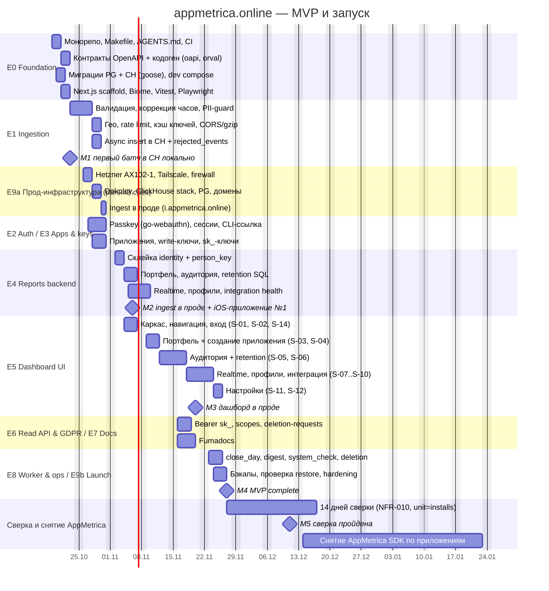

# Дорожная карта: appmetrica.online

**Версия**: 1.1 | **Дата**: 2026-10-14

> Поэтапный план реализации внутренней системы аналитики приложений appmetrica.online:
> эпики E0–E9 из канонического якоря, оценки, зависимости, критический путь и вехи.
> Это уровень эпиков. Детальные задачи лежат в [13-tickets.md](./13-tickets.md) и в ralphex-плане
> `docs/plans/20261013-appmetrica-online.md`. Требования FR/NFR определены в [02-tech-spec.md](./02-tech-spec.md),
> продуктовый контекст — в [01-prd.md](./01-prd.md).
>
> **Модель исполнения.** Код по тикетам пишет AI-агент (ralphex / Claude Code), а владелец
> ревьюит PR, деплоит и интегрирует события в свои приложения. Ёмкость владельца 10–15 часов в неделю.
> Подход к тестированию — **TDD**: у каждого тикета падающий тест появляется раньше реализации.
> Старт MVP — понедельник **2026-10-19**, MVP complete — пятница **2026-11-27**, сверка с AppMetrica
> идёт до **2026-12-11**.

---

## 1. Высокоуровневый план



**Календарь недель MVP**:

| Неделя | Даты | Основные эпики | Веха |
|---|---|---|---|
| 1 | 2026-10-19 – 2026-10-23 | E0, старт E1 | M1 (пт 2026-10-23) |
| 2 | 2026-10-26 – 2026-10-30 | E1 финал, E9a, E2, E3 | ingest в проде (пт 2026-10-30) |
| 3 | 2026-11-02 – 2026-11-06 | E4, старт E5 | M2 (пт 2026-11-06) |
| 4 | 2026-11-09 – 2026-11-13 | E5 (портфель, аудитория, retention) | — |
| 5 | 2026-11-16 – 2026-11-20 | E5 финал, E6, E7 | M3 (пт 2026-11-20) |
| 6 | 2026-11-23 – 2026-11-27 | E8, E9b | M4 MVP complete (пт 2026-11-27) |
| 7–8 | 2026-11-30 – 2026-12-11 | Сверка 14 дней, багфиксы | M5 (пт 2026-12-11) |
| 9–13 | 2026-12-14 – 2027-01-22 | Снятие AppMetrica SDK по приложениям | M6 |

---

## 2. Этапы (Epics)

### Epic 0: Discovery (этот этап) ✅

**Статус**: Complete (2026-10-13).
**Выход**: пакет discovery-документов в `docs/discovery/2026-10-13-appmetrica-online/` (00–14, 21, 22 + `00-bootstrap/`)
и ralphex-план `docs/plans/20261013-appmetrica-online.md`.
Все решения интервью (34 вопроса, 4 research-цикла) зафиксированы. Открытые вопросы с дедлайнами вынесены в [10-open-questions.md](./10-open-questions.md).

---

### Epic E0: Foundation (неделя 1, 2026-10-19 – 2026-10-23)

**Цель**: монорепо собирается, тестируется и линтуется одной командой. Контракты OpenAPI становятся источником
истины для Go-сервера и TS-клиента, а локальный стек (ClickHouse 26.8.25.14 + PostgreSQL 18.6) поднимается за 5 минут.

**Работа**:
1. Корень: `AGENTS.md` (симлинк `CLAUDE.md`), `Makefile` с целями `dev`, `test`, `gen`, `lint`, `migrate`, а также `lefthook.yml`, `.editorconfig`, `.gitignore`. (0.5d)
2. `backend/`: модуль `appmetrica.online/backend` на Go 1.27.2, `cmd/appmetrica/main.go` с подкомандами `ingest|api|worker|migrate|admin|healthcheck`, пакеты `internal/config`, `internal/clock`, `internal/httpx`. (1d)
3. `contracts/openapi/ingest.yaml` и `contracts/openapi/api.yaml` (OAS 3.0.3) по [06-api-contracts.md](./06-api-contracts.md). Кодоген: oapi-codegen v2.8.0 (strict-server, std-http-server) в `internal/gen/*` и orval 8.42.0 в `web/src/lib/api`. (1d)
4. Миграции goose v3.29.0: `migrations/postgres/00001_init.sql` (13 таблиц) и `migrations/clickhouse/00001_init.sql` (events), `00002_aggregates.sql` (install_first_seen, user_first_seen, identity_links + 3 MV), `00003_service_tables.sql` (rejected_events, daily_stats) по [05-data-model.md](./05-data-model.md); sqlc v1.31.1 для `queries/postgres`. (1d)
5. Тестовый харнесс: testcontainers-go v0.44.0 (модули clickhouse и postgres), загрузчик фикстур `testdata/fixtures/*.ndjson` и сравнение с `*.golden.json`. (0.5d)
6. `web/`: Next.js 16.4.0, React 19.3.0, TypeScript 6.0.3 strict, Tailwind 4.3.3, `npx shadcn@4.21.4 init -b radix`, Biome 2.5.15, Vitest 5.0.4, Playwright 1.64.0. (1d)
7. `.github/workflows/ci.yml`: Go (golangci-lint v2.14.0, `go test -race`, coverage gate), web (biome, `tsc --noEmit`, vitest, playwright smoke), проверка, что сгенерированный код совпадает с контрактом. (0.5d)

**Deliverable**: `make dev` поднимает CH + PG + ingest + api + web локально; `make test` зелёный; CI на PR укладывается в 10 минут.

**Definition of Done**:
- [ ] `git clone && make dev` работает на чистой машине (macOS / Linux) за ≤ 5 минут.
- [ ] `make gen` идемпотентен: повторный запуск не даёт диффа, CI падает при расхождении контракта и кода.
- [ ] `make migrate` применяет обе схемы, `goose status` показывает версию 00001 для PG и CH.
- [ ] Коммиты по Conventional Commits, хук lefthook запускает biome + gofmt.

**Estimate**: 5 дней агента; около 6 часов ревью владельца.
**Зависимости**: GitHub-репозиторий создан, у владельца есть Docker Desktop / OrbStack.

---

### Epic E1: Ingestion (недели 1–2, 2026-10-21 – 2026-10-30)

**Цель**: `POST /v1/events` принимает батчи от любой платформы без SDK, валидирует, обогащает и пишет в ClickHouse
с подтверждением. Ни одно подтверждённое событие не теряется.

**Stories** (из [02-tech-spec.md](./02-tech-spec.md)):
- FR-001: приём батча, частичный успех, конверт ошибок.
- FR-002: коррекция часов `event_time = received_at + (timestamp − sent_at)`, окно 7 дней, clamp будущего +10 мин.
- FR-003: идемпотентность по `insert_id`, дедуп внутри батча, `ReplacingMergeTree`.
- FR-004: гео DB-IP City Lite, IP не сохраняется; `context.ip` для server-to-server, `"none"` отключает гео.
- FR-005: rate limit (приложение: 2000 событий/с → 429; установка: burst 1000 / 100 в минуту → `install_rate_limited`).
- FR-006: PII-guard для `user_id`.
- FR-024: поле `environment` (production / development).

**Работа**:
1. Тесты на векторы из [06-api-contracts.md](./06-api-contracts.md) (табличные, сначала падающие). (1d)
2. Декодер: `application/json` и `text/plain`, gzip, лимит 1 048 576 байт, 1..500 событий, ключ из `X-App-Key` или `app_key`. (1d)
3. Валидация полей, слияние `context` батча и события, PII-guard, коррекция часов, дедуп в батче. (1.5d)
4. `internal/geo` на geoip2-golang v2.5.0, mmdb кладётся в образ при CI-сборке. (0.5d)
5. `internal/ratelimit` (x/time/rate, map с TTL-эвикцией), кэш `write_keys` с перезагрузкой раз в 15 с. (1d)
6. `internal/chstore`: async insert с ожиданием (clickhouse-go v2.49.0 `WithAsync(true)`), запись `rejected_events`, метрики Prometheus. (1d)

**Deliverable**: curl-батч из 500 событий принят за P99 ≤ 500 мс при 500 rps на dev-машине (k6-смоук). Отклонённые события видны в `rejected_events`.

**Definition of Done**:
- [ ] Все векторы контракта зелёные, coverage `internal/ingest` ≥ 80 %.
- [ ] Ответ 200 отдаётся только после ack ClickHouse. Тест с остановленным CH даёт 503 `storage_unavailable` + `Retry-After`.
- [ ] Сырой IP не встречается ни в CH, ни в логах. Тест grep-ает вывод slog и `payload_sample`.

**Estimate**: 7 дней агента; около 8 часов владельца (ревью + первые curl-проверки).
**Зависимости**: E0 (контракт, миграции CH, харнесс).

---

### Epic E2: Auth (неделя 2, 2026-10-27 – 2026-10-30)

**Цель**: вход в дашборд только по passkey. Первый passkey и восстановление — через одноразовую ссылку из CLI.

**Stories**: FR-008.

**Работа**:
1. `appmetrica admin passkey-link`: токен 32 байта, sha256 в `passkey_setup_tokens`, TTL 15 мин. (0.5d)
2. Церемонии `beginSetup/finishSetup`, `beginLogin/finishLogin` на go-webauthn v0.18.2 (discoverable credentials, UV required). (1.5d)
3. Сессии `am_session` (30 дней абсолютно, 7 дней idle, sliding раз в 5 мин), logout, CSRF-заголовок `X-Requested-With: appmetrica-web`. (1d)
4. Управление passkey: список, добавление, переименование, удаление (409 `last_passkey`). (0.5d)
5. UI S-01 `/login` и S-02 `/setup/[token]` (@simplewebauthn/browser 14.0.0, conditional UI). E2E через виртуальный аутентификатор Playwright. (1d)

**Deliverable**: владелец входит в дашборд на проде с MacBook (Touch ID) и iPhone (Face ID через iCloud Keychain).

**DoD**:
- [ ] Повторное использование setup-ссылки даёт 410 `setup_token_expired`.
- [ ] Удаление последнего passkey запрещено (409).
- [ ] Playwright E2E «setup → login → logout» зелёный в CI.

**Estimate**: 4 дня агента; около 3 часов владельца.
**Зависимости**: E0. Для прод-проверки нужен E9a (домен `appmetrica.online` и HTTPS: WebAuthn требует secure context).

---

### Epic E3: Apps & keys (неделя 2, 2026-10-28 – 2026-10-30)

**Цель**: приложения и ключи управляются из UI. Ingest видит изменения не позже чем через 15 секунд.

**Stories**: FR-009, FR-010, FR-011.

**Работа**:
1. `/admin/v1/apps` — создать, изменить, архивировать, разархивировать, удалить (202 + `deletion_requests` с subject_type=app). (1d)
2. Write-ключи `pk_` (несколько активных, отзыв) и API-ключи `sk_` (HMAC-SHA256 с `KEY_HASH_PEPPER`, секрет показывается один раз). (1d)
3. Интеграционные тесты: отозванный `pk_` через ≤ 15 с даёт 401 `invalid_app_key`, архивное приложение — 403 `app_archived`. (1d)

**Deliverable**: создание приложения возвращает `write_key`, им сразу можно слать события.

**DoD**:
- [ ] Имя приложения уникально без учёта регистра (409 `app_name_taken`).
- [ ] `sk_` нигде не хранится в открытом виде; тест проверяет, что в PG только хэш.

**Estimate**: 3 дня агента; около 2 часов владельца.
**Зависимости**: E0, E2 (cookie-аутентификация `/admin/v1`).

---

### Epic E4: Reports backend (неделя 3, 2026-11-02 – 2026-11-06)

**Цель**: все отчёты MVP считаются правильно по определениям AppMetrica и это доказано тестами на фикстурах с известным ответом.

**Stories**: FR-007, FR-012, FR-013, FR-014, FR-015, FR-016, FR-022 (расчётная часть: SQL закрытия дня).

**Работа**:
1. Фикстуры: 3 приложения, 40 установок, 12 user_id, общий девайс (два аккаунта), досыл через 6 дней, смена часового пояса DST (Europe/Moscow без DST, America/New_York с DST 2026-11-01). (1d)
2. `internal/identity`: `links` CTE, `person_key`, first_seen для `u:` и `i:`. (1d)
3. `internal/reports`: портфель, summary, timeseries, rolling-active, breakdown, retention day/week, realtime, профили, integration health. (2.5d)
4. Golden-тесты для `unit=persons` и `unit=installs`, бенчмарк на синтетике 100k DAU × 90 дней (P95 ≤ 1.5 с). (0.5d)

**Deliverable**: Read API `/v1/*` отвечает на все отчёты, golden-файлы в `testdata/fixtures`.

**DoD**:
- [ ] Coverage `internal/reports` и `internal/identity` ≥ 80 %.
- [ ] Повторная отправка батча с теми же `insert_id` не меняет ни одной метрики (тест идемпотентности).
- [ ] `EXPLAIN indexes=1` для портфеля читает только партиции диапазона.

**Estimate**: 5 дней агента; около 5 часов владельца (проверка определений на реальных данных iOS-приложения).
**Зависимости**: E1 (схема событий), E3 (приложения в PG).

---

### Epic E5: Dashboard UI (недели 3–5, 2026-11-04 – 2026-11-20)

**Цель**: десктопный дашборд в стиле AppMetrica (светлая тема, карточки-виджеты, синий акцент, от 1280px), экраны S-01..S-12 и S-14 по [14-ux-ui-spec.md](./14-ux-ui-spec.md).

**Работа**:
1. Каркас: шапка, переключатель приложения, вкладки, `proxy.ts`, обработка 401 → `/login`, страницы S-14. (1.5d)
2. S-03 портфель (таблица, сортировка, sparkline, environment, дата) и S-04 создание приложения. (2.5d)
3. S-05 аудитория (период, детализация, сравнение, фильтры через nuqs 2.10.2, KPI-карточки, Recharts 3.10.1, разбивки). (2.5d)
4. S-06 retention (HTML-heatmap D0..D30 / W0..W12, средняя кривая). (1.5d)
5. S-07 realtime (polling 5 с, пауза), S-08/S-09 профили (удаление данных), S-10 интеграция (сниппеты, ожидание первого события). (3d)
6. S-11 настройки приложения, S-12 настройки (Passkeys, API-ключи, Telegram, Система, Удаления). (2d)
7. Атрибуция «IP Geolocation by DB-IP» в футере, axe-core в Playwright, бюджет JS ≤ 250 KB gz. (1d)

**Deliverable**: владелец каждое утро открывает портфель на проде вместо AppMetrica.

**DoD**:
- [ ] Для каждого экрана реализованы 4 состояния (данные, пусто, загрузка, ошибка) с компонентными тестами.
- [ ] Playwright E2E: вход → портфель → приложение → retention → интеграция.
- [ ] axe-core без нарушений WCAG 2.2 AA; LCP ≤ 2.5 с на портфеле.

**Estimate**: 14 дней агента; около 12 часов владельца.
**Зависимости**: E2, E3, E4.

---

### Epic E6: Read API & GDPR (неделя 5, 2026-11-16 – 2026-11-18)

**Stories**: FR-018, FR-019.

**Работа**:
1. Bearer `sk_`, проверка scopes `read`/`delete`, ограничение ключа одним приложением (404 `app_not_found` для чужого), rate limit 10 rps на ключ. (1d)
2. `POST/GET /v1/apps/{app_id}/deletion-requests`, кнопка «Удалить данные» в S-09, журнал в S-12. (1d)
3. Исполнение удаления в worker (job `deletion`): lightweight DELETE в `events`, мутации агрегатов, ≤ 5 попыток. (1d)

**Deliverable**: удаление по `user_id` через curl с `sk_` завершается в статусе `done`, данные пропадают из отчётов и профиля.

**DoD**:
- [ ] Ключ без scope `delete` получает 403 `insufficient_scope`.
- [ ] Тест: после удаления `user_id` его install_id не встречается ни в `events`, ни в `identity_links`.

**Estimate**: 3 дня агента; около 2 часов владельца.
**Зависимости**: E4 (identity), E8 (worker-каркас) — каркас worker-а делается в начале E6, джобы E8 доделываются в неделе 6.

---

### Epic E7: Docs (неделя 5, 2026-11-16 – 2026-11-20)

**Stories**: FR-023, S-13.

**Работа**:
1. Fumadocs (core/ui 16.17.2, mdx 15.4.7, openapi 12.4.2) в route group `(docs)` за логином. (1d)
2. API reference из `contracts/openapi/ingest.yaml` и `api.yaml` (без `x-internal` путей `/admin/v1`). (0.5d)
3. MDX-гайды: быстрый старт, identity, сессии, время и офлайн-очередь, рецепты iOS/Swift, Android/Kotlin, Web/JS (sendBeacon), боты и бэкенды (HMAC Telegram ID), Go и curl, ошибки и ретраи, приватность и GDPR, обзор Read API. (2.5d)

**Deliverable**: интеграция нового приложения по докам занимает ≤ 30 минут без чтения кода сервера.

**DoD**:
- [ ] Каждый сниппет из рецептов прогоняется в CI против локального ingest (smoke) и даёт `accepted > 0`.
- [ ] Страницы `/docs/*` без сессии редиректят на `/login`.

**Estimate**: 4 дня агента; около 4 часов владельца (проверка Swift/Kotlin-рецептов в реальных проектах).
**Зависимости**: E1 (контракт ingest стабилен), E6 (Read API).

---

### Epic E8: Worker & ops (неделя 6, 2026-11-23 – 2026-11-25)

**Stories**: FR-020, FR-021, FR-022, FR-025.

**Работа**:
1. Планировщик `internal/worker`, журнал `job_runs`, `alert_states`, Telegram-клиент (net/http `sendMessage`, обработка 429 `retry_after`). (1d)
2. `system_check` раз в 5 мин: диск CH < 20 %, ошибки вставки > 1 %, бэкап старше 26 ч, `/health` ingest и api, ping healthchecks.io и `/fail`. (1d)
3. `digest` в `settings.digest_time`, `close_day` (D−8 в 03:30 TZ приложения → `daily_stats`, `closed_days`), `session_cleanup`. (1d)

**Deliverable**: утренний дайджест приходит в Telegram; искусственно заполненный диск на staging-volume даёт алерт `disk_free`.

**DoD**:
- [ ] Алерт приходит при переходе false→true, повторяется раз в 6 часов, при восстановлении приходит «восстановлено».
- [ ] Остановка worker-а на 10 минут даёт алерт healthchecks.io в Telegram.

**Estimate**: 3 дня агента; около 3 часов владельца.
**Зависимости**: E4 (SQL закрытия дня), E9a (бэкапы для проверки свежести).

---

### Epic E9: Deploy & launch (E9a — неделя 2, E9b — неделя 6)

**E9a — ранний срез прод-инфраструктуры (2026-10-26 – 2026-10-30)**. Нужен, чтобы данные начали копиться
до готовности дашборда и iOS-релиз с интеграцией успел пройти ревью App Store:
1. Заказ Hetzner AX102-1 (FSN1), Ubuntu 24.04 на RAID1, Tailscale, правила Robot firewall по [21-ops-runbooks.md](./21-ops-runbooks.md). (0.5d владельца)
2. Dokploy ≥ v0.30.8 (панель только через Tailscale), реестр GHCR, compose `clickhouse-stack`, managed Postgres, домены. (0.5d владельца)
3. `deploy.yml`: build → GHCR → tailscale/github-action → `application.saveDockerProvider` + `application.deploy`. (1d агента)
4. Ingest на `i.appmetrica.online`, интеграция в iOS-приложение №1 параллельно с AppMetrica SDK, релиз в App Store. (владелец, около 4 часов)

**E9b — запуск (2026-11-24 – 2026-11-27)**:
1. `clickhouse-backup` в режиме `server --watch` (инкремент 24 ч, полный 168 ч) в S3 `appmetrica-ch-backup`, бэкап Postgres в `appmetrica-pg-backup`. (0.5d)
2. Учебное восстановление CH и PG на временный volume, замер RTO. (0.5d)
3. Hardening: проверка firewall снаружи (nmap), закрытый порт 3000, секреты на вебхуках, Dokploy notifications в Telegram. (0.5d)
4. Подключение Android-приложения №1 и первого веб-сайта, запуск сверки (NFR-010). (владелец)

**Definition of Done**:
- [ ] Восстановление из бэкапа выполнено и задокументировано; RTO ≤ 4 ч подтверждён замером.
- [ ] С внешнего хоста открыты только 80/443 (и UDP 41641 для Tailscale).
- [ ] Rolling update ingest не теряет запросы: k6 во время деплоя даёт 0 ответов 5xx без `Retry-After`.

**Estimate**: 4 дня агента + около 1.5 дня владельца.
**Зависимости**: E1 (для E9a), E2–E8 (для E9b).

---

### Post-launch: P1 и далее (горизонты 3 / 6 / 12 месяцев)

P1/P2 фичи из [01-prd.md](./01-prd.md) — сознательно вне MVP:

| Горизонт | Срок | Что | Условие старта |
|---|---|---|---|
| 3 мес | до 2027-01-15 | CSV-экспорт таблиц отчётов; переход на Node 26 LTS; снятие AppMetrica SDK из всех приложений | M5 пройдена |
| 6 мес | до 2027-04-15 | Кастомные события (контракт уже forward-compatible: `name` расширяется без breaking change) + отчёт «События» с разбивкой по параметрам | Появилась конкретная продуктовая гипотеза, которую нельзя проверить сессиями |
| 6 мес | до 2027-04-15 | Воронки по цепочкам событий | Кастомные события в проде ≥ 30 дней |
| 12 мес | до 2027-10-15 | Крэши и ошибки (отдельная таблица, группировка по сигнатуре, crash-free rate) | Решение отказаться от сторонних крэш-репортеров |

Итерации — по реальному использованию дашборда (см. метрики успеха в [01-prd.md](./01-prd.md)).

---

## 3. Milestones

| # | Дата | Критерий |
|---|---|---|
| M1 | 2026-10-23 | Первый батч `session_start`/`session_end` из curl принят локальным ingest и виден в `appmetrica.events` (ClickHouse 26.8 в dev compose) |
| M2 | 2026-11-06 | Ingest работает в проде на `i.appmetrica.online`; iOS-приложение №1 с интеграцией (параллельно с AppMetrica SDK) прошло App Store review и шлёт события |
| M3 | 2026-11-20 | Дашборд в проде за passkey: портфель, аудитория, retention, realtime, профили, интеграция |
| M4 | 2026-11-27 | **MVP complete**: FR-001..FR-025 закрыты, бэкапы проверены восстановлением, алерты работают |
| M5 | 2026-12-11 | Сверка пройдена: 14 дней подряд DAU и новые расходятся с AppMetrica ≤ 5 %, D1 ≤ 3 п.п. (`unit=installs`), ноль дней простоя приёма |
| M6 | 2027-01-22 | AppMetrica SDK удалён из всех приложений, прошедших сверку |

---

## 4. Critical path

Последовательность, без которой запуск невозможен:

```
E0 контракты+миграции → E1 ingest → E9a прод-ingest → iOS-релиз №1 (App Store review)
                                  ↘
E0 → E2 auth → E3 apps&keys → E4 reports → E5 UI → E8 worker → E9b бэкапы/запуск → 14 дней сверки → снятие SDK
```

Самое длинное звено календарно — **сверка 14 дней**: её нельзя ускорить, поэтому прод-ingest вынесен в неделю 2 (E9a).
Тогда данные за сверочное окно уже накоплены к моменту готовности дашборда, а сама сверка может идти через Read API
(`/v1/portfolio?unit=installs`) ещё до M3.

Non-critical (параллельно, можно сдвинуть):
- E7 документация (рецепты нужны к подключению Android и веба, но iOS №1 интегрируется по контракту).
- Дайджест в Telegram (FR-020).
- Экран «Удаления» в S-12 (журнал виден и через API).
- Бенчмарки производительности сверх смоука.

**Если сроки сжимаются**: запуск возможен без дайджеста и без MDX-рецептов для ботов, но не без бэкапов, system_check и
корректного retention (иначе сверка теряет смысл).

---

## 5. Risks на roadmap

См. детально в [09-risks-and-mitigations.md](./09-risks-and-mitigations.md).

Top-3 roadmap-specific:
1. **Задержка App Store review для iOS-приложения №1.** Сверка стартует позже, M5 сдвигается. Mitigation: интеграция и релиз в неделю 2, сразу после прод-ingest; если ревью затягивается, сверку начинаем на веб-сайте (без ревью) и параллельно ждём iOS.
2. **Ошибки в определениях retention или новых пользователей** находятся только на реальных данных. Mitigation: golden-фикстуры в E4, ранние сравнения с AppMetrica уже с 2026-11-09 через Read API, буфер недели 7–8 под багфиксы.
3. **Ёмкость владельца** (10–15 ч/нед) — узкое место ревью: агент производит больше PR, чем владелец успевает посмотреть. Mitigation: PR ≤ 500 LOC, обязательный зелёный CI до ревью, ralphex-пайплайн с 5 ревью-агентами снимает первичное ревью; к каждому эпику заложено 20 % буфера.

---

## 6. Team & resource plan

| Epic | Исполнитель | Lead | Reviewer |
|---|---|---|---|
| E0 Foundation | AI-агент (ralphex, Claude Code) | владелец | владелец |
| E1 Ingestion | AI-агент | владелец | владелец + ralphex review-агенты |
| E2 Auth | AI-агент | владелец | владелец (security-фокус) |
| E3 Apps & keys | AI-агент | владелец | владелец |
| E4 Reports backend | AI-агент | владелец | владелец (сверка определений) |
| E5 Dashboard UI | AI-агент | владелец | владелец |
| E6 Read API & GDPR | AI-агент | владелец | владелец |
| E7 Docs | AI-агент | владелец | владелец (прогон рецептов в своих приложениях) |
| E8 Worker & ops | AI-агент | владелец | владелец |
| E9 Deploy & launch | владелец (сервер, Dokploy, firewall) + AI-агент (CI, конфиги) | владелец | владелец |

Распределение времени владельца по неделям: неделя 1 — 10 ч (ревью фундамента), неделя 2 — 15 ч (сервер + iOS-интеграция),
недели 3–5 — по 12 ч (ревью отчётов и UI), неделя 6 — 15 ч (запуск, restore-тест), недели 7–8 — по 5 ч (сверка).

---

## 7. Budget checkpoints

| Этап | Cumulative effort | Cost infra | Check |
|---|---|---|---|
| Конец E0+E1 (2026-10-23) | 10 агент-дней, 14 ч владельца | 0 € (локально) | M1: curl-батч в локальном CH |
| E9a (2026-10-30) | 18 агент-дней, 30 ч владельца | 129 € setup + 259 €/мес (AX102-1 257,30 € + IPv4 1,70 €) + Object Storage 6,49 €/мес | Ingest в проде, первый трафик |
| M3 (2026-11-20) | 42 агент-дня, 66 ч владельца | ~265,5 €/мес | Дашборд в проде |
| M4 (2026-11-27) | 49 агент-дней, 81 ч владельца | ~265,5 €/мес + GHCR сверх бесплатных 500 МБ / 1 ГБ трафика (оценка ≤ 5 $/мес) | MVP complete |
| M5 (2026-12-11) | + 10 ч владельца | ~265,5 €/мес | Сверка пройдена |

Total: **~49 агент-дней + ~91 час владельца + 6 недель календаря** до MVP complete, плюс 2 недели сверки.
Бесплатные сервисы: healthchecks.io Hobbyist (20 checks), Tailscale Personal, GitHub Actions (лимит минут Free-плана
для приватного репо — следить в Settings → Billing), DB-IP Lite (CC BY 4.0).

---

## 8. После launch — итерационные loops

- **Ежедневно (2 минуты)**: Telegram-дайджест — портфель за вчера; аномалии разбираются через экран «Интеграция».
- **Еженедельно (пятница, 30 минут)**: обзор `rejected_events` по причинам и версиям приложений, `job_runs` с ошибками,
  проверка свободного места ClickHouse и роста таблиц, обновления безопасности Dokploy и ClickHouse 26.8.
- **Ежемесячно (первая неделя месяца)**: учебное восстановление из бэкапа (см. [21-ops-runbooks.md](./21-ops-runbooks.md)),
  проверка нового DB-IP mmdb (workflow `geo-refresh.yml` 2-го числа), ревью метрик успеха из PRD.
- **Ежеквартально**: решение по P1/P2 (кастомные события, воронки, крэши) на основе того, каких вопросов не хватало.

---

## 9. Non-linear paths (contingency)

**Если P0 фича оказывается сложнее ожидаемого**:
- Retention/склейка дольше на 3+ дня → недельные когорты W0..W12 переносятся на неделю 7 (дневные остаются в MVP).
- Realtime-лента сложнее (нагрузка polling) → интервал polling увеличивается с 5 до 15 с, лента сокращается до 20 событий.
- Fumadocs-интеграция ломается на Next.js 16.4 → временно отдаём API reference через `@scalar/nextjs-api-reference`
  0.12.10 по маршруту `/docs/api`, а MDX-гайды переносятся после M4.

**Если в середине разработки правильность стека под вопросом**:
- Остановить работу по затронутому эпику; решение фиксируется ADR в `docs/adr/NNNN-*.md` (формат MADR).
- Кандидаты на пересмотр: go-webauthn (версия 0.x с breaking changes), orval + MSW 3, sqlc на синтаксисе PG 18.

**Если критический баг в production**:
- Ingest/api/web: откат на предыдущий образ в Dokploy (Deployments → Rollback) или повторный `application.deploy` с прошлым тегом.
- Схема ClickHouse/PG: только forward-fix миграцией (миграции expand/contract, откат кода безопасен).
- Данные: восстановление по [21-ops-runbooks.md](./21-ops-runbooks.md); после — blameless postmortem в `docs/incidents/`.

**Если сверка с AppMetrica не проходит (> 5 %)**:
- Разбор расхождения по `unit=installs` и разбивке по версиям приложения; типичные причины — потерянный `session_end`,
  отладочный трафик без `environment=development`, разное определение суток (TZ приложения).
- Сверка перезапускается на новые 14 дней после фикса; AppMetrica SDK не снимается до прохождения.

---

## Changelog

| Date | Version | Changes |
|---|---|---|
| 2026-10-13 | 1.0 | Initial roadmap: эпики E0–E9, вехи M1–M6, ранний прод-срез E9a, сверка до 2026-12-11 |
| 2026-10-14 | 1.1 | E0 п. 4: миграции ClickHouse — три файла 00001–00003, как в 05-data-model и коде |
