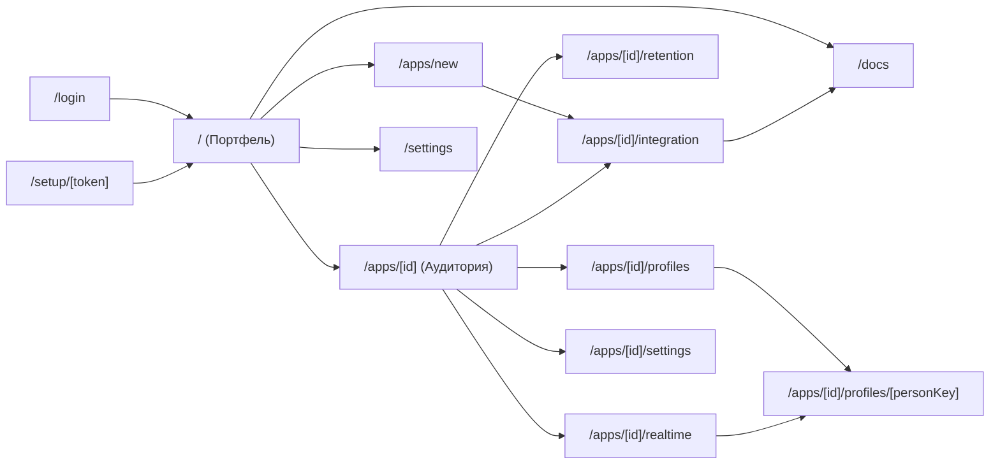

# UX/UI Specification: appmetrica.online

**Версия**: 1.0 | **Дата**: 2026-10-13 | **Consumer**: AI-агент реализации UI

> Это полная спецификация дизайн-системы и интерфейса дашборда `appmetrica.online`. Её задача — чтобы агент-реализатор
> собрал весь UI **без уточняющих вопросов** и **ничего не угадывал**.
>
> Все значения конкретные: цвета заданы в OKLCH, отступы в px или токенах. Источники истины для идентификаторов:
> экраны S-01..S-14, operationId и коды ошибок из [06-api-contracts.md](./06-api-contracts.md), требования FR/NFR из [02-tech-spec.md](./02-tech-spec.md).
> Решения пользователя, которые здесь заданы жёстко:
> - стиль «как AppMetrica», только светлая тема;
> - главная страница — портфель-таблица;
> - только десктоп, минимальная ширина окна 1280px;
> - интерфейс на русском, без i18n;
> - доступность по WCAG 2.2 AA.
>
> testing_approach = **tdd**: каждый компонент начинается с падающего теста в указанном `*.test.tsx`.

---

## 1. Brand & visual identity

### 1.1. Референсы (existing products с похожим feel)
1. **Яндекс AppMetrica.** Что берём:
   - светлый интерфейс: серый фон страницы и белые карточки-виджеты;
   - KPI-карточки с крупной цифрой, дельтой и мини-графиком;
   - синий акцент;
   - вкладки отчётов приложения;
   - выбор периода (по умолчанию «неделя») и детализации час/день/неделя/месяц;
   - сравнение с предыдущим периодом;
   - кнопка «скопировать как запрос к API».

   Что **не** берём: логотипы, шрифт YS Text и любые фирменные элементы Яндекса (риск по товарному знаку, см. [09-risks-and-mitigations.md](./09-risks-and-mitigations.md)), левую простыню отчётов, мастер «группировки и метрики».
2. **Aptabase.** Что берём:
   - плотную таблицу ключевых метрик на главной;
   - переключатель debug/release, у нас это `EnvironmentSwitch` (production/development);
   - простой live-экран с лентой событий (наш S-07).
3. **Amplitude (Retention).** Что берём:
   - таблицу когорт с цветовой шкалой (heatmap), строкой «Среднее» и размером когорты в отдельной колонке;
   - «пустые» ячейки для ещё не наступивших периодов.

### 1.2. Mood & tone
- **Mood**: enterprise / trustworthy в версии AppMetrica. Интерфейс спокойный, светлый и плотный по данным, без градиентов, иллюстраций и декоративной анимации. Цифры крупные, всё остальное подчинено им.
- **Tone of voice в UI текстах**: нейтральный технический, обращение на «вы» в безличной форме («Добавьте приложение», «Скопируйте ключ»). Термины аналитики остаются как в индустрии: DAU, WAU, MAU, retention, D1, D7.
- **Эмоции на первых секундах**: уверенность («цифры на месте, всё работает») и спокойствие. Ошибки не прячем: если что-то сломалось, интерфейс говорит об этом прямо и показывает `request_id`.

### 1.3. Brand assets
- **Логотип**: текстовый wordmark, компонент `web/src/components/layout/logo.tsx` (inline SVG, без внешних файлов).
  - Знак: квадрат 20×20 px, `rx=5`, заливка `--color-primary-600`, внутри три белых столбика шириной 3 px и высотой 6/10/14 px с шагом 2 px, выровненные по нижнему краю с отступом 3 px.
  - Справа на расстоянии 8 px текст «appmetrica.online»: Inter 600 16px, цвет `--fg-base`, `.online` окрашено в `--fg-muted`.
- **Favicon**: `web/src/app/icon.svg` — тот же знак 32×32 (`rx=8`, столбики 5 px). Next.js 16 подхватывает `app/icon.svg` автоматически.
- **OG image template**: не используется. Все страницы закрыты логином и отдают `<meta name="robots" content="noindex, nofollow">` (через `metadata.robots` в `web/src/app/layout.tsx`).
- **Иллюстрации**: нет. В пустых состояниях только иконки lucide-react размером 48 px.
- **Фотостиль**: не используется.

---

## 2. Design tokens (single source of truth)

Источник истины — `web/src/app/globals.css`, полный файл приведён в секции 3. Ниже токены сгруппированы по смыслу.

### 2.1. Цветовая палитра

#### Primary (brand)
Синий в духе AppMetrica, hue 256. Для текста и кнопок на белом используется `primary-600`: его контраст с белым около 5.4:1, это AA. `primary-500` берётся только для фокусных колец, линий графиков и декоративных элементов.
```css
--color-primary-50:  oklch(0.97 0.015 256);
--color-primary-100: oklch(0.93 0.035 256);
--color-primary-200: oklch(0.87 0.07 256);
--color-primary-300: oklch(0.78 0.11 256);
--color-primary-400: oklch(0.68 0.16 256);
--color-primary-500: oklch(0.58 0.19 256);   /* base: графики, focus ring */
--color-primary-600: oklch(0.51 0.19 256);   /* кнопки, ссылки, активная вкладка */
--color-primary-700: oklch(0.44 0.17 257);   /* hover кнопки */
--color-primary-800: oklch(0.36 0.13 258);   /* active/pressed, текст на primary-50 */
--color-primary-900: oklch(0.28 0.09 259);
--color-primary-950: oklch(0.20 0.06 260);
```

#### Neutral (greys)
Нейтральная шкала с лёгким холодным оттенком (hue 256, chroma ≤ 0.014), как серые в AppMetrica.
```css
--color-neutral-0:   oklch(1 0 0);            /* #FFFFFF — карточки */
--color-neutral-50:  oklch(0.985 0.002 256);  /* шапки таблиц, hover строк */
--color-neutral-100: oklch(0.967 0.004 256);  /* фон страницы */
--color-neutral-200: oklch(0.92 0.006 256);   /* границы карточек и таблиц */
--color-neutral-300: oklch(0.87 0.008 256);   /* границы инпутов */
--color-neutral-400: oklch(0.71 0.012 256);   /* иконки неактивные, пунктир сравнения */
--color-neutral-500: oklch(0.52 0.014 256);   /* подписи, caption (контраст на белом ≈ 4.9:1) */
--color-neutral-600: oklch(0.45 0.014 256);   /* вторичный текст (≈ 6.6:1) */
--color-neutral-700: oklch(0.37 0.014 256);
--color-neutral-800: oklch(0.28 0.012 256);
--color-neutral-900: oklch(0.21 0.010 256);   /* основной текст */
--color-neutral-950: oklch(0.15 0.008 256);
```

#### Semantic
```css
--color-success-50:  oklch(0.97 0.03 155);
--color-success-500: oklch(0.65 0.16 155);
--color-success-600: oklch(0.56 0.15 155);
--color-success-700: oklch(0.48 0.13 155);   /* текст «рост» на белом, ≈ 5.6:1 */

--color-warning-50:  oklch(0.98 0.04 85);
--color-warning-500: oklch(0.78 0.16 75);
--color-warning-600: oklch(0.66 0.15 65);
--color-warning-700: oklch(0.52 0.13 60);    /* текст предупреждений, ≈ 5.3:1 */

--color-danger-50:   oklch(0.97 0.02 25);
--color-danger-500:  oklch(0.63 0.21 27);
--color-danger-600:  oklch(0.56 0.21 27);    /* destructive-кнопки с белым текстом, ≈ 4.8:1 */
--color-danger-700:  oklch(0.50 0.19 27);    /* текст «падение», ошибки форм, ≈ 6.0:1 */

--color-info-50:     var(--color-primary-50);
--color-info-500:    var(--color-primary-500);
--color-info-700:    var(--color-primary-700);
```

#### Chart categorical (серии графиков, разбивки)
Восемь различимых цветов в фиксированном порядке. Серия «предыдущий период» всегда рисуется `--color-neutral-400` пунктиром `4 4`.
```css
--color-chart-1: oklch(0.58 0.19 256);  /* синий = основная метрика */
--color-chart-2: oklch(0.70 0.15 45);   /* оранжевый */
--color-chart-3: oklch(0.62 0.14 160);  /* зелёный */
--color-chart-4: oklch(0.58 0.20 300);  /* фиолетовый */
--color-chart-5: oklch(0.66 0.13 200);  /* бирюзовый */
--color-chart-6: oklch(0.62 0.20 15);   /* красно-розовый */
--color-chart-7: oklch(0.55 0.06 256);  /* сланцевый */
--color-chart-8: oklch(0.74 0.15 115);  /* оливковый */
```

#### Retention heatmap (sequential, 6 шагов)
| Шаг | Диапазон значения | Фон | Цвет текста | Контраст текста |
|---|---|---|---|---|
| `ret-0` | 0 % ≤ v < 5 % | `oklch(0.97 0.015 256)` | `--color-neutral-900` | ≈ 16:1 |
| `ret-1` | 5 % ≤ v < 10 % | `oklch(0.92 0.04 256)` | `--color-neutral-900` | ≈ 14:1 |
| `ret-2` | 10 % ≤ v < 20 % | `oklch(0.85 0.08 256)` | `--color-neutral-900` | ≈ 11:1 |
| `ret-3` | 20 % ≤ v < 35 % | `oklch(0.74 0.13 256)` | `--color-neutral-950` | ≈ 7.5:1 |
| `ret-4` | 35 % ≤ v < 60 % | `oklch(0.54 0.19 256)` | `#FFFFFF` | ≈ 5.0:1 |
| `ret-5` | 60 % ≤ v ≤ 100 % | `oklch(0.42 0.17 258)` | `#FFFFFF` | ≈ 8.3:1 |
Колонка D0 (W0) равна 100 % по определению и не окрашивается: фон `--bg-subtle`, текст `--fg-muted`. Ячейки периодов, которые ещё не наступили (`null`), остаются без фона и текста, `aria-label="Период ещё не наступил"`.

#### Semantic aliases (use these in components, не raw values)
```css
--bg-page:        var(--color-neutral-100);  /* фон под карточками */
--bg-base:        var(--color-neutral-0);    /* карточки, шапка, диалоги */
--bg-subtle:      var(--color-neutral-50);   /* шапки таблиц, hover строки */
--bg-muted:       var(--color-neutral-100);  /* неактивные сегменты, skeleton base */
--bg-selected:    var(--color-primary-50);   /* выбранная строка, активный пункт меню */
--bg-inverse:     var(--color-neutral-900);  /* tooltip */

--fg-base:        var(--color-neutral-900);
--fg-muted:       var(--color-neutral-600);
--fg-subtle:      var(--color-neutral-500);
--fg-inverse:     var(--color-neutral-0);
--fg-link:        var(--color-primary-600);
--fg-positive:    var(--color-success-700);
--fg-negative:    var(--color-danger-700);
--fg-warning:     var(--color-warning-700);

--border-base:    var(--color-neutral-200);
--border-strong:  var(--color-neutral-300);
--border-focus:   var(--color-primary-500);
--ring-focus:     var(--color-primary-500);
```

**Правило**: компоненты используют **только** semantic aliases и shadcn-переменные из секции 3 (`bg-card`, `text-muted-foreground`, `border-border` и т. п. Tailwind-утилиты). Raw-токены (`--color-*`) живут только в `:root` и в `@theme`. Biome не умеет проверять это правило, поэтому его проверяет ревью PR (чек-лист в [12-dev-runbook.md](./12-dev-runbook.md)).

### 2.2. Dark mode

**Решение**: **disabled** (решение пользователя от 2026-10-13, стиль «как AppMetrica — только светлая тема»).

Реализация:
- в `web/src/app/layout.tsx` прописано `<html lang="ru">`, а в `globals.css` (секция 3, `@layer base`) — `html { color-scheme: light; }`, поэтому нативные контролы (скроллбары, `input type="time"`) всегда светлые;
- блока `[data-theme="dark"]` нет, медиа-запрос `prefers-color-scheme` игнорируется;
- shadcn-компоненты ставятся без `dark:`-вариантов, а уже имеющиеся `dark:` утилиты в скопированных компонентах не удаляются: без класса `.dark` на `<html>` они ни на что не влияют.

### 2.3. Typography

#### Шрифты
- **Основной (sans)**: `Inter` через `next/font/google`: `Inter({ subsets: ['latin', 'cyrillic'], variable: '--font-inter', display: 'swap' })`. Weights: 400, 500, 600, 700 (variable font). Для всех чисел в таблицах, KPI и осях графиков включается `font-variant-numeric: tabular-nums` (утилита `tabular-nums`).
- **Моноширинный (mono)**: `JetBrains Mono` через `next/font/google`: `JetBrains_Mono({ subsets: ['latin', 'cyrillic'], variable: '--font-jetbrains-mono', display: 'swap' })`. Weights: 400, 500. Применяется для `install_id`, `user_id`, `person_key`, ключей `pk_`/`sk_`, JSON-примеров payload и сниппетов кода.
- **Дисплей**: не используется.

Подключение (`web/src/app/layout.tsx`): `<body className={cn(inter.variable, jetbrainsMono.variable, 'font-sans antialiased')}>`.

#### Type scale (fluid clamp)
> **Deviation:** fluid `clamp()` не используем. UI только десктопный (≥ 1280 px), а плотные таблицы требуют предсказуемых размеров. Шкала фиксированная, в px. В Tailwind 4 она задаётся парами `--text-*` / `--text-*--line-height`.

```css
--text-xs:   12px;  --text-xs--line-height:   16px;   /* caption, бейджи, подписи осей */
--text-sm:   13px;  --text-sm--line-height:   18px;   /* ячейки таблиц, лейблы */
--text-base: 14px;  --text-base--line-height: 20px;   /* основной текст UI */
--text-lg:   16px;  --text-lg--line-height:   24px;   /* заголовки карточек */
--text-xl:   18px;  --text-xl--line-height:   26px;   /* heading-4 */
--text-2xl:  22px;  --text-2xl--line-height:  28px;   /* заголовок страницы */
--text-3xl:  28px;  --text-3xl--line-height:  34px;   /* значение KPI */
--text-4xl:  36px;  --text-4xl--line-height:  40px;   /* значение KPI на Realtime */
--text-5xl:  56px;  --text-5xl--line-height:  60px;   /* «Активны сейчас» на S-07 */
```
Размер `6xl` не вводится: в интерфейсе нет hero-заголовков.

#### Line heights
```css
--leading-tight:   1.1;   /* только KPI-значения */
--leading-snug:    1.25;  /* заголовки */
--leading-normal:  1.45;  /* body в документации */
--leading-relaxed: 1.65;  /* MDX-статьи в /docs */
```

#### Letter spacing
```css
--tracking-tight:  -0.02em;  /* KPI-значения, заголовок страницы */
--tracking-normal:  0em;     /* весь остальной текст */
--tracking-wide:    0.04em;  /* uppercase-подписи колонок в шапке таблиц */
```

#### Text styles (используй эти aliases в компонентах)
| Style | size | weight | line-height | tracking | Где |
|---|---|---|---|---|---|
| `kpi-xl` | 5xl (56px) | 600 | tight | tight | S-07 «Активны сейчас» |
| `kpi-lg` | 3xl (28px) | 600 | tight | tight | `KpiCard` значение |
| `heading-1` | 2xl (22px) | 600 | snug | tight | Заголовок страницы (`PageHeader`) |
| `heading-2` | xl (18px) | 600 | snug | normal | Заголовок секции внутри страницы |
| `heading-3` | lg (16px) | 600 | snug | normal | Заголовок карточки |
| `body-md` | base (14px) | 400 | 20px | normal | Основной текст |
| `body-sm` | sm (13px) | 400 | 18px | normal | Ячейки таблиц |
| `label-md` | sm (13px) | 500 | 18px | normal | Лейблы полей, названия KPI |
| `label-sm` | xs (12px) | 500 | 16px | wide | Шапки колонок (uppercase), бейджи |
| `caption` | xs (12px) | 400 | 16px | normal | Подписи, `request_id`, атрибуция |
| `code` | sm (13px) mono | 400 | 18px | normal | ID, ключи, сниппеты |
Реализация: каждому стилю соответствует `@utility` в `globals.css` (`text-kpi-xl`, `text-kpi-lg`, `text-heading-1`, `text-heading-2`, `text-heading-3`, `text-body-md`, `text-body-sm`, `text-label-md`, `text-label-sm`, `text-caption`, `text-code`).

### 2.4. Spacing scale (4px base)

В Tailwind 4 шкала задаётся одной переменной `--spacing: 4px`. Утилита `p-N` = N × 4 px. Ниже допустимые значения, другие в коде не используются.
```css
--space-0:   0;      /* p-0 */
--space-px:  1px;    /* p-px */
--space-0_5: 2px;    /* p-0.5 */
--space-1:   4px;    /* p-1 */
--space-1_5: 6px;    /* p-1.5 */
--space-2:   8px;    /* p-2 */
--space-3:   12px;   /* p-3 */
--space-4:   16px;   /* p-4 */
--space-5:   20px;   /* p-5 */
--space-6:   24px;   /* p-6 */
--space-8:   32px;   /* p-8 */
--space-10:  40px;   /* p-10 */
--space-12:  48px;   /* p-12 */
--space-16:  64px;   /* p-16 */
```

**Правила**:
- Все отступы между UI-элементами берутся из шкалы, значения вроде `p-[13px]` запрещены.
- Горизонтальный padding контейнера страницы — 32 px (`px-8`). Вертикальный: 24 px сверху (`pt-6`), 48 px снизу (`pb-12`).
- Внутренний padding карточки — 20 px (`p-5`), у карточки-таблицы шапка 16 px 20 px (`px-5 py-4`), а у таблицы внутри padding нулевой.
- Gap между карточками в сетке и между блоками страницы — 16 px (`gap-4`). Между заголовком страницы и первым блоком — 24 px (`mb-6`).
- Высоты: шапка 56 px, панель вкладок приложения 48 px, строка таблицы 44 px (в портфеле 52 px), инпуты и кнопки по умолчанию 36 px, маленькие кнопки 32 px.

### 2.5. Border radius

shadcn рассчитывает радиусы от `--radius`. Мы задаём `--radius: 8px` и переопределяем шкалу явно, чтобы карточки были «AppMetrica-скруглёнными» (12 px), а не 16 px.
```css
--radius-none: 0;
--radius-sm:   4px;     /* бейджи, ячейки heatmap */
--radius-md:   6px;     /* кнопки, инпуты, select (shadcn rounded-md) */
--radius-lg:   8px;     /* popover, dropdown, tooltip */
--radius-xl:   12px;    /* карточки (shadcn Card rounded-xl), диалоги */
--radius-2xl:  16px;    /* не используется в MVP */
--radius-full: 9999px;  /* точки статуса, pill-переключатели */
```

### 2.6. Shadows (elevation)

```css
--shadow-xs: 0 1px 2px 0 oklch(0.21 0.01 256 / 0.05);                                          /* карточки */
--shadow-sm: 0 1px 3px 0 oklch(0.21 0.01 256 / 0.08), 0 1px 2px -1px oklch(0.21 0.01 256 / 0.08); /* hover карточки-ссылки */
--shadow-md: 0 4px 8px -2px oklch(0.21 0.01 256 / 0.10), 0 2px 4px -2px oklch(0.21 0.01 256 / 0.06); /* dropdown, popover, select */
--shadow-lg: 0 12px 16px -4px oklch(0.21 0.01 256 / 0.10), 0 4px 6px -2px oklch(0.21 0.01 256 / 0.05); /* dialog, toast */
--shadow-xl: 0 20px 24px -4px oklch(0.21 0.01 256 / 0.10), 0 8px 8px -4px oklch(0.21 0.01 256 / 0.04); /* не используется в MVP */
--shadow-inner: inset 0 1px 2px 0 oklch(0.21 0.01 256 / 0.06);                                 /* поле CopyField */
```

### 2.7. Motion tokens

```css
--duration-instant:  75ms;
--duration-fast:    150ms;   /* hover, focus, переключатели */
--duration-base:    200ms;   /* skeleton → контент, появление popover */
--duration-slow:    300ms;   /* dialog open */
--duration-highlight: 1000ms; /* подсветка новой строки в EventFeed */

--ease-linear:   linear;
--ease-in:       cubic-bezier(0.4, 0, 1, 1);
--ease-out:      cubic-bezier(0, 0, 0.2, 1);
--ease-in-out:   cubic-bezier(0.4, 0, 0.2, 1);
```
`--ease-spring` не вводится: пружинных анимаций в продукте нет.

**Правило**: при `prefers-reduced-motion: reduce` все анимации сокращаются до `duration-instant`, а подсветка новых строк в `EventFeed` отключается полностью (строка просто появляется).

### 2.8. Z-index scale

```css
--z-base:      0;
--z-sticky:    200;   /* sticky-шапка страницы, sticky-шапки таблиц, первая колонка heatmap */
--z-dropdown:  300;   /* dropdown-menu, select, popover, calendar */
--z-overlay:   400;   /* затемнение под dialog */
--z-modal:     410;   /* dialog, alert-dialog */
--z-toast:     600;   /* sonner */
--z-tooltip:   700;   /* tooltip, tooltip графиков Recharts */
--z-skiplink:  9999;  /* ссылка «Перейти к содержимому» при фокусе */
```
Произвольные `z-[N]` в коде запрещены. Используются только утилиты, привязанные к этой шкале: `z-sticky`, `z-dropdown`, `z-overlay`, `z-modal`, `z-toast`, `z-tooltip`, `z-skiplink` объявлены через `@utility` в `globals.css` (секция 3). Radix-порталы (dropdown, popover, dialog) получают `z-dropdown` / `z-modal` через `className` в `web/src/components/ui/*`.

---

## 3. Tailwind config (если Tailwind используется)

Tailwind CSS 4.3.3 настраивается **в CSS** (`@theme`), файла `tailwind.config.ts` нет. PostCSS: `web/postcss.config.mjs` → `export default { plugins: { '@tailwindcss/postcss': {} } }`. Пакет `tw-animate-css` ставит `shadcn init` (версия фиксируется lockfile). Biome 2.5.15 разбирает директивы Tailwind при `css.parser.tailwindDirectives: true` в `web/biome.json`.

Полный файл `web/src/app/globals.css`:
```css
@import "tailwindcss";
@import "tw-animate-css";

@source "../../content";

:root {
  /* raw palette */
  --color-primary-50:  oklch(0.97 0.015 256);
  --color-primary-100: oklch(0.93 0.035 256);
  --color-primary-200: oklch(0.87 0.07 256);
  --color-primary-300: oklch(0.78 0.11 256);
  --color-primary-400: oklch(0.68 0.16 256);
  --color-primary-500: oklch(0.58 0.19 256);
  --color-primary-600: oklch(0.51 0.19 256);
  --color-primary-700: oklch(0.44 0.17 257);
  --color-primary-800: oklch(0.36 0.13 258);
  --color-primary-900: oklch(0.28 0.09 259);
  --color-primary-950: oklch(0.20 0.06 260);

  --color-neutral-0:   oklch(1 0 0);
  --color-neutral-50:  oklch(0.985 0.002 256);
  --color-neutral-100: oklch(0.967 0.004 256);
  --color-neutral-200: oklch(0.92 0.006 256);
  --color-neutral-300: oklch(0.87 0.008 256);
  --color-neutral-400: oklch(0.71 0.012 256);
  --color-neutral-500: oklch(0.52 0.014 256);
  --color-neutral-600: oklch(0.45 0.014 256);
  --color-neutral-700: oklch(0.37 0.014 256);
  --color-neutral-800: oklch(0.28 0.012 256);
  --color-neutral-900: oklch(0.21 0.010 256);
  --color-neutral-950: oklch(0.15 0.008 256);

  --color-success-50:  oklch(0.97 0.03 155);
  --color-success-500: oklch(0.65 0.16 155);
  --color-success-600: oklch(0.56 0.15 155);
  --color-success-700: oklch(0.48 0.13 155);
  --color-warning-50:  oklch(0.98 0.04 85);
  --color-warning-500: oklch(0.78 0.16 75);
  --color-warning-600: oklch(0.66 0.15 65);
  --color-warning-700: oklch(0.52 0.13 60);
  --color-danger-50:   oklch(0.97 0.02 25);
  --color-danger-500:  oklch(0.63 0.21 27);
  --color-danger-600:  oklch(0.56 0.21 27);
  --color-danger-700:  oklch(0.50 0.19 27);

  --ret-0: oklch(0.97 0.015 256);
  --ret-1: oklch(0.92 0.04 256);
  --ret-2: oklch(0.85 0.08 256);
  --ret-3: oklch(0.74 0.13 256);
  --ret-4: oklch(0.54 0.19 256);
  --ret-5: oklch(0.42 0.17 258);

  /* semantic aliases */
  --bg-page: var(--color-neutral-100);
  --bg-base: var(--color-neutral-0);
  --bg-subtle: var(--color-neutral-50);
  --bg-muted: var(--color-neutral-100);
  --bg-selected: var(--color-primary-50);
  --bg-inverse: var(--color-neutral-900);
  --fg-base: var(--color-neutral-900);
  --fg-muted: var(--color-neutral-600);
  --fg-subtle: var(--color-neutral-500);
  --fg-inverse: var(--color-neutral-0);
  --fg-link: var(--color-primary-600);
  --fg-positive: var(--color-success-700);
  --fg-negative: var(--color-danger-700);
  --fg-warning: var(--color-warning-700);
  --border-base: var(--color-neutral-200);
  --border-strong: var(--color-neutral-300);
  --ring-focus: var(--color-primary-500);

  /* shadcn variables (Radix base, style radix-nova) */
  --radius: 8px;
  --background: var(--bg-page);
  --foreground: var(--fg-base);
  --card: var(--bg-base);
  --card-foreground: var(--fg-base);
  --popover: var(--bg-base);
  --popover-foreground: var(--fg-base);
  --primary: var(--color-primary-600);
  --primary-foreground: var(--color-neutral-0);
  --secondary: var(--color-neutral-100);
  --secondary-foreground: var(--fg-base);
  --muted: var(--color-neutral-100);
  --muted-foreground: var(--fg-muted);
  --accent: var(--color-primary-50);
  --accent-foreground: var(--color-primary-800);
  --destructive: var(--color-danger-600);
  --border: var(--border-base);
  --input: var(--border-strong);
  --ring: var(--ring-focus);
  --chart-1: oklch(0.58 0.19 256);
  --chart-2: oklch(0.70 0.15 45);
  --chart-3: oklch(0.62 0.14 160);
  --chart-4: oklch(0.58 0.20 300);
  --chart-5: oklch(0.66 0.13 200);
  --chart-6: oklch(0.62 0.20 15);
  --chart-7: oklch(0.55 0.06 256);
  --chart-8: oklch(0.74 0.15 115);
  --chart-compare: var(--color-neutral-400);
}

@theme inline {
  --font-sans: var(--font-inter), ui-sans-serif, system-ui, sans-serif;
  --font-mono: var(--font-jetbrains-mono), ui-monospace, SFMono-Regular, monospace;

  --color-background: var(--background);
  --color-foreground: var(--foreground);
  --color-card: var(--card);
  --color-card-foreground: var(--card-foreground);
  --color-popover: var(--popover);
  --color-popover-foreground: var(--popover-foreground);
  --color-primary: var(--primary);
  --color-primary-foreground: var(--primary-foreground);
  --color-secondary: var(--secondary);
  --color-secondary-foreground: var(--secondary-foreground);
  --color-muted: var(--muted);
  --color-muted-foreground: var(--muted-foreground);
  --color-accent: var(--accent);
  --color-accent-foreground: var(--accent-foreground);
  --color-destructive: var(--destructive);
  --color-border: var(--border);
  --color-input: var(--input);
  --color-ring: var(--ring);
  --color-chart-1: var(--chart-1);
  --color-chart-2: var(--chart-2);
  --color-chart-3: var(--chart-3);
  --color-chart-4: var(--chart-4);
  --color-chart-5: var(--chart-5);
  --color-chart-6: var(--chart-6);
  --color-chart-7: var(--chart-7);
  --color-chart-8: var(--chart-8);
  --color-chart-compare: var(--chart-compare);

  --color-page: var(--bg-page);
  --color-subtle: var(--bg-subtle);
  --color-selected: var(--bg-selected);
  --color-fg-muted: var(--fg-muted);
  --color-fg-subtle: var(--fg-subtle);
  --color-fg-link: var(--fg-link);
  --color-positive: var(--fg-positive);
  --color-negative: var(--fg-negative);
  --color-warning: var(--fg-warning);
  --color-ret-0: var(--ret-0);
  --color-ret-1: var(--ret-1);
  --color-ret-2: var(--ret-2);
  --color-ret-3: var(--ret-3);
  --color-ret-4: var(--ret-4);
  --color-ret-5: var(--ret-5);
}

@theme {
  --spacing: 4px;

  --text-xs: 12px;   --text-xs--line-height: 16px;
  --text-sm: 13px;   --text-sm--line-height: 18px;
  --text-base: 14px; --text-base--line-height: 20px;
  --text-lg: 16px;   --text-lg--line-height: 24px;
  --text-xl: 18px;   --text-xl--line-height: 26px;
  --text-2xl: 22px;  --text-2xl--line-height: 28px;
  --text-3xl: 28px;  --text-3xl--line-height: 34px;
  --text-4xl: 36px;  --text-4xl--line-height: 40px;
  --text-5xl: 56px;  --text-5xl--line-height: 60px;

  --radius-sm: 4px;
  --radius-md: 6px;
  --radius-lg: 8px;
  --radius-xl: 12px;
  --radius-2xl: 16px;

  --shadow-xs: 0 1px 2px 0 oklch(0.21 0.01 256 / 0.05);
  --shadow-sm: 0 1px 3px 0 oklch(0.21 0.01 256 / 0.08), 0 1px 2px -1px oklch(0.21 0.01 256 / 0.08);
  --shadow-md: 0 4px 8px -2px oklch(0.21 0.01 256 / 0.10), 0 2px 4px -2px oklch(0.21 0.01 256 / 0.06);
  --shadow-lg: 0 12px 16px -4px oklch(0.21 0.01 256 / 0.10), 0 4px 6px -2px oklch(0.21 0.01 256 / 0.05);

  --ease-out: cubic-bezier(0, 0, 0.2, 1);
  --ease-in: cubic-bezier(0.4, 0, 1, 1);
  --ease-in-out: cubic-bezier(0.4, 0, 0.2, 1);
}

@utility text-kpi-xl { font-size: var(--text-5xl); line-height: 1.1; font-weight: 600; letter-spacing: -0.02em; font-variant-numeric: tabular-nums; }
@utility text-kpi-lg { font-size: var(--text-3xl); line-height: 1.1; font-weight: 600; letter-spacing: -0.02em; font-variant-numeric: tabular-nums; }
@utility text-heading-1 { font-size: var(--text-2xl); line-height: 1.25; font-weight: 600; letter-spacing: -0.02em; }
@utility text-heading-2 { font-size: var(--text-xl); line-height: 1.25; font-weight: 600; }
@utility text-heading-3 { font-size: var(--text-lg); line-height: 1.25; font-weight: 600; }
@utility text-body-md { font-size: var(--text-base); line-height: 20px; font-weight: 400; }
@utility text-body-sm { font-size: var(--text-sm); line-height: 18px; font-weight: 400; }
@utility text-label-md { font-size: var(--text-sm); line-height: 18px; font-weight: 500; }
@utility text-label-sm { font-size: var(--text-xs); line-height: 16px; font-weight: 500; letter-spacing: 0.04em; text-transform: uppercase; }
@utility text-caption { font-size: var(--text-xs); line-height: 16px; font-weight: 400; }
@utility text-code { font-family: var(--font-mono); font-size: var(--text-sm); line-height: 18px; }

@utility z-sticky { z-index: 200; }
@utility z-dropdown { z-index: 300; }
@utility z-overlay { z-index: 400; }
@utility z-modal { z-index: 410; }
@utility z-toast { z-index: 600; }
@utility z-tooltip { z-index: 700; }
@utility z-skiplink { z-index: 9999; }

@layer base {
  html { color-scheme: light; }
  body {
    min-width: 1280px;
    background: var(--bg-page);
    color: var(--fg-base);
    font-size: var(--text-base);
    line-height: 20px;
  }
  * { border-color: var(--border-base); }
  :focus-visible { outline: 2px solid var(--ring-focus); outline-offset: 2px; }
  @media (prefers-reduced-motion: reduce) {
    *, *::before, *::after {
      animation-duration: 75ms !important;
      transition-duration: 75ms !important;
      scroll-behavior: auto !important;
    }
  }
}
```
Тест: `web/src/app/globals.test.ts` (Vitest, `fs.readFileSync`) проверяет, что в `globals.css` объявлены все алиасы из секции 2.1 и все `--color-chart-1..8`. Так случайное удаление токена ловится до визуальной регрессии.

---

## 4. Component library

### 4.1. Выбранная библиотека
**Используем**: `shadcn/ui` (CLI 4.21.4, base **Radix**, preset `nova`, style `radix-nova`) + Radix primitives + Tailwind CSS 4.3.3 + Recharts 3.10.1 (через shadcn `chart`).

Инициализация: `cd web && pnpm dlx shadcn@4.21.4 init -b radix`. Начиная с июля 2026 shadcn по умолчанию ставит Base UI, поэтому **флаг `-b radix` обязателен**. В `web/components.json`: `"aliases": { "components": "@/components", "ui": "@/components/ui", "lib": "@/lib", "hooks": "@/hooks" }`, CSS-файл `src/app/globals.css`. Утилита `cn` берётся из пакета `cn`, как ставит CLI 4.x.

Почему именно это:
1. Код компонентов копируется в репозиторий (`web/src/components/ui`), поэтому стиль AppMetrica (радиусы, плотность, серый фон) можно настроить без форка библиотеки.
2. Radix даёт из коробки доступность диалогов, меню, popover, tooltip и select: фокус-трап, `Esc`, ARIA. Это закрывает большую часть WCAG 2.2 AA.
3. shadcn `chart` — тонкая обёртка над Recharts с CSS-переменными, что позволяет единообразно рисовать линии, area, bar и sparkline.
4. Для AI-агента это самый документированный и предсказуемый стек.

Отклонённые альтернативы:
- **MUI**: навязывает Material-стиль и тяжёлый runtime на CSS-in-JS.
- **Mantine**: собственная система стилей конфликтует с Tailwind.
- **Base UI-вариант shadcn**: моложе, у агентов меньше примеров. Переход на него возможен позже без смены API.

### 4.2. Primitive components (устанавливаются через shadcn CLI)

Команда установки для MVP (одна строка):
`pnpm dlx shadcn@4.21.4 add button input select switch label dialog popover tooltip dropdown-menu command sonner alert alert-dialog card badge tabs separator skeleton table calendar chart toggle-group scroll-area`

- [x] `button`: все кнопки. Варианты `default`, `secondary`, `outline`, `ghost`, `destructive`, `link`; размеры `sm` (32 px), `default` (36 px), `icon` (36×36).
- [x] `input`: поля форм, поиск профиля.
- [ ] `textarea`: не нужен, многострочного ввода в MVP нет.
- [x] `select`: платформа, часовой пояс (вместе с `command` для поиска), детализация, dimension разбивки.
- [ ] `checkbox`: не нужен. Scopes API-ключа выбираются через `toggle-group` (multiple).
- [ ] `radio-group`: не нужен, одиночный выбор делается через `toggle-group` (single).
- [x] `switch`: `digest_enabled`, `alerts_enabled`, «Показать архивные», пауза Realtime.
- [x] `label`: у каждого поля.
- [ ] `form`: не ставим. Формы строятся на `useZodForm` (секция 7.1) со схемами, которые сгенерировал orval.
- [x] `dialog`: создание write-ключа, создание API-ключа (показ секрета), добавление и переименование passkey.
- [ ] `sheet`: не нужен. Мобильной версии нет, боковые панели не используются, все вторичные формы открываются в `dialog`.
- [x] `popover`: PeriodPicker (календарь), фильтры FilterBar, пример payload в RejectionReasonsTable.
- [x] `tooltip`: пояснения метрик (иконка `Info`), полные значения обрезанных ID, подсказки к дельтам.
- [x] `dropdown-menu`: меню пользователя в шапке (Выход), действия над ключами.
- [x] `command`: AppSwitcher (поиск приложения), поиск часового пояса в `TimezoneSelect`.
- [x] `toast` (`sonner`): «Скопировано», результаты мутаций, ошибки 429/5xx в фоне.
- [x] `alert`: баннеры состояния: «Приложение в архиве», «Данные за открытые дни ещё могут измениться», ошибки страниц.
- [x] `alert-dialog`: отзыв ключа, удаление passkey, удаление данных профиля, архивирование.
- [x] `card`: все виджеты.
- [x] `badge`: статусы (`Активен`, `Архив`, `Отозван`, `development`), scopes, коды отказов.
- [ ] `avatar`: не нужен, пользователь один, аватара нет.
- [x] `tabs`: вкладки разбивок на S-05, вкладки S-12, вкладки языков в SnippetTabs.
- [ ] `accordion`: не нужен.
- [x] `separator`: разделители в шапке и карточках.
- [x] `skeleton`: все loading-состояния.
- [ ] `progress`: не нужен, прогресс удаления показывается статус-бейджем.
- [x] `scroll-area`: EventFeed (фиксированная высота 520 px), горизонтальный скролл heatmap при periods=30.
- [x] `table`: все таблицы. Сортировка реализована вручную в `PortfolioTable` и `BreakdownTable`, без `@tanstack/react-table`: строк ≤ 50, сортировка клиентская.
- [ ] `pagination`: не нужен. Лента сессий в профиле догружается кнопкой «Показать ещё» по курсору `before`.
- [ ] `breadcrumb`: не нужен. Иерархия неглубокая (Портфель → Приложение → вкладка), контекст даёт AppSwitcher.
- [x] `calendar`: выбор произвольного диапазона в PeriodPicker (react-day-picker ставится вместе с компонентом, локаль `ru` из `date-fns/locale`).
- [ ] `navigation-menu`: не нужен, навигация — простые ссылки в шапке.
- [x] `chart`: обёртка Recharts (`ChartContainer`, `ChartTooltip`, `ChartLegend`). После `add chart` обновить recharts до 3.10.1: `pnpm add recharts@3.10.1`, потому что CLI пинит 3.8.0.
- [x] `toggle-group`: детализация (час/день/неделя/месяц), environment, unit, scopes, метрика графика.

### 4.3. Custom compound components

Компоненты, которые **мы пишем сами** для MVP. Тест каждого лежит рядом (`*.test.tsx`, Vitest 5.0.4 + Testing Library) и пишется **до** реализации.

| Name | Path | Composes from | Purpose |
|---|---|---|---|
| `AppHeader` | `web/src/components/layout/app-header.tsx` | Logo + AppSwitcher + nav-ссылки + DropdownMenu | Шапка 56 px на всех экранах дашборда |
| `AppSwitcher` | `web/src/components/layout/app-switcher.tsx` | Popover + Command + PlatformIcon | Переключение приложения с поиском |
| `AppTabs` | `web/src/components/layout/app-tabs.tsx` | `<nav>` + Link | Вкладки приложения (Аудитория…Настройки) |
| `PageHeader` | `web/src/components/layout/page-header.tsx` | heading-1 + actions | Заголовок страницы и правые действия |
| `AppFooter` | `web/src/components/layout/app-footer.tsx` | caption + Link | Атрибуция DB-IP, ссылка на доки |
| `SkipLink` | `web/src/components/layout/skip-link.tsx` | `<a>` | «Перейти к содержимому» |
| `Logo` | `web/src/components/layout/logo.tsx` | inline SVG | Wordmark |
| `PortfolioTable` | `web/src/components/reports/portfolio-table.tsx` | Table + Sparkline + Delta + PlatformIcon | Главная таблица (FR-012) |
| `KpiCard` | `web/src/components/reports/kpi-card.tsx` | Card + Delta + Sparkline + Tooltip | Карточка метрики (FR-013) |
| `MetricChart` | `web/src/components/reports/metric-chart.tsx` | ChartContainer + Recharts AreaChart/LineChart | Основной график метрики со сравнением |
| `RollingActiveChart` | `web/src/components/reports/rolling-active-chart.tsx` | ChartContainer + LineChart (3 серии) | DAU/WAU/MAU |
| `Sparkline` | `web/src/components/reports/sparkline.tsx` | Recharts LineChart без осей | Мини-график 30 дней |
| `Delta` | `web/src/components/reports/delta.tsx` | `<span>` + ArrowUp/ArrowDown | Дельта в % с цветом и знаком |
| `PeriodPicker` | `web/src/components/reports/period-picker.tsx` | ToggleGroup + Popover + Calendar | Период отчёта |
| `GranularitySelect` | `web/src/components/reports/granularity-select.tsx` | ToggleGroup | Час / день / неделя / месяц |
| `CompareToggle` | `web/src/components/reports/compare-toggle.tsx` | Switch + Label | Сравнение с предыдущим периодом |
| `FilterBar` | `web/src/components/reports/filter-bar.tsx` | Popover + Command (multi) + Badge | Фильтры platform / app_version / os_name / country |
| `EnvironmentSwitch` | `web/src/components/reports/environment-switch.tsx` | ToggleGroup | production / development |
| `UnitBadge` | `web/src/components/reports/unit-badge.tsx` | Badge + Tooltip | Индикатор сервисного режима `unit=installs` |
| `BreakdownTable` | `web/src/components/reports/breakdown-table.tsx` | Tabs + Table + bar-ячейка | Разбивки по dimension |
| `RetentionHeatmap` | `web/src/components/reports/retention-heatmap.tsx` | `<table>` + ScrollArea + Tooltip | Матрица когорт (FR-014) |
| `RetentionAverageChart` | `web/src/components/reports/retention-average-chart.tsx` | ChartContainer + LineChart | Средняя кривая удержания |
| `RealtimeCounter` | `web/src/components/realtime/realtime-counter.tsx` | Card + kpi-xl + live-точка | «Активны сейчас» (FR-015) |
| `PerMinuteChart` | `web/src/components/realtime/per-minute-chart.tsx` | ChartContainer + BarChart | Старты сессий по минутам |
| `EventFeed` | `web/src/components/realtime/event-feed.tsx` | ScrollArea + Table | Последние 50 событий |
| `ProfileSearch` | `web/src/components/profiles/profile-search.tsx` | Input + Button | Поиск профиля (FR-016) |
| `ProfileCard` | `web/src/components/profiles/profile-card.tsx` | Card + CopyField | Сводка по person |
| `InstallsTable` | `web/src/components/profiles/installs-table.tsx` | Table + PlatformIcon | Устройства человека |
| `SessionsTable` | `web/src/components/profiles/sessions-table.tsx` | Table + Button «Показать ещё» | Лента сессий |
| `DeletionStatusBadge` | `web/src/components/profiles/deletion-status-badge.tsx` | Badge | pending / running / done / failed |
| `SnippetTabs` | `web/src/components/integration/snippet-tabs.tsx` | Tabs + CodeBlock + CopyButton | Сниппеты curl/Swift/Kotlin/JS/Go (FR-017) |
| `WaitingForFirstEvent` | `web/src/components/integration/waiting-for-first-event.tsx` | Card + статус-точка | Ожидание первого события |
| `HourlyIngestChart` | `web/src/components/integration/hourly-ingest-chart.tsx` | ChartContainer + stacked BarChart | Принято / отклонено по часам |
| `RejectionReasonsTable` | `web/src/components/integration/rejection-reasons-table.tsx` | Table + Popover (JSON) | Причины отказов |
| `VersionsHealthTable` | `web/src/components/integration/versions-health-table.tsx` | Table | Здоровье по app_version |
| `PasskeyButton` | `web/src/components/auth/passkey-button.tsx` | Button + KeyRound | Вход по passkey (FR-008) |
| `SetupPasskeyForm` | `web/src/components/auth/setup-passkey-form.tsx` | Input + Button | Регистрация passkey по ссылке |
| `CopyField` | `web/src/components/common/copy-field.tsx` | Input readOnly + Button(Copy) | Ключи, ID, ссылки |
| `CodeBlock` | `web/src/components/common/code-block.tsx` | `<pre>` + shiki (из fumadocs-core) + CopyButton | Подсвеченный код |
| `PlatformIcon` | `web/src/components/common/platform-icon.tsx` | SVG из `icons/platform/*` | Иконка платформы |
| `TimezoneSelect` | `web/src/components/common/timezone-select.tsx` | Popover + Command | Выбор IANA TZ |
| `EmptyState` | `web/src/components/feedback/empty-state.tsx` | icon 48px + heading-3 + body-md + Button | Пустые состояния |
| `ErrorState` | `web/src/components/feedback/error-state.tsx` | Alert + Button + caption | Ошибки загрузки |
| `ConfirmDeleteDialog` | `web/src/components/feedback/confirm-delete-dialog.tsx` | AlertDialog + Input (ввод имени) | Опасные действия |
| `ArchivedBanner` | `web/src/components/feedback/archived-banner.tsx` | Alert | Баннер «Приложение в архиве» |
| Platform icons | `web/src/components/icons/platform/{apple,android,web,bot,server,desktop,other}.tsx` | inline SVG 16/20 px, `currentColor` | lucide 1.x без бренд-иконок |

Полные сигнатуры props каждого custom-компонента приведены в секции 16.

---

## 5. Screen inventory (MVP)

**Всего экранов**: 14 (S-01..S-14). Плюс страницы документации внутри S-13.

### Public (no auth)

| # | Route | Name | Purpose | Auth | Responsive | States |
|---|---|---|---|---|---|---|
| S-01 | `/login` | Вход | Вход по passkey | no | desktop ≥ 1280 | idle / waiting-authenticator / error / setup-required |
| S-02 | `/setup/[token]` | Регистрация passkey | Регистрация passkey по одноразовой ссылке из CLI | no (токен) | desktop ≥ 1280 | idle / submitting / success / expired / error |

### App (requires auth)

| # | Route | Name | Purpose | Auth | Layout | States |
|---|---|---|---|---|---|---|
| S-03 | `/` | Портфель | Все приложения на одном экране | yes | DashboardShell | populated / empty / loading / error |
| S-04 | `/apps/new` | Новое приложение | Создание приложения | yes | DashboardShell + FormPage | idle / submitting / error |
| S-05 | `/apps/[appId]` | Аудитория | KPI, графики, разбивки | yes | DashboardShell + AppShell | populated / empty / loading / error / not-found |
| S-06 | `/apps/[appId]/retention` | Retention | Когорты | yes | DashboardShell + AppShell | populated / empty / loading / error |
| S-07 | `/apps/[appId]/realtime` | Realtime | Активные сейчас, лента | yes | DashboardShell + AppShell | populated / empty / loading / error / paused |
| S-08 | `/apps/[appId]/profiles` | Профили | Поиск person | yes | DashboardShell + AppShell | idle / searching / results / no-results / error |
| S-09 | `/apps/[appId]/profiles/[personKey]` | Профиль | Карточка person, удаление | yes | DashboardShell + AppShell | populated / not-found / loading / error / deleting |
| S-10 | `/apps/[appId]/integration` | Интеграция | Онбординг + здоровье | yes | DashboardShell + AppShell | onboarding / healthy / loading / error |
| S-11 | `/apps/[appId]/settings` | Настройки приложения | Имя, TZ, ключи, архив, удаление | yes | DashboardShell + AppShell | idle / submitting / error / archived |
| S-12 | `/settings` | Настройки | Passkeys, API-ключи, Telegram, Система, Удаления | yes | DashboardShell | populated / loading / error |
| S-13 | `/docs/[[...slug]]` | Документация | Гайды + API reference | yes | DocsShell (Fumadocs) | populated / not-found |

### Error / system

| # | Route | Name | Purpose |
|---|---|---|---|
| S-14a | `not-found` (`web/src/app/not-found.tsx`, `web/src/app/(dashboard)/apps/[appId]/not-found.tsx`) | Не найдено | Несуществующие пути и `app_not_found` |
| S-14b | `error` (`web/src/app/(dashboard)/error.tsx`, `web/src/app/global-error.tsx`) | Ошибка | Error boundary для неожиданных исключений и 5xx |

Layouts:
- `DashboardShell` (`web/src/app/(dashboard)/layout.tsx`): SkipLink + AppHeader + `<main id="main" className="mx-auto max-w-[1600px] px-8 pt-6 pb-12">` + AppFooter.
- `AppShell` (`web/src/app/(dashboard)/apps/[appId]/layout.tsx`): загружает `getApp`, рендерит AppTabs (48 px, белый фон, нижняя граница) и ArchivedBanner, если `status = archived`.
- `AuthShell` (`web/src/app/(auth)/layout.tsx`): центрированная карточка шириной 400 px на `--bg-page`.
- `DocsShell` (`web/src/app/(docs)/layout.tsx`): Fumadocs `DocsLayout` с нашим AppHeader вместо навбара Fumadocs.

### Для каждого экрана — детализация

---

#### Screen S-01: `/login`

**Purpose**: войти в дашборд по passkey (FR-008). Пароля нет.

**Auth**: public. Если `getAuthState` возвращает `authenticated = true`, сразу редирект на `next` или `/`. Если `setup_required = true` (passkey ещё нет), показывается состояние `setup-required`.

**Layout**: `AuthShell`.

**Block structure**:
```
┌──────────────────────────── 1280 ────────────────────────────┐
│                       (фон --bg-page)                        │
│              ┌──────────── 400 ────────────┐                 │
│              │ [Logo]                      │                 │
│              │ Вход в appmetrica.online    │  heading-1      │
│              │ Используйте passkey на этом │  body-md muted  │
│              │ устройстве или телефоне.    │                 │
│              │ ┌─────────────────────────┐ │                 │
│              │ │ 🔑 Войти с passkey      │ │  Button 40px    │
│              │ └─────────────────────────┘ │  w-full         │
│              │ (inline Alert при ошибке)   │                 │
│              └─────────────────────────────┘                 │
└──────────────────────────────────────────────────────────────┘
```

**States**:

| State | When | UI |
|---|---|---|
| `idle` | Загружено, `authenticated=false`, `setup_required=false` | Кнопка «Войти с passkey» активна. Параллельно запускается conditional UI: `startAuthentication({ optionsJSON, useBrowserAutofill: true })` при поддержке `PublicKeyCredential.isConditionalMediationAvailable()`. В DOM есть скрытый `<input autocomplete="username webauthn">` |
| `waiting-authenticator` | После клика, пока открыт системный диалог | Кнопка `disabled`, внутри `Loader2` (spin) и текст «Ожидаем подтверждение…» |
| `error` | `webauthn_verification_failed`, `NotAllowedError` браузера, сетевая ошибка | Под кнопкой `Alert variant="destructive"`: «Не удалось войти. Подтверждение отменено или ключ не подошёл. Попробуйте ещё раз.»; для сети — «Нет соединения с сервером. Проверьте подключение.» Кнопка снова активна |
| `setup-required` | `setup_required=true` | Вместо кнопки карточка-инструкция: «Passkey ещё не настроен. На сервере выполните `appmetrica admin passkey-link` и откройте выведенную ссылку.» Команда показывается в `CopyField` |

**Data requirements**: `getAuthState` (RSC, до рендера), `beginLogin`, `finishLogin` (client).

**Components used**: `Logo`, `PasskeyButton`, `Alert`, `CopyField`.

**Interactions**: после успешного `finishLogin` (204 + Set-Cookie) выполняется `router.replace(next ?? '/')`. Значение `next` принимается только как относительный путь, начинающийся с `/`, без `//`. Это защита от open redirect, тест `web/src/lib/safe-next.test.ts`.

**Accessibility**: `<main>` с `aria-labelledby` на заголовок. После ошибки фокус возвращается на кнопку, Alert имеет `role="alert"`. Кнопка доступна с клавиатуры (Enter/Space).

**Tests**: `web/src/components/auth/passkey-button.test.tsx`, E2E `web/e2e/login.spec.ts` (Playwright virtual authenticator через CDP `WebAuthn.addVirtualAuthenticator`).

---

#### Screen S-02: `/setup/[token]`

**Purpose**: зарегистрировать первый passkey или восстановить доступ по одноразовой ссылке из `appmetrica admin passkey-link` (TTL 15 мин).

**Auth**: public, доступ определяется токеном в URL.

**Layout**: `AuthShell`.

**Block structure**:
```
┌──────────── 400 ────────────┐
│ [Logo]                      │
│ Регистрация passkey         │ heading-1
│ Ссылка одноразовая и        │ body-md muted
│ действует 15 минут.         │
│ Название устройства *       │ label-md
│ ┌─────────────────────────┐ │
│ │ MacBook Pro             │ │ Input (default — из UA)
│ └─────────────────────────┘ │
│ ┌─────────────────────────┐ │
│ │ Создать passkey         │ │ Button primary w-full
│ └─────────────────────────┘ │
└─────────────────────────────┘
```

**States**:

| State | When | UI |
|---|---|---|
| `idle` | Страница открыта | Поле «Название устройства», предзаполненное по User-Agent: «MacBook», «iPhone», «Windows PC» или «Устройство» |
| `submitting` | Идут `beginSetup`, системный диалог, `finishSetup` | Кнопка disabled + «Создаём passkey…» |
| `success` | `finishSetup` 204 | Короткая зелёная плашка «Passkey создан. Переходим в дашборд…», через 800 мс `router.replace('/')` |
| `expired` | Ответ 410 `setup_token_expired` (на `beginSetup` или `finishSetup`) | `EmptyState` с иконкой `TimerOff`: «Ссылка устарела или уже использована», описание «Получите новую: выполните на сервере `appmetrica admin passkey-link`.», CopyField с командой |
| `error` | 422 `webauthn_verification_failed`, `NotAllowedError`, сеть | Alert: «Не удалось создать passkey. Попробуйте ещё раз.»; форма остаётся |

**Data requirements**: `beginSetup` (`POST /admin/v1/auth/setup/{token}/begin`), `finishSetup`.

**Validation**: название обязательно, длина 1–64 после trim. Ошибки: «Введите название устройства», «Не длиннее 64 символов».

**Accessibility**: label связан с input. Ошибки поля в `aria-describedby`. Состояние `expired` объявляется через `role="status"`.

**Tests**: `web/src/components/auth/setup-passkey-form.test.tsx`, `web/e2e/setup.spec.ts`.

---

#### Screen S-03: `/` (Портфель)

**Purpose**: главный экран (FR-012). Одна таблица со всеми активными приложениями за выбранную дату (по умолчанию «вчера»).

**Auth**: required.

**Layout**: `DashboardShell`.

**Block structure**:
```
┌ AppHeader 56px: [Logo] [Все приложения ▾]   Портфель  Документация  Настройки   [⋯ Выйти] ┐
├──────────────────────────────────────────────────────────────────────────────────────────┤
│ Портфель                                     [production|development] [◀ 12 окт 2026 ▶]   │
│                                                         [+ Добавить приложение]           │
│ ┌ Card ────────────────────────────────────────────────────────────────────────────────┐ │
│ │ ПРИЛОЖЕНИЕ        СЕГОДНЯ  DAU 12 ОКТ  Δ К ВС 5 ОКТ  НОВЫЕ   СЕССИИ   D1    D7  30 ДНЕЙ │ │
│ │  Notes iOS     8 912   12 480    ▲ +4,1 %     1 204   31 022  38 %  14 % ▁▃▅▆▇ │ │
│ │  Notes Android 6 001    8 902    ▼ −1,2 %       861   20 117  31 %  11 % ▅▅▄▄▃ │ │
│ │  site.ru         940    3 117    ▲ +12 %      2 210    4 870   9 %   2 % ▂▃▅▇█ │ │
│ │  TG bot          310    1 045    ▲ +0,3 %        98    2 213  22 %   9 % ▄▄▄▅▄ │ │
│ └───────────────────────────────────────────────────────────────────────────────────────┘ │
│ [ ] Показать архивные (2)                                                                   │
├──────────────────────────────────────────────────────────────────────────────────────────┤
│ AppFooter: IP Geolocation by DB-IP · Документация API                                     │
└──────────────────────────────────────────────────────────────────────────────────────────┘
```

**Колонки PortfolioTable** (поля `PortfolioRow`):
1. «Приложение»: `PlatformIcon` (`app.platform`) + `app.name`. Ссылка на `/apps/{app.id}`, вся строка кликабельна.
2. «Сегодня»: `active_today`, live с начала суток в TZ приложения. Цвет `--fg-muted`, tooltip «Неполный день: данные с 00:00 по TZ приложения».
3. «DAU {дата}»: `active_date`.
4. «Δ к {день недели} {дата − 7}»: `active_delta_pct` через `Delta`. Значение `null` (не было данных неделю назад) показывается как «—».
5. «Новые»: `new_date`.
6. «Сессии»: `sessions_date`.
7. «D1»: `retention_d1` (когорта date − 1), «—» при `null`.
8. «D7»: `retention_d7` (когорта date − 7), «—» при `null`.
9. «30 дней»: `Sparkline` по `sparkline[30].active`, 96×28 px, без осей, последняя точка отмечена кружком 3 px.

Сортировка: клик по шапке колонки переключает desc → asc. По умолчанию сортировка по `active_date` desc, у активной колонки иконка `ArrowDown`/`ArrowUp` и `aria-sort`.

**States**:

| State | When | UI |
|---|---|---|
| `populated` | `rows.length ≥ 1` | Таблица |
| `empty` | Нет ни одного приложения (`listApps` пуст) | `EmptyState`: иконка `LayoutGrid`, «Пока нет приложений», «Добавьте первое приложение — получите ключ и готовые сниппеты для отправки событий.», кнопка «Добавить приложение» → `/apps/new` |
| `empty-no-data` | Приложения есть, но у всех нули за дату | Таблица с нулями + Alert info над ней: «За 12 окт 2026 событий нет. Проверьте вкладку «Интеграция» у приложений.» |
| `loading` | Первый fetch | Skeleton таблицы: 4 строки по 52 px, ширины колонок совпадают с реальными |
| `error` | Ошибка `getPortfolio` | `ErrorState variant="inline"` внутри карточки + «Повторить» |

**Data requirements**: `getPortfolio` (`date` из URL `?date=YYYY-MM-DD`, по умолчанию вчера в `settings.owner_timezone`; `environment` из `?env=`; `unit` из скрытого `?unit=installs`), `listApps` (архивные для переключателя).

**Interactions**:
- Стрелки ◀ ▶ у даты сдвигают дату на ±1 день, вперёд не дальше вчера. Клик по дате открывает Popover + Calendar (single).
- «Показать архивные» раскрывает под карточкой вторую таблицу «Архив» (название, платформа, дата архивации, ссылка «Открыть»), метрики там не показываются.
- Если в URL есть `?unit=installs`, рядом с заголовком появляется `UnitBadge`.

**Accessibility**: таблица с `<caption className="sr-only">Портфель приложений за 12 окт 2026</caption>`. Строка — `<tr>` со ссылкой в первой ячейке; вся строка кликабельна для мыши, а для клавиатуры фокусируется ссылка. Спарклайн `aria-hidden`, рядом sr-only текст «Тренд за 30 дней: рост».

**Tests**: `web/src/components/reports/portfolio-table.test.tsx` (сортировка, null-значения, форматирование), `web/e2e/portfolio.spec.ts` (MSW-моки orval).

---

#### Screen S-04: `/apps/new`

**Purpose**: создать приложение (FR-009) и сразу получить write-ключ.

**Auth**: required.

**Layout**: `DashboardShell`, карточка формы шириной 560 px, выровнена влево под PageHeader.

**Block structure**:
```
│ Новое приложение                                                │
│ ┌ Card 560 ──────────────────────────────────────┐             │
│ │ Название *        [Notes iOS                 ] │             │
│ │ Платформа *       [iOS                     ▾ ] │             │
│ │   Используется по умолчанию, если в событии    │             │
│ │   не передан context.platform.                 │             │
│ │ Часовой пояс *    [Europe/Moscow (UTC+3)   ▾ ] │             │
│ │   Границы суток в отчётах.                     │             │
│ │                         [Отмена] [Создать]     │             │
│ └────────────────────────────────────────────────┘             │
```

**States**:

| State | When | UI |
|---|---|---|
| `idle` | Открыта | Платформа по умолчанию не выбрана (placeholder «Выберите платформу»). Часовой пояс = `settings.owner_timezone` |
| `submitting` | `createApp` в полёте | Кнопка «Создать» disabled + «Создаём…» |
| `error` | 409 `app_name_taken` → ошибка поля «Название»; 400 `invalid_request` → ошибки полей по `details`; 5xx → toast | — |
| `success` | 201 | toast «Приложение создано», `router.push('/apps/{id}/integration')` |

Опции платформы (значения `app_platform`): iOS (`ios`), Android (`android`), Веб (`web`), macOS (`macos`), Windows (`windows`), Linux (`linux`), Бот (`bot`), Сервер (`server`), Другое (`other`).

**Data requirements**: `getSettings` (TZ по умолчанию), `createApp`.

**Accessibility**: первая ошибка после submit получает фокус. Обязательные поля отмечены звёздочкой и `aria-required="true"`.

**Tests**: `web/src/app/(dashboard)/apps/new/create-app-form.test.tsx`.

---

#### Screen S-05: `/apps/[appId]` (Аудитория)

**Purpose**: обзор аудитории приложения (FR-013): KPI, график метрики, DAU/WAU/MAU, разбивки.

**Auth**: required. При 404 `app_not_found` рендерится `apps/[appId]/not-found.tsx`.

**Layout**: `DashboardShell` + `AppShell`.

**Block structure**:
```
┌ AppHeader ─────────────────────────────────────────────────────────────────────────────┐
├ AppTabs 48px: [Аудитория] Retention  Realtime  Профили  Интеграция  Настройки          ┤
│ Notes iOS  [iOS]                                                                        │
│ [Сегодня|Вчера|7 дней|30 дней|90 дней|📅 6–12 окт]  [час|день|неделя|месяц]  [◻ Сравнить]│
│ [+ Фильтр] platform: ios ×  app_version: 2.1.0, 2.1.1 ×      [production|development]   │
│ ┌ KpiCard ────────┐ ┌ KpiCard ────────┐ ┌ KpiCard ────────┐ ┌ KpiCard ────────┐          │
│ │ Активные   ⓘ    │ │ Новые      ⓘ    │ │ Сессии     ⓘ    │ │ Ср. длительность│          │
│ │ 41 230          │ │ 7 905           │ │ 198 304         │ │ 4 мин 12 с      │          │
│ │ ▲ +6,2 %        │ │ ▼ −3,0 %        │ │ ▲ +1,1 %        │ │ медиана 2 мин 5 с│         │
│ │ ▁▂▃▅▆▇█         │ │ ▃▃▄▅▄▅▆         │ │ ▂▃▄▆▇▇█         │ │ ▅▅▅▆▅▆▅         │          │
│ └─────────────────┘ └─────────────────┘ └─────────────────┘ └─────────────────┘          │
│ ┌ Card: [Активные|Новые|Сессии|Ср. длительность]          [⧉ Скопировать запрос API] ┐ │
│ │  MetricChart 360px (area + пунктир «предыдущий период»)                             │ │
│ └──────────────────────────────────────────────────────────────────────────────────────┘ │
│ ┌ Card: DAU / WAU / MAU (RollingActiveChart 280px) ───────────────────────────────────┐ │
│ └──────────────────────────────────────────────────────────────────────────────────────┘ │
│ ┌ Card: Разбивка  [Версия приложения|ОС|Версия ОС|Устройство|Тип устройства|Страна|  ┐ │
│ │                  Город|Язык|Платформа]   метрика [Активные ▾]                       │ │
│ │  ЗНАЧЕНИЕ             АКТИВНЫЕ      ДОЛЯ                                            │ │
│ │  2.1.1                 24 001   ███████████ 58,2 %                                  │ │
│ │  2.1.0                 12 330   ██████ 29,9 %                                       │ │
│ └──────────────────────────────────────────────────────────────────────────────────────┘ │
```

**URL-state** (nuqs, `web/src/lib/url-state.ts`): `?period=7d|30d|90d|today|yesterday|custom&from=&to=&g=hour|day|week|month&compare=1&metric=active|new|sessions|avg_duration_ms&dim=app_version&bmetric=active&platform=ios&app_version=2.1.0&os_name=&country=&env=production&unit=installs`. Значения по умолчанию: `period=7d` («неделя», как в AppMetrica), `g=day`, `compare` выключено, `metric=active`, `dim=app_version`, `bmetric=active`, `env=production`.

Детализация, доступная для периода:
- `today` и `yesterday`: только `hour`;
- `7d`: `hour` и `day`;
- `30d`: `day` и `week`;
- `90d`: `day`, `week`, `month`;
- `custom`: hour допускается при длине ≤ 7 дней, month — при длине ≥ 60 дней.

Недопустимая комбинация автоматически заменяется на ближайшую допустимую, и показывается toast «Детализация изменена на «день»».

**States**:

| State | When | UI |
|---|---|---|
| `populated` | Есть данные | Все карточки |
| `empty` | `summary.active = 0` за период и у приложения нет событий за всё время (`getIntegrationHealth.first_event_at = null`) | Вместо KPI и графиков `EmptyState`: иконка `PlugZap`, «Событий ещё нет», «Отправьте первое событие — сниппеты на вкладке «Интеграция».», кнопка «Открыть интеграцию» |
| `empty-period` | Нули за период, но события в целом были | KPI с нулями; график с плоской линией и подписью в карточке «Нет событий за выбранный период» |
| `loading` | Fetch | Skeleton: 4 KPI-карточки по 132 px, график 360 px, таблица 6 строк. Каждая карточка грузится независимо (свой `useQuery`) |
| `error` | Ошибка конкретного запроса | `ErrorState variant="inline"` в соответствующей карточке, остальные работают. `range_too_large` → inline под PeriodPicker |
| `not-found` | 404 `app_not_found` | `apps/[appId]/not-found.tsx` |

**Data requirements**: `getApp` (в AppShell), `getAudienceSummary` (KPI + compare), `getAudienceTimeseries` (по одному запросу на метрику; спарклайны KPI берутся из timeseries с `g=day`), `getRollingActive`, `getAudienceBreakdown`.

**Interactions**:
- Клик по KpiCard делает эту метрику текущей в MetricChart (`metric=`).
- «Скопировать запрос API» копирует curl к Read API для текущего графика с теми же параметрами, с заголовком `Authorization: Bearer sk_ВАШ_КЛЮЧ` — секрета в UI нет. После копирования toast «Запрос скопирован».
- Клик по строке BreakdownTable добавляет фильтр по этому значению, если dimension входит в фильтруемые (`platform`, `app_version`, `os_name`, `country`).
- Tooltip графика показывает дату, значение и, при сравнении, значение предыдущего периода и Δ.
- Над графиком действует баннер про открытые дни: если период захватывает последние 8 дней, показывается caption «Данные за последние 8 дней могут дополниться событиями из офлайн-очередей (окно 7 дней).»

**Accessibility**: у каждого графика `role="img"` и `aria-label` с кратким описанием («График активных пользователей по дням, 6–12 окт 2026, максимум 6 512 13 окт»), а под графиком ссылка-переключатель «Показать таблицей», которая раскрывает `<table>` с точками (для скринридеров). У KPI-иконки `Info` есть tooltip с определением метрики.

**Определения метрик в tooltip** (тексты):
- Активные: «Уникальные люди с хотя бы одним событием за период. Люди с логином склеиваются по user_id.»
- Новые: «Люди, чья первая сессия пришлась на период.»
- Сессии: «Количество уникальных session_id по событиям session_start.»
- Ср. длительность: «Среднее по сессиям, у которых пришёл session_end. Сессии без session_end в расчёт не входят.»

**Tests**: `kpi-card.test.tsx`, `metric-chart.test.tsx`, `period-picker.test.tsx`, `filter-bar.test.tsx`, `breakdown-table.test.tsx`, `web/src/lib/url-state.test.ts`, E2E `web/e2e/audience.spec.ts`.

---

#### Screen S-06: `/apps/[appId]/retention`

**Purpose**: удержание по когортам (FR-014): дневные D0..D30 и недельные W0..W12.

**Auth**: required. **Layout**: `DashboardShell` + `AppShell`.

**Block structure**:
```
│ Retention                                                                                │
│ [Когорты: по дням|по неделям]  [📅 13 сен – 12 окт 2026]  [+ Фильтр]  [production|dev]    │
│ ┌ Card: Средняя кривая удержания (RetentionAverageChart 220px) ─────────────────────────┐ │
│ └───────────────────────────────────────────────────────────────────────────────────────┘ │
│ ┌ Card: Когорты ───────────────────────────────────────────────────────────────────────┐ │
│ │ КОГОРТА      РАЗМЕР   D0     D1     D2     D3  …  D30   (горизонтальный скролл)      │ │
│ │ Среднее       1 204  100 %  36 %   24 %   19 %     6 %                               │ │
│ │ 13 сен 2026   1 310  100 %  38 %   25 %   20 %     7 %                               │ │
│ │ 14 сен 2026   1 102  100 %  35 %   23 %   18 %                                       │ │
│ └───────────────────────────────────────────────────────────────────────────────────────┘ │
```
Колонки «Когорта» и «Размер» закреплены (`position: sticky; left: 0` и `left: 132px`, z `--z-sticky`). Ширина ячейки периода 56 px, высота 32 px, текст `body-sm tabular-nums`, выравнивание по центру. Цвет фона по шкале `ret-0..ret-5`. Строка «Среднее» закреплена сверху (sticky top под шапкой), фон `--bg-subtle`, шрифт 600.

Период по умолчанию:
- по дням — последние 30 когорт (`from` = вчера − 29, `to` = вчера), `periods=30`;
- по неделям — последние 12 ISO-недель, `periods=12`.

Шапка колонок: `D0…D30` или `W0…W12`. Строки когорт подписаны «13 сен 2026» или, для недель, «8–14 сен».

**States**:

| State | When | UI |
|---|---|---|
| `populated` | ≥ 1 когорта с size > 0 | График + матрица |
| `empty` | Все когорты size = 0 | `EmptyState` иконка `Users`: «Нет новых пользователей в выбранных когортах», «Retention считается по людям, чья первая сессия пришлась на период.» |
| `loading` | Fetch | Skeleton графика 220 px + сетка 10×12 ячеек |
| `error` | Ошибка `getRetention` | `ErrorState` в карточке |

**Data requirements**: `getRetention` (`cohort_granularity`, `from`, `to`, `periods`, фильтры, `environment`, `unit`).

**Interactions**:
- Наведение и фокус на ячейке показывают tooltip «Когорта 13 сен 2026 (1 310 чел.) · день 7: 186 чел. (14,2 %)». Абсолют вычисляется как `round(size × value)`.
- Клик по шапке «D7» выделяет колонку рамкой `--border-focus`.

**Accessibility**:
- Матрица — настоящая `<table>` с `<th scope="col">` и `<th scope="row">`.
- Значение ячейки читается как «14,2 процента».
- `null`-ячейки: `aria-label="Период ещё не наступил"`.
- Таблица находится в ScrollArea, у которой `tabIndex={0}` и `aria-label="Матрица когорт, прокручивается по горизонтали"`.

**Tests**: `retention-heatmap.test.tsx` (шкала цветов на границах 5/10/20/35/60 %, null-ячейки, sticky-колонки), `retention-average-chart.test.tsx`, E2E `web/e2e/retention.spec.ts`.

---

#### Screen S-07: `/apps/[appId]/realtime`

**Purpose**: живой экран (FR-015): сколько людей активно сейчас, старты сессий по минутам за 30 минут, лента последних 50 событий. Используется в день релиза и для проверки интеграции.

**Auth**: required. **Layout**: `DashboardShell` + `AppShell`.

**Block structure**:
```
│ Realtime                         ● обновлено 14:32:05   [⏸ Пауза]  [production|development] │
│ ┌ RealtimeCounter 320 ─┐ ┌ Card: Старты сессий по минутам (PerMinuteChart, 200px) ────┐ │
│ │ АКТИВНЫ СЕЙЧАС       │ │ ▂▃▅▃▂▄▆▇▅▃▂▃▄▅▆▅▄▃▂▃▄▅▆▇█▆▅▄▃▂                         │ │
│ │ 1 284                │ │ 14:03                                         14:32        │ │
│ │ за последние 30 мин  │ └────────────────────────────────────────────────────────────┘ │
│ └──────────────────────┘                                                                 │
│ ┌ Card: Последние события (EventFeed, высота 520px, ScrollArea) ─────────────────────────┐ │
│ │ ВРЕМЯ     СОБЫТИЕ         ПЛАТФОРМА  ВЕРСИЯ  СТРАНА / ГОРОД        INSTALL    ЧЕЛОВЕК  │ │
│ │ 14:32:04  session_start   iOS        2.1.1   RU · Москва           5d8e…4e5f  u:8f2…  │ │
│ │ 14:32:01  session_end     Android    2.0.9   DE · Berlin           a91c…77d0  i:a91…  │ │
│ └────────────────────────────────────────────────────────────────────────────────────────┘ │
```

Polling: `getRealtime` с `refetchInterval: 5000` и `refetchIntervalInBackground: false`. На скрытой вкладке опрос приостанавливается — это поведение TanStack Query по умолчанию.

**States**:

| State | When | UI |
|---|---|---|
| `populated` | Есть события за 30 мин | Всё заполнено |
| `empty` | `active_now = 0` и `recent_events` пуст | Счётчик «0», график из пустых столбиков, в ленте `EmptyState` иконка `Radio`: «За последние 30 минут событий нет», «Отправьте тестовое событие из сниппета на вкладке «Интеграция» — оно появится здесь в течение 10 секунд.» |
| `loading` | Первый fetch | Skeleton счётчика (56 px), графика и 8 строк ленты |
| `error` | 3 подряд неудачных опроса | Над лентой `Alert variant="destructive"`: «Не удаётся обновить данные. Показаны данные на 14:31:40.» Последние данные остаются на экране, опрос продолжается |
| `paused` | Нажата «Пауза» | Индикатор серый, текст «на паузе», кнопка «Продолжить». `refetchInterval: false` |

**Interactions**:
- Новые строки ленты (insert_id ещё не виден в предыдущем ответе) подсвечиваются фоном `--bg-selected` и затухают за `--duration-highlight`.
- Клик по `INSTALL` или `ЧЕЛОВЕК` открывает `/apps/{appId}/profiles/{encodeURIComponent(person_key)}`.
- ID сокращаются до `первые4…последние4`, полное значение показывается в tooltip.

**Accessibility**:
- Счётчик в `aria-live="polite"`, объявление не чаще раза в 30 секунд: в `aria-live` попадает значение, округлённое до последнего объявленного 30-секундного тика. Иначе скринридер говорил бы каждые 5 секунд.
- Лента не live-region.
- Кнопка «Пауза» — `aria-pressed`.

**Tests**: `realtime-counter.test.tsx`, `event-feed.test.tsx` (подсветка новых, reduced motion), `per-minute-chart.test.tsx`, E2E `web/e2e/realtime.spec.ts`.

---

#### Screen S-08: `/apps/[appId]/profiles`

**Purpose**: найти человека или устройство по точному `install_id` или `user_id` (FR-016).

**Auth**: required. **Layout**: `DashboardShell` + `AppShell`.

**Block structure**:
```
│ Профили                                                                    │
│ ┌ Card ─────────────────────────────────────────────────────────────────┐ │
│ │ [ install_id или user_id                                ] [Найти]     │ │
│ │ Поиск по точному совпадению. person_key вида u:… или i:… тоже подходит.│ │
│ └───────────────────────────────────────────────────────────────────────┘ │
│ ┌ Card: Результаты ─────────────────────────────────────────────────────┐ │
│ │ ЧЕЛОВЕК          USER_ID      УСТРОЙСТВ  ПЕРВЫЙ ВИЗИТ   ПОСЛЕДНИЙ     │ │
│ │ u:8f2c…a10b      8f2c…a10b    2          3 мар 2026     12 окт 2026 → │ │
│ └───────────────────────────────────────────────────────────────────────┘ │
```

**States**:

| State | When | UI |
|---|---|---|
| `idle` | Пустой запрос | Только поиск, подсказка под полем |
| `searching` | `searchProfiles` в полёте | Кнопка disabled, skeleton 2 строки |
| `results` | ≥ 1 результат | Таблица. Если результат один, сразу `router.push` на S-09 |
| `no-results` | 0 | `EmptyState` иконка `SearchX`: «Ничего не найдено», «Проверьте значение: поиск работает только по точному совпадению install_id или user_id. Данные старше 25 месяцев удаляются.» |
| `error` | Ошибка | `ErrorState` |

URL: `?q=`, поиск по Enter или кнопке. Перед запросом значение обрезается по краям (trim). Префиксы `u:` и `i:` срезаются и определяют тип.

**Data requirements**: `searchProfiles`.

**Tests**: `profile-search.test.tsx`.

---

#### Screen S-09: `/apps/[appId]/profiles/[personKey]`

**Purpose**: карточка человека: устройства, сессии и удаление данных по GDPR (FR-016, FR-019).

**Auth**: required. **Layout**: `DashboardShell` + `AppShell`.

**Block structure**:
```
│ ← К поиску                                                                             │
│ ┌ ProfileCard ─────────────────────────────────────────────────────────────────────┐   │
│ │ u:8f2c4e1a-…-a10b  [⧉]                                     [🗑 Удалить данные]    │   │
│ │ user_id: 8f2c4e1a-…-a10b   Первый визит: 3 мар 2026   Последний: 12 окт 2026 14:01│   │
│ │ Статус удаления: — | [Ожидает] | [Выполняется] | [Удалено 12 окт 2026 15:10]     │   │
│ └───────────────────────────────────────────────────────────────────────────────────┘   │
│ ┌ Card: Устройства (InstallsTable) ─────────────────────────────────────────────────┐   │
│ │ INSTALL_ID     ПЛАТФОРМА  УСТРОЙСТВО   ОС          ВЕРСИЯ  ГЕО              ПЕРВЫЙ  ПОСЛЕДНИЙ│
│ │ 5d8e…4e5f      iOS        iPhone17,1   iOS 26.0    2.1.1   RU · Москва      3 мар   12 окт │
│ └───────────────────────────────────────────────────────────────────────────────────┘   │
│ ┌ Card: Сессии (SessionsTable) ─────────────────────────────────────────────────────┐   │
│ │ НАЧАЛО              ДЛИТЕЛЬНОСТЬ   ВЕРСИЯ  ПЛАТФОРМА  INSTALL                      │   │
│ │ 12 окт 2026 14:01   4 мин 12 с     2.1.1   iOS        5d8e…4e5f                    │   │
│ │ 12 окт 2026 09:15   — (нет session_end)                                           │   │
│ │                        [Показать ещё]                                              │   │
│ └───────────────────────────────────────────────────────────────────────────────────┘   │
```

**States**:

| State | When | UI |
|---|---|---|
| `populated` | 200 | Все блоки. Время показано в TZ приложения |
| `not-found` | 404 `profile_not_found` | `EmptyState` иконка `UserX`: «Профиль не найден», «Возможно, данные удалены или ещё не поступили.», кнопка «К поиску» |
| `loading` | Fetch | Skeleton карточки и двух таблиц |
| `error` | Ошибка | `ErrorState` |
| `deleting` | Есть `deletion_request` со статусом `pending` или `running` | Кнопка «Удалить данные» disabled, бейдж `DeletionStatusBadge`. Статус опрашивается через `getDeletionRequest` каждые 10 с до `done`/`failed` |

**Удаление**: кнопка открывает `ConfirmDeleteDialog`:
- заголовок «Удалить все данные этого человека?»;
- описание: «Будут удалены все события и связки устройств для {person_key} в приложении «{app.name}». Агрегаты закрытых дней не меняются. Удаление выполняется в фоне до 24 часов и необратимо.»;
- поле подтверждения «Введите УДАЛИТЬ»;
- кнопки «Отмена» и «Удалить данные» (destructive).

Вызов `createDeletionRequest`:
- для `u:` — `subject_type=user`, `subject_value=user_id`;
- для `i:` — `subject_type=install`, `subject_value=install_id`.

Ответ 202 → toast «Запрос на удаление создан», переход в состояние `deleting`. При статусе `done` toast «Данные удалены» и через 2 секунды редирект на S-08.

**Data requirements**: `getProfile` (пагинация сессий `sessions_limit=100`, `before` из `next_before`), `createDeletionRequest`, `getDeletionRequest`.

**Accessibility**: `ConfirmDeleteDialog` — Radix AlertDialog с фокусом на поле подтверждения, по `Esc` закрывается. Кнопка подтверждения disabled, пока введённый текст не совпадёт.

**Tests**: `profile-card.test.tsx`, `installs-table.test.tsx`, `sessions-table.test.tsx`, `confirm-delete-dialog.test.tsx`, E2E `web/e2e/profile-delete.spec.ts`.

---

#### Screen S-10: `/apps/[appId]/integration`

**Purpose**: экран интеграции без SDK (FR-017). У него два режима:
- **онбординг** — пока не пришло ни одного события: ключ, готовые сниппеты, ожидание первого события;
- **здоровье** — после первого события: принятые и отклонённые события за 24 часа, причины отказов с примерами, разбивка по версиям.

**Auth**: required. **Layout**: `DashboardShell` + `AppShell`.

**Block structure (онбординг)**:
```
│ Интеграция                                                                               │
│ ┌ Card: 1. Ключ приложения ─────────────────────────────────────────────────────────────┐│
│ │ Write-ключ (публичный, встраивается в приложение)                                     ││
│ │ [pk_7Hq2x9AbLm3Np4Qr5St6Uv7Wx8Yz9Ab0                                    ] [⧉]         ││
│ │ Эндпоинт: https://i.appmetrica.online/v1/events  [⧉]                                  ││
│ └────────────────────────────────────────────────────────────────────────────────────────┘│
│ ┌ Card: 2. Отправьте первое событие ────────────────────────────────────────────────────┐│
│ │ [curl] [Swift] [Kotlin] [JavaScript] [Go]                                    [⧉]      ││
│ │ ┌ CodeBlock (max-height 480, scroll) ───────────────────────────────────────────────┐ ││
│ │ └────────────────────────────────────────────────────────────────────────────────────┘ ││
│ │ Полные рецепты с офлайн-очередью и сессиями — в документации →                       ││
│ └────────────────────────────────────────────────────────────────────────────────────────┘│
│ ┌ WaitingForFirstEvent ──────────────────────────────────────────────────────────────────┐│
│ │ ◌ Ждём первое событие… Проверяем каждые 3 секунды.                                   ││
│ │   → ● Первое событие получено 14:32:05 — Notes iOS подключено! [Открыть Аудиторию]   ││
│ └────────────────────────────────────────────────────────────────────────────────────────┘│
```

**Block structure (здоровье)**:
```
│ Интеграция                                          [Показать ключ и сниппеты ▾]        │
│ ┌ KpiCard: Принято за 24 ч ┐ ┌ KpiCard: Отклонено за 24 ч ┐ ┌ KpiCard: Доля отказов ┐     │
│ │ 412 905                  │ │ 1 204                      │ │ 0,29 %  (warning ≥ 1 %)│     │
│ └──────────────────────────┘ └────────────────────────────┘ └────────────────────────┘     │
│ ┌ Card: По часам (HourlyIngestChart, stacked: принято chart-1 / отклонено danger-500) ┐  │
│ ┌ Card: Причины отказов (RejectionReasonsTable) ─────────────────────────────────────┐  │
│ │ КОД                     ОПИСАНИЕ                     КОЛ-ВО   ПОСЛЕДНИЙ   ПРИМЕР      │  │
│ │ event_too_old           Событие старше 7 дней           903   14:20       [{ } JSON]  │  │
│ │ user_id_looks_like_pii  user_id похож на email/телефон  301   13:58       [{ } JSON]  │  │
│ └─────────────────────────────────────────────────────────────────────────────────────┘  │
│ ┌ Card: По версиям приложения (VersionsHealthTable) ─────────────────────────────────┐  │
│ │ ВЕРСИЯ   ПРИНЯТО    ОТКЛОНЕНО   ДОЛЯ ОТКАЗОВ   ПОСЛЕДНЕЕ СОБЫТИЕ                     │  │
│ │ 2.1.1    300 112        12        0,004 %     14:32                                  │  │
│ │ 2.0.9     98 400     1 190        1,2 %  ⚠    14:31                                  │  │
│ └─────────────────────────────────────────────────────────────────────────────────────┘  │
```

Режим выбирается по `IntegrationHealth.first_event_at`: `null` — онбординг, иначе здоровье. В режиме здоровья онбординг-блоки доступны через раскрывающуюся секцию «Показать ключ и сниппеты».

Polling `getIntegrationHealth(hours=24)`:
- `refetchInterval: 3000`, пока `first_event_at = null`;
- после первого события — `30000`.

Write-ключ берётся из `listWriteKeys`: первый неотозванный ключ, отсортированный по `created_at` asc.

**States**:

| State | When | UI |
|---|---|---|
| `onboarding` | `first_event_at = null` | Онбординг-блоки, WaitingForFirstEvent в режиме ожидания (`Loader2` spin, `aria-live="polite"`) |
| `first-event` | Переход `null → значение` в текущей сессии страницы | WaitingForFirstEvent зелёный, toast «Первое событие получено» |
| `healthy` | `first_event_at ≠ null` | Режим здоровья. Пустая таблица причин → строка «Отказов за 24 часа нет ✓» |
| `no-key` | Все write-ключи отозваны | Alert warning: «Нет активного write-ключа. Создайте ключ в настройках приложения.» + ссылка на S-11; сниппеты скрыты |
| `archived` | `app.status = archived` | ArchivedBanner: «Приложение в архиве: события отклоняются с кодом app_archived.» |
| `loading` | Fetch | Skeleton |
| `error` | Ошибка | `ErrorState` в карточке |

**Пример payload** (`example_payload`): кнопка `{ }` открывает Popover шириной 560 px с CodeBlock (JSON, pretty-print, max-height 320) и текстом `example_message`. Поле `context.ip` сервер уже вырезал.

**Сниппеты**: генерируются функцией `buildSnippet(lang, { ingestUrl, writeKey, platform })` из `web/src/lib/snippets.ts`:
- `ingestUrl` = `process.env.NEXT_PUBLIC_INGEST_URL` + `/v1/events`;
- `writeKey` — ключ из `listWriteKeys`;
- `platform` = `app.platform`.

Тест `web/src/lib/snippets.test.ts` проверяет, что в каждом сниппете есть точный ключ и URL, а JSON-часть curl валидна. Тексты всех пяти сниппетов для платформы `ios` с ключом-примером приведены ниже. Для других платформ меняются только значения `context` (`platform`, `os_name`, `device_type`).

curl (во всех сниппетах `environment: "development"`, чтобы тестовые события не попали в production-отчёты):
```bash
NOW=$(date -u +"%Y-%m-%dT%H:%M:%S.000Z")
curl -sS -X POST "https://i.appmetrica.online/v1/events" \
  -H "Content-Type: application/json" \
  -H "X-App-Key: pk_7Hq2x9AbLm3Np4Qr5St6Uv7Wx8Yz9Ab0" \
  --data-binary @- <<JSON
{
  "sent_at": "$NOW",
  "context": {
    "platform": "ios",
    "os_name": "iOS",
    "os_version": "26.0",
    "app_version": "1.0.0",
    "device_type": "phone",
    "locale": "ru-RU",
    "environment": "development"
  },
  "events": [
    {
      "insert_id": "$(uuidgen)",
      "name": "session_start",
      "timestamp": "$NOW",
      "install_id": "$(uuidgen)",
      "session_id": "$(uuidgen)"
    }
  ]
}
JSON
# Ожидаемый ответ: {"accepted":1,"rejected":[],"warnings":[],"server_time":"…"}
```

Swift (iOS, Foundation + UIKit, без зависимостей):
```swift
import Foundation
import UIKit

struct EventBatch: Encodable, Sendable { let sentAt: Date; let context: EventContext; let events: [Event] }
struct EventContext: Encodable, Sendable {
    let platform, osName, osVersion, appVersion, appBuild, deviceModel, deviceType, locale, environment: String
}
struct Event: Encodable, Sendable {
    let insertId: UUID; let name: String; let timestamp: Date
    let installId: UUID; let sessionId: UUID; let userId: String?; let durationMs: Int?
}

enum Analytics {
    static let endpoint = URL(string: "https://i.appmetrica.online/v1/events")!
    static let writeKey = "pk_7Hq2x9AbLm3Np4Qr5St6Uv7Wx8Yz9Ab0"

    static func send(_ events: [Event], context: EventContext) async throws {
        let encoder = JSONEncoder()
        encoder.keyEncodingStrategy = .convertToSnakeCase
        encoder.dateEncodingStrategy = .iso8601
        var request = URLRequest(url: endpoint)
        request.httpMethod = "POST"
        request.setValue("application/json", forHTTPHeaderField: "Content-Type")
        request.setValue(writeKey, forHTTPHeaderField: "X-App-Key")
        request.httpBody = try encoder.encode(EventBatch(sentAt: Date(), context: context, events: events))
        let (_, response) = try await URLSession.shared.data(for: request)
        guard let http = response as? HTTPURLResponse, http.statusCode == 200 else {
            throw URLError(.badServerResponse)
        }
    }

    @MainActor static func currentContext() -> EventContext {
        let info = Bundle.main.infoDictionary ?? [:]
        #if DEBUG
        let environment = "development"
        #else
        let environment = "production"
        #endif
        return EventContext(
            platform: "ios",
            osName: UIDevice.current.systemName,
            osVersion: UIDevice.current.systemVersion,
            appVersion: info["CFBundleShortVersionString"] as? String ?? "",
            appBuild: info["CFBundleVersion"] as? String ?? "",
            deviceModel: hardwareModel(),
            deviceType: UIDevice.current.userInterfaceIdiom == .pad ? "tablet" : "phone",
            locale: Locale.current.identifier.replacingOccurrences(of: "_", with: "-"),
            environment: environment
        )
    }

    static func hardwareModel() -> String {
        var systemInfo = utsname()
        uname(&systemInfo)
        return withUnsafeBytes(of: &systemInfo.machine) { raw in
            String(decoding: raw.prefix(while: { $0 != 0 }), as: UTF8.self)
        }
    }
}

// Старт сессии при выходе на передний план. InstallID.current — UUID из Keychain
// (рецепт хранения и офлайн-очередь: /docs/recipes/ios-swift).
// let context = await Analytics.currentContext()
// try await Analytics.send([Event(insertId: UUID(), name: "session_start", timestamp: Date(),
//     installId: InstallID.current, sessionId: UUID(), userId: nil, durationMs: nil)], context: context)
```

Kotlin (Android, без зависимостей: `HttpURLConnection` + `org.json`; `java.time` требует minSdk 26 или core library desugaring):
```kotlin
import android.content.Context
import android.os.Build
import org.json.JSONArray
import org.json.JSONObject
import java.net.HttpURLConnection
import java.net.URL
import java.time.Instant
import java.util.Locale
import java.util.UUID

object Analytics {
    private const val ENDPOINT = "https://i.appmetrica.online/v1/events"
    private const val WRITE_KEY = "pk_7Hq2x9AbLm3Np4Qr5St6Uv7Wx8Yz9Ab0"

    // Вызывать из фонового потока (Dispatchers.IO). Возвращает HTTP-код ответа.
    fun send(events: JSONArray, context: JSONObject): Int {
        val body = JSONObject()
            .put("sent_at", Instant.now().toString())
            .put("context", context)
            .put("events", events)
        val conn = URL(ENDPOINT).openConnection() as HttpURLConnection
        return try {
            conn.requestMethod = "POST"
            conn.doOutput = true
            conn.connectTimeout = 10_000
            conn.readTimeout = 10_000
            conn.setRequestProperty("Content-Type", "application/json")
            conn.setRequestProperty("X-App-Key", WRITE_KEY)
            conn.outputStream.use { it.write(body.toString().toByteArray(Charsets.UTF_8)) }
            conn.responseCode
        } finally {
            conn.disconnect()
        }
    }

    fun context(app: Context, versionName: String, versionCode: Long, debug: Boolean): JSONObject =
        JSONObject()
            .put("platform", "android")
            .put("os_name", "Android")
            .put("os_version", Build.VERSION.RELEASE)
            .put("app_version", versionName)
            .put("app_build", versionCode.toString())
            .put("device_model", "${Build.MANUFACTURER} ${Build.MODEL}")
            .put("device_type", if (app.resources.configuration.smallestScreenWidthDp >= 600) "tablet" else "phone")
            .put("locale", Locale.getDefault().toLanguageTag())
            .put("environment", if (debug) "development" else "production")

    fun sessionStart(installId: UUID, sessionId: UUID, userId: String?): JSONObject =
        JSONObject()
            .put("insert_id", UUID.randomUUID().toString())
            .put("name", "session_start")
            .put("timestamp", Instant.now().toString())
            .put("install_id", installId.toString())
            .put("session_id", sessionId.toString())
            .apply { if (userId != null) put("user_id", userId) }
}
```

JavaScript (браузер; `fetch` при старте, `sendBeacon` при уходе со страницы. Тип `text/plain` позволяет обойтись без preflight, поэтому ключ передаётся в теле):
```js
const ENDPOINT = "https://i.appmetrica.online/v1/events";
const WRITE_KEY = "pk_7Hq2x9AbLm3Np4Qr5St6Uv7Wx8Yz9Ab0";

function installId() {
  let id = localStorage.getItem("am_install_id");
  if (!id) {
    id = crypto.randomUUID();
    localStorage.setItem("am_install_id", id);
  }
  return id;
}

const context = {
  platform: "web",
  app_version: "1.0.0",
  device_type: "desktop",
  locale: navigator.language,
  environment: location.hostname === "localhost" ? "development" : "production",
};

let sessionId = crypto.randomUUID();
let sessionStartedAt = Date.now();

function batch(events) {
  return JSON.stringify({ app_key: WRITE_KEY, sent_at: new Date().toISOString(), context, events });
}

function sessionStart() {
  sessionId = crypto.randomUUID();
  sessionStartedAt = Date.now();
  const event = {
    insert_id: crypto.randomUUID(),
    name: "session_start",
    timestamp: new Date().toISOString(),
    install_id: installId(),
    session_id: sessionId,
  };
  fetch(ENDPOINT, { method: "POST", headers: { "Content-Type": "text/plain" }, body: batch([event]), keepalive: true });
}

function sessionEnd() {
  const event = {
    insert_id: crypto.randomUUID(),
    name: "session_end",
    timestamp: new Date().toISOString(),
    install_id: installId(),
    session_id: sessionId,
    duration_ms: Date.now() - sessionStartedAt,
  };
  navigator.sendBeacon(ENDPOINT, new Blob([batch([event])], { type: "text/plain" }));
}

sessionStart();
document.addEventListener("visibilitychange", () => {
  if (document.visibilityState === "hidden") sessionEnd();
  else sessionStart();
});
```

Go (боты и бэкенды, только стандартная библиотека):
```go
package main

import (
	"bytes"
	"crypto/rand"
	"encoding/json"
	"fmt"
	"log"
	"net/http"
	"time"
)

const (
	endpoint = "https://i.appmetrica.online/v1/events"
	writeKey = "pk_7Hq2x9AbLm3Np4Qr5St6Uv7Wx8Yz9Ab0"
)

func newUUID() string {
	var b [16]byte
	if _, err := rand.Read(b[:]); err != nil {
		panic(err)
	}
	b[6] = (b[6] & 0x0f) | 0x40
	b[8] = (b[8] & 0x3f) | 0x80
	return fmt.Sprintf("%x-%x-%x-%x-%x", b[0:4], b[4:6], b[6:8], b[8:10], b[10:16])
}

func main() {
	now := time.Now().UTC().Format(time.RFC3339Nano)
	batch := map[string]any{
		"sent_at": now,
		"context": map[string]any{
			"platform":    "bot",
			"app_version": "1.0.0",
			"device_type": "server",
			"environment": "development",
			"ip":          "none", // для s2s: передайте IP пользователя или "none"
		},
		"events": []map[string]any{{
			"insert_id":  newUUID(),
			"name":       "session_start",
			"timestamp":  now,
			"install_id": newUUID(), // для бота — стабильный UUID на пользователя чата
			"session_id": newUUID(),
		}},
	}
	body, err := json.Marshal(batch)
	if err != nil {
		log.Fatal(err)
	}
	req, err := http.NewRequest(http.MethodPost, endpoint, bytes.NewReader(body))
	if err != nil {
		log.Fatal(err)
	}
	req.Header.Set("Content-Type", "application/json")
	req.Header.Set("X-App-Key", writeKey)
	resp, err := (&http.Client{Timeout: 10 * time.Second}).Do(req)
	if err != nil {
		log.Fatal(err)
	}
	defer resp.Body.Close()
	log.Println("status:", resp.Status)
}
```

**Data requirements**: `getApp`, `listWriteKeys`, `getIntegrationHealth`.

**Accessibility**:
- Вкладки сниппетов — Radix Tabs (стрелки ←/→).
- CodeBlock: `<pre tabIndex={0}>` с `aria-label="Пример кода на Swift"`.
- Кнопка копирования объявляет «Скопировано» через sonner (`aria-live`).
- Статус ожидания — `role="status"`.

**Tests**: `snippet-tabs.test.tsx`, `waiting-for-first-event.test.tsx` (переход null → значение), `rejection-reasons-table.test.tsx` (маппинг кодов → описания), `versions-health-table.test.tsx`, `web/src/lib/snippets.test.ts`, E2E `web/e2e/integration.spec.ts`.

---

#### Screen S-11: `/apps/[appId]/settings`

**Purpose**: настройки приложения (FR-009, FR-010): имя, часовой пояс, write-ключи, архивирование, удаление.

**Auth**: required. **Layout**: `DashboardShell` + `AppShell`, колонка шириной 720 px.

**Block structure**:
```
│ Настройки приложения                                                         │
│ ┌ Card: Основное ────────────────────────────────────────────────────────┐  │
│ │ Название *     [Notes iOS                    ]                         │  │
│ │ Платформа      iOS (изменить нельзя)                                   │  │
│ │ Часовой пояс * [Europe/Moscow (UTC+3)      ▾]  Меняет границы суток   │  │
│ │                в отчётах; закрытые дни не пересчитываются.             │  │
│ │                                                        [Сохранить]    │  │
│ └────────────────────────────────────────────────────────────────────────┘  │
│ ┌ Card: Write-ключи                                    [+ Создать ключ] ┐  │
│ │ КЛЮЧ                         МЕТКА     СОЗДАН      ИСПОЛЬЗОВАН   ⋯     │  │
│ │ pk_7Hq2…Ab0  [⧉]             iOS 2.x   1 окт 2026  12 окт 14:30  [Отозвать]│
│ │ pk_Qw9r…1Zx  [Отозван]       iOS 1.x   3 мар 2026  29 сен 10:02         │  │
│ └────────────────────────────────────────────────────────────────────────┘  │
│ ┌ Card: Опасная зона (рамка --color-danger-500) ─────────────────────────┐  │
│ │ Архивировать — приём событий прекращается (403 app_archived), данные  │  │
│ │ сохраняются.                                         [Архивировать]   │  │
│ │ Удалить навсегда — все события и настройки удаляются в фоне.          │  │
│ │                                                   [Удалить навсегда]  │  │
│ └────────────────────────────────────────────────────────────────────────┘  │
```

**States**:

| State | When | UI |
|---|---|---|
| `idle` | Загружено | Форма заполнена текущими значениями. «Сохранить» disabled, пока нет изменений |
| `submitting` | `updateApp` / `createWriteKey` / `revokeWriteKey` / `archiveApp` / `unarchiveApp` / `deleteApp` | Соответствующая кнопка со spinner |
| `error` | `app_name_taken` → поле; `confirm_name_mismatch` → поле в диалоге; 5xx → toast | — |
| `archived` | `status = archived` | Вместо «Архивировать» кнопка «Вернуть из архива» (`unarchiveApp`); ArchivedBanner вверху |

**Диалоги**:
- «Создать ключ»: Dialog с полем «Метка» (0–64 символа, необязательно). После `createWriteKey` в диалоге показывается CopyField с ключом и текст «Ключ публичный: его можно встраивать в приложение. Старые ключи продолжают работать, пока вы их не отзовёте.»
- «Отозвать ключ»: AlertDialog «Отозвать ключ pk_7Hq2…Ab0?». Описание: «Через 15 секунд все запросы с этим ключом начнут получать 401 invalid_app_key. Установленные версии приложения с этим ключом перестанут отправлять данные.» Кнопка «Отозвать» (destructive).
- «Архивировать»: AlertDialog с описанием последствий, кнопка «Архивировать».
- «Удалить навсегда»: `ConfirmDeleteDialog` с вводом точного названия приложения (`confirm_name`). Ответ 202 → toast «Удаление запущено», редирект на `/`.

**Data requirements**: `getApp`, `updateApp`, `listWriteKeys`, `createWriteKey`, `revokeWriteKey`, `archiveApp`, `unarchiveApp`, `deleteApp`.

**Tests**: `web/src/app/(dashboard)/apps/[appId]/settings/app-settings-form.test.tsx`, `write-keys-card.test.tsx`, E2E `web/e2e/app-settings.spec.ts`.

---

#### Screen S-12: `/settings`

**Purpose**: настройки владельца и системы (FR-008, FR-011, FR-019, FR-020, FR-021, FR-025).

**Auth**: required. **Layout**: `DashboardShell`. Вкладки (`Tabs`, синхронизированы с `?tab=`): `passkeys` (по умолчанию), `api-keys`, `telegram`, `system`, `deletions`.

**Block structure**:
```
│ Настройки                                                                          │
│ [Passkeys] [API-ключи] [Telegram] [Система] [Удаления]                             │
│ ── Passkeys ──────────────────────────────────────────────── [+ Добавить passkey] │
│ НАЗВАНИЕ          СОЗДАН        ПОСЛЕДНИЙ ВХОД     СИНХРОНИЗИРУЕТСЯ   ⋯            │
│ MacBook Pro       13 окт 2026   13 окт 2026 09:01  да (iCloud)        [Переим.][Удал.]│
│ ── API-ключи ─────────────────────────────────────────────── [+ Создать ключ]     │
│ КЛЮЧ          МЕТКА           ПРАВА          ПРИЛОЖЕНИЕ    СОЗДАН    ИСПОЛЬЗОВАН   │
│ sk_a8Kd2…     Telegram-отчёт  read           Все           1 окт     сегодня 09:00 │
│ ── Telegram ───────────────────────────────────────────────────────────────────── │
│ Chat ID [123456789     ]  Часовой пояс владельца [Europe/Moscow ▾]                 │
│ [● Ежедневный дайджест]  Время [09:00]   [● Системные алерты]                      │
│                                     [Отправить тестовое сообщение] [Сохранить]    │
│ ── Система ────────────────────────────────────────────────────────────────────── │
│ ClickHouse ● OK · свободно 71 % · событий 1 204 551 902                            │
│ Postgres ● OK      Бэкап: 13 окт 2026 03:12 (increment-2026-10-13)                 │
│ Алерты: disk_free ● норма · insert_errors ● норма · backup_stale ● норма …         │
│ Задачи: system_check 14:30 ok · digest 09:00 ok · close_day 03:30 ok …             │
│ ── Удаления ───────────────────────────────────────────────────────────────────── │
│ ПРИЛОЖЕНИЕ  ТИП      ЗНАЧЕНИЕ      ИСТОЧНИК  СТАТУС     СОЗДАН       ЗАВЕРШЁН       │
```

**States** (по вкладкам):

| State | When | UI |
|---|---|---|
| `populated` | Данные загружены | Таблицы и формы |
| `empty` (api-keys) | Ключей нет | `EmptyState` иконка `KeySquare`: «API-ключей нет», «Ключ нужен для скриптов и интеграций с Read API.», кнопка «Создать ключ» |
| `empty` (deletions) | Запросов нет | Строка «Запросов на удаление не было» |
| `loading` | Fetch | Skeleton таблицы |
| `error` | Ошибка | `ErrorState` во вкладке |

**Passkeys**:
- «Добавить passkey»: Dialog с полем «Название устройства» → `beginPasskeyRegistration` → `startRegistration({ optionsJSON: resp.publicKey })` → `finishPasskeyRegistration`.
- «Переименовать»: Dialog → `renamePasskey`.
- «Удалить»: AlertDialog → `deletePasskey`. Ответ 409 `last_passkey` показывается в диалоге: «Нельзя удалить последний passkey — сначала добавьте другой.»

**API-ключи**: «Создать ключ» открывает Dialog:
- поля: «Метка *» (1–64), «Права *» (ToggleGroup multiple: `read`, `delete`, минимум одно), «Приложение» (Select: «Все приложения» = `app_id` не передаётся, или конкретное);
- после `createApiKey` в диалоге показывается секрет в CopyField и Alert warning: «Секрет показывается один раз. Сохраните его сейчас — восстановить нельзя.» Закрыть диалог можно только кнопкой «Я сохранил ключ»;
- «Отозвать» → AlertDialog → `revokeApiKey`.

**Telegram**:
- поля `telegram_chat_id`, `owner_timezone` (TimezoneSelect), `digest_enabled`, `digest_time` (Input `type="time"`, шаг 15 мин), `alerts_enabled`;
- «Отправить тестовое сообщение» → `sendTelegramTest`. Успех: toast «Сообщение отправлено». Ошибка: toast «Telegram не принял сообщение: проверьте Chat ID и что бот добавлен в чат.»;
- подсказка под Chat ID: «Напишите боту /start и узнайте chat_id через @userinfobot. Токен бота задаётся на сервере переменной TELEGRAM_BOT_TOKEN.»

**Система**: `getSystemStatus` с `refetchInterval: 30000`. Строки статуса:
- точка `--color-success-500` и «OK» или `--color-danger-500` и «Недоступен»;
- `disk_free_pct`: при значении < 20 % текст `--fg-negative` и иконка `TriangleAlert`;
- бэкап: при отсутствии или если он старше 26 ч — «⚠ Бэкап старше 26 часов»;
- алерты: имя ключа, бейдж «Норма» (success) или «Сработал с 14:05» (danger);
- задачи: `job`, время последнего запуска, статус (`ok`, `failed`, `running`).

**Удаления**: `listDeletionRequests`, таблица со статусами `DeletionStatusBadge`, столбцы «Приложение», «Тип» (install / user / app → «Устройство» / «Пользователь» / «Приложение»), «Значение» (mono, сокращённое), «Источник» (api → «API», dashboard → «Дашборд»), «Статус», «Создан», «Завершён», «Ошибка» (если есть).

**Tests**: `passkeys-tab.test.tsx`, `api-keys-tab.test.tsx`, `telegram-tab.test.tsx`, `system-tab.test.tsx`, `deletions-tab.test.tsx` в `web/src/app/(dashboard)/settings/`; E2E `web/e2e/settings.spec.ts`.

---

#### Screen S-13: `/docs/[[...slug]]`

**Purpose**: документация API за логином (FR-023): гайды на MDX и API reference из `contracts/openapi/ingest.yaml` и `contracts/openapi/api.yaml`. Админские пути `/admin/v1` (`x-internal: true`) в справочник не попадают.

**Auth**: required. `web/src/app/(docs)/layout.tsx` на сервере вызывает `getAuthState` с проброшенной cookie и при `authenticated=false` делает `redirect('/login?next=/docs')`. `'use cache'` в этой route group запрещён.

**Layout**: `DocsShell`: AppHeader 56 px сверху, слева Fumadocs sidebar шириной 280 px, контент до 760 px, справа TOC 220 px. Цвета Fumadocs связаны с нашими токенами: `--color-fd-primary: var(--color-primary-600)`, `--color-fd-background: var(--bg-base)`, `--color-fd-muted: var(--bg-subtle)`, `--color-fd-border: var(--border-base)` (в `web/src/app/(docs)/docs.css`).

**Дерево навигации** (из `content/docs`):
1. Быстрый старт (`index`)
2. Концепции: Идентификация (`concepts/identity`), Сессии (`concepts/sessions`), Время и офлайн-очередь (`concepts/time-and-offline`)
3. Рецепты: iOS (Swift) (`recipes/ios-swift`), Android (Kotlin) (`recipes/android-kotlin`), Веб (JS) (`recipes/web-js`), Боты и бэкенды (`recipes/bots-and-backends`), Go и curl (`recipes/go-and-curl`)
4. Ошибки и ретраи (`errors-and-retries`)
5. Приватность и GDPR (`privacy-and-gdpr`)
6. Read API: Обзор (`read-api/overview`)
7. API reference: Ingestion (`api-reference/ingest/*`), Read API (`api-reference/read/*`)

**States**: `populated` — контент; `not-found` — `notFound()` Fumadocs со ссылкой «К быстрому старту».

**Interactions**:
- Code-блоки с вкладками языков (Fumadocs `Tabs` + `Tab`, `groupId="lang"`, выбор запоминается).
- Кнопка копирования в каждом блоке.
- Поиск Fumadocs (встроенный, по заголовкам и тексту).
- Playground отключён (`fumadocs-openapi` без `@scalar/api-client-react`).

**Tests**: `web/e2e/docs.spec.ts`: редирект без cookie; рендер `/docs/recipes/ios-swift`; в API reference есть operationId `POST /v1/events`.

---

#### Screen S-14: `not-found` / `error`

**Purpose**: системные страницы.

**S-14a not-found**:
- Глобальная версия (`web/src/app/not-found.tsx`): `EmptyState` иконка `FileQuestion`, «Страница не найдена», «Проверьте адрес или вернитесь в портфель.», кнопка «В портфель».
- Внутри приложения (`apps/[appId]/not-found.tsx`): «Приложение не найдено или удалено», кнопка «В портфель».

**S-14b error** (`error.tsx`, client component с `reset`): `ErrorState variant="full-page"`. Заголовок «Что-то пошло не так», описание «Произошла непредвиденная ошибка. Попробуйте обновить страницу.», кнопки «Попробовать снова» (`reset()`) и «В портфель». Если ошибка содержит `request_id`, внизу caption «Код запроса: 01J…». `global-error.tsx` повторяет этот текст с минимальной разметкой без шрифтов.

**Accessibility**: заголовок `<h1>`, фокус на нём после рендера.

**Tests**: `web/src/components/feedback/error-state.test.tsx`, `empty-state.test.tsx`.

---

## 6. Navigation pattern

### 6.1. Web

**Primary navigation**: верхняя шапка `AppHeader` (56 px, белый фон, нижняя граница `--border-base`, sticky top, z `--z-sticky`). Боковой панели нет: экранов мало, а ширина нужна таблицам. Внутри приложения — вкладки `AppTabs` (48 px).

**Items шапки**:
| Label | Icon | Path | Auth |
|---|---|---|---|
| (Logo) | — | `/` | yes |
| AppSwitcher «Все приложения ▾» / «Notes iOS ▾» | `ChevronsUpDown` | `/apps/{id}` выбранного | yes |
| Портфель | `LayoutGrid` | `/` | yes |
| Документация | `BookOpen` | `/docs` | yes |
| Настройки | `Settings` | `/settings` | yes |
| Меню «⋯» → «Выйти» | `LogOut` | `logout` → `/login` | yes |

**Вкладки приложения** (`AppTabs`):
| Label | Icon | Path |
|---|---|---|
| Аудитория | `Users` | `/apps/{appId}` |
| Retention | `Repeat` | `/apps/{appId}/retention` |
| Realtime | `Radio` | `/apps/{appId}/realtime` |
| Профили | `UserSearch` | `/apps/{appId}/profiles` |
| Интеграция | `PlugZap` | `/apps/{appId}/integration` |
| Настройки | `SlidersHorizontal` | `/apps/{appId}/settings` |

Активная вкладка: текст `--fg-link`, нижняя граница 2 px `--color-primary-600`, `aria-current="page"`. При переходе между вкладками query-параметры отчётов (`period`, `from`, `to`, `env`, `platform`, `app_version`, `os_name`, `country`, `unit`) сохраняются.

AppSwitcher: Popover + Command со строкой поиска «Найти приложение…». Список активных приложений с `PlatformIcon` отсортирован по имени. Выбор ведёт на ту же вкладку другого приложения. В конце списка пункт «+ Добавить приложение».

**Breadcrumbs**: не используются (см. 4.2). На S-09 есть ссылка «← К поиску».

**Mermaid**:


### 6.2. Mobile (если native app)

> **N/A для этого проекта.** Причина: решение пользователя от 2026-10-13 — только десктоп, минимальная ширина 1280 px. Нативного приложения и мобильной вёрстки нет. (Относится к: категория I, breakpoints.)

---

## 7. Forms UX

### 7.1. Validation strategy
- Ошибка поля показывается **on blur**, если поле тронуто, и **on submit** для всех полей. После первой неудачной отправки валидация идёт на каждый ввод.
- **Library**: `react-hook-form` не используется.

  > **Deviation:** форм всего девять, и они маленькие (1–5 полей). Вместо отдельной библиотеки форм используется собственный хук `useZodForm` (`web/src/lib/forms/use-zod-form.ts`, около 80 строк). Он работает со Zod-схемами, которые генерирует orval 8.42.0 из `contracts/openapi/api.yaml`, поэтому правила валидации совпадают с контрактом API и проверяются тем же источником. Тест: `web/src/lib/forms/use-zod-form.test.ts`.
- Кнопка submit блокируется **только** во время отправки, при невалидной форме она остаётся активной, чтобы пользователь увидел ошибки.
- Серверные ошибки полей (400 `invalid_request` с `details.fields`, 409 `app_name_taken`, `confirm_name_mismatch`) маппятся на поля функцией `applyServerErrors` в том же хуке.

Перечень форм и правил:
| Форма | Экран | Поле | Правило | Текст ошибки |
|---|---|---|---|---|
| F-1 Создание приложения | S-04 | name | trim, 1–64 | «Введите название» / «Не длиннее 64 символов» / 409: «Приложение с таким названием уже есть» |
| F-1 | S-04 | platform | значение из `app_platform` | «Выберите платформу» |
| F-1 | S-04 | timezone | IANA из `Intl.supportedValuesOf('timeZone')` | «Выберите часовой пояс» |
| F-2 Основное приложения | S-11 | name, timezone | как F-1 | как F-1 |
| F-3 Write-ключ | S-11 | label | 0–64 | «Не длиннее 64 символов» |
| F-4 API-ключ | S-12 | label | trim, 1–64 | «Введите метку» |
| F-4 | S-12 | scopes | ≥ 1 из read/delete | «Выберите хотя бы одно право» |
| F-5 Telegram | S-12 | telegram_chat_id | пусто или `^-?\d{1,20}$` либо `^@[A-Za-z0-9_]{5,32}$` | «Chat ID — число (для групп с минусом) или @username канала» |
| F-5 | S-12 | digest_time | `HH:MM`, минуты кратны 15 | «Время с шагом 15 минут» |
| F-6 Название passkey | S-02, S-12 | name | trim, 1–64 | «Введите название устройства» |
| F-7 Удаление приложения | S-11 | confirm_name | точное совпадение с `app.name` | «Название не совпадает» |
| F-8 Поиск профиля | S-08 | q | trim, 1–200 | «Введите install_id или user_id» |
| F-9 Удаление данных | S-09 | confirm | равно «УДАЛИТЬ» | кнопка disabled до совпадения (без текста ошибки) |

### 7.2. Error display
- Ошибки показываются **inline** под полем: `text-caption text-negative`, иконка `CircleAlert` 14 px, `id` связан с полем через `aria-describedby`. У поля выставляется `aria-invalid="true"`.
- **Toast** используется только для ошибок уровня формы, не привязанных к полю: сеть, 5xx, 429.
- Невалидное поле получает рамку `border-[var(--color-danger-600)]` и focus ring того же цвета.

### 7.3. Required indicator
- После label ставится `*` цветом `--fg-negative`, рядом sr-only текст «обязательное поле». В placeholder звёздочки нет.
- У необязательных полей в label добавляется «(необязательно)», цвет `--fg-subtle`.

### 7.4. Autosave
- **Applied to**: не используется. Все формы сохраняются явной кнопкой «Сохранить»: настройки редкие, а случайное сохранение часового пояса меняет границы суток в отчётах.
- **Debounce**: не применяется.
- **Indicator**: после сохранения — toast «Сохранено».

### 7.5. Optimistic UI
- **Applied to**: переименование passkey (`renamePasskey`) и переключатели `digest_enabled` / `alerts_enabled`. Значение обновляется в кэше TanStack Query сразу.
- **Rollback on error**: возврат прежнего значения + toast «Не удалось сохранить. Повторить?» с action-кнопкой «Повторить».
- Создание, отзыв и удаление ключей, архивирование и удаление выполняются **без** оптимистичного обновления: только после ответа сервера.

### 7.6. Submit feedback
- Кнопка во время отправки: `Loader2` 16 px (`animate-spin`) + текст в процессе («Создаём…», «Сохраняем…», «Отзываем…», «Удаляем…»).
- Успех: toast на 3 с, затем по контексту — закрытие диалога, редирект (создание приложения → S-10, удаление приложения → `/`) или остаёмся на месте (сохранение настроек).

---

## 8. States — унифицированные паттерны

### 8.1. Empty state
**Компонент**: `<EmptyState icon={PlugZap} title="Событий ещё нет" description={text} action={openIntegration} />`, где `openIntegration` — объект `{ label: 'Открыть интеграцию', href: '/apps/<appId>/integration' }`.

**Структура** (внутри карточки, вертикальный padding 48 px, центрирование, max-width текста 420 px):
```
┌──────────────────────────────┐
│     [Icon 48px --fg-subtle]  │
│                              │
│     heading-3 (title)        │
│     body-md --fg-muted       │
│     (description)            │
│                              │
│     [Button default]         │
└──────────────────────────────┘
```

Применение (иконка — заголовок):
- S-03: `LayoutGrid` — «Пока нет приложений»;
- S-05: `PlugZap` — «Событий ещё нет»;
- S-06: `Users` — «Нет новых пользователей в выбранных когортах»;
- S-07: `Radio` — «За последние 30 минут событий нет»;
- S-08: `SearchX` — «Ничего не найдено»;
- S-09: `UserX` — «Профиль не найден»;
- S-12: `KeySquare` — «API-ключей нет»;
- S-02: `TimerOff` — «Ссылка устарела или уже использована»;
- S-14: `FileQuestion` — «Страница не найдена».

### 8.2. Loading state

**Правило выбора**:
- Ожидание < 200 мс — ничего не показывается: Skeleton появляется с задержкой 200 мс через CSS `animation-delay`, чтобы не мигать.
- 200 мс – 1 с внутри кнопок — `Loader2` в кнопке.
- Данные отчётов — всегда `Skeleton`, повторяющий layout (карточки и графики грузятся медленнее 200 мс на диапазонах 90 дней).

**Skeleton-ы** (каждый в `web/src/components/skeletons/`):
- `PortfolioSkeleton`: шапка таблицы + 4 строки по 52 px.
- `KpiCardSkeleton`: заголовок 80×12, значение 120×28, дельта 60×14, спарклайн 100 % × 32.
- `ChartSkeleton`: прямоугольник нужной высоты (360 / 280 / 220 / 200), радиус `--radius-lg`.
- `TableSkeleton`: `rows` строк по 44 px.
- `RetentionSkeleton`: сетка 10 строк × 12 колонок по 56×32.
- `RealtimeSkeleton`: счётчик 160×56, график 200 px, 8 строк ленты.

### 8.3. Error state

**Component**: `<ErrorState error={apiError} onRetry={refetch} correlationId={apiError.request_id} variant="inline" />`

**Разновидности**:
- **Inline** (в карточке): `Alert variant="destructive"` + кнопка «Повторить». Остальные карточки страницы продолжают работать.
- **Full-page**: `error.tsx`, когда упала страница целиком.
- **Toast**: фоновые операции и мутации (сохранение, копирование, отзыв ключа).

**Content**:
- Generic: «Что-то пошло не так. Повторите попытку.»
- Network: «Нет соединения с сервером. Проверьте подключение.»
- Unauthorized (401): без сообщения — редирект на `/login?next=…`.
- Not found: «Объект не найден или был удалён.»
- Server 5xx: «Ошибка сервера. Повторите через минуту.»
- 503 `storage_unavailable`: «Хранилище данных временно недоступно. Повторим автоматически.» (TanStack Query повторяет 3 раза с экспоненциальной задержкой 1, 2, 4 с).
- Correlation ID: caption внизу «Код запроса: {request_id}» с кнопкой копирования.

Полный маппинг всех кодов ошибок API приведён в секции 14.3.

### 8.4. Success feedback
- Toast на 3 секунды (sonner, правый нижний угол, иконка `CircleCheck` `--color-success-600`).
- Создание приложения → редирект на S-10. Создание ключа → ключ показывается в диалоге.
- Копирование → toast «Скопировано» на 1,5 с.

---

## 9. Breakpoints & responsive

```css
--breakpoint-xl:   1280px;   /* минимальная поддерживаемая ширина */
--breakpoint-2xl:  1536px;   /* KPI-сетка остаётся 4 колонки, графики шире */
--content-max:     1600px;   /* максимальная ширина контента */
```

**Подход**: **desktop-first, только десктоп** (решение пользователя). Брейкпоинтов `sm`, `md` и `lg` в коде нет.
- `body { min-width: 1280px }`: на окнах уже 1280 px появляется горизонтальный скролл страницы, вёрстка не перестраивается.
- Контент центрирован, `max-width: 1600px`, padding 32 px по бокам. На 1920 px по бокам остаётся фон `--bg-page`.

**Min supported**: окно 1280×720. Проверяется Playwright-проектом `chromium-1280` (viewport 1280×720) и `chromium-1920` (1920×1080).

**Сетки**:
- KPI: `grid grid-cols-4 gap-4` на всех ширинах.
- S-07, верхний ряд: `grid grid-cols-[320px_1fr] gap-4`.
- S-10, KPI здоровья: `grid-cols-3`.
- Формы S-04/S-11 — колонка 560 / 720 px, слева.

**Container widths**:
- ≥ 1280: ширина окна минус 64 px, но не больше 1600 px.
- Документация: контент 760 px (Fumadocs), sidebar 280 px, TOC 220 px.

**Reading-width content** (MDX-доки): max-width `72ch`.

---

## 10. Accessibility

### 10.1. Target level
**WCAG 2.2 AA** (NFR-008) для всех экранов. Полная клавиатурная навигация обязательна. AAA не ставится целью.

### 10.2. Checklist (enforced via CI через `@axe-core/playwright`)
`@axe-core/playwright` ставится как dev-зависимость в тикете bootstrap web (версия фиксируется lockfile). `web/e2e/a11y.spec.ts` прогоняет axe на S-01, S-03, S-05, S-06, S-07, S-10, S-12, S-13 с тегами `wcag2a`, `wcag2aa`, `wcag21aa`, `wcag22aa`. Любое нарушение роняет CI.
- [ ] Контраст текста ≥ 4.5:1, крупного (≥ 18,66 px bold / 24 px) ≥ 3:1. Палитра в 2.1 спроектирована под это; ячейки heatmap — см. таблицу контрастов.
- [ ] У всех интерактивных элементов есть `:focus-visible` кольцо 2 px `--ring-focus` со смещением 2 px.
- [ ] Минимальный размер цели 24×24 px (WCAG 2.2 SC 2.5.8). Иконки-кнопки 32×32 / 36×36.
- [ ] Все сценарии проходятся только с клавиатурой: вход, создание приложения, смена периода, фильтры, копирование ключа, удаление данных.
- [ ] Порядок Tab совпадает с визуальным: шапка → вкладки → панель периода → фильтры → карточки слева направо → таблицы.
- [ ] У каждого `<input>` есть `<label>`. Иконкам-кнопкам задан `aria-label` («Копировать ключ», «Пауза обновления»).
- [ ] `aria-live` — для toast (sonner), WaitingForFirstEvent и RealtimeCounter (с троттлингом 30 с).
- [ ] `aria-expanded` и `aria-controls` — у Popover-триггеров PeriodPicker и FilterBar (Radix делает это сам).
- [ ] На каждой странице есть landmarks `<header>`, `<nav aria-label="Основная навигация">`, `<nav aria-label="Разделы приложения">`, `<main id="main">`, `<footer>`.
- [ ] Заголовки идут без пропусков уровней: один `<h1>` (PageHeader), `<h2>` у карточек.
- [ ] Skip link «Перейти к содержимому» — первый фокусируемый элемент.
- [ ] Ошибки форм видны текстом, а не только цветом. Дельты дублируются стрелкой и знаком (`▲ +4,1 %`).
- [ ] Модальные окна: фокус-трап, `Esc` закрывает, фокус возвращается на триггер (Radix).
- [ ] Графики: `role="img"` + `aria-label` + переключатель «Показать таблицей».
- [ ] Декоративные SVG (спарклайны, иконки рядом с текстом) помечены `aria-hidden="true"`.
- [ ] `prefers-reduced-motion` учитывается (10.3).
- [ ] `prefers-color-scheme` намеренно не учитывается: тёмной темы нет (2.2), `color-scheme: light`.
- [ ] Ручная проверка со скринридером VoiceOver (macOS Safari) на сценариях: вход → портфель → аудитория → интеграция. Чек-лист в `web/e2e/MANUAL-A11Y.md`.

### 10.3. Reduced motion
```css
@media (prefers-reduced-motion: reduce) {
  *, *::before, *::after {
    animation-duration: 75ms !important;
    transition-duration: 75ms !important;
    scroll-behavior: auto !important;
  }
}
```
Дополнительно `EventFeed` проверяет `window.matchMedia('(prefers-reduced-motion: reduce)')` и не добавляет класс подсветки. У Recharts в этом режиме `isAnimationActive={false}` (хук `usePrefersReducedMotion` в `web/src/hooks/use-prefers-reduced-motion.ts`).

---

## 11. Icon system

**Library**: `lucide-react` 1.56.0. В v1 бренд-иконок нет, поэтому платформенные иконки свои: `web/src/components/icons/platform/apple.tsx` (iOS и macOS), `android.tsx`, `web.tsx` (глобус), `bot.tsx`, `server.tsx`, `desktop.tsx` (Windows и Linux), `other.tsx`. `PlatformIcon` выбирает нужную по значению `app_platform` или `context.platform`.

**Sizes**:
- `--icon-sm`: 14 px — внутри бейджей, ошибок полей, дельт;
- `--icon-md`: 16 px — кнопки, пункты меню, ячейки таблиц, иконки платформ в таблицах;
- `--icon-lg`: 20 px — шапка, вкладки;
- `--icon-xl`: 48 px — EmptyState.

**Style**: монохромные, `currentColor`, `strokeWidth={1.75}`. Иконки платформ — заливка `currentColor`, viewBox 24×24.

**Правило**: цвет иконке задаётся только через CSS `color` родителя (`text-fg-muted`, `text-negative`). Цвет внутри SVG не прописывается.

**Часто используемые (MVP)**:
- Навигация: `LayoutGrid`, `BookOpen`, `Settings`, `LogOut`, `ChevronsUpDown`, `Users`, `Repeat`, `Radio`, `UserSearch`, `PlugZap`, `SlidersHorizontal`.
- Действия: `Plus`, `Copy`, `Check`, `Trash2`, `Pencil`, `KeyRound`, `KeySquare`, `Pause`, `Play`, `ArrowUp`, `ArrowDown`, `ChevronLeft`, `ChevronRight`, `CalendarDays`, `Filter`, `X`.
- Состояния: `Loader2`, `CircleAlert`, `CircleCheck`, `TriangleAlert`, `Info`, `SearchX`, `UserX`, `TimerOff`, `FileQuestion`, `Archive`, `ArchiveRestore`, `Braces`.

---

## 12. Motion & micro-interactions

### 12.1. Level
**Subtle (минимум).** Только переходы состояний и появление оверлеев. Анимации переходов между страницами, stagger списков и декоративного движения нет.

### 12.2. Transitions
| Interaction | Duration | Easing |
|---|---|---|
| Hover кнопки, строки таблицы, ссылки (фон/цвет) | `fast` 150 мс | `ease-out` |
| Нажатие кнопки | без scale; только смена фона на `primary-800` | — |
| Dialog open (fade + zoom 0.98 → 1) | `slow` 300 мс | `ease-out` |
| Dialog close | `base` 200 мс | `ease-in` |
| Popover, dropdown, select open | `base` 200 мс | `ease-out` |
| Toast enter / exit | `base` 200 мс | `ease-out` / `ease-in` |
| Skeleton → контент (opacity) | `base` 200 мс | `ease-out` |
| Подсветка новой строки EventFeed | `highlight` 1000 мс (фон `--bg-selected` → transparent) | `ease-out` |
| Графики Recharts (первая отрисовка) | 300 мс | `ease-out` (`animationDuration={300}`) |
| Обновление графиков при polling (S-07) | без анимации (`isAnimationActive={false}`) | — |

### 12.3. Library
Только CSS: Tailwind-утилиты `transition-*` и `tw-animate-css` для входа и выхода Radix-оверлеев. Библиотека `motion` не подключается.

### 12.4. Loading transitions
- Skeleton → контент: `fade 200ms ease-out`.
- Spinner в кнопке → текст: мгновенная замена.
- При polling (S-07, S-10, S-12 «Система») данные меняются на месте, без skeleton и без мерцания: `placeholderData: keepPreviousData`.

---

## 13. Imagery, illustrations, empty-state art

### 13.1. Illustrations
- **Source**: не используются (решение по стилю: интерфейс AppMetrica-подобный, утилитарный).
- **Style**: не применяется.
- **Primary color**: не применяется.
- **Placement**: в пустых состояниях и на 404/500 вместо иллюстраций стоят иконки lucide 48 px цвета `--fg-subtle`.

### 13.2. Photography
- **Where**: не используется.
- **Style**: не применяется.
- **Source**: не применяется.

### 13.3. Image optimization
- Растровых изображений в продукте нет: логотип, favicon и иконки — SVG inline или `app/icon.svg`.
- `next/image` не используется. Если в MDX-доках появятся скриншоты, их кладут в `web/public/docs/` и рендерят через `next/image` с `sizes="760px"` (ширина колонки доков).
- CDN не используется: статика отдаётся Next.js standalone за Traefik.

---

## 14. Copy & microcopy guidelines

### 14.1. Tone
- Обращение на «вы», предпочтительно безличное («Скопируйте ключ», «Ключ скопирован»).
- Предложения короткие, залог действительный. Никаких «Упс!», «К сожалению», «Пожалуйста».
- Кнопки: глагол + объект («Создать приложение», «Отозвать ключ», «Удалить данные»). Не «ОК», не «Отправить».
- Технические идентификаторы (`install_id`, `user_id`, `session_start`, коды ошибок) пишутся как есть, моноширинным шрифтом.
- Числа: `Intl.NumberFormat('ru-RU')`, разделитель разрядов — узкий неразрывный пробел (U+202F), который даёт `Intl`. Между числом и «%» ставится неразрывный пробел: «38,4 %».

### 14.2. Названия в UI
| English | Русский |
|---|---|
| Sign in | Войти |
| Sign out | Выйти |
| Passkey | Passkey (без перевода) |
| Portfolio | Портфель |
| Active users | Активные |
| New users | Новые |
| Sessions | Сессии |
| Avg. session duration | Ср. длительность |
| Median | Медиана |
| Retention | Retention |
| Cohort | Когорта |
| Breakdown | Разбивка |
| Realtime | Realtime |
| Active now | Активны сейчас |
| Profile | Профиль |
| Integration | Интеграция |
| Write key | Write-ключ |
| API key | API-ключ |
| Scopes | Права |
| Environment | Среда (production / development) |
| Compare to previous period | Сравнить с предыдущим периодом |
| Granularity | Детализация (час / день / неделя / месяц) |
| Archive | Архивировать |
| Unarchive | Вернуть из архива |
| Delete permanently | Удалить навсегда |
| Revoke | Отозвать |
| Copy | Копировать |
| Save | Сохранить |
| Cancel | Отмена |
| Try again | Повторить |
| Loading… | Загрузка… |

Форматы (реализация `web/src/lib/format.ts`, тест `web/src/lib/format.test.ts`):
| Функция | Вход | Выход |
|---|---|---|
| `formatNumber(12480)` | число | «12 480» |
| `formatCompact(1204551902)` | число ≥ 1 млн | «1,2 млрд» (`notation: 'compact'`) — только в Системе |
| `formatPercent(0.3841)` | доля 0..1 | «38,4 %» (1 знак, если < 10 % — 2 знака: «0,29 %») |
| `formatDelta(4.1)` | `active_delta_pct` портфеля и `compare.delta_pct.<metric>` аудитории, в процентах | «+4,1 %» / «−1,2 %» (минус U+2212) / «0 %» |
| `formatDuration(252000)` | мс | «4 мин 12 с»; < 1000 → «< 1 с»; < 60 000 → «45 с»; ≥ 3 600 000 → «1 ч 05 мин» |
| `formatDate('2026-10-12')` | дата | «12 окт 2026» |
| `formatDateShort('2026-10-12')` | дата | «12 окт» (оси графиков) |
| `formatDateTime(ts, tz)` | ISO + IANA TZ | «12 окт 2026, 14:01» в TZ приложения |
| `formatTime(ts, tz)` | ISO + TZ | «14:32:05» |
| `formatWeek('2026-10-06')` | понедельник ISO-недели | «6–12 окт» (через месяцы: «29 сен – 5 окт») |
| `formatMonth('2026-10-01')` | первое число | «окт 2026» |
| `shortId(uuid)` | UUID | «5d8e…4e5f» |
| `plural(n, ['событие','события','событий'])` | число | по `Intl.PluralRules('ru-RU')` |

### 14.3. Error messages — стандартные
Маппинг кодов API на тексты UI (реализация `web/src/lib/errors.ts`, функция `toUiError(code, details)`, тест `web/src/lib/errors.test.ts` проверяет, что у каждого кода из `contracts/openapi/api.yaml` есть текст):

| HTTP | code | Где | Текст / поведение |
|---|---|---|---|
| 400 | `invalid_request` | формы, отчёты | Ошибки полей по `details.fields`; иначе toast «Некорректный запрос: {message}» |
| 400 | `range_too_large` | PeriodPicker | Inline: «Слишком большой период: максимум 366 дней, для детализации по часам — 7 дней.» |
| 401 | `unauthenticated` | везде | Без текста: `router.replace('/login?next=' + текущий путь)` |
| 403 | `insufficient_scope` | Read API (в UI не ожидается) | ErrorState «Недостаточно прав для этого действия.» |
| 403 | `csrf_check_failed` | мутации | Toast «Сессия устарела. Обновите страницу.» с действием «Обновить» (`location.reload()`) |
| 404 | `app_not_found` | AppShell | Страница `apps/[appId]/not-found.tsx` |
| 404 | `profile_not_found` | S-09 | EmptyState «Профиль не найден» |
| 404 | `not_found` | прочее | «Объект не найден или был удалён.» |
| 409 | `last_passkey` | S-12 | В диалоге: «Нельзя удалить последний passkey — сначала добавьте другой.» |
| 409 | `app_name_taken` | S-04, S-11 | Поле «Название»: «Приложение с таким названием уже есть» |
| 409 | `confirm_name_mismatch` | S-11 | Поле подтверждения: «Название не совпадает» |
| 410 | `setup_token_expired` | S-02 | Состояние `expired` |
| 422 | `webauthn_verification_failed` | S-01, S-02, S-12 | «Не удалось проверить passkey. Попробуйте ещё раз или используйте другой ключ.» |
| 429 | `rate_limited` | везде | Toast «Слишком много запросов. Повторим через {Retry-After} с.» + автоповтор |
| 500 | `internal_error` | везде | ErrorState «Ошибка сервера. Повторите через минуту.» + «Код запроса» |
| 503 | `storage_unavailable` | отчёты | ErrorState «Хранилище данных временно недоступно. Повторим автоматически.» |
| — | сеть (`TypeError: Failed to fetch`) | везде | «Нет соединения с сервером. Проверьте подключение.» |

Коды отказов ingestion (RejectionReasonsTable, S-10). Тексты и подсказки задаются в `web/src/lib/rejection-codes.ts`:
| code | Описание | Как исправить (подсказка в строке) |
|---|---|---|
| `missing_field` | Нет обязательного поля | В каждом событии должны быть insert_id, name, timestamp, install_id, session_id |
| `invalid_field` | Неверный формат поля | UUID — 36 символов; время — RFC 3339 с часовым поясом, например 2026-10-13T09:00:00Z |
| `unknown_event_name` | Неизвестное имя события | Сейчас принимаются только session_start и session_end |
| `event_too_old` | Событие старше 7 дней | Удаляйте из офлайн-очереди события старше 7 дней |
| `user_id_looks_like_pii` | user_id похож на email или телефон | Передавайте непрозрачный внутренний ID (UUID из вашего бэкенда); Telegram ID — через HMAC |
| `duration_required` | У session_end нет duration_ms | Передавайте длительность сессии в миллисекундах |
| `install_rate_limited` | Превышен лимит событий для одного install_id | Проверьте, не отправляет ли клиент события в цикле; такие события можно повторить позже |
| `invalid_json` | Тело запроса — не JSON | Проверьте сериализацию и Content-Encoding |
| `invalid_batch` | Неверная структура батча | Нужны sent_at и от 1 до 500 событий |
| `unsupported_content_encoding` | Неподдерживаемое сжатие | Используйте gzip или отправляйте без сжатия |
| `payload_too_large` | Батч больше 1 МБ | Разбейте батч на части |
| `unsupported_media_type` | Неверный Content-Type | Используйте application/json или text/plain |
| `app_archived` | Приложение в архиве | Верните приложение из архива в настройках |
Предупреждения (`timestamp_in_future_clamped`, `duplicate_insert_id_in_batch`, `geo_ip_invalid`) сервер не хранит, и UI их не показывает. Они описаны в документации (`errors-and-retries`).

### 14.4. Confirmation dialogs
Деструктивные действия выполняются только через AlertDialog. Кнопка подтверждения стоит справа и имеет вариант `destructive`.
| Действие | Заголовок | Тело | Кнопки |
|---|---|---|---|
| Отозвать write-ключ | «Отозвать ключ pk_7Hq2…Ab0?» | «Через 15 секунд запросы с этим ключом начнут получать 401. Установленные версии приложения с этим ключом перестанут отправлять данные.» | «Отмена» / «Отозвать ключ» |
| Отозвать API-ключ | «Отозвать API-ключ «{label}»?» | «Скрипты, использующие этот ключ, сразу получат 401.» | «Отмена» / «Отозвать ключ» |
| Удалить passkey | «Удалить passkey «{name}»?» | «Войти с этого устройства больше не получится.» | «Отмена» / «Удалить passkey» |
| Архивировать приложение | «Архивировать «{name}»?» | «Приём событий прекратится (403 app_archived). Данные и отчёты сохранятся, приложение можно вернуть.» | «Отмена» / «Архивировать» |
| Удалить приложение | «Удалить «{name}» навсегда?» | «Все события, ключи и настройки будут удалены в фоне. Это необратимо. Введите название приложения для подтверждения.» | «Отмена» / «Удалить навсегда» |
| Удалить данные человека | «Удалить все данные этого человека?» | см. S-09 | «Отмена» / «Удалить данные» |
Подстановки в фигурных скобках (`{name}`, `{label}`) — это значения из данных, а не плейсхолдеры документа.

---

## 15. Localization (i18n)

### 15.1. Scope
- **Языки на старте**: только `ru` (решение пользователя от 2026-10-13). `<html lang="ru">`.
- **Через 6 мес**: не планируется. Добавление `en` вынесено в [10-open-questions.md](./10-open-questions.md) как вопрос без срока.
- **RTL**: нет.

### 15.2. Library
- Web: i18n-библиотека **не используется**. Строки пишутся прямо в компонентах (решение пользователя «русский, без i18n»). Повторяющиеся тексты (ошибки, коды отказов, названия метрик, подсказки) собраны в модули `web/src/lib/errors.ts`, `web/src/lib/rejection-codes.ts`, `web/src/lib/metric-definitions.ts`, чтобы не дублироваться.
- iOS / Android: не применяется (нативных клиентов дашборда нет).

### 15.3. Content localization
- UI-строки лежат в коде компонентов и трёх модулях выше.
- Документация — MDX в `web/content/docs/*.mdx`, только на русском.
- Даты и время — `Intl.DateTimeFormat('ru-RU', { timeZone: app.timezone })`. Все метки времени от API приходят в UTC (ISO 8601), а отображаются в часовом поясе приложения (в настройках S-12 — в TZ владельца). Даты отчётов (`from`, `to`, `day`, `cohort_start`) уже относятся к TZ приложения и форматируются без сдвига (`timeZone: 'UTC'` для `YYYY-MM-DD`).
- Числа — `Intl.NumberFormat('ru-RU')` (секция 14.2).
- Плюрализация — `Intl.PluralRules('ru-RU')` через `plural()` в `web/src/lib/plural.ts` (тест `plural.test.ts`: 1 событие, 2 события, 5 событий, 11 событий, 21 событие).
- Календарь (react-day-picker) получает `locale={ru}` из `date-fns/locale` и `weekStartsOn={1}`.

### 15.4. String keys
Ключи строк не используются, i18n нет. Соглашение для повторяющихся текстов — именованные константы в модулях 15.2: `METRIC_DEFINITIONS.active`, `REJECTION_CODES.event_too_old.title`, `API_ERRORS.range_too_large`.

---

## 16. Custom compound components — signatures

Все типы данных импортируются из сгенерированных orval-моделей: `import type { … } from '@/lib/api/model'`. Названия моделей совпадают со схемами в [06-api-contracts.md](./06-api-contracts.md): `App`, `AppSummary`, `Portfolio`, `PortfolioRow`, `AudienceSummary`, `TimeSeries`, `RollingActive`, `Breakdown`, `RetentionMatrix`, `Realtime`, `RecentEvent`, `ProfileSummary`, `Profile`, `ProfileInstall`, `ProfileSession`, `IntegrationHealth`, `DeletionRequest`, `WriteKey`, `ApiKey`, `Passkey`, `Settings`, `SystemStatus`, `AlertState`, `JobRun`, `Error`.

### 16.1. `<PageHeader>`

```tsx
// web/src/components/layout/page-header.tsx
type PageHeaderProps = {
  title: string;
  /** Иконка платформы и бейджи справа от заголовка (S-05: PlatformIcon + UnitBadge). */
  adornment?: React.ReactNode;
  description?: string;
  actions?: React.ReactNode;
};
```

Рендерит `<header>` с `<h1 className="text-heading-1">`. Слева заголовок с `adornment`, справа `actions` (flex, gap 12 px). Нижний отступ 24 px. На S-05..S-11 `title` = `app.name`, `adornment` = `PlatformIcon` + `UnitBadge`. Тест: `web/src/components/layout/page-header.test.tsx` (h1 единственный, actions рендерятся справа).

Usage:
```tsx
<PageHeader
  title="Портфель"
  actions={
    <>
      <EnvironmentSwitch value={env} onChange={setEnv} />
      <Button asChild><Link href="/apps/new"><Plus aria-hidden />Добавить приложение</Link></Button>
    </>
  }
/>
```

### 16.2. `<EmptyState>`

```tsx
// web/src/components/feedback/empty-state.tsx
type EmptyStateProps = {
  icon: React.ComponentType<{ className?: string; 'aria-hidden'?: boolean }>;
  title: string;
  description?: React.ReactNode;
  action?: { label: string; href?: string; onClick?: () => void };
  className?: string;
};
```

### 16.3. `<ErrorState>`

```tsx
// web/src/components/feedback/error-state.tsx
type ApiErrorLike = { code: string; message: string; request_id?: string; status?: number };
type ErrorStateProps = {
  error: ApiErrorLike | Error;
  onRetry?: () => void;
  correlationId?: string;
  variant?: 'inline' | 'full-page';
};
```

### 16.4. `<PortfolioTable>`

```tsx
// web/src/components/reports/portfolio-table.tsx
type PortfolioSortKey =
  | 'name' | 'active_today' | 'active_date' | 'active_delta_pct'
  | 'new_date' | 'sessions_date' | 'retention_d1' | 'retention_d7';
type PortfolioTableProps = {
  rows: PortfolioRow[];
  date: string;            // YYYY-MM-DD, для заголовков колонок
  sort: { key: PortfolioSortKey; desc: boolean };
  onSortChange: (sort: { key: PortfolioSortKey; desc: boolean }) => void;
  loading?: boolean;
};
```

### 16.5. `<KpiCard>` и `<Delta>`

```tsx
// web/src/components/reports/kpi-card.tsx
type KpiCardProps = {
  label: string;                        // «Активные»
  definition: string;                   // текст tooltip из METRIC_DEFINITIONS
  value: number | null;
  format: 'number' | 'duration' | 'percent';
  deltaPct?: number | null;             // из AudienceSummary.compare.delta_pct.<metric> (схема AudienceDelta)
  secondary?: string;                   // «медиана 2 мин 5 с»
  sparkline?: Array<{ ts: string; value: number }>;
  selected?: boolean;                   // текущая метрика MetricChart
  onSelect?: () => void;
  loading?: boolean;
};

// web/src/components/reports/delta.tsx
type DeltaProps = {
  value: number | null;                 // проценты, 4.1 = +4,1 %
  /** Для метрик, где рост — плохо (доля отказов на S-10). */
  invert?: boolean;
  size?: 'sm' | 'md';
};
```

### 16.6. `<MetricChart>`, `<RollingActiveChart>`, `<Sparkline>`

```tsx
// web/src/components/reports/metric-chart.tsx
type MetricChartProps = {
  series: TimeSeries;                   // points + compare_points?
  granularity: 'hour' | 'day' | 'week' | 'month';
  metric: 'active' | 'new' | 'sessions' | 'avg_duration_ms';
  timezone: string;                     // для подписей часов
  height?: number;                      // по умолчанию 360
};

// web/src/components/reports/rolling-active-chart.tsx
type RollingActiveChartProps = {
  data: RollingActive;
  height?: number;                      // 280
};

// web/src/components/reports/sparkline.tsx
type SparklineProps = {
  values: number[];
  width?: number;                       // 96
  height?: number;                      // 28
  trendLabel: string;                   // sr-only «Тренд за 30 дней: рост»
};
```

### 16.7. `<PeriodPicker>`, `<GranularitySelect>`, `<CompareToggle>`, `<EnvironmentSwitch>`, `<UnitBadge>`

```tsx
// web/src/components/reports/period-picker.tsx
type PeriodPreset = 'today' | 'yesterday' | '7d' | '30d' | '90d' | 'custom';
type PeriodValue = { preset: PeriodPreset; from: string; to: string }; // YYYY-MM-DD в TZ приложения
type PeriodPickerProps = {
  value: PeriodValue;
  onChange: (value: PeriodValue) => void;
  timezone: string;
  maxRangeDays?: number;                // 366
  error?: string;                       // текст range_too_large
};

// web/src/components/reports/granularity-select.tsx
type Granularity = 'hour' | 'day' | 'week' | 'month';
type GranularitySelectProps = {
  value: Granularity;
  allowed: Granularity[];               // вычисляется allowedGranularities(period)
  onChange: (value: Granularity) => void;
};

// web/src/components/reports/compare-toggle.tsx
type CompareToggleProps = { checked: boolean; onCheckedChange: (checked: boolean) => void };

// web/src/components/reports/environment-switch.tsx
type EnvironmentSwitchProps = {
  value: 'production' | 'development';
  onChange: (value: 'production' | 'development') => void;
};

// web/src/components/reports/unit-badge.tsx
type UnitBadgeProps = { unit: 'persons' | 'installs' };   // рендерится только для 'installs'
```

### 16.8. `<FilterBar>` и `<BreakdownTable>`

```tsx
// web/src/components/reports/filter-bar.tsx
type FilterDimension = 'platform' | 'app_version' | 'os_name' | 'country';
type Filters = Partial<Record<FilterDimension, string[]>>;
type FilterBarProps = {
  value: Filters;
  onChange: (value: Filters) => void;
  /** Значения для выбора — из getAudienceBreakdown по текущему периоду (limit 50). */
  options: Partial<Record<FilterDimension, Array<{ value: string; count: number }>>>;
};

// web/src/components/reports/breakdown-table.tsx
type BreakdownDimension =
  | 'platform' | 'os_name' | 'os_version' | 'app_version' | 'device_model'
  | 'device_type' | 'country' | 'city' | 'locale';
type BreakdownTableProps = {
  dimension: BreakdownDimension;
  onDimensionChange: (d: BreakdownDimension) => void;
  metric: 'active' | 'new' | 'sessions';
  onMetricChange: (m: 'active' | 'new' | 'sessions') => void;
  data: Breakdown | undefined;
  onRowClick?: (value: string) => void;  // добавляет фильтр
  loading?: boolean;
};
```

### 16.9. `<RetentionHeatmap>` и `<RetentionAverageChart>`

```tsx
// web/src/components/reports/retention-heatmap.tsx
type RetentionHeatmapProps = {
  matrix: RetentionMatrix;
  /** 'day' → D0..Dn, 'week' → W0..Wn */
  granularity: 'day' | 'week';
};
/** Чистая функция для теста шкалы: 0.049 → 0, 0.05 → 1, 0.1 → 2, 0.2 → 3, 0.35 → 4, 0.6 → 5. */
export function retentionStep(value: number): 0 | 1 | 2 | 3 | 4 | 5;

// web/src/components/reports/retention-average-chart.tsx
type RetentionAverageChartProps = { average: Array<number | null>; granularity: 'day' | 'week'; height?: number };
```

### 16.10. `<RealtimeCounter>`, `<PerMinuteChart>`, `<EventFeed>`

```tsx
// web/src/components/realtime/realtime-counter.tsx
type RealtimeCounterProps = {
  value: number;
  updatedAt: string;                    // Realtime.generated_at
  paused: boolean;
  stale?: boolean;                      // 3 неудачных опроса подряд
};

// web/src/components/realtime/per-minute-chart.tsx
type PerMinuteChartProps = { points: Realtime['per_minute']; timezone: string; height?: number };

// web/src/components/realtime/event-feed.tsx
type EventFeedProps = {
  events: RecentEvent[];
  timezone: string;
  appId: string;                        // для ссылок на профиль
};
```

### 16.11. Профили

```tsx
// web/src/components/profiles/profile-search.tsx
type ProfileSearchProps = { defaultValue?: string; onSearch: (q: string) => void; pending?: boolean };

// web/src/components/profiles/profile-card.tsx
type ProfileCardProps = {
  profile: Profile;
  timezone: string;
  deletion?: DeletionRequest;           // последний запрос по этому person
  onDelete: () => void;
};

// web/src/components/profiles/installs-table.tsx
type InstallsTableProps = { installs: ProfileInstall[]; timezone: string };

// web/src/components/profiles/sessions-table.tsx
type SessionsTableProps = {
  sessions: ProfileSession[];
  timezone: string;
  hasMore: boolean;
  onLoadMore: () => void;
  loadingMore?: boolean;
};

// web/src/components/profiles/deletion-status-badge.tsx
type DeletionStatusBadgeProps = { status: DeletionRequest['status'] };
// pending → «Ожидает» (neutral), running → «Выполняется» (info), done → «Удалено» (success), failed → «Ошибка» (danger)
```

### 16.12. Интеграция

```tsx
// web/src/components/integration/snippet-tabs.tsx
type SnippetLang = 'curl' | 'swift' | 'kotlin' | 'javascript' | 'go';
type SnippetTabsProps = {
  ingestUrl: string;                    // https://i.appmetrica.online/v1/events
  writeKey: string;                     // pk_…
  platform: App['platform'];
  defaultLang?: SnippetLang;            // ios/macos → swift, android → kotlin, web → javascript, bot/server → go, иначе curl
};
// web/src/lib/snippets.ts
export function buildSnippet(lang: SnippetLang, input: { ingestUrl: string; writeKey: string; platform: App['platform'] }): string;

// web/src/components/integration/waiting-for-first-event.tsx
type WaitingForFirstEventProps = {
  firstEventAt: string | null;
  appName: string;
  audienceHref: string;
};

// web/src/components/integration/hourly-ingest-chart.tsx
type HourlyIngestChartProps = { hourly: IntegrationHealth['hourly']; timezone: string; height?: number };

// web/src/components/integration/rejection-reasons-table.tsx
type RejectionReasonsTableProps = { reasons: IntegrationHealth['reasons']; timezone: string };

// web/src/components/integration/versions-health-table.tsx
type VersionsHealthTableProps = { versions: IntegrationHealth['versions']; timezone: string };
```

### 16.13. Auth, layout, common

```tsx
// web/src/components/auth/passkey-button.tsx
type PasskeyButtonProps = {
  next?: string;                        // безопасный относительный путь
  onError?: (message: string) => void;
};

// web/src/components/auth/setup-passkey-form.tsx
type SetupPasskeyFormProps = { token: string; defaultName: string };

// web/src/components/layout/app-switcher.tsx
type AppSwitcherProps = { apps: App[]; currentAppId?: string; currentTab?: string };

// web/src/components/layout/app-tabs.tsx
type AppTabsProps = { appId: string };

// web/src/components/common/copy-field.tsx
type CopyFieldProps = {
  value: string;
  label: string;                        // для aria-label кнопки: «Копировать {label}»
  mono?: boolean;                       // по умолчанию true
  masked?: boolean;                     // показать sk_ первые 11 символов + «••••»
};

// web/src/components/common/code-block.tsx
type CodeBlockProps = { code: string; lang: 'bash' | 'swift' | 'kotlin' | 'javascript' | 'go' | 'json'; ariaLabel: string; maxHeight?: number };

// web/src/components/common/platform-icon.tsx
type PlatformIconProps = { platform: App['platform'] | string; className?: string; title?: string };

// web/src/components/common/timezone-select.tsx
type TimezoneSelectProps = { value: string; onChange: (tz: string) => void; id?: string };
```

### 16.14. `<ConfirmDeleteDialog>`

```tsx
// web/src/components/feedback/confirm-delete-dialog.tsx
type ConfirmDeleteDialogProps = {
  open: boolean;
  onOpenChange: (open: boolean) => void;
  title: string;
  description: React.ReactNode;
  /** Строка, которую нужно ввести для подтверждения: название приложения или «УДАЛИТЬ». */
  confirmText: string;
  confirmLabel: string;                 // «Удалить навсегда»
  pending?: boolean;
  serverError?: string;                 // confirm_name_mismatch
  onConfirm: () => void | Promise<void>;
};
```
Поведение: Radix AlertDialog. Фокус при открытии стоит на поле подтверждения. Кнопка подтверждения (`variant="destructive"`) disabled, пока `input.trim() !== confirmText`, и во время `pending`. `serverError` выводится под полем. Закрытие по `Esc` и по «Отмена» сбрасывает ввод. Используется на S-09 (`confirmText="УДАЛИТЬ"`) и S-11 (`confirmText={app.name}`). Тест: `web/src/components/feedback/confirm-delete-dialog.test.tsx` (кнопка disabled до точного совпадения, Enter не подтверждает при несовпадении, `serverError` виден).

---

## 17. Design file / Figma

- **Figma URL**: не используется. Источник истины дизайна — этот документ и `web/src/app/globals.css`. ASCII-wireframes в секции 5 — референс layout-а.
- **Library components**: только в коде (`web/src/components/ui` + `web/src/components/*`).
- **Tokens sync**: ручная синхронизация не нужна, потому что токены существуют только в коде. Изменение токена = PR в `globals.css` + правка таблиц секции 2 этого документа в том же PR.

---

## 18. Dark mode screenshots placement

> **N/A для этого проекта.** Причина: тёмная тема отключена (секция 2.2), скриншотов в dark не будет. (Относится к: категория I, dark mode.)

Замена — визуальные снапшоты светлой темы. Playwright `web/e2e/visual.spec.ts` (`expect(page).toHaveScreenshot()`, проект `chromium-1280`, данные из MSW-фикстур) снимает S-01, S-03, S-05, S-06, S-07, S-10, S-12. Эталоны хранятся в `web/e2e/visual.spec.ts-snapshots/`, порог `maxDiffPixelRatio: 0.01`.

---

## 19. Open UX questions

Открытые вопросы перенесены в [10-open-questions.md](./10-open-questions.md), секция UX:
1. **Финальный логотип.** В MVP используется текстовый wordmark (1.3). Нужен ли графический знак и отличный от AppMetrica нейминг в UI — связано с риском по товарному знаку. Решается до публичного показа.
2. **CSV-экспорт таблиц** (портфель, разбивки, retention) — P1 после MVP. UI: кнопка «Скачать CSV» в правом углу шапки карточки.
3. **Метрики «уснувшие / вернувшиеся»** (как в Audience у AppMetrica, окно неактивности 7 дней) — в MVP нет. Решение после 14 дней сверки.
4. **Сохранённые сегменты** (именованные наборы фильтров) — в MVP нет, состояние фильтров живёт только в URL.
5. **Английская версия интерфейса** — не планируется. Вопрос открыт без срока.

---

## Changelog

| Date | Version | Changes |
|---|---|---|
| 2026-10-13 | 1.0 | Первая версия UX/UI-спецификации после discovery. Стиль AppMetrica, только светлая тема, десктоп ≥ 1280 px, экраны S-01..S-14, токены OKLCH, Tailwind 4 `@theme`, shadcn (Radix) + Recharts |
