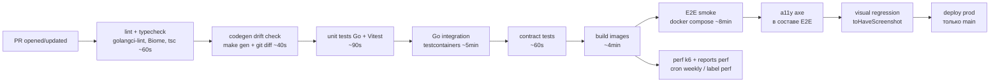

# Test Strategy — appmetrica.online

> Единая стратегия тестирования проекта. Определяет pyramid, frameworks,
> coverage targets, CI gates, fixtures. Консумер: QA и разработчики.
> Каждая фича наследует эту стратегию (см. `features/<slug>/08-test-plan.md`).
>
> Подход: **TDD** (решение владельца от 2026-10-13). Поведение и AC каждого требования — в
> [02-tech-spec.md](./02-tech-spec.md); здесь — как именно эти AC превращаются в тесты, где лежат файлы, чем запускаются
> и что блокирует merge. Особый акцент проекта: **корректность цифр аналитики** (DAU, новые, retention, склейка) —
> владелец не эксперт в ClickHouse, поэтому каждый отчётный SQL защищён golden-тестом на фикстурах с вручную
> посчитанным ответом.

---

## 1. Philosophy

- **TDD (test-first) — обязателен** для FR с verifiable AC. Red → Green → Refactor.
- Для UI / exploratory — test-alongside допустимо, но acceptance tests создаются ДО merge.
- Тесты — first-class citizens: ревьюятся с той же строгостью, что и production-код.
- Тест без assertions / flaky / irrelevant — удаляется, не «фиксится постфактум».
- **Реальные хранилища вместо моков.** ClickHouse 26.8.25.14 и Postgres 18.6 поднимаются через testcontainers-go в
  каждом integration-прогоне: аналитическая логика живёт в SQL, мок ClickHouse проверял бы только собственные
  допущения автора.
- **Golden-фикстуры для отчётов.** Ожидаемый ответ отчёта посчитан человеком по таблице в заголовке фикстуры до
  написания SQL; golden-файл — это «Red» для отчётных FR. Автоматическая перегенерация golden из кода запрещена в CI.
- **Время — только через `internal/clock`.** Ни один тест не зависит от реального `time.Now()`; на web — `vi.useFakeTimers()`.
- **Цифры сверяются с внешним эталоном.** Финальная проверка корректности — 14-дневная сверка с AppMetrica (NFR-010,
  §11.3), автоматизированная скриптом на Read API.

## 2. Test pyramid

```
            /\
           /E2\   E2E (Playwright)   — 9 критических journeys (web/e2e/*.spec.ts)
          /----\
         /Integ.\ Integration        — Go ↔ ClickHouse/Postgres (testcontainers), ~60 тестов
        /--------\
       / Contract \ Contract          — ответы ingest и api против OpenAPI (каждый operationId)
      /------------\
     /   Unit       \ Unit           — Go: валидация, PII, время, лимиты, SQL-билдеры; web: компоненты, утилиты (~400)
    /----------------\
```

**Distribution target**: 70% unit / 20% integration / 10% E2E (по количеству, не по coverage).

Проектная специфика распределения:

| Слой | Ориентир количества | Что покрывает | Время прогона в CI |
|---|---|---|---|
| Go unit | ~250 | `ingest` (валидация, PII, время, enrich), `ratelimit`, `identity` (SQL-фрагменты, person_key), `auth` (сессии, CSRF, ключи), `worker` (машина алертов, расписание) | ≤ 60 с |
| Go integration | ~60 | Отчёты (golden), MV ClickHouse, удаление, закрытие дня, миграции, sqlc-запросы, ingest end-to-end | ≤ 5 мин |
| Contract | 1 тест на operationId (40+) | Ответы хендлеров валидны по `ingest.yaml` / `api.yaml` | ≤ 60 с |
| Web unit/component | ~150 | Компоненты отчётов, форматирование чисел/дат, сниппеты, URL-state, fetcher | ≤ 90 с |
| E2E | 9 спецификаций, ~30 сценариев | Критические пути владельца | ≤ 8 мин |

## 3. Frameworks по слоям

### 3.1 Stack-specific выбор

| Stack | Unit | Integration | Component | E2E | A11y | Visual | Perf |
|---|---|---|---|---|---|---|---|
| TS Next.js | Vitest | Vitest + Testcontainers/Neon branch | Vitest + RTL + MSW | Playwright | @axe-core/playwright | Chromatic / Percy | k6 |
| TS Node (API) | Vitest | Vitest + Testcontainers | — | — | — | — | k6 / autocannon |
| Python FastAPI | pytest + pytest-asyncio | pytest + testcontainers-python | — | Playwright (Python) | axe via Playwright | — | Locust |
| Swift (iOS/macOS) | XCTest / Swift Testing | XCTest с Network mocks | XCTest (ViewInspector) | XCUITest | Accessibility Inspector (manual) | XCTest snapshot | Instruments |
| Kotlin Android | JUnit 5 + MockK | Robolectric / instrumented | Compose Test | Espresso | Accessibility Scanner | Paparazzi / Shot | Macrobenchmark |
| Go | testing + testify | testing + dockertest | — | — | — | — | vegeta / k6 |

**Выбор для этого проекта** (строки Python, Swift, Kotlin и TS Node API — N/A: таких компонентов в репозитории нет;
рецепты Swift/Kotlin в документации проверяются владельцем вручную на реальных приложениях):

| Компонент | Unit | Integration | Component | E2E | A11y | Visual | Perf |
|---|---|---|---|---|---|---|---|
| `backend/` (Go 1.27.2) | `testing` + testify v1.12.1, fuzz (`go test -fuzz`) | `testing` + testcontainers-go v0.44.0 (`modules/clickhouse`, `modules/postgres`) — вместо dockertest | — | — | — | — | k6 v2.3.0 (ingest), Go-перф-тест с тегом `perf` (отчёты) |
| `web/` (Next.js 16.4.0) | Vitest 5.0.4 | Vitest + MSW 3.0.3 (моки, сгенерированные orval 8.42.0) | Vitest + Testing Library + jsdom | Playwright 1.64.0 против docker compose стека | @axe-core/playwright 4.13.0 | Playwright `toHaveScreenshot` (`# Deviation` от Chromatic/Percy: solo, без внешнего сервиса) | Lighthouse CI (@lhci/cli 0.15.1) |

### 3.2 Версии (из context7, замени placeholders)

Context7 MCP в сессии discovery был недоступен; версии проверены 2026-10-13 по npm registry, proxy.golang.org и GitHub
Releases.

```
TS stack (web/package.json devDependencies):
vitest@5.0.4
@vitest/coverage-v8@5.0.4
@testing-library/react@16.3.3
@testing-library/user-event@14.6.8
@testing-library/jest-dom@7.0.1
jsdom@30.1.2
@playwright/test@1.64.0
msw@3.0.3            # fallback 2.15.0, если orval-моки не совместимы с MSW 3 (не подтверждено)
@axe-core/playwright@4.13.0
@lhci/cli@0.15.1
k6 (CLI, not npm): grafana/k6 v2.3.0 (2026-09-21), Docker-образ grafana/k6:2.3.0

Go stack (backend/go.mod):
github.com/stretchr/testify v1.12.1
github.com/testcontainers/testcontainers-go v0.44.0
github.com/testcontainers/testcontainers-go/modules/clickhouse v0.44.0
github.com/testcontainers/testcontainers-go/modules/postgres v0.44.0
github.com/getkin/kin-openapi v0.149.0       # contract-валидация ответов
golang.org/x/vuln v1.9.0 (govulncheck, tool)
golangci-lint v2.14.0 (бинарь в CI, не зависимость модуля)

Python stack: N/A — Python в проекте не используется.
```

## 4. Coverage targets

| Area | Metric | Target | Rationale |
|---|---|---|---|
| Business logic modules | lines | **≥ 80%** (гейт `scripts/coverage-gate.sh`, `COVER_MIN`) | `internal/ingest`, `internal/identity`, `internal/reports`, `internal/deletion`, `internal/auth`: ошибка здесь = неверные цифры или нарушение GDPR |
| API routers / controllers | branches + lines | **≥ 85%** | `internal/api`, `internal/auth`: каждый error path (401/403/404/409/410/422/429) покрыт |
| UI components | lines | ≥ 70% | `web/src/components/reports`, `integration`, `profiles`; визуал дополнительно защищён скриншотами и axe |
| Utilities / helpers | lines | ≥ 95% | `web/src/lib` (форматирование, person_key, safe-next, copy-as-curl), `internal/httpx`, `internal/clock` |
| Overall project | lines | **≥ 80%** | Not negotiable — CI gate (NFR-009) |

Coverage **не** является самоцелью: 100% coverage с `expect(fn()).not.toThrow()` — ложный сигнал. Ревью смотрит на **качество** тестов, не только % .

Измерение: Go — `go test -coverpkg=./internal/... -coverprofile=coverage.out ./...` (integration-тесты включены, чтобы
SQL-зависимый код учитывался); исключены `internal/gen/**` и `internal/pgstore/sqlc/**` (сгенерированный код). Web —
`vitest run --coverage` (provider v8), исключены `src/lib/api/generated/**` (orval) и `src/components/ui/**` (shadcn).

## 5. CI pipeline — test stages



### 5.1 Gates

- **Blocks merge**: lint, typecheck, unit, integration, build, E2E smoke, a11y
- **Optional but visible**: visual regression (reviewer approves diffs), E2E full, perf (по label)

Проектные уточнения:
- В «blocks merge» дополнительно входят: codegen drift (`make gen && git diff --exit-code`), contract-тесты, coverage
  gate (≥ 80 % для `internal/{ingest,reports,auth,identity,deletion}` — скрипт `scripts/coverage-gate.sh`, порог `COVER_MIN`), govulncheck и
  `pnpm audit --audit-level high`.
- «E2E full» совпадает со smoke (9 спецификаций достаточно для одного пользователя) — отдельного набора нет.
- Perf запускается: еженедельно по cron (`schedule: '0 3 * * 1'`), по label `perf` на PR, и обязательно перед снятием
  AppMetrica SDK.
- Visual regression: изменённые скриншоты коммитятся в PR вместе с кодом; ревьюер (владелец) смотрит diff в артефакте
  Playwright HTML report.

### 5.2 Flakiness policy

- Flaky test (passes sometimes) — **quarantined** (skip + JIRA tracker), не ignore
- 3+ flaky retry в main — revert PR и fix
- Weekly flakiness review: любой test с >5% fail rate на main обсуждается в retro

Проектные уточнения: трекер — GitHub Issues с label `flaky` (JIRA не используется); карантин — `t.Skip("flaky: #<issue>")`
в Go и `test.fixme()` с ссылкой на issue в Playwright; Playwright `retries: 1` только в CI, повтор фиксируется в
отчёте; «retro» — еженедельный 15-минутный просмотр владельцем вкладки Actions по понедельникам вместе с перф-отчётом.
Типовые источники флейков и их запрет: реальное время (используй `clock.Fixed`), сон вместо ожидания (используй
`require.Eventually` с таймаутом 10 с только для async insert), порядок строк без `ORDER BY` в SQL-тестах.

## 6. Data fixtures & factories

### 6.1 Правила

- **Никаких global seeds** между тестами — каждый тест самодостаточен
- **Factory functions** (с sensible defaults + overrides) вместо literals
- **Ephemeral DB** per run (Neon branch / Testcontainers) или полное очищение между тестами в transaction rollback pattern
- **Faker** для рандомных значений, но **deterministic в CI** (seed из test name)

Проектная реализация:
- Один контейнер ClickHouse и один Postgres на пакет (`TestMain`), каждый тест получает **собственную базу**:
  ClickHouse — `CREATE DATABASE t_<sha1(test name)[:12]>_<n>` (n — счётчик вызовов в процессе, чтобы повторный
  `testutil.Start` в том же тесте получал новую базу) + применение миграций goose; Postgres — шаблонная база
  `appmetrica_template` с миграциями и `CREATE DATABASE … TEMPLATE appmetrica_template` (≈ 50 мс).
- Golden-фикстуры отчётов — NDJSON в `backend/testdata/fixtures/` (по одному событию `Event` с явными `app_id`,
  `event_time`, `install_id`, `user_id`, `session_id`, `name`, `duration_ms`, `environment`, `app_version`, `country`),
  рядом `*.golden.json` — ожидаемые ответы API. Каждая фикстура начинается с комментария-таблицы
  (`# day | person | event`), по которой ответ посчитан вручную.
- Фикстуры: `identity.ndjson`, `audience.ndjson`, `retention.ndjson`, `portfolio.ndjson`, `realtime.ndjson`,
  `profiles.ndjson`, `integration_health.ndjson`, `deletion.ndjson`, `closeday.ndjson`.
- Генератор объёма для перф-тестов — `backend/testdata/gen/main.go` (детерминированный `math/rand/v2` с seed 42):
  100k DAU × 90 дней ≈ 27 млн событий, 2 млн связок identity.
- Web: фабрики поверх orval-сгенерированных моков (`src/lib/api/generated/*.msw.ts`) с переопределениями; faker
  с `faker.seed(hash(test name))`.

### 6.2 Пример factory

```go
// backend/internal/testutil/events.go
package testutil

import (
	"time"

	"github.com/google/uuid"

	"appmetrica.online/backend/internal/chstore"
)

// EventOpt mutates a fixture event.
type EventOpt func(*chstore.EventRow)

// SessionStart returns a production session_start for the given app/install at t.
func SessionStart(appID, installID uuid.UUID, t time.Time, opts ...EventOpt) chstore.EventRow {
	row := chstore.EventRow{
		AppID:       appID,
		EventDate:   t.UTC().Truncate(24 * time.Hour),
		EventTime:   t.UTC(),
		ClientTime:  t.UTC(),
		SentAt:      t.UTC(),
		ReceivedAt:  t.UTC(),
		InsertID:    uuid.New(),
		Name:        "session_start",
		InstallID:   installID,
		SessionID:   uuid.New(),
		Environment: "production",
		Platform:    "ios",
		OSName:      "iOS",
		OSVersion:   "18.1",
		AppVersion:  "2.4.0",
		Locale:      "ru-RU",
		Country:     "RU",
	}
	for _, o := range opts {
		o(&row)
	}
	return row
}

// WithUser sets user_id.
func WithUser(id string) EventOpt { return func(r *chstore.EventRow) { r.UserID = id } }

// WithSession forces session_id (to pair start/end).
func WithSession(id uuid.UUID) EventOpt { return func(r *chstore.EventRow) { r.SessionID = id } }

// SessionEnd builds a matching session_end with duration.
func SessionEnd(start chstore.EventRow, dur time.Duration) chstore.EventRow {
	end := start
	end.InsertID = uuid.New()
	end.Name = "session_end"
	end.EventTime = start.EventTime.Add(dur)
	end.EventDate = end.EventTime.Truncate(24 * time.Hour)
	end.DurationMs = uint32(dur.Milliseconds())
	return end
}
```

```typescript
// web/src/test/factories.ts
import { faker } from '@faker-js/faker';
import type { PortfolioRow } from '@/lib/api/generated/model';

export function portfolioRow(overrides: Partial<PortfolioRow> = {}): PortfolioRow {
  return {
    app: { id: faker.string.uuid(), name: 'Notes iOS', platform: 'ios', status: 'active', timezone: 'Europe/Moscow' },
    active_today: 5120,
    active_date: 12480,
    active_same_day_prev_week: 11988,
    active_delta_pct: 4.1,
    new_date: 1204,
    sessions_date: 31022,
    retention_d1: 0.38,
    retention_d7: 0.14,
    sparkline: Array.from({ length: 30 }, (_, i) => ({ day: `2026-09-${String(i + 1).padStart(2, '0')}`, active: 12000 + i * 10 })),
    ...overrides,
  };
}
```

`@faker-js/faker` — devDependency web (версию резолвить при bootstrap, тикет T-003).

## 7. Mocks & stubs

### 7.1 Rules

- **Network**: MSW (browser + Node) для HTTP, VCR-pattern для third-party
- **Time**: `vi.useFakeTimers()` / `freezegun` / `sinon.useFakeTimers`
- **Env**: отдельный `.env.test`, не мутируй `process.env` в тестах
- **Database**: prefer ephemeral real DB (Testcontainers/Neon branch) over mocks — catches schema drift
- **3rd-party SDK-s**: thin adapters, тестировать через contract (not mock the SDK directly)

Проектная реализация:
- **Go, внешние HTTP** (Telegram Bot API, healthchecks.io, clickhouse-backup REST, `/metrics` ingest для system check):
  `net/http/httptest.Server`, базовые URL инжектируются через конфиг (`TELEGRAM_API_BASE` только в тестах — поле
  конфига, не env в prod).
- **Go, время**: интерфейс `clock.Clock` (`Now()`, `After()`), реализации `clock.Real` и `clock.Fixed` с `Advance(d)`.
- **Go, GeoIP**: тестовая mmdb `backend/testdata/geo/test-city.mmdb` (сгенерирована из официальных тестовых данных
  MaxMind-формата с фиксированными адресами 81.2.69.142 → GB/England/London, 2001:db8::1 → DE/Berlin/Berlin).
- **Go, ClickHouse-ошибки**: интерфейс `chstore.Inserter` с фейком, возвращающим ошибку — только для веток 503;
  все остальные тесты — реальный ClickHouse.
- **Web**: MSW 3.0.3 `setupServer` в `vitest.setup.ts` с хендлерами orval; `onUnhandledFrame: 'error'` (MSW 3).
- **Env**: `backend/.env.test` не используется — конфиг собирается в тесте через `config.ForTest(overrides)`;
  web — `web/.env.test` с `NEXT_PUBLIC_INGEST_URL=https://i.appmetrica.test`.

### 7.2 Запрещено

- **Monkey-patching** модулей через `vi.mock(<prod module>)` без strong reason — ведёт к false-negative
- **Global state** между тестами (в т.ч. Redis/cache, если не очищается в `beforeEach`)
- **Snapshot tests без assertion** в snapshot (пустой snapshot = зелёный тест с 0 sense)

Дополнительно запрещено в проекте:
- Мокать ClickHouse для проверки отчётов (только реальный контейнер).
- `time.Sleep` в тестах (кроме `require.Eventually` для async insert с таймаутом 10 с).
- Флаг `-update` для golden-файлов в CI; перегенерация golden вручную — отдельный коммит с обоснованием.
- Общий кэш ключей между тестами: каждый тест создаёт свой `apps.KeyCache`.

## 8. TDD discipline для каждого FR

Каждое Functional Requirement из `02-tech-spec.md`:

1. **Write failing test** (red) — для каждого AC в формате Given/When/Then
2. **Minimal impl** (green) — код только чтобы tests passed
3. **Refactor** (still green) — improve code quality без изменения behaviour

Reviewer checklist: тест был написан ДО реализации (смотрим git history — test commit предшествует impl commit).

**Маппинг FR → тест-файлы** (основные; полные AC с именами тестов — в [02-tech-spec.md](./02-tech-spec.md)):

| FR | Go-тесты | Web / E2E |
|---|---|---|
| FR-001 Приём батча | `backend/internal/ingest/handler_test.go`, `integration_test.go`, `contract_test.go`, `backend/internal/httpx/cors_test.go` | `web/e2e/app-onboarding.spec.ts` |
| FR-002 Время и окно | `backend/internal/ingest/timecorrect_test.go`, `validate_test.go` | — |
| FR-003 Идемпотентность | `backend/internal/ingest/handler_test.go`, `backend/internal/chstore/events_integration_test.go`, `backend/internal/reports/idempotency_test.go`, `sql_lint_test.go` | — |
| FR-004 Гео | `backend/internal/ingest/enrich_test.go`, `backend/internal/geo/lookup_test.go` | — |
| FR-005 Лимиты | `backend/internal/ratelimit/limiter_test.go`, `backend/internal/ingest/handler_test.go` | — |
| FR-006 PII-guard | `backend/internal/ingest/pii_test.go` (вкл. `FuzzLooksLikePII`) | — |
| FR-007 Склейка | `backend/internal/reports/identity_test.go`, `backend/internal/chstore/mv_integration_test.go`, `backend/internal/api/params_test.go` | — |
| FR-008 Passkey | `backend/internal/auth/setup_test.go`, `login_test.go`, `passkeys_test.go`, `session_test.go`, `csrf_test.go` | `web/e2e/auth-passkey.spec.ts`, `web/src/proxy.test.ts`, `web/src/lib/safe-next.test.ts` |
| FR-009 Приложения | `backend/internal/apps/service_test.go` | `web/e2e/app-onboarding.spec.ts`, `web/src/components/apps/app-settings-form.test.tsx` |
| FR-010 Write-ключи | `backend/internal/ingest/keycache_test.go`, `backend/internal/ingest/health_test.go` | — |
| FR-011 API-ключи | `backend/internal/auth/apikey_test.go` | `web/e2e/settings.spec.ts` |
| FR-012 Портфель | `backend/internal/reports/portfolio_test.go` | `web/src/components/reports/portfolio-table.test.tsx`, `web/e2e/portfolio.spec.ts` |
| FR-013 Аудитория | `backend/internal/reports/audience_test.go`, `filters_test.go` | `web/src/components/reports/audience-kpis.test.tsx`, `web/e2e/audience.spec.ts` |
| FR-014 Retention | `backend/internal/reports/retention_test.go` | `web/src/components/reports/retention-heatmap.test.tsx`, `web/e2e/retention.spec.ts` |
| FR-015 Realtime | `backend/internal/reports/realtime_test.go`, `realtime_integration_test.go` | `web/src/components/reports/realtime-panel.test.tsx`, `web/e2e/realtime.spec.ts` |
| FR-016 Профили | `backend/internal/reports/profiles_test.go` | `web/src/components/profiles/profile-delete-dialog.test.tsx`, `web/src/lib/person-key.test.ts`, `web/e2e/profiles-deletion.spec.ts` |
| FR-017 Интеграция | `backend/internal/reports/integration_health_test.go` | `web/src/components/integration/integration-onboarding.test.tsx`, `web/e2e/app-onboarding.spec.ts` |
| FR-018 Read API | `backend/internal/api/contract_test.go`, `handlers_test.go` | `web/src/lib/copy-as-curl.test.ts` |
| FR-019 Удаление | `backend/internal/deletion/executor_test.go`, `executor_integration_test.go`, `backend/internal/api/deletion_test.go` | `web/e2e/profiles-deletion.spec.ts` |
| FR-020 Дайджест | `backend/internal/worker/digest_test.go`, `backend/internal/api/settings_test.go` | `web/e2e/settings.spec.ts` |
| FR-021 System check | `backend/internal/worker/systemcheck_test.go` | — |
| FR-022 Закрытие дня | `backend/internal/worker/closeday_test.go` | — |
| FR-023 Документация | `backend/internal/docscheck/snippets_test.go` | `web/e2e/docs.spec.ts`, `web/src/lib/docs/openapi-source.test.ts` |
| FR-024 Environment | `backend/internal/ingest/enrich_test.go`, `backend/internal/reports/audience_test.go` | `web/e2e/audience.spec.ts` |
| FR-025 Настройки | `backend/internal/api/settings_test.go`, `system_test.go` | `web/src/app/(dashboard)/settings/settings-page.test.tsx`, `web/e2e/settings.spec.ts` |

### 8.1 Anti-pattern: «написал тесты постфактум»

- Смотрим: тесты рождаются в одном commit с implementation → reject PR, ask to split.
- Exception: hotfix под production incident — тесты добавляем в follow-up PR в течение 24 часов.

Автоматизация: в каждом тикете первый коммит имеет тип `test(<scope>):`, второй —
`feat(<scope>):`/`fix(<scope>):`. Скрипт `scripts/check-tdd-order.sh` (запускается в CI на PR) проверяет, что для
каждого изменённого `*_test.go` / `*.test.ts(x)` / `*.spec.ts` коммит с тестом не позже первого коммита с
изменением соответствующего non-test файла того же пакета; нарушение — warning в PR-комментарии и блок merge
без метки `tdd-exception` (ставится только владельцем для hotfix).

## 9. Test naming convention

```
tests/
├── unit/
│   └── <module>/
│       └── <subject>.spec.ts           # "canCreateAlert" logic
├── integration/
│   └── <surface>/
│       └── <endpoint>.<scenario>.spec.ts  # "POST /alerts happy.spec.ts"
├── components/
│   └── <component-name>.spec.tsx
├── e2e/
│   └── <flow>/<scenario>.spec.ts
├── a11y/
├── perf/k6/
├── fixtures/
└── helpers/
```

Naming внутри теста:

- `describe('subject under test', () => { ... })`
- `it('verb + expected outcome when condition', ...)`
  - Good: `it('blocks 4th alert on free tier')`
  - Bad: `it('test 1')`, `it('works')`, `it('happy path')` (не конкретно)

**Фактическая раскладка этого проекта** (`# Deviation` от единого `tests/`: Go требует тесты рядом с пакетом, web —
colocated-тесты рядом с компонентами):

```
backend/
├── internal/<pkg>/<file>_test.go              # unit + integration (integration — файлы *_integration_test.go)
├── internal/testutil/                         # фабрики событий, запуск контейнеров, golden-хелперы
├── testdata/fixtures/<report>.ndjson          # golden-входы
├── testdata/fixtures/<report>.golden.json     # golden-ответы
├── testdata/geo/test-city.mmdb
├── testdata/gen/main.go                       # генератор объёма для перф-тестов
└── perf/ingest-load.js                        # k6
web/
├── src/**/<name>.test.ts(x)                   # unit + component, рядом с кодом
├── src/test/{factories.ts,setup.ts,msw.ts}
└── e2e/<flow>.spec.ts + e2e/helpers/{webauthn.ts,seed.ts}
```

Go-именование: `TestSubject_ExpectedOutcomeWhenCondition` (например `TestIngestHandler_PartialSuccess`), table-driven
подтесты — `t.Run("device_clock_ahead", …)`, интеграционные тесты помечены build-тегом отсутствия: запускаются всегда,
но пропускаются при `-short` (`if testing.Short() { t.Skip("integration") }`); перф-тесты — build-тег `perf`.

## 10. Contract tests

### 10.1 OpenAPI

- Source of truth: `06-api-contracts.md` + sourced `openapi.yaml`
- Validator: `@apidevtools/swagger-parser` — validates schema structurally
- Runtime validator: `express-openapi-validator` / `zod-to-openapi` — blocks malformed responses at runtime in dev/CI
- Consumer contract tests (если есть mobile клиент): Pact

Проектная реализация:
- Источник истины — `contracts/openapi/ingest.yaml` и `contracts/openapi/api.yaml` (OAS 3.0.3); `06-api-contracts.md`
  содержит их полный текст.
- Структурная валидация спецификаций: `kin-openapi` `openapi3.Loader` + `doc.Validate(ctx)` в
  `backend/internal/api/spec_test.go::TestOpenAPISpecs_Valid` (вместо swagger-parser — один язык в backend).
- Runtime-валидация ответов: `openapi3filter.ValidateResponse` во всех contract-тестах
  (`backend/internal/ingest/contract_test.go`, `backend/internal/api/contract_test.go`); в dev-режиме api включается
  middleware `oapi-codegen/nethttp-middleware` v1.2.0 для валидации входящих запросов.
- Consumer-сторона: TS-клиент генерируется orval из той же спецификации; `tsc --noEmit` ломается при несовместимом
  изменении контракта. Pact — N/A (мобильные клиенты не используют сгенерированный код, контракт фиксируют рецепты
  документации и тест `TestDocsGoSnippets_Vet`).
- Обратная совместимость ingest: тест `backend/internal/ingest/compat_test.go::TestIngest_AcceptsV1Fixtures` прогоняет
  замороженные батчи `backend/testdata/compat/v1/*.json` — любой будущий PR, ломающий старые клиенты в сторах, падает.

### 10.2 Event schemas

- Если Kafka/NATS/SQS: schema в Avro/Protobuf/JSON Schema
- Contract tests: producer сериализует → consumer десериализует, round-trip тест
- Schema registry (Confluent/custom) — обязательно для compatibility

> **N/A для этого проекта.** Причина: брокера сообщений нет — ingest пишет напрямую в ClickHouse (async insert).
> Роль схемы события выполняет `EventBatch` в `ingest.yaml`, его совместимость проверяет `TestIngest_AcceptsV1Fixtures`.

## 11. Performance testing

- Baseline: установлен в `03-architecture.md` / `05-impact-and-regression.md` per endpoint
- Run frequency: weekly in staging, per-release before production
- Scenarios: см. `tests/perf/k6/*.js`
- Thresholds (pass/fail):
  - P95 latency < SLO + 10%
  - Error rate < 0.1%
  - CPU/memory within limits

### 11.1 Ingest (k6 v2.3.0)

- Сценарий `backend/perf/ingest-load.js`: `constant-arrival-rate` 500 итераций/с в течение 10 минут, батч 10 событий
  (случайные `install_id` из пула 100 000, `session_start`/`session_end` пары), `X-App-Key` из env `K6_APP_KEY`.
- Окружение: `make perf-ingest` запускает k6 в Docker против уже работающего локального ingest (`make dev-infra migrate-up seed`,
  затем `make run-ingest-perf` — лимит приложения 20 000 событий/с); адрес — `INGEST_URL`, нагрузка — `PERF_RATE`, `PERF_DURATION`.
  Базовые цифры — `backend/perf/reports/baseline.json`, сравнение прогона с ними — `scripts/perf-compare.sh`.
- Thresholds k6: `http_req_duration{expected_response:true}: ['p(99)<500']`, `http_req_failed: ['rate==0']`,
  `checks: ['rate>0.999']` (проверка `accepted == 10`), `server_errors_without_retry_after: ['count==0']`,
  `dropped_iterations` < 1 % от rate (иначе нагрузка ниже заявленной).

### 11.2 Отчёты (Go, тег `perf`)

- `backend/internal/reports/perf_integration_test.go::TestReportsPerf_90Days100kDAU` загружает данные генератора
  (27 млн событий) и проверяет P95 из 20 повторов: портфель ≤ 1 с, audience summary/timeseries ≤ 1,5 с, retention
  (30×30) ≤ 1,5 с, профиль ≤ 1 с, realtime ≤ 300 мс.
- Запуск: `go test -tags perf -run TestReportsPerf ./internal/reports/...` еженедельно и по label `perf`.

### 11.3 Сверка с AppMetrica (NFR-010) — процедура 14 дней

1. Подготовка: в первом приложении (iOS) интеграция по рецепту из `/docs/recipes/ios-swift`, AppMetrica SDK остаётся.
2. Ежедневно в 10:00 MSK владелец выгружает из AppMetrica CSV отчёта «Аудитория» по дням (дата, активные, новые)
   с колонкой retention D1 и запускает `make reconcile` (`scripts/reconcile/appmetrica_compare.go`). Скрипт берёт
   диапазон дат из CSV и запрашивает наш Read API по ключу `sk_` из env `AM_SK`:
   `getAudienceTimeseries?unit=installs&granularity=day` для `metric=active` и `metric=new` и
   `getRetention?unit=installs&cohort_granularity=day&periods=1` для D1. Reporting API AppMetrica не используется (OQ-068).
3. Таблица `date | metric | ours | appmetrica | diff | PASS/FAIL` с вердиктом сохраняется в `docs/reconciliation/<date>.md`,
   ответы Read API — в `docs/reconciliation/<date>-snapshot.json` (`-save`); exit 1 при любом FAIL. Порядок —
   `docs/reconciliation/README.md`.
4. Критерий прохода: 14 подряд дней, где |diff_pct| ≤ 5 % для active и new и ≤ 3 п.п. для D1; ни одного дня с
   `ingest_down` в `alert_states`.
5. Расхождение > 5 % → разбор по чек-листу (разные определения сессии, фильтр `environment`, TZ приложения, события
   отклонённые на S-10) → баг-тикет с фикстурой, воспроизводящей случай.

## 12. Accessibility testing

- **Automated** (in CI): axe-core на каждом новом screen + critical flows
- **Manual** (QA sign-off per release): keyboard-only walkthrough, screen reader (VoiceOver/NVDA/TalkBack) spot check
- Target: **WCAG 2.2 AA** (минимум), AAA для конкретных critical flows если требуется

Проектная реализация: в каждом E2E-сценарии после загрузки экрана вызывается хелпер
`web/e2e/helpers/a11y.ts::expectNoA11yViolations(page)` (@axe-core/playwright 4.13.0, теги `wcag2a`, `wcag2aa`,
`wcag21aa`, `wcag22aa`); экраны S-01..S-13 покрыты. Ручная проверка — владелец перед снятием AppMetrica SDK: проход
S-01 → S-03 → S-05 → S-06 → S-10 → S-12 только клавиатурой и VoiceOver на macOS (TalkBack/NVDA — N/A, desktop-only
продукт). AAA не требуется.

## 13. Visual regression

- Tool: Chromatic (Storybook) or Percy
- Baseline: main branch
- PRs: diff autocomputed, reviewer approves intentional changes
- Anti-pattern: approve всё что diff показал, не вчитываясь — каждый approve = conscious decision

Проектная реализация (`# Deviation`): Playwright `expect(page).toHaveScreenshot()` на 5 экранах (S-03, S-05, S-06, S-07,
S-10) с детерминированными данными MSW-подобного seed-эндпоинта E2E-стека (`web/e2e/helpers/seed.ts` вставляет
фикстуру через ingest), viewport 1440×900, `animations: 'disabled'`, шрифты из образа. Baseline-скриншоты
коммитятся в `web/e2e/__screenshots__/`; Storybook не используется.

## 14. Load/stress testing

- Run в staging с production-like data volume
- Scenarios: baseline, spike (10× normal), soak (24h at 80% capacity)
- Tool: k6 (TS stack) / Locust (Python) / JMeter (legacy)
- Reports: HTML + JSON, archived в `tests/perf/reports/<date>-<scenario>.html`

Проектная реализация (staging отсутствует — `# Deviation`, см. [02-tech-spec.md](./02-tech-spec.md) §6.1):
- Baseline: §11.1 (500 rps, 10 мин).
- Spike: `ingest-load.js` со сценарием `ramping-arrival-rate` 50 → 2 500 rps за 30 с, удержание 2 мин (имитация
  утра после выхода всех телефонов из офлайна); ожидание: 429 `app_rate_limited` для одного приложения при превышении
  2000 событий/с, 0 ответов 5xx, P99 принятых ≤ 1 с.
- Soak: 4 часа при 400 rps на временном сервере Hetzner Cloud (не 24 ч — solo-бюджет времени); ожидание: RSS ingest
  стабилен (рост < 10 %), `ingest_install_limiters` не растёт неограниченно (вытеснение работает).
- Отчёты: `k6 run --out json=backend/perf/reports/<date>-<scenario>.json` + `--summary-export`; HTML не генерируется.

## 15. Chaos / reliability testing

(Для Tier 3/4 проектов)

- Tool: Chaos Mesh / Chaos Monkey / manual Fault Injection
- Scenarios: kill pod mid-request, Redis down, DB failover, latency injection
- Frequency: monthly game-day exercise
- Reports: post-mortem template, action items tracked

Проект — Tier 1/2, полноценный chaos-инжиниринг N/A. Вместо него — ежеквартальный ручной drill по
[21-ops-runbooks.md](./21-ops-runbooks.md) (вместе с тестом восстановления):
1. Остановить контейнер ClickHouse на 2 минуты под нагрузкой k6 → ingest отвечает 503 `storage_unavailable` с
   `Retry-After`, приходит алерт `clickhouse_down`, после старта приём восстанавливается без ручных действий.
2. Остановить worker на 20 минут → healthchecks.io присылает алерт о тишине.
3. Восстановить ClickHouse из S3-бэкапа на временный сервер → `getAudienceSummary` за вчера совпадает с production.
Integration-тест на отказ хранилища: `TestIngestHandler_StorageUnavailable` (фейк), `TestCloseDay_RetriesAfterFailure`.

## 16. Security testing

- **SAST**: CodeQL (GitHub Security), Semgrep — on every PR
- **SCA**: Snyk / Dependabot — daily scans, critical = block merge
- **DAST**: OWASP ZAP baseline on staging — weekly
- **Secrets scanning**: gitleaks pre-commit + GitHub secret scanning
- **Penetration test**: external firm annually для production-facing features

Проектная реализация:
- SAST: golangci-lint v2.14.0 с линтером `gosec` (каждый PR); CodeQL — только если репозиторий публичный или подключён
  GitHub Advanced Security (`# Deviation`: приватный репозиторий без GHAS — CodeQL недоступен бесплатно); Semgrep — N/A.
- SCA: `govulncheck` (golang.org/x/vuln v1.9.0) и `pnpm audit --audit-level high` блокируют merge; Dependabot (version +
  security updates) для `gomod`, `npm`, `github-actions`, `docker` еженедельно.
- DAST: OWASP ZAP baseline (`ghcr.io/zaproxy/zaproxy:stable`, `zap-baseline.py`) ежемесячно по cron против
  production `https://appmetrica.online/login` и `https://i.appmetrica.online/health` (только пассивный режим).
- Secrets: gitleaks в lefthook `pre-commit` + GitHub secret scanning (бесплатно для приватных репозиториев с push
  protection, если доступно на тарифе).
- Специфичные тесты безопасности: `TestEnrich_GeoFromForwardedFor_NoIPPersisted` (IP нигде), `TestLogging_NoSensitiveFields`,
  `TestCSRF_AdminMutations`, `TestAPIKey_*`, `TestPasskeyLink_StoresOnlyHash`, fuzz `FuzzLooksLikePII` и
  `backend/internal/ingest/fuzz_test.go::FuzzDecodeBatch` (паник на произвольном теле нет).
- Penetration test: N/A для внутреннего инструмента; заменяется ежегодным self-review по OWASP API Top 10 2023.

## 17. Test data lifecycle

- Dev: seeded local DB + Faker
- CI: ephemeral DB (new per run) + Faker with test-name seed (deterministic)
- Staging: production-like schema + synthetic data (no real PII)
- Production: нет test runs на live DB (никогда)
- PII handling: если prod data нужен для debugging — обфускация через скрипт перед staging copy

Проектная реализация:
- Dev: `make dev-seed` — генератор `backend/testdata/gen` в режиме `-small` (2 приложения, 500 DAU, 60 дней) через
  ingest API (не прямой INSERT), чтобы проверялся весь конвейер.
- CI: базы на тест (§6.1), генератор с seed 42.
- Staging: N/A (нет staging).
- Production: тестовые события только в отдельном приложении «Sandbox» с `environment=development`; E2E против
  production не запускаются.
- PII: production-данные для отладки не копируются; воспроизведение — через фикстуру, построенную по описанию
  проблемы и примеру из `rejected_events.payload_sample` (уже без IP и с `[redacted]` PII).

## 18. Observability во время тестов

- Unit/Integration: лог в `stderr` только при failure (нет шума)
- E2E: record video + trace per test run, artifact в CI (retained 14 дней)
- Perf: results → Grafana dashboard (историческая тенденция)

Проектная реализация: Go — `slog` в `bytes.Buffer` через `testutil.Logger(t)`, вывод `t.Log` только при провале
(`t.Cleanup` проверяет `t.Failed()`); логи контейнеров ClickHouse/Postgres сохраняются в `t.TempDir()` и печатаются
при провале. Playwright — `trace: 'retain-on-failure'`, `video: 'retain-on-failure'`, артефакт `playwright-report`
14 дней. Perf — JSON-отчёты в `backend/perf/reports/` (Grafana — N/A, тенденцию владелец смотрит сравнением JSON
скриптом `scripts/perf-compare.sh`).

## 19. Framework-specific helpers

### 19.1 `tests/helpers/test-db.ts`

Для Go-backend аналог — `backend/internal/testutil/containers.go`:

```go
package testutil

import (
	"context"
	"crypto/sha1"
	"encoding/hex"
	"testing"

	"github.com/stretchr/testify/require"
	"github.com/testcontainers/testcontainers-go/modules/clickhouse"
	"github.com/testcontainers/testcontainers-go/modules/postgres"
)

const (
	ClickHouseImage = "clickhouse/clickhouse-server:26.8.25.14"
	PostgresImage   = "postgres:18.6-trixie"
)

// Stores holds per-package containers started in TestMain.
type Stores struct {
	CH *clickhouse.ClickHouseContainer
	PG *postgres.PostgresContainer
}

// StartStores starts ClickHouse and Postgres once per package.
func StartStores(ctx context.Context) (*Stores, func(), error) {
	ch, err := clickhouse.Run(ctx, ClickHouseImage,
		clickhouse.WithUsername("appmetrica_rw"), clickhouse.WithPassword("test"))
	if err != nil {
		return nil, nil, err
	}
	pg, err := postgres.Run(ctx, PostgresImage,
		postgres.WithDatabase("appmetrica_template"), postgres.WithUsername("appmetrica"), postgres.WithPassword("test"),
		postgres.BasicWaitStrategies())
	if err != nil {
		_ = ch.Terminate(ctx)
		return nil, nil, err
	}
	cleanup := func() { _ = ch.Terminate(ctx); _ = pg.Terminate(ctx) }
	return &Stores{CH: ch, PG: pg}, cleanup, nil
}

// DBName returns a deterministic per-test database name.
func DBName(t *testing.T) string {
	sum := sha1.Sum([]byte(t.Name()))
	return "t_" + hex.EncodeToString(sum[:])[:12]
}

// FreshClickHouse creates a database for the test and applies goose migrations from migrations/clickhouse.
func (s *Stores) FreshClickHouse(t *testing.T) string {
	t.Helper()
	db := DBName(t)
	require.NoError(t, ApplyClickHouseMigrations(context.Background(), s.CH, db))
	t.Cleanup(func() { _ = DropClickHouseDB(context.Background(), s.CH, db) })
	return db
}
```

`ApplyClickHouseMigrations` и `DropClickHouseDB` используют goose v3.29.0 Provider с `embed.FS` из
`backend/migrations/clickhouse` — те же миграции, что в production.

### 19.2 `tests/helpers/test-caller.ts`

Для web аналог — виртуальный WebAuthn authenticator в Playwright (`web/e2e/helpers/webauthn.ts`):

```typescript
import type { Page } from '@playwright/test';

export async function addVirtualAuthenticator(page: Page): Promise<{ authenticatorId: string }> {
  const client = await page.context().newCDPSession(page);
  await client.send('WebAuthn.enable');
  const { authenticatorId } = await client.send('WebAuthn.addVirtualAuthenticator', {
    options: {
      protocol: 'ctap2',
      transport: 'internal',
      hasResidentKey: true,
      hasUserVerification: true,
      isUserVerified: true,
      automaticPresenceSimulation: true,
    },
  });
  return { authenticatorId };
}

export async function setupOwner(page: Page, baseURL: string): Promise<void> {
  // Ссылка выдаётся тестовой ручкой E2E-стека: docker compose exec api /app/appmetrica admin passkey-link
  const link = process.env.E2E_SETUP_LINK ?? (await (await fetch(`${baseURL}/e2e/setup-link`)).text());
  await addVirtualAuthenticator(page);
  await page.goto(link);
  await page.getByLabel('Название устройства').fill('E2E');
  await page.getByRole('button', { name: 'Создать passkey' }).click();
  await page.waitForURL(`${baseURL}/`);
}
```

Эндпоинт `/e2e/setup-link` существует только в E2E-образе web (route handler под флагом сборки
`NEXT_PUBLIC_E2E=1`, вызывает `docker compose exec`-эквивалент через api внутреннего тестового маршрута
`POST /internal/e2e/passkey-link`, доступного только при `APP_ENV=e2e`); в production-образе маршрута нет
(проверка — `web/src/app/e2e/setup-link/route.test.ts::"is not built without NEXT_PUBLIC_E2E"`).

## 20. Review checklist перед merge

- [ ] TDD discipline соблюдена (tests commit перед impl commit)
- [ ] Coverage не опустился (CI report)
- [ ] Нет flaky tests в этом PR
- [ ] Assertions конкретные (не `expect(x).toBeTruthy()` когда надо `toEqual`)
- [ ] Fixtures используются (не inline literals в 5+ местах)
- [ ] Мокироване только там где необходимо, не везде
- [ ] Перформанс не regressed (если applicable, benchmark ран)
- [ ] E2E ран на preview deploy успешно
- [ ] A11y тесты прошли

Проектные пункты:
- [ ] Для отчётных изменений: golden-фикстура обновлена отдельным коммитом с объяснением, ответ посчитан вручную
- [ ] В логах/колонках нет IP и PII (тесты-детекторы зелёные)
- [ ] `make gen && git diff --exit-code` чисто
- [ ] Совместимость ingest: `TestIngest_AcceptsV1Fixtures` зелёный
- [ ] «E2E на preview deploy» читается как «E2E против docker compose в CI» (preview нет)

## 21. Ссылки

- Per-feature test plans: `features/<slug>/08-test-plan.md`
- FR AC definitions: `02-tech-spec.md`
- API test vectors: `06-api-contracts.md §9-examples`
- Ops drills и восстановление: [21-ops-runbooks.md](./21-ops-runbooks.md)
- Dev-окружение и команды `make`: [12-dev-runbook.md](./12-dev-runbook.md)
